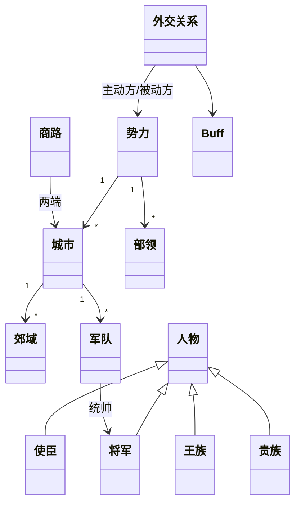
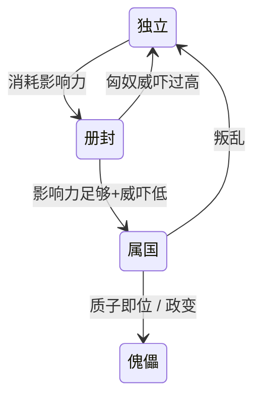

# 西域策略游戏 设计文档 v0.6

> 说明：**正文**为整理后的设计；标注 `【提议】` 的是补充的方案，等确认或修改；标注 `【待定】` 的是需要拍板的问题。
>
> **状态标注**（v0.4 起）：每节标题下有两个标签——实现状态 `【已实现】/【部分实现】/【未实现】`（对照 repo 代码与数据，见 §10）；设计状态 `【待细化】`，并列出待细化要点。未标注的章节（§0、§8）无需实现或细化。
>
> 来源：Google Drive `design_doc.md`（2026-10-10 修改）。文中引用的参考图与 `mvp_scope.md` 位于原作者本机，未随文档导入。

---

## 0. 核心定位

| 项 | 内容 |
|---|---|
| 题材 | 汉匈争夺西域（大致武帝—宣帝时期） |
| 玩家势力 | **汉、匈奴均可玩**（非对称玩法）✅ |
| 胜利条件 | 汉：设立西域都护府 ✅；匈奴：完整夺回河西四郡 ✅（见 §9） |
| 核心张力 | 汉靠**影响力**（商路、外交）拉拢；匈奴靠**威吓**（武力、征税）控制。西域各国在两者间摇摆 |
| 核心难点 | **后勤**：汉军远征受粮食/民夫限制；匈奴受牧草/马匹季节限制 |

### 核心循环 `【提议】`

> `【部分实现】` `【待细化】` 回合推进已跑通（`core/sim.gd`），可做模拟。v0.5 已加入汉/匈奴 AI（`core/ai.gd`），AI 对 AI 默认 29 回合（约 7 年）汉达成都护府，匈奴过弱（见 §10 末「平衡观察」）。待细化：重新校准匈奴动员/攻势与威吓收支，目标是汉胜在史实量级（数十年）而非数年。


---

## 1. 时间与地图

### 1.1 回合 ✅ 同时下令、统一结算；**玩家每季度下一次令**（已定，v0.2）

> `【部分实现】` `【待细化】` 已有：10天tick、季节日历、回合循环（`Sim.step/advance_turn`）、常备指令的触发判定与反应（触发 `enemy_near`/`supply_low`/`losses_high`；反应 `retreat_origin`/`return_supply`/`evade_home`）、快进（`Sim.fast_forward`：遇战斗/占领/外交/扩建事件即停）。未实现：多段计划步骤（`plan.steps` 仍空）。待细化：触发条件的完整语义与可选集合（目前仅 3 种）；快进事件清单（缺使臣归来、秋收）；事件系统接口（现仅 `state.log` 的 `kind` 字段）。

- 引擎内部每 10 天一步，1 季 = 9 步（春夏秋冬各一回合）；玩家每季度下一次令。军队在回合中途按**常备指令**（计划步骤 + 触发条件）自主行动，体现古代通信条件下"将在外"的预判与授权。
- 原提议（1 回合 = 1 月）的理由仍适用于**模拟精度**：后勤、行军按 10 天精度结算，与决策间隔无关。
- （原理由，现由 10 天 tick 满足）长安→敦煌约 2 月、敦煌→大宛约 3~4 月，若模拟也按季度推进，后勤与截粮道就没有空间。
- 季节作为全局 buff：春草返青、夏秋放牧高峰、秋收、冬季草枯/雪山封路。匈奴的"秋高马肥南下"自然出现。
- 中央军年度恢复在正月结算；屯田粮食秋季集中收获，平时只消耗 → 制造"春荒"窗口。
- 按季下令后，季节与回合一一对应：**春 3–5 月、夏 6–8、秋 9–11、冬 12–2**。秋季回合集中收获，冬季回合牧草枯、山路封，春季回合出现春荒窗口。剧本从某季首月开局（MVP：前 119 年 3 月，春）。
- 中央军年度恢复：在每年包含正月的冬季回合开头结算。
- 防拖沓：提供"快进至下一事件"（军队到达、使臣归来、秋收、遭袭）。
- 剧本跨度 `【提议】`：前 119 年 3 月（漠北之战后、张骞二使乌孙）→ 前 49（宣帝崩），70 年 = 280 个玩家回合（2520 个引擎步）；都护府历史上设于前 60。另可做短剧本（如前 104 大宛之战起）。

### 1.2 地图模型 `【提议】`

> `【部分实现】` `【待细化】` 已有：节点、路段、Dijkstra寻路、冬季封路、在途位置结算（`loc={route,from,to,prog}`，天数累计；冬季封路段上的军队原地等待）、路段相向相遇接战、运输队被截。待细化：路段中途「截击」仅限相向相遇，同向追击未做；在途位置对 UI 的插值。

- **节点图**而非格子：节点 = 城市 / 部领，边 = 商路（也是行军路线）。
- 人物/军队/运输队的位置 = 城市，或"商路 + 进度比例(0~1)"——与原设计一致。
- 坐标仅用于绘图和计算基础距离。

### 1.3 初版地图 ✅

> `【已实现】` `【待细化】` 42节点/52路段已入数据。待细化：各路段天数与地形的史实校准（最长102天）；关隘规则（玉门关/阳关通行）；节点人口、城防、粮产等初值的史实依据；山脉等地形标记是否影响战斗。

以参考图一为主（西汉格局、含匈奴境内节点），参考图二补充 4 个节点。（参考图未导入。）

**节点清单**（42 个；抽象拓扑见 `mvp_scope.md` §2，未导入）

| 区域 | 节点 | 类型 |
|---|---|---|
| 汉后方 | 长安、陇西 | 补给源 / 补给干线 |
| 河西（汉）| 武威、张掖、酒泉、敦煌、居延 | 汉郡城 |
| | 玉门关、阳关 | 关隘（北道/南道起点）|
| 匈奴 | 龙城、赵信城、单于庭、范夫人城、伊吾 | 匈奴城/王庭/前进据点 |
| | 右贤王部（右部）、呼揭 | 匈奴部领 |
| 西域北道 | 东且弥、车师前王国、车师后王国、焉耆、尉犁\*、轮台、乌垒、龟兹、姑墨、温宿、疏勒 | 城邦 |
| 西域南道 | 楼兰（都扜泥）、且末、精绝、于阗、莎车 | 城邦 |
| 葱岭 | 捐毒、休循 | 小国（山口）|
| 葱岭以西 | 大宛（贵山城、贰师城、郁成）、康居（郅支城\*）、大月氏（蓝氏城）、罽宾 | 大国 |
| 北方游牧 | 乌孙（赤谷城）、伊列 | 游牧大国 |

- 来自参考图二：**乌垒**（都护府治所，汉胜利必需）、**陇西**、**东且弥**、**伊吾**。参考图二中的东汉元素（班超路线、洛阳）不采用。
- `*` 尉犁：图上未标，用户城市清单有，位于焉耆南；郅支城：约前 44 年才建，MVP 并入康居。
- 浚稽山、涿邪山、祁连山等作为地形/战场标记，不作节点。

---

## 2. 数据模型（整理版）

> `【部分实现】` `【待细化】` 已有：势力、节点（城市/部领）、路段、商路、兵种、军队（含运输队 `is_convoy`）、外交关系、Buff 的数据。未实现：人物、政治行动、出征行动的数据结构；郊域（MVP不拆）。待细化：行动对象（政治/出征）的字段与生命周期；运输行动目前以「运输队军队」表示，无独立对象。



| 类 | 关键属性 | 备注 |
|---|---|---|
| **势力** | 下辖城市/部领、资源库存、`汉影响力`、`匈奴威吓`、`对匈奴怨恨`、外交状态 | 影响力/威吓/怨恨建议**按国家分别记录**，见 §5 |
| **城市** | 坐标、人口、郊域列表、资源、驻军、`是否屯田区` | 河西四郡、赵信城、龙城、尉犁、蓝氏城、贰师城、贵山城、郅支城 + 西域城邦都城 |
| **郊域** | 类型(农田/牧场)、粮食潜力、牧草潜力、实际粮产、牧草存量、`已开垦度` | **MVP 暂不拆分**：数据里直接在节点上聚合为 `farm_cap`、`pasture_cap`、`farm_dev`；郊域留待后续版本 |
| **部领** | 坐标、人口、牧草潜力、牧草存量、资源（马/羊…） | 匈奴、乌孙、康居等游牧单位 |
| **商路** | 两端城市、基础移动时间、`商队流量`、`被袭扰度` | |
| **资源** | 运输速度、每单位每回合牧草消耗、`每单位每回合粮食消耗` | 马、羊、粮、钱 |
| **人物** | 年龄、寿命、性别、民族、姓、名、位置 | |
| ├ 使臣 | 能力、谨慎 | 能力=成功率，谨慎=失败时暴露/被杀概率↓ |
| ├ 将军 | 武力、统率 | 统率=可带兵上限 & 战术加成；武力=单挑/先锋 |
| ├ 王族 | 父母、子女、兄弟姐妹、继承顺位 | 质子、傀儡、政变都依赖它 |
| └ 贵族 | （匈奴）兼具使臣+将军功能 | |
| **兵种** | 位置(前排/后排/机动)、近战防御、远程防御、`近战攻击`、`远程攻击`、`机动力`、`是否消耗马` | 见 §4.3 |
| **军队** | 各兵种数量、统帅、携带粮/马/民夫 | |
| **外交关系** | 主动方、被动方、类型、buff 列表 | |
| **政治行动** | 类型、执行使臣、目标、耗时、成功率 | |
| **出征行动** | 出发地、目的地、军队编成、征召来源 | |
| **运输行动** | 出发地、目的地、货物、护送/民夫 | |
| **Buff** | id、持续回合、叠加规则、`on_apply/on_turn/on_remove` 脚本 | 见 §7 |

---

## 3. 经济与后勤

### 3.1 粮食（汉 / 农耕城邦）

> `【部分实现】` `【待细化】` 已有：月结（居民/驻军/民夫口粮）、秋收（月 9 末集中入库）、劳力不足减产（`Economy.harvest`：潜力×开垦度×min(1,劳力/需求)×72×劫掠系数）、屯田扩建（`Actions.expand_farm` + `farm_expanding` Buff：200 钱、占用 5% 人口劳力、3 回合后开垦度 +0.2，参数为初值）。未实现：征召占用劳力（待征召逻辑，`levied_out` 字段已预留）。待细化：扩建劳力/时间公式的史实校准。

- 每回合：`存粮 += Σ郊域实际粮产 − 人口×人均消耗 − 驻军消耗 − 民夫消耗`
- **扩大屯田**：在己方控制区，把郊域的 `已开垦度` 提升，需消耗 钱 + 民夫劳力 + 时间；上限为该郊域粮食潜力。`【提议】`
- 实际粮产 = 潜力 × 开垦度 × min(1, 劳力/需求劳力)。→ 征屯田兵/民夫会**降低当季产量**，形成取舍。`【提议】`

### 3.2 人口

> `【部分实现】` `【待细化】` 已有：自然增长（存粮≥6 个月口粮时 +2%/年）、饥荒月减员 5%（`Economy._node_pop`）。未实现：人口迁徙行动。待细化：迁徙途中消耗；饥荒对秩序的影响（秩序变量尚未设计）。

- 己方屯田区之间可迁徙人口（运输行动，按商路时间，途中消耗粮食）。
- 自然增长 `【提议】`：存粮充足时 +x%/年；饥荒时负增长并降秩序。

### 3.3 民夫与运输 `【提议公式】`

> `【部分实现】` `【待细化】` 已有：行囊容量与补给点补满（`Economy.refill`）、`T_max` 估算（`Economy.max_supply_days`，计入士兵自带粮）、运输行动（`Actions.transport`：民夫载量约束、途中民夫吃粮、抵达卸货、无己方战斗部队同处时被敌军截获 50%）。待细化：k、c 的校准；兵站存取（现仅节点存粮）；护送规则（现仅「同处有己方战斗部队即视为护送」）；运输损耗。

- 民夫来源：屯田区人口。每名民夫运载 `k` 粮，每回合吃 `c` 粮。
- 军队 N 人 + 民夫 M 人，出发带粮 `M·k`，最大补给天数：

$$T_{max} = \frac{M \cdot k}{c\,(N+M)}$$

 → 这就是"民夫需与粮食成正比"的数学来源：路越远，民夫比例越高，收益递减。迫使玩家**前推屯田/兵站**而非一次远征。
- 城市可存放资源 = 兵站。运输行动把资源从 A 运到 B。

### 3.4 匈奴后勤

> `【部分实现】` `【待细化】` 已有：春季（5 月末）马群增殖 15% 受牧场余量约束、超载死亡、冬季粮料/无粮冻死、匈奴军马奶抵口粮。未实现：牧草存量与季节恢复（现以 `pasture_cap` 静态近似）；杀马换粮。待细化：俘获马匹归属（现入胜方军队，汉方计入 `stats.horses_captured`）。

- 马、羊在部领吃牧草；牧草按季节恢复，过度放牧则下降潜力。`【提议】`
- 马 → 每回合产马奶（食物）；可**杀马/羊**换一次性大量食物。
- 匈奴大军败北 → 部分马匹被汉军俘获（汉获得骑兵扩充资源）。
- 钱：来自对西域征税、掠夺。

---

## 4. 军事

### 4.1 汉军兵源

> `【部分实现】` `【待细化】` 已有：中央军池与年度恢复/上限数据、中央军征召（`Actions.recruit_central`，骑兵按 1 兵 1 马从节点马群扣除）。未实现：屯田兵/胡骑/雇佣兵征召。待细化：罪人兵（Q3，尚无数据）；雇佣兵规则与成本。

| 兵源 | 规则 | 成本 |
|---|---|---|
| 中央军 | 每年固定恢复 R，上限 C | 免费，但数量少、质量高 |
| 屯田兵 | 屯田区人口 × 比例 | 征召降低该区粮产 |
| 属国胡骑 | 消耗影响力征召，上限 = 当地人口 × 比例 | 属国可免影响力（见 §5） |
| 雇佣兵 | 册封国开启，消耗钱/影响力 | |
| 罪人兵 | `【待定 Q3】`提议：免费、无上限受朝廷事件限制、士气低、战后可赦免为屯田人口 | |

### 4.2 匈奴兵源 `【提议】`

> `【部分实现】` `【待细化】` 已有：部领动员（`Actions.levy_xiongnu`：每次 5% 人口、每骑耗马 2、累计上限 20%，人口按年自然增长并释放额度），AI 在野战兵力 <4 万时自动动员。未实现：从附属国征召及其怨恨。待细化：动员对马奶/放牧劳力的影响；每骑兵耗马1~2匹的具体取值。

- 部领人口 × 动员率，每骑兵消耗 1~2 匹马。动员越多，放牧劳力越少，马奶↓。
- 从附属西域国征召 → 该国怨恨↑。

### 4.3 兵种 `【提议数值方向】`

> `【部分实现】` `【待细化】` 已有：6种兵种数据，数值为占位。待细化：数值平衡；兵种克制关系（tags）的具体系数；步弓手/重骑兵的定位。

| 兵种 | 位置 | 特点 |
|---|---|---|
| 弩兵 | 后排 | 远程攻击最高，克骑兵冲锋；近战极弱 |
| 步弓手 | 后排 | 远程中等，便宜 |
| 长戟兵 | 前排 | 近战防御高，克重骑 |
| 轻骑兵 | 机动 | 侦察、追击、截粮道 |
| 弓骑兵 | 机动 | 远程+高机动，匈奴主力 |
| 重骑兵 | 前排/机动 | 冲击，破阵 |

数据 id 对照（`data/units.json`）：弩兵 `crossbow`、步弓手 `archer`、长戟兵 `infantry`、轻骑兵 `cavalry`、弓骑兵 `horse_archer`、重骑兵 `heavy_cavalry`。数值为占位，待战斗系统细化。

### 4.4 战斗结算 `【提议】`

> `【部分实现】` `【待细化】` 已有（`core/combat.gd`）：接战判定（愿战阈值/高机动避战/守城不可避战）、远程→近战→侧翼→溃败追击五阶段、兵种 tag（`anti_mobile` ×1.5）、城防减伤、饥饿减战力、马匹俘获 30%；围城（`Warfare`）：攻城值削城墙、先打民兵、墙毁或断粮投降后占领。待细化：数值平衡；`anti_heavy`/`shock` 尚未生效；侧翼用固定 0.5 系数；城内断粮投降概率；攻城器械。

1. **接战判定**：双方机动力对比 → 高机动方可选择避战/追击（匈奴拖垮汉军后勤的核心机制）。
2. **远程阶段**：后排 + 弓骑对敌方前排（远程防御减伤）。
3. **近战阶段**：前排互击（近战防御减伤）。
4. **侧翼阶段**：机动单位若己方占优，绕击敌后排。
5. **溃败与追击**：败方损失按胜方机动单位数量放大；败方马匹按比例被俘。

### 4.5 军事行动

> `【未实现】` `【待细化】` 待细化：进攻牧区的收益公式（现仅能占领城市，牧区部领无俘获/削人口）；焚毁屯田/掠夺的效果（`sacked` Buff 仅在匈奴占领城邦时生效）；袭扰商路与护路驻军规则（现 `Diplomacy._route_raided` 以匈奴军队驻在商路节点判定）。

- **对匈奴**：进攻牧区 → 俘虏马匹/羊、削减该部领人口。
- **匈奴对汉**：焚毁屯田（降低开垦度）、攻城掠夺钱粮。
- **匈奴对商路**：袭扰商队 → 商路影响力收入↓，需驻军护路。

### 4.6 讨伐西域城邦 `【提议】`

> `【未实现】` `【待细化】` 待细化：「罪状」事件清单与生成条件；有/无罪状对周边影响力、怨恨、朝廷信任的具体数值；讨伐结果（立傀儡/迫降/屠城）的差异。

- 历史上汉多次攻打西域城邦，且多为"**发诸国兵**"——少量汉军 + 属国兵。
- **罪状（出兵理由）**：斩汉使、劫商队、附匈奴、叛属国等事件给汉方记"罪状"。
 - 有罪状讨伐：周边国家影响力小降或不降，朝廷信任↑。
 - 无罪状讨伐：周边影响力大跌、怨恨↑，且需矫诏或高信任。
- 讨伐结果：立新王（傀儡）/ 迫降为属国 / 屠城掠夺（威吓式，汉方慎用）。

---

## 5. 外交：影响力 vs 威吓

### 5.1 每个西域国家的状态变量 `【提议】`

> `【部分实现】` `【待细化】` 已有：每月更新（威吓/怨恨衰减，册封/和亲/质子使威吓衰减减缓）、商路辐射（沿途逐国 +1.5 影响力、+5 钱，被威吓≥60 的匈奴属国（无汉质子）或被袭扰处中断）、大军威吓辐射（兵力/人口每 10% +3，月上限 10，邻接减半）。待细化：辐射范围（现为本节点+1 跳）与强度。

| 变量 | 归属 | 变化 |
|---|---|---|
| `汉影响力[国]` | 汉对该国 | 商路+、和亲/册封持续+；行动消耗 |
| `匈奴威吓[国]` | 匈奴对该国 | 每回合衰减；军事行动、质子+ |
| `对匈奴怨恨[国]` | 该国 | 征兵、征税、掠夺+；缓慢衰减 |

> ✅ 影响力**每国独立**。推论 `【提议】`：
> - 商路给**沿途经过的每个国家**加影响力 → 打通一条商路=同时经营一串国家，匈奴袭扰一段就伤一串。
> - 影响力**不可在国家间转移** ✅，必须在每个国家本地经营（商路、和亲、使臣、册封等）。
> - 威吓同理按国家计，但匈奴大军经过/驻扎会对**周边所有国家**产生威吓辐射。

### 5.2 外交状态（层级 + 附加）`【提议】`

> `【部分实现】` `【待细化】` 已有：状态转换——册封（`Actions.enfeoff`）、册封→属国（`make_vassal`）、册封因匈奴威吓失效、匈奴属国叛乱、独立国降附匈奴、被汉占领→傀儡。未实现：质子即位流程。待细化：傀儡触发条件与收益；册封→属国门槛核对。

- **层级（互斥）**：独立 → 册封 → 属国 → 傀儡
- **附加（可叠加）**：和亲、质子
- 数据字段（`relations`）：`han_status`、`xn_status`（`none/enfeoffed/vassal/puppet`）、`overlord`（实际控制方）、`marriage`、`hostage`（值为施加方势力 id 或空）。
- 一国不能同时是汉、匈奴两方的属国；成为汉属国时解除匈奴属国。



### 5.3 汉方行动效果

> `【部分实现】` `【待细化】` 已有：赏赐（边际递减，累计量按月衰减 1.5%）、册封、属国、和亲（300 钱 +10 影响力 +1/月）、质子（+15 影响力，防商路禁运）——和亲/质子数值为初值。未实现：情报/刺杀/离间/政变（依赖人物系统）。待细化：各行动耗时与成功率。

| 行动 | 效果 |
|---|---|
| 和亲 | 影响力持续增加 |
| 册封 | 影响力更多持续增加；购粮成本↓；开启雇佣兵 |
| 质子 | 对方不能禁止商路；质子回国即位 → 傀儡 |
| 属国 | 可驻军；购本地粮、征胡骑不再耗影响力；解除匈奴属国 |
| 情报 / 刺杀 / 离间 / 政变 | 使臣执行，成功率=能力，暴露率=1−谨慎 `【提议】` |
| 赏赐 ✅ | 花钱/丝帛，一次性增加该国影响力（边际递减）|
| 附近击败匈奴 ✅ | 战场周边国家影响力↑，匈奴威吓↓ |

### 5.4 匈奴方行动效果

> `【部分实现】` `【待细化】` 已有：匈奴属国按税率档位月征钱、怨恨随税率累积（`Diplomacy._collect_tax`）、占领城邦的威吓/怨恨/邻国连锁。未实现：册封保护义务、质子、政变、征兵怨恨。待细化：保护义务的判定。

| 行动 | 效果 |
|---|---|
| 册封 | 威吓衰减变慢，但有保护义务（不保护则威吓骤降）|
| 和亲 | 威吓衰减变慢 |
| 属国 | 可征税、可借道 |
| 质子 | 不能拒绝征税；可即位为傀儡；定期+威吓 |
| 政变 | 扶植亲匈奴王族 |
| 征兵 / 收税 | 怨恨↑（与税率成正比）|
| 军事进攻 | 恢复属国 / 掠夺，怨恨↑ |

### 5.5 西域国家 AI 倾向 `【提议】`

> `【部分实现】` `【待细化】` 已有：倾向公式 `lean = 影响力 − 威吓 + 怨恨×0.5 − 距汉边境跳数×1`；触发：叛离匈奴、降附匈奴、请求册封（写入 `state.requests`，冷却 4 回合）、册封失效。未实现：王族个人倾向、驱逐使者。待细化：权重 w 与阈值的校准；大国（Q9）是否主动行动。

`倾向 = 汉影响力 − 匈奴威吓 + 怨恨×w + 地理距离修正 + 王族个人倾向`
→ 达到阈值时主动请求册封/驱逐使者/叛离。

### 5.6 驻军权 ✅（简化版）

> `【未实现】` `【待细化】` 待定：非属国境内能否过境（借道）及其影响（Q11）。

- **只有属国可以驻军**（汉、匈奴同理）。驻军本身不加影响力。
- 武力攻占（讨伐）见 §4.6。
- `【待定】`非属国境内能否过境（借道）？

### 5.7 汉廷与玩家（仅汉方）`【提议】`

> `【未实现】` `【待细化】` 全部未实现，数据也未建。待细化：信任增减的具体数值；诏令模板池与生成规则；副使/监军AI；朝廷风向各时期的参数；矫诏判定；职位继任流程；拨付额度公式。

不模拟汉朝内政，只模拟**朝廷 ↔ 玩家**的关系。玩家扮演"汉廷西域使节"这一**职位**，由具体人物担任（张骞 → 常惠/傅介子/郑吉…），人物死亡或召回则继任。

#### 朝廷信任（0~100，初始 50）
| 增加 | 减少 |
|---|---|
| 完成诏令 | 诏令逾期/失败 |
| 捷报：斩首、俘获匈奴马匹（天马尤佳）| 丧师（按损失比例）|
| 外国遣使/质子入朝、新属国 | 汉使被杀、受辱 |
| 献贡（良马、奇珍）| 每年超支（请援过多）|
| | 久无功绩（缓慢衰减，"朝中非议"）|

#### 信任的效果
| 信任 | 效果 |
|---|---|
| ≥ 80 | **持节·便宜行事**：可不待诏令出兵，矫诏无惩罚；封侯（人物属性提升）|
| 50~80 | 正常拨付，请援易准 |
| 20~50 | 拨付减少；朝廷派**副使/监军**（AI 人物，可能掣肘或争功）|
| < 20 | 诏令变苛刻，限期缩短；警告 |
| 0 | **召回** = 汉方失败（可选：给一次"戴罪立功"诏令）|

#### 诏令
- 从模板池按局势生成（如"一年内令车师归附"、"护送公主和亲乌孙"、"求大宛良马"、"斩某国叛王"），带期限与奖惩。
- 可上书推辞或讨价还价（消耗信任）。

#### 朝廷风向（皇帝 buff，不模拟内政）
| 时期 | 偏好 |
|---|---|
| 武帝前期（~前 89）| 喜拓边、良马、远征；丧师惩罚重 |
| 轮台诏后（前 89~前 87）| 厌战：远征减信任，屯田/安抚加信任 |
| 昭帝·霍光（前 87~前 74）| 保守，偏好低成本手段（刺杀、离间、屯田）|
| 宣帝（前 74~）| 重新积极，奖励击匈奴、收西域 |

#### 矫诏
- 无授权出兵/处置国君。成功则大赏（冯奉世击莎车、陈汤斩郅支），失败则信任暴跌。
- 拨付：每年钱/中央军名额由信任决定；请援（请兵/钱/公主）消耗信任。

---

## 6. 人物

> `【未实现】` `【待细化】` 待细化：史实花名册（`data/characters.json`）；属性体系与取值依据；寿命/死亡/继承；使臣与将军行动的挂接；史料缺名小国王的处理。

- 年龄增长，超过寿命按概率死亡 → 触发继承（王族按继承顺位）。
- 质子 = 王族成员被移送至对方首都；即位时若质子在位即成傀儡。
- ✅ Q5 已定（v0.2）：**只建模关键人物，且全部以史实人物为基础**（汉匈将领、使臣、各国国王及继承人、质子等）。不做随机生成人物，不做全量人口个体。
- 史料缺失的小国（国王名不详）：以史书记载的官职/称号命名（如"某国王"），不虚构姓名。`【提议】`
- 人物花名册另立数据文件（`data/characters.json`），含生卒年、出场/退场年份、阵营、国别、属性，按剧本起始年份载入。

---

## 7. Buff / 脚本系统 `【提议】`

> `【已实现】` `【待细化】` 已有（`core/buffs.gd`）：Buff 引擎（unique/refresh/stack 叠加，`period` 为 month/turn，duration 同单位），回调 `influence_tick`、`farm_expand_finish`、`season_winter`，新增数据 `han_marriage`。待细化：外交关系/事件/政策改为 Buff 的清单；回调 ctx 目前为 `{state,buff,target,params}`；`on_apply` 暂无使用方。

```text
Buff {
 id, name, source, target
 duration // -1 = 永久
 stack_rule // 刷新 / 叠加 / 互斥
 on_apply(ctx)
 on_turn(ctx) // 每回合执行
 on_remove(ctx)
}
```
- 外交关系、季节、事件、政策都实现为 buff，便于数据驱动扩展。
- ✅ Q6 已定（v0.2）：**Godot 4 + GDScript**，与现有「湘南行军」同栈。Buff 的 `on_apply/on_turn/on_remove` 用 GDScript 实现，数值与叠加规则放 JSON（沿用 repo 的 `data/*.json` 数据驱动结构）。

---

## 8. 待定问题汇总
- ~~Q1 可玩势力~~ ✅ 双方可玩
- ~~Q2 回合粒度~~ ✅ 每季下令（引擎 10 天一步）
- **Q3** 罪人兵的规则？
- ~~Q4 影响力~~ ✅ 每国独立
- ~~Q5 人物系统规模~~ ✅ 仅关键史实人物
- ~~Q6 技术栈~~ ✅ Godot 4 + GDScript
- ~~Q7 胜利条件~~ → 见 §9（匈奴部分待确认）
- ~~Q8 汉朝内部~~ ✅ 不模拟内政，只模拟朝廷↔玩家关系（§5.7）
- **Q11** 驻军权规则（§5.6 讨论中）
- **Q9** 乌孙、康居、大月氏、大宛等大国是否主动行动？
- **Q10** 都护府的具体门槛数值。

---

## 9. 胜利条件

### 9.1 汉：设立西域都护府 ✅

> `【已实现】` `【待细化】` 已有：判定（`Sim.han_condition/_victory`，每回合末检查并累计持续回合）：≥11 城邦为汉属国/傀儡且含乌垒+车师前、所有计分属国威吓 < 40、乌垒+轮台屯田存粮 ≥ 60000（Q10 门槛初值），维持 4 回合。待细化：Q10 门槛的合理值；「日逐王来降」事件（依赖事件系统）。

`【提议门槛】`同时满足并**维持 4 个回合（1 年）**：
1. 18 个西域城邦中 ≥ 11 个（约 60%）为汉属国/傀儡，且必须包含**乌垒**（都护府治所）与**车师前**（北道咽喉）。
2. 在轮台/乌垒一带拥有屯田区，存粮 ≥ X（都护府要能自养）。
3. 所有汉属国的匈奴威吓 < 阈值（匈奴已失去实际控制）。
- 历史对照：前 60 年日逐王降汉，郑吉任都护。可设事件"日逐王来降"——匈奴在西域的贵族降汉会大幅推进条件 3。

### 9.2 匈奴：完整夺回河西四郡 ✅

> `【已实现】` `【待细化】` 已有：判定（四郡城均由匈奴控制，维持 2 回合）与剧本结束计分（`Sim._final_score`：汉属国×10 + 守住四郡×15 + 马匹；匈奴取反向项，权重为初值）。待细化：维持回合数的合理性；计分权重；匈奴攻城手段（现已有围城/断粮，无器械）。

- 条件：**同时占领武威、张掖、酒泉、敦煌四郡城**（维持回合数 `【待定】`，提议 2 个回合（半年），给汉反攻窗口）。
- 设计含义 `【提议】`：
 - 非对称：汉的目标在西（西域），匈奴的目标在东（河西）。匈奴经营西域是**手段**（征税、征兵、牵制汉军），不是目的。
 - 汉方取舍：兵力投向西域推进都护府 ↔ 留守河西防反扑。
 - 匈奴需要**攻城能力**：游牧骑兵攻城弱 → 需围城断粮、或先焚屯田削弱守军、或策反/借西域步兵。
 - 历史对照："失我祁连山，使我六畜不蕃息；失我焉支山，使我妇女无颜色。"
- 原"重建僮仆都尉""汉朝罢兵"两条路线取消（后者在信任系统上线后可作为汉方失败条件另议）。
- **剧本结束**（到达终止年仍无人胜利）：按控制国数、人口、马匹、影响力/威吓计分。

---

## 10. 与现有代码的对照（v0.3）

repo 中 `core/` + `data/` 为 MVP 内核（42 节点、52 路段、23 个国家关系初值、15 支军队）。已对齐项与缺口：

| 项 | 状态 |
|---|---|
| 42 节点、18 个计分城邦、2 条商路、胜利参数 | ✅ 与设计一致（大宛/大月氏/乌孙三个节点改名为贵山城/蓝氏城/赤谷城）|
| 每季下令、季节划分、开局月 | ✅ 已改为 `decision_ticks=9`，春3–5/夏6–8/秋9–11/冬12–2，前119年3月开局 |
| 剧本长度、胜利持续回合 | ✅ `max_turns=280`；汉 4 回合、匈奴 2 回合 |
| 兵种 | ✅ 6 种，数值占位 |
| 外交数据字段 | ✅ 增加 `xn_status/marriage/hostage` |
| 常备指令 | ✅ 5 个预设已在 `balance.json`（待审核调参）|
| 郊域 | ⏸ MVP 不拆分（见 §2）|
| 回合推进、行军、补给结算 | ✅ v0.5：`core/sim.gd`、`warfare.gd`、`economy.gd` |
| 战斗结算（§4.4）、围城 | ✅ v0.5：`core/combat.gd`、`warfare.gd`（数值待平衡）|
| 外交行动与 AI 倾向（§5.3–5.5）、和亲/质子/傀儡逻辑 | 🟡 v0.5：`actions.gd`、`diplomacy.gd`（缺情报类行动、质子即位）|
| Buff 引擎与三个回调 | ✅ v0.5：`core/buffs.gd` |
| 朝廷信任、诏令、矫诏（§5.7）| ❌ 未实现 |
| 人物系统与 `characters.json`（§6）| ❌ 未实现 |
| 西域国家 AI、匈奴 AI | ❌ 未实现（仅 `ai_profiles.json` 参数）|
| 界面与存档 | ❌ 未实现 |

**v0.5 平衡观察**（`tests/sim_test.gd` 之外的 60 回合无 AI/无玩家空跑，种子 1）：
- 河西驻军（敦煌 1 万人×3 粮/月）吃光本地存粮，敦煌人口 1 万 → 约 1000，说明河西必须靠 `Actions.transport` 从陇西输粮；需要决定开局是否给边郡更高初始存粮/产量，或默认自动补给。
- 无匈奴行动时威吓每月 −2（册封/属国减半）很快归零，车师前等匈奴属国仍因怨恨为 0 不会叛乱 → 匈奴 AI 上线前，西域倾向只受汉影响力驱动，影响力 ~10 回合涨满 100。
- 匈奴无农业人口（游牧城）不计口粮；城邦 grain 约 12 个月口粮，随屯田盈余逐年增长。
- 汉年度拨款 5000 钱 + 商路收入使空跑 60 回合后钱累积至 9 万，开销项（雇佣兵、行动）接入后需重算。

**v0.6 AI 对 AI 观察**（`tests/ai_run.gd`，种子 1/2/3 结果一致）：
- 汉 AI（赏赐→册封→属国，向边郡/都护府粮仓输粮）约 20 回合收得 15 个属国，29 回合满足都护府条件获胜；匈奴 AI 开局攻势（阳关/酒泉）后兵力耗尽（累计损失 13 万），动员速度（部领人口 5%/回合、受马匹和 20% 上限约束）追不上。
- 长安→乌垒约 5 个月行程已达民夫自载粮极限（k=15、c=3/月），必须经敦煌二程转运；单程超过 5 个月的运输会在途中耗尽（符合 §3.3 设计意图，但 AI 需要兵站概念）。
- 开局河西驻军在没有后续补给时约 3.6 个月吃空本地存粮；汉 AI 需在第一回合就大量输粮，否则敦煌人口塌缩（本版以「移民实边」`Actions.settle` 兜底）。
- 影响力涨满后无衰减项，汉对属国的优势难以逆转；匈奴缺乏有效的反制手段（威吓辐射只靠驻军，且被 AI 战役打光）。

---

## 附录：变更记录
- **v0.6**：新增 `core/ai.gd`（汉/匈奴 AI：集结-出击战役、动员、示威、外交经营、输粮、反攻）、`Actions.recruit_central/levy_xiongnu/settle`、运输避敌路径；修复运输队被地形损耗误删；`tests/ai_run.gd`。- **v0.5**：实现回合推进、Buff 引擎、经济月结、行军与在途位置、常备指令、战斗/围城、运输与截粮道、外交行动与月结、胜负判定（见 §10）；新增 `tests/sim_test.gd`。未动：§4.1/4.2 征召、§4.5–4.6、§5.6–5.7、§6 人物。
- **v0.4**：为各章节标注实现状态与待细化要点。
- **v0.3**：删除「湘南行军」原型；数据按季下令与设计对齐；新增 §10 代码对照。
- **v0.2**：确定 Q2（每季下令）、Q5（仅关键史实人物）、Q6（Godot 4 + GDScript）；同步 §1.1、§6、§7、§8。
- **v0.1**：从 Drive 导入初稿。
