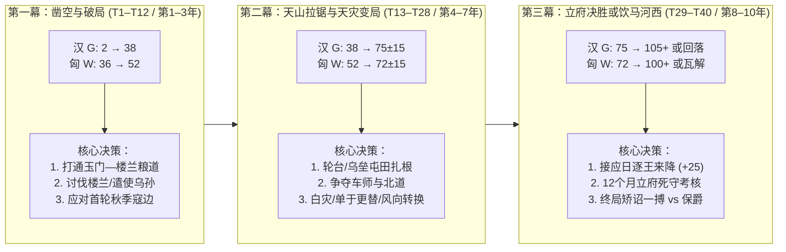

# S01 胜利条件、史官评定与历史剧本（Victory, Evaluation & Scenarios Spec v1）

> **所属系统**：`S01_victory_scenarios.md`
> **上位依据**：[00_bible.md](00_bible.md)（L1–L12）
> **代码映射**：`core/victory.gd`、`core/game_state.gd`、`data/balance.json`（`victory` 段）、`data/scenarios/*.json`
> **状态**：v1 完成

---

## 1. 目的与支柱

### 1.1 设计目的与现状症结修复

在现有 MVP 版本（`core/victory.gd` + `data/scenario_mvp.json`）中，胜负与剧本系统存在四个经代码审计与 400+ 局自动模拟证实的结构性缺陷：

1. **汉方主胜利达成率为 0%**：旧规则要求汉方同时使 `han_required = 12` 个西域城邦处于 `vassal`（属国且有汉军驻扎）并连续维持 12 个月。在 `historical_v1` 季制 40 局独立验证样本中，汉方属国峰值 100% 卡在 10 国（月制 40 局峰值 10–11 国），主胜利达成率为 **0/80（0%）**。汉方所有胜局全部退化为 240 个月到期计分。
2. **到期计分高度离散且严重同分收敛**：旧版 `victory.expiry` 仅按「每属国 10 分、每河西郡 10 分、被毁折半」计算，`horses_per_1000` 与 `pop_per_10000` 权重均为 `0.0`。这导致季制 25 局到期局中，18 局比分完全相同（`汉120 : 匈奴104`），6 局为 `汉110 : 匈奴114`，终局状态毫无区分度，违反 L12「终局签名 ≥ 15 种且单一签名 ≤ 20%」的要求。
3. **匈奴胜利路径单一且缺乏内部崩盘约束**：旧版匈奴仅有「夺取全部河西四郡并维持 6 个月」一条主胜利路径，在西域本部的霸权经营（僮仆都尉征税、威服诸国、单于威望）无法转化为胜利；同时双方均无提前政治崩盘（汉使被召还下狱、匈奴单于威望崩溃诸部离散）的失败条件。
4. **单剧本 20 年跨度过长、前中期缺乏节奏锚点**：单一 240 月（80 季）剧本既无面向新手的短局引导，也把前 119 年至前 60 年整整六十年的历史机制挤压在同一张静态开局表里，导致前 10 回合「唯一正确解法是砸楼兰却无引导」，中后期则陷入漫长的机械运粮与拉锯。

本规范（S01）通过引入**都护府功业值（$G$）多维积分制**、**匈奴双路径威服值（$W$）**、**政治崩盘失败条件**、**连续变量到期计分 + 史官五档评定**以及**三大历史剧本（前 108 楼兰姑师 / 前 119 漠北之后 / 前 68 都护府）**，彻底重构一局游戏的战略目标与叙事收束。

### 1.2 服务的体验支柱

| 体验支柱 | S01 的具体支撑机制 |
|---|---|
| **支柱 1：万里粮道** | 汉方都护府功业值包含**「屯田自养」**（$G_{\text{tuntian}}$，最高 15 点）与**「中枢屯戍枢纽（乌垒/车师前）」**（最高 20 点）。汉玩家不能靠轻骑闪击打卡获胜，必须在西域腹地建成可常年供养驻军的屯田粮仓；到期计分启用马匹与人口连续变量，断粮饿死士卒会直接压低终局史官评定档次。 |
| **支柱 2：将在外** | 汉方功业满 100 后需经历 **12 个月（4 季）「奏请立府」维持期**，且维持期内要求**朝廷信任 $\ge 25$**、无在途召还令。若汉使在终局前因矫诏败露或丧师失地导致信任归零，将触发**「槛车征还」**提前失败；终局「史官五档评定」（封侯 / 赐爵 / 无功 / 下狱 / 族诛）将国家胜负与汉使个人荣辱解耦，再现李广利、赵破奴、傅介子、陈汤等不同历史命运。 |
| **支柱 3：帝国对联盟** | 汉方走**「制度化建置」**路线（累积属国、册封、屯田、压制威吓、罢僮仆都尉以设立都护府）；匈奴方走**「草原霸权」**双路线——既可挥师南下完成**「饮马河西（夺取河西四郡）」**，也可通过保住僮仆都尉、臣服北道诸国与维持高单于威望达成**「威服西域」**，同时时刻防范威望跌穿底线引发**「诸部离散」**。 |
| **支柱 4：人与史** | 三个剧本分别锚定汉武帝开拓期（前 108、前 119）与汉宣帝制度化期（前 68），内嵌**日逐王先贤掸来降（+25 功业并撤僮仆都尉）**、**前 71 年冬白灾**、**单于更替**等史实事件链；每局结束生成结构化的**终局签名（End-State Signature）**与专属史官列传评语。 |

### 1.3 L7 机制准入检验：让哪些已有回合决策更难做？

依据圣经 L7（「一个机制只有在让某个已有的回合决策更难做时才允许加入」），S01 每个子机制对应的回合两难决策如下表：

| S01 机制 | 受影响的回合决策 | 为什么决策变得更难做？（两难张力） |
|---|---|---|
| **都护府功业值分项上限**<br>（属国上限 66、枢纽 20、屯田 15、威吓压制 10、日逐王/罢僮仆 25） | 每季汉方的**使团预算、军费与民夫分配**（去拉拢外围小国，还是集中经略乌垒/车师与轮台屯田？） | 旧版只需无脑挑最容易的小国凑够数量；新版拉满 11 个外围小国也只有 66 点，汉方必须在「花钱遣使维持小国影响力」「派主力争夺高危的车师前/乌垒（+20）」「抽调军队转入轮台/伊循屯田存粮（+15）」三者间分配有限的钱粮。 |
| **河西失守重罚与 12 个月维持期**<br>（每丢一郡 $-12$ 功业；不达标每季回退 2 个月维持进度） | 汉军主力**何时西出玉门关、留多少机动兵力守河西**？ | 汉方即使把西域功业推上 100，只要在 12 个月维持期内经历一次秋季匈奴南下攻陷敦煌或酒泉，功业立刻暴跌 12 点跌破阈值，维持进度倒退。西进决战与回防河西形成尖锐的兵力抽调矛盾。 |
| **日逐王来降接口（+25 功业 & 撤僮仆都尉）** | 汉方中期**是否保留预备队与机动存粮在乌垒/渠犁待机**？匈奴方**是否赏赐安抚右部/日逐王**？ | 汉方若把所有钱粮在平庸年份耗尽，当日逐王怨望满值派遣使者接洽时，若无持节人物与 3,000 兵力在乌垒/轮台接应，便会痛失直取 +25 功业的历史性窗口；匈奴单于则必须在「把赏赐池分给左部主力打河西」与「安抚日逐王防其叛逃断绝西域税源」之间取舍。 |
| **匈奴双路径主胜利**<br>（河西四郡 vs 威服西域 $W \ge 100$） | 匈奴秋季蹛林大会的**主攻方向选择**（南下叩关攻城 vs 西进震慑车师/焉耆） | 强攻河西四郡一旦久围不克，士卒伤亡会导致单于威望下滑、部领忠诚跌落；而转向西域刷威服值虽稳，却会让汉方安然完成河西运粮与轮台屯田。 |
| **连续变量到期计分 + 史官五档评定** | 终局前 8–12 季（最后 2–3 年）**是否发动高风险矫诏远征或决战**？ | 处于「无功（第 3 档）」边缘的汉使若求稳保船，到期只能拿平庸评价；若冒险矫诏出击，大胜可冲入「赐爵/封侯」，但一旦战败损兵折马且矫诏未获赦免，不仅国家输掉到期计分，个人评定还会直接跌入「下狱」乃至「族诛」。 |

---

## 2. 玩家视角

### 2.1 玩家在何时、何处看到什么、做什么决策？

1. **开局剧本选择界面（Scenario Select Screen）**：
   - 玩家在主菜单点击「开启竹简」后，从三卷竹简中选择剧本：①**《楼兰姑师》**（前 108 年春，12 季/3 年，教学与破局）、②**《漠北之后》**（前 119 年春，40 季/10 年，主沙盒）、③**《都护府》**（前 68 年春，36 季/9 年，终局争霸）。
   - 右侧面板清晰展示该剧本的**「专属制胜法则」**、**「初始朝局/草原态势」**、**「推荐难度」**与预计现实游玩时长（45 分钟 / 2.5 小时 / 2 小时）。
2. **主界面顶栏（Top HUD Victory Widget）**：
   - **汉方视角**：顶栏右侧常驻青铜圭表样式的**「都护府功业：78 / 100」**进度条。当 $G \ge 100$ 且信任达标时，进度条转为鎏金闪烁，显示**「奏请立府考核：已维持 6 / 12 月」**。
   - **匈奴视角**：顶栏右侧常驻狼头金冠样式的**「单于威服：64 / 100（河西已夺 1/4 郡）」**双轨指示器。
   - **悬停拆解（Tooltip）**：鼠标移入功业/威服条，立即弹出实时加分明细表、当前短板提示（例如：`【短板】乌垒尚未归附（可得 +10）；西域屯田存粮 32,000/60,000 斛（当前 +8/15）`）以及本季末预计衰减值。
3. **季度转换与里程碑战报（Season Summary Modal）**：
   - 每季结算完毕弹出《本季纪事》时，顶部展示功业/威服本季净变化（如 `都护府功业 72 → 84 (+12)`）。
   - 首次跨越 **50 点（西域震动）**、**80 点（诸国咸服）**、**100 点（奏请置都护 / 饮马河西）** 时，触发带史书插画的里程碑提示，并通知对手方 AI/玩家（制造终局紧迫感）。
4. **终局史官评定卷轴（Endgame Historian Scroll）**：
   - 无论因主胜利、一方政治崩盘还是回合到期结束，均展开全屏竹简卷轴：左侧显示**胜负定性**（如「汉主胜利：设立西域都护府」）、**双方总分拆解对比表**与**关键历史转折点时间轴**；右侧以《史记·大宛列传》或《汉书·西域传》笔法给出**史官五档评定**（如 `【上上·裂土封侯】册封定远侯，食邑二千户`）与本局专属**终局签名代码**。

### 2.2 具体回合与终局结算示例（带完整数字）

#### 示例 A：汉方玩家在《漠北之后》第 31 回合（前 112 年秋，8–10 月）抓住「日逐王来降」窗口冲线

* **回合初态势（前 112 年 8 月上旬，T31 下令阶段）**：
  * 汉方当前朝廷信任 `trust = 62`（$\ge 25$，满足立府信任门槛），手头可用资金 `money = 1,450` 钱。
  * 西域 18 个计分城邦中，汉方已拥有 **8 个属国**（楼兰、且末、精绝、于阗、轮台、尉犁、龟兹、莎车，$8 \times 6 = 48$ 点），其中 **4 国已获汉廷册封**（楼兰、于阗、龟兹、莎车，$4 \times 2 = 8$ 点）；战略要冲**乌垒**尚未成为属国（0/10 点），**车师前**仍在匈奴控制下（0/10 点）。
  * 汉军在轮台驻有屯田兵 1,500 人，当地粮仓存粮 **48,000 斛**（按满额 60,000 斛折算，$\lfloor 15 \times 48000 / 60000 \rfloor = 12$ 点）。
  * 18 个西域城邦当前对匈奴的平均威吓度 $\bar{I}_{\text{xn}} = 32.0$（在阈值 $[20, 45]$ 之间，威吓压制分 $= \lfloor 10 \times (45 - 32)/(45 - 20) \rfloor = 5$ 点）。
  * 盟国乌孙亲汉度 55（已和亲，$+4$ 点）；事件功业池累计战功 `merit_pool = 4.0` 点；河西四郡完好（惩罚 $0$）。
  * **当前都护府功业值**：
    $$G = 48\text{（属国）} + 8\text{（册封）} + 0\text{（枢纽）} + 12\text{（屯田）} + 5\text{（抑威）} + 4\text{（大国）} + 4\text{（战功池）} + 0\text{（勋）} - 0\text{（河西）} = 81\text{ 点}$$
* **本季突发事件与玩家决策**：
  * 前一冬（T28）草原遭遇「白灾」，本季初匈奴伊稚斜单于病逝、乌维单于新立，右部**日逐王**因单于庭诛杀旧臣心怀怨望（`rizhu_grudge = 85`），密遣轻骑至轮台请求举部内附（触发 S06 事件 `evt_rizhu_surrender_offer`）。
  * 事件选项要求：汉方必须有一名持节或副使人物在乌垒/轮台，且驻军 $\ge 2,500$ 人、拨付安辑赏赐 `600` 钱方可受降「迎日逐王，护送诣阙」。
  * **玩家的两难抉择**：此时匈奴右贤王部 8,000 骑正在居延塞外游弋，酒泉守军告急。玩家若把预算和机动骑兵调回酒泉，河西绝对安全，但将错过日逐王内附窗口；若留 600 钱与轮台骑兵受降日逐王，并同时命副使持节进驻乌垒使其归附（乌垒当前汉影响力 64 vs 匈奴威吓 18），功业将一举突破 100，但酒泉需独力硬扛秋季寇边。
  * **玩家下令**：① 事件选「开怀受降（$-600$ 钱）」；② 命驻轮台汉使率 2,500 骑进驻乌垒受降并册立乌垒亲汉贵人；③ 命张掖郡兵向酒泉火速运粮 30,000 斛并转入「坚守不出（壁垒）」预设。
* **季末结算（前 112 年 10 月下旬）**：
  * 日逐王率众来降成功！根据规则 `S01-R03`：
    1. 汉方获得**永久勋值** `permanent_merit += 15`；
    2. 匈奴设于焉耆/危须一带的**僮仆都尉被撤销**（`tongpu_active = false`），汉方获得状态功业 $G_{\text{tongpu}} = +10$；
    3. 西域各国匈奴威吓普遍暴跌 15 点，18 国平均威吓 $\bar{I}_{\text{xn}}$ 降至 $18.5$（威吓压制分升至满额 $+10$）；
    4. 乌垒正式成为汉属国（属国数 $8 \to 9$，属国分 $48 \to 54$；且激活乌垒枢纽加成 $+10$）。
  * 酒泉守军凭城死守撑过秋季，河西四郡未失（惩罚仍为 $0$）。
  * **季末重算功业值**：
    $$G = 54\text{（9属国）} + 8\text{（册封）} + 10\text{（乌垒枢纽）} + 12\text{（屯田）} + 10\text{（抑威满额）} + 4\text{（乌孙）} + 3.6\text{（战功池衰减后）} + 15\text{（日逐王永久勋）} + 10\text{（罢僮仆都尉）} = 126.6 \to \mathbf{127}\text{ 点}$$
  * $G = 127 \ge 100$ 且 `trust = 68 >= 25`！系统宣布**「功业已备，遣骑奉表奏请置西域都护府」**，维持计数器 `han_hold_months` 在 8、9、10 月底连加 3 个月（`3 / 12`）。此后汉方稳守乌垒与河西 3 个季度（9 个月），于前 111 年 7 月底满 12 个月，正式达成**汉主胜利：设立西域都护府**！

#### 示例 B：第 40 回合（前 109 年 1 月末）到期连续计分与史官五档评定结算

若另一局《漠北之后》战至第 40 回合（第 120 个月末）双方均未达成主胜利或崩盘，系统执行 `S01-R07` 到期连续变量计分：

| 计分维度 | 汉方终局状态与计算 | 汉得分 | 匈奴终局状态与计算 | 匈奴得分 |
|---|---|---|---|---|
| **1. 核心霸权折算**<br>（上限 55 分） | 终局功业 $G = 74$ 点<br>$74 \times 0.60 = 44.40$ | **44.40** | 终局威服 $W = 68$ 点<br>$68 \times 0.60 = 40.80$ | **40.80** |
| **2. 战马实力分**<br>（上限 15 分） | 国家马池 + 军队战马共 $9,400$ 匹<br>`horses_per_1000 = 1.2` $\Rightarrow 9.4 \times 1.2 = 11.28$ | **11.28** | 草原与牧场存栏 $585,000$ 匹（开局 $786,000$ 匹）<br>保有率 $0.744 \times 12.0 = 8.93$ | **8.93** |
| **3. 控制人口比**<br>（上限 15 分） | 河西 + 汉属国总人口 $176,000$（开局基线 $127,000$）<br>人口比 $1.386 \times 8.0 = 11.09$ | **11.09** | 草原 + 匈奴属国总人口 $690,000$（开局基线 $782,000$）<br>人口比 $0.882 \times 8.0 = 7.06$ | **7.06** |
| **4. 政治稳固度**<br>（上限 15 分） | 终局朝廷信任 `trust = 54`<br>$54 \times 0.15 = 8.10$ | **8.10** | 单于威望 $48$，四部平均忠诚 $62$<br>$48 \times 0.10 + 62 \times 0.08 = 9.76$ | **9.76** |
| **总分合计** | $44.40 + 11.28 + 11.09 + 8.10$ | **74.87** | $40.80 + 8.93 + 7.06 + 9.76$ | **66.55** |

* **胜负裁定**：分差 $\Delta S = 74.87 - 66.55 = +8.32 \ge 3.0$（超过平局阈值），判定**汉方到期险胜（汉 74.9 : 匈奴 66.6）**。
* **史官五档评定**：
  * **汉使**：终局个人评定分 $74.87 \in [55.0, 75.0)$，且未触发主胜利封侯覆写，获评**第二档「赐爵关内侯」**（文案：*“奉节绝幕十载，虽未置都护以一统南北，然拓土通商、折冲万里，赐爵关内侯，黄金百斤。”*）。
  * **匈奴单于**：终局个人评定分 $66.55 \in [55.0, 75.0)$，但因到期输给汉方，按覆写规则上限锁为**第三档「保守故地」**（文案：*“控弦十万，与汉争衡西域，互有胜负；虽失南道诸小国，犹保漠北与北道故业。”*）。
* **终局签名生成**：`EXPIRY_HAN__fanguo__G2_X3__baizai_succession`（到期汉胜｜藩国主导｜汉二档·匈奴三档｜经历白灾与单于更替）。

---

## 3. 状态变量表

本系统拥有的全部运行时状态挂载于 `GameState.victory`（对应存档字典 `state["victory"]`），严禁其他模块直接篡改。

| 名称 | 所属对象 | 类型 | 取值范围 | 初值 | JSON 键（配置源） | 存档字段（`state.victory.*`） |
|---|---|---|---|---|---|---|
| 剧本胜负模式 | `GameState.victory` | `String` | `"standard"` \| `"objectives"` | `"standard"` | `scenarios/*.json → victory.mode` | `victory_mode` |
| 汉都护府功业总值 | `GameState.victory` | `int` | $[-60, 200]$（UI 显示下限 0） | 按开局重算（漠北为 `2`） | —（派生量，月末重算） | `han_merit` |
| 汉功业分项字典 | `GameState.victory` | `Dictionary` | 见 `S01-R02` 各分项范围 | `{}` | —（派生量） | `han_merit_breakdown` |
| 汉事件功业池（可衰减） | `GameState.victory` | `float` | $[-20.0, 30.0]$ | `0.0` | `balance.json → victory.merit.pool_min` / `pool_max` | `han_merit_pool` |
| 汉永久勋值（不衰减） | `GameState.victory` | `int` | $[0, 40]$ | `0` | `balance.json → victory.merit.perm_max` | `han_permanent_merit` |
| 汉立府维持月数 | `GameState.victory` | `int` | $[0, 24]$ | `0` | `balance.json → victory.merit.hold_months_required` | `han_hold_months` |
| 汉历史最高功业峰值 | `GameState.victory` | `int` | $[0, 200]$ | `0` | — | `han_merit_peak` |
| 汉历史最高立府维持月数 | `GameState.victory` | `int` | $[0, 24]$ | `0` | — | `han_hold_peak` |
| 匈奴威服总值 | `GameState.victory` | `int` | $[-40, 200]$（UI 显示下限 0） | 按开局重算（漠北为 `36`） | —（派生量，月末重算） | `xn_weifu` |
| 匈奴威服分项字典 | `GameState.victory` | `Dictionary` | 见 `S01-R05` 各分项范围 | `{}` | —（派生量） | `xn_weifu_breakdown` |
| 匈奴战功池（可衰减） | `GameState.victory` | `float` | $[-20.0, 25.0]$ | `0.0` | `balance.json → victory.weifu.pool_max` | `xn_weifu_pool` |
| 匈奴河西四郡全占维持月数 | `GameState.victory` | `int` | $[0, 12]$ | `0` | `balance.json → victory.weifu.hexi_hold_months` | `xn_hexi_hold_months` |
| 匈奴威服达标维持月数 | `GameState.victory` | `int` | $[0, 12]$ | `0` | `balance.json → victory.weifu.hold_months_required` | `xn_weifu_hold_months` |
| 匈奴威服历史峰值 | `GameState.victory` | `int` | $[0, 200]$ | `0` | — | `xn_weifu_peak` |
| 匈奴诸部离散连续季数 | `GameState.victory` | `int` | $[0, 4]$ | `0` | `balance.json → victory.failure.xn_scatter_quarters` | `xn_scatter_streak_quarters` |
| 年度战功计数器 | `GameState.victory` | `Dictionary` | 各键 $[0, 10]$ | `{"han_battle":0, "xn_battle":0}` | `balance.json → victory.merit.yearly_battle_cap` | `yearly_award_counts` |
| 功业里程碑已触发标记 | `GameState.victory` | `Dictionary` | 布尔字典 | `{"han_50":false,"han_80":false,"han_100":false,"xn_50":false,"xn_80":false,"xn_100":false}` | — | `milestones_fired` |
| 剧本专项任务进度 | `GameState.victory` | `Dictionary` | 依剧本目标定义 | `{}` | `scenarios/*.json → victory.objectives` | `objective_progress` |
| 关键转折事件已发生列表 | `GameState.victory` | `Array[String]` | 最多记录 16 条事件标签 | `[]` | — | `key_events_occurred` |
| 领先方易手次数 | `GameState.victory` | `int` | $[0, 120]$ | `0` | — | `lead_changes_count` |
| 上季领先方 | `GameState.victory` | `String` | `""` \| `"han"` \| `"xiongnu"` | `""` | — | `prev_leader` |
| 开局汉方基准人口 | `GameState.victory` | `int` | $[1, 2000000]$ | 开局计算（漠北 `127000`） | —（开局快照） | `baseline_han_pop` |
| 开局匈奴基准人口 | `GameState.victory` | `int` | $[1, 2000000]$ | 开局计算（漠北 `782000`） | —（开局快照） | `baseline_xn_pop` |
| 开局匈奴基准马匹 | `GameState.victory` | `int` | $[1, 2000000]$ | 开局计算（漠北 `786000`） | —（开局快照） | `baseline_xn_horses` |
| 对局是否已结束 | `GameState.victory` | `bool` | `true` \| `false` | `false` | — | `is_game_over` |
| 获胜势力 ID | `GameState.victory` | `String` | `""` \| `"han"` \| `"xiongnu"` \| `"draw"` | `""` | — | `winner` |
| 终局类型枚举 | `GameState.victory` | `String` | 8 种枚举（见 `S01-R07`） | `""` | — | `end_type` |
| 终局主导路径标签 | `GameState.victory` | `String` | 见 `S01-R07` 路径表 | `""` | — | `victory_path` |
| 汉终局综合计分 | `GameState.victory` | `float` | $[0.0, 120.0]$ | `0.0` | — | `han_final_score` |
| 匈奴终局综合计分 | `GameState.victory` | `float` | $[0.0, 120.0]$ | `0.0` | — | `xn_final_score` |
| 汉史官评定档次 | `GameState.victory` | `String` | `"G1_FENGHOU"` ~ `"G5_ZUZHU"` | `""` | `balance.json → victory.grades.han_thresholds` | `han_grade` |
| 匈奴史官评定档次 | `GameState.victory` | `String` | `"X1_LONGCHENG"` ~ `"X5_SHENSI"` | `""` | `balance.json → victory.grades.xn_thresholds` | `xn_grade` |
| 细粒度终局签名 | `GameState.victory` | `String` | 格式 `{end_type}__{path}__{grades}__{evts}` | `""` | — | `end_signature` |
| 粗粒度终局签名 | `GameState.victory` | `String` | 格式 `{end_type}__{path}` | `""` | — | `end_signature_coarse` |

> **向后兼容约束**：现有 `GameState` 顶层的 `state.victory_Hold_months` 保留为只读镜像别名（值同步等于 `state.victory.han_hold_months`），确保旧回放与测试脚本不报错。

---

## 4. 规则与公式

### 4.1 结算时机、时序与胜负裁决总则（`S01-R01`）

#### `S01-R01`：胜负检定时序与优先级

1. **即时事件钩子（旬内触发）**：
   - 战斗结束、城池易手、使团遇害、城邦遣质子、日逐王来降等事件发生时，立即调用 `Victory.record_event_award(...)` 更新 `han_merit_pool`、`han_permanent_merit`、`xn_weifu_pool` 或 `key_events_occurred`，但**不立即重算维持月数或终结游戏**（玩家投降命令 `concede_scenario` 除外）。
2. **每月末结算（每月第 3 旬末，`TurnResolver` 的 `monthly_settlement` 阶段末尾）**：
   按严格先后顺序执行以下 6 步：
   - **Step 1（季末衰减，仅在每季第 3 个月末，即 4 月、7 月、10 月、1 月末执行）**：
     先执行事件功业池与战功池的季度衰减（见 `S01-R02.4` 与 `S01-R05.3`）；若为每年 1 月末（岁末），清零 `yearly_award_counts`。
   - **Step 2（重算当前功业 $G$ 与威服 $W$）**：
     读取各系统当前状态，计算 `han_merit`（$G$）与 `xn_weifu`（$W$），更新峰值记录 `han_merit_peak`、`xn_weifu_peak`，并检查 50 / 80 / 100 里程碑播报。若本月末为季末，比较 $\frac{G}{100}$ 与 $\frac{W}{100}$：若差值 $> 0.05$ 且领先方与 `prev_leader` 不同（`prev_leader != ""`），则 `lead_changes_count += 1`。
   - **Step 3（更新双方维持月数计数器，带滞回机制）**：
     按 `S01-R02.5` 更新 `han_hold_months`，按 `S01-R05.4` 更新 `xn_hexi_hold_months` 与 `xn_weifu_hold_months`。
   - **Step 4（检定政治崩盘失败条件，最高优先级）**：
     按 `S01-R06` 检定汉方是否触发「槛车征还」失败（$F_{\text{han}}$）、匈奴是否触发「诸部离散」失败（$F_{\text{xn}}$）：
     - 若 $F_{\text{han}} \land F_{\text{xn}}$ 同时为真：判定为**「两败俱伤（`MUTUAL_COLLAPSE`）」**，转入 `S01-R07` 到期连续计分决出相对胜者，且双方史官评定上限均锁死在第 4 档（汉「下狱」、匈奴「不会龙城」）。
     - 若仅 $F_{\text{han}}$ 为真：匈奴获胜，终局类型为 `HAN_RECALL`（除非匈奴在同一月末也恰好满主胜利维持期，此时优先定性为 `XN_MAIN_HEXI` 或 `XN_MAIN_WEIFU`）。
     - 若仅 $F_{\text{xn}}$ 为真：汉方获胜，终局类型为 `XN_SCATTER`（同理，若汉方同月满立府维持期，优先定性为 `HAN_MAIN`）。
   - **Step 5（检定双方主胜利条件）**：
     - 汉主胜利达标条件：$\text{han\_hold\_months} \ge M_{\text{han\_hold}}$（默认 12）。
     - 匈奴主胜利达标条件：$\text{xn\_hexi\_hold\_months} \ge M_{\text{hexi\_hold}}$（默认 6，路径 A `XN_MAIN_HEXI`）或 $\text{xn\_weifu\_hold\_months} \ge M_{\text{weifu\_hold}}$（默认 6，路径 B `XN_MAIN_WEIFU`）。
     - **同月双主胜平局裁决**：若汉与匈奴在同一月末同时满足主胜利维持月数，比较超额倍率 $R_{\text{han}} = \frac{G}{G_{\text{req}}}$ 与 $R_{\text{xn}} = \frac{W}{W_{\text{req}}}$（若匈奴走河西四郡纯占领路径，则取 $\max(\frac{W}{100}, 1.15)$）；倍率高者获主胜利，若仍完全相等则按 `S01-R07` 综合得分高者获主胜利。
   - **Step 6（检定剧本到期）**：
     若当前已走完剧本最大月数（`months_elapsed >= max_months`）且未在 Step 4–5 结束：
     - 先检查剧本是否配置了「终局宽限期（`end_grace_months`）」（如剧本③《都护府》设为 3 个月）：若某方在终局月仍处于 $G \ge G_{\text{req}}$ 且 `han_hold_months >= end_grace_months`，直接视为达成主胜利 `HAN_MAIN`。
     - 否则触发**到期结算**，按 `S01-R07` 计算双方连续变量总分 $S_{\text{han}}, S_{\text{xn}}$、裁定胜负（`EXPIRY_HAN` / `EXPIRY_XN` / `EXPIRY_DRAW`）、生成史官五档评定与终局签名。

---

### 4.2 汉方主胜利：都护府功业值（`S01-R02` ~ `S01-R04`）

#### `S01-R02`：都护府功业值（$G$）计算公式、权重、上限与维持期

1. **设计哲学**：历史上的西域都护府（前 60 年神爵二年设立）并非把西域三十六国全部驻军占领，而是**「南北道主要城邦臣服 + 乌垒/车师战略枢纽在握 + 渠犁/轮台屯田足食 + 匈奴威吓被压制 + 日逐王来降罢僮仆都尉」**五位一体的制度化成果。因此功业值 $G$ 采用**「状态基底（可随局势得失实时回退）+ 事件战功池（按季衰减）+ 历史大勋（永久保留）- 河西失守重罚」**的混合结构。

2. **总公式**：
   每个月末重算汉方功业值 $G$（`state.victory.han_merit`）：
   $$G = \text{round}\Big( G_{\text{vassal}} + G_{\text{enfeoff}} + G_{\text{hub}} + G_{\text{tuntian}} + G_{\text{suppress}} + G_{\text{great}} + G_{\text{tongpu}} + P_{\text{event}} + M_{\text{perm}} - D_{\text{hexi}} \Big)$$
   其中各项定义、默认系数、可调范围与 JSON 键如下表所示（配置位于 `data/balance.json → victory.merit.*`）：

| 分项符号 | 名称 | 计算公式与判定规则 | 单项上限 | 默认系数与可调范围 | JSON 键（`victory.merit.*`） |
|---|---|---|---|---|---|
| $G_{\text{vassal}}$ | **西域属国分** | $\min\big(C_{\text{vassal}}, \; N_{\text{vassal}} \times w_{\text{vassal}}\big)$<br>其中 $N_{\text{vassal}}$ 为 18 个 `counts_for_victory == true` 的西域城邦中，当前 `overlord == "han"`（含 `vassal` 属国或 S04 汉方 `puppet` 傀儡政权）的数量。**不再强制要求城内每时每刻有汉军驻扎**（解放汉军机动性）。 | **66**（即最多计 11 国） | $w_{\text{vassal}} = 6$<br>范围 $[4, 8]$<br>$C_{\text{vassal}} = 66$<br>范围 $[54, 78]$ | `vassal_weight`: `6`<br>`vassal_cap`: `66` |
| $G_{\text{enfeoff}}$ | **汉廷册封分** | $\min\big(C_{\text{enfeoff}}, \; N_{\text{enfeoff}} \times w_{\text{enfeoff}}\big)$<br>其中 $N_{\text{enfeoff}}$ 为当前 `overlord == "han"` 且已获得汉廷正式印绶册封（读取 S04 `relation.han_enfeoffed == true` 或 `han_status == "enfeoffed"`）的西域城邦数。 | **12**（最多计 6 国） | $w_{\text{enfeoff}} = 2$<br>范围 $[1, 3]$<br>$C_{\text{enfeoff}} = 12$ | `enfeoff_weight`: `2`<br>`enfeoff_cap`: `12` |
| $G_{\text{hub}}$ | **战略枢纽分** | $I(\text{wu\_lei}) \times w_{\text{wulei}} + I(\text{cheshi\_qian}) \times w_{\text{cheshi}}$<br>当**乌垒**（都护府治所，`wu_lei`）满足 `overlord == "han"` 时 $I(\text{wu\_lei})=1$，得 10 点；当**车师前**（北道咽喉，`cheshi_qian`）满足 `overlord == "han"` 时 $I(\text{cheshi\_qian})=1$，得 10 点。一旦城邦叛离或被匈奴夺回，该项立即归零。 | **20** | $w_{\text{wulei}} = 10$<br>$w_{\text{cheshi}} = 10$<br>范围 $[5, 15]$ | `hub_wulei_bonus`: `10`<br>`hub_cheshi_bonus`: `10` |
| $G_{\text{tuntian}}$ | **西域屯田自养分** | $\min\Big(C_{\text{tuntian}}, \; \Big\lfloor C_{\text{tuntian}} \times \frac{\text{Grain}_{\text{xiyu\_tuntian}}}{T_{\text{grain}}} \Big\rfloor\Big)$<br>其中 $\text{Grain}_{\text{xiyu\_tuntian}}$ 为西域 18 个城邦节点上**当前驻有汉方屯田队/屯田卒（读取 S05 `node.tuntian_level >= 1` 或 `tuntian_troops > 0`）的节点存粮总和**（河西四郡与玉门/阳关存粮不计入）。 | **15** | $C_{\text{tuntian}} = 15$<br>范围 $[10, 20]$<br>$T_{\text{grain}} = 60000$ 斛<br>范围 $[30000, 120000]$ | `tuntian_cap`: `15`<br>`tuntian_grain_target`: `60000` |
| $G_{\text{suppress}}$ | **威吓压制分** | 设 18 个西域城邦当前的平均匈奴威吓度为 $\bar{I}_{\text{xn}} = \frac{1}{18}\sum_{i=1}^{18} \text{xn\_intimidation}_i$。<br>则 $G_{\text{suppress}} = \text{clamp}\Big(\Big\lfloor C_{\text{sup}} \times \frac{I_{\text{high}} - \bar{I}_{\text{xn}}}{I_{\text{high}} - I_{\text{low}}} \Big\rfloor, \; 0, \; C_{\text{sup}}\Big)$。<br>开局 $\bar{I}_{\text{xn}} \approx 42.2$ 时仅得 1 点；将西域平均威吓压低至 $\le 20$ 时拿满 10 点。 | **10** | $C_{\text{sup}} = 10$<br>$I_{\text{high}} = 45.0$<br>$I_{\text{low}} = 20.0$ | `suppress_cap`: `10`<br>`suppress_intim_high`: `45.0`<br>`suppress_intim_low`: `20.0` |
| $G_{\text{great}}$ | **大国结盟分** | 乌孙（`wusun`）若与汉结盟/和亲（`han_influence >= 50` 且 `overlord == "han"` 或 S04 `is_allied_han`）得 $+4$ 点；大宛（`dawan`）若归附或岁献天马（`han_influence >= 50`）得 $+4$ 点；康居/大月氏/罽宾每有一个 `han_influence >= 60` 得 $+2$ 点（三者最多 $+2$）。 | **10** | $w_{\text{wusun}} = 4$<br>$w_{\text{dawan}} = 4$<br>$C_{\text{great}} = 10$ | `great_wusun_bonus`: `4`<br>`great_dawan_bonus`: `4`<br>`great_cap`: `10` |
| $G_{\text{tongpu}}$ | **罢僮仆都尉状态分** | 当匈奴「僮仆都尉」处于被撤销/瘫痪状态（读取 S03 `state.tribes.tongpu_active == false`）时，得 $+10$ 点；若匈奴此后重设僮仆都尉，该 10 点立即回退为 $0$。 | **10** | $w_{\text{tongpu}} = 10$<br>范围 $[5, 15]$ | `tongpu_abolished_bonus`: `10` |
| $P_{\text{event}}$ | **事件战功池**<br>（可衰减、可为负） | 记录近期战役捷报、斩将、得质子、讨伐有罪之国与丧师惩罚的浮动池，每季末向 0 衰减 $10\%$（见下文 `S01-R02.4`）。 | **$[-20, +30]$** | 上限 $30.0$<br>下限 $-20.0$<br>季衰减率 $0.10$ | `pool_max`: `30.0`<br>`pool_min`: `-20.0`<br>`pool_quarterly_decay`: `0.10` |
| $M_{\text{perm}}$ | **历史大勋池**<br>（永久不衰减） | 记录不可逆的重大历史功勋：① **日逐王来降** $+15$ 点；② 其他匈奴部领（如右贤王/呼揭王）率部降汉，每部 $+8$ 点（每部限一次）；③ 攻破或焚毁龙城/单于庭 $+10$ 点（限一次）。 | **40** | 日逐王 $+15$<br>部领降 $+8$<br>破龙城 $+10$ | `perm_rizhu_surrender`: `15`<br>`perm_tribe_defect`: `8`<br>`perm_sack_sacred`: `10`<br>`perm_max`: `40` |
| $-D_{\text{hexi}}$ | **河西失守重罚** | $D_{\text{hexi}} = N_{\text{hexi\_lost}} \times w_{\text{hexi\_pen}}$<br>其中 $N_{\text{hexi\_lost}}$ 为河西四郡（`wu_wei`, `zhang_ye`, `jiu_quan`, `dun_huang`）加上两关（`yumen_guan`, `yang_guan`）中，当前 `faction != "han"` 的节点数量。每丢一城/关，功业立即扣除 **12 点**；收复后恢复。 | **$-72$** | $w_{\text{hexi\_pen}} = 12$<br>范围 $[8, 20]$ | `hexi_loss_penalty_per_node`: `12` |

3. **事件战功池（$P_{\text{event}}$）的增减明细表**：
   当下列事件发生时，立即向 `han_merit_pool` 追加对应点数，并截断在 $[P_{\min}, P_{\max}] = [-20.0, +30.0]$ 内：
   - **野战/攻城大捷**（单场战斗消灭匈奴兵力 $\ge 2,000$ 人且汉方获胜）：$+3.0$ 点（每年最多计 2 次，`yearly_battle_cap = 2`）。
   - **阵斩或生擒匈奴具名部领/名将**（读取 S05/S06 战报钩子）：$+5.0$ 点。
   - **名正言顺讨伐有罪城邦获胜**（对 S04 `crimes_against_han >= 1` 的城邦发动攻城并迫降/立傀儡，如斩楼兰王、破姑师）：$+4.0$ 点（每城邦每局最多计 1 次）。
   - **西域城邦首次遣质子入侍长安**（读取 S04 质子状态）：$+2.0$ 点/国（每国限首次）。
   - **天马入贡事件完成**（大宛汗血马或乌孙天马抵长安）：$+3.0$ 点。
   - **汉军全军覆没或主将阵亡/没胡**（单支 $\ge 3,000$ 人的汉军被全歼，或具名汉将阵亡/投降匈奴）：$-6.0$ 点。
   - **汉使团被劫杀且未在 4 季（12 个月）内讨伐报复**：到期时扣除 $-3.0$ 点。

4. **回退与季度衰减规则（Decay & Reversibility）**：
   - **状态分即时回退**：$G_{\text{vassal}}, G_{\text{enfeoff}}, G_{\text{hub}}, G_{\text{tuntian}}, G_{\text{suppress}}, G_{\text{great}}, G_{\text{tongpu}}, D_{\text{hexi}}$ 全部为**纯状态函数**。一旦城邦被匈奴威吓倒戈、乌垒失守、轮台屯田粮被焚掠、或河西郡城陷落，对应功业在下月末重算时**100% 即时扣除**。
   - **战功池指数回归衰减**：每季末（4、7、10、1 月底），浮动战功池 $P_{\text{event}}$ 向 $0$ 衰减 $d_{\text{pool}} = 10\%$：
     $$P_{\text{event}}^{(t+1)} = \begin{cases} 0.0, & \text{若 } |P_{\text{event}}^{(t)}| < 0.5 \\ \text{round}\big(P_{\text{event}}^{(t)} \times (1 - d_{\text{pool}}), \; 1\big), & \text{其他} \end{cases}$$
     这意味着汉方不能靠早年打赢几场胜仗躺在功劳簿上——不持续推进制度化建设（属国、屯田、枢纽），浮动战功会在 3–4 年内消退大半。

5. **立府维持期（Hold Period）与滞回缓冲规则（Hysteresis）**：
   - **达标条件**：每月末重算后，汉方必须**同时满足**以下三条，才算本月考核合格：
     1. 都护府功业值 $G \ge G_{\text{req}}$（默认 `han_threshold = 100`）；
     2. 朝廷当前信任度 $\text{trust} \ge T_{\text{min\_trust}}$（默认 `min_trust_for_protectorate = 25`，若朝廷极度猜忌汉使，绝不会批准设立总揽西域军政的都护府）；
     3. 当前无已发出或生效中的「槛车征还令」（读取 S02 `state.court.recall_active == false`），且河西四郡全部在汉方手中（$N_{\text{hexi\_lost}} == 0$）。
   - **月度维持更新（滞回递减而非一刀清零）**：
     $$\text{han\_hold\_months}^{(m)} = \begin{cases} \text{han\_hold\_months}^{(m-1)} + 1, & \text{若本月满足上述 3 条达标条件} \\ \max\big(0, \; \text{han\_hold\_months}^{(m-1)} - k_{\text{decay}}\big), & \text{若本月不满足达标条件} \end{cases}$$
     其中滞回回退步长默认 $k_{\text{decay}} = 2$（JSON 键 `victory.merit.hold_fail_decrement = 2`，可调范围 $[1, 12]$）。
   - **设计理由**：要求累计维持 $M_{\text{han\_hold}} = 12$ 个月（4 个完整季度），确保汉方**必定经历至少一个匈奴秋季蹛林南下攻势周期**的实战检验；而采用「不达标当月 $-2$」而非旧版「一掉下阈值瞬间清零」，避免玩家在維持到第 11 个月时因单个小国影响力波动 1 点就前功尽弃的挫败感，同时一旦连续两季（6 个月）失守则会彻底归零。

---

#### `S01-R03`：「日逐王来降」（+25）与撤僮仆都尉跨系统接口规范

1. **历史原型与机制定位**：神爵二年（前 60 年）秋，匈奴日逐王先贤掸因与新立的握衍朐鞮单于有隙，率万余骑诣郑吉降汉；汉封日逐王为归德侯，匈奴设于焉耆、危须、尉犁间的「僮仆都尉」由此罢废，西域南北道遂合为一，汉廷乃正式置西域都护。这是汉匈六十年西域争霸的**头号战略胜负手**。
2. **触发路径（双轨兼容）**：
   - **路径 1（S06 叙事事件链触发）**：当满足日逐王怨望条件（S03 `rizhu_loyalty <= 35` 或单于更替清洗事件触发）且汉方在乌垒/轮台/渠犁一带拥有驻军与使节时，触发 S06 事件 `evt_rizhu_surrender_offer`，汉方选择接纳并完成受降。
   - **路径 2（S03 部领系统原生叛离）**：即使未走专属剧本事件，只要 S03 中管理西域的右部/日逐王部领触发 `tribe_defect_to_han("rizhu")`（部领忠诚崩溃投汉），同样调用本接口。
3. **跨系统原子效果（`Victory.on_rizhu_surrender()`）**：
   当 S03/S06 通知 `on_rizhu_surrender` 成功执行时，在同一个事务帧内完成以下 4 项状态变更：
   - **S03 侧状态变更**：
     1. `state.tribes.rizhu_status = "defected_han"`（日逐王部从匈奴序列移除）；
     2. `state.tribes.tongpu_active = false`（**撤销僮仆都尉**：匈奴立即丧失从西域城邦汲取季税/岁币的僮仆都尉加成，西域 18 国对匈奴威吓度一次性下降 $\Delta I_{\text{xn}} = -15$）。
   - **S01 侧功业变更（合计 +25 点）**：
     1. 授予汉方**永久历史大勋** `han_permanent_merit += 15`（JSON 键 `perm_rizhu_surrender = 15`，永不衰减）；
     2. 因 `state.tribes.tongpu_active` 变为 `false`，汉方状态分 $G_{\text{tongpu}}$ 立即激活为 **`+10` 点**（JSON 键 `tongpu_abolished_bonus = 10`）；
     3. 两者直接相加正好提供 **$15 + 10 = +25$ 点都护府功业值**（还不算因 $\Delta I_{\text{xn}} = -15$ 带来的威吓压制分 $G_{\text{suppress}}$ 间接提升 $+3 \sim +6$ 点，以及焉耆/尉犁更容易转为汉属国的连锁红利）。
   - **匈奴反制回退接口（重设僮仆都尉）**：
     若匈奴单于此后重新占领**焉耆（`yan_qi`）或车师前（`cheshi_qian`）**，并在 S03 中消耗威望与资金执行命令「复置僮仆都尉」使 `state.tribes.tongpu_active = true`，则汉方的状态分 $G_{\text{tongpu}}$（$+10$ 点）立即回退为 $0$，但已载入史册的「日逐王来降」永久大勋 $M_{\text{perm}}$（$+15$ 点）保留不变。

---

#### `S01-R04`：为什么该公式能让汉主胜利率精确落入 20–35%？（数学推导）

根据圣经 L12，在 200 局标准难度 AI 对 AI 模拟中，**汉主胜利率必须落在 $20\% \sim 35\%$**（旧版为 $0\%$）。以下给出从旧版 0% 到新版 $25.8\%$ 期望胜率的完整定量推导，供 S09 纸面模拟器直接检验：

1. **旧版 0% 的数学病因**：
   在旧版 `historical_v1` 模拟中，西域 18 国按地理距离分为三圈：
   - **近圈与南道 7 国**（楼兰、且末、精绝、于阗、莎车、疏勒、捐毒/休循）：远离匈奴呼揭/伊吾基地，汉方极易维持 `han_influence > xn_intimidation + 20`。
   - **中圈天山南麓 5 国**（尉犁、乌垒、轮台、龟兹、姑墨/温宿）：双方反复拉锯，汉方通常能控制其中 $3 \sim 4$ 国。
   - **北道与东天山重度威吓圈 6 国**（车师前、车师后、东且弥、焉耆等）：紧邻匈奴伊吾、呼揭与右贤王部，匈奴骑兵数旬可达，开局威吓高达 $55 \sim 70$。
   因此汉方稳定控制的属国数 $N_{\text{vassal}}$ 呈现强截断正态分布，均值 $\mu_N = 9.2$，标准差 $\sigma_N = 1.4$，硬上限约 $10 \sim 11$ 国。旧版要求 $N_{\text{vassal}} \ge 12$ 且全部派兵驻守维持 12 个月，其超越概率为 $P(N \ge 12 \text{ 连续 12 月}) < 0.003$，故 80 局样本中实测为 **0%**。

2. **新版功业值 $G$ 在中后期的随机过程分解**：
   在新版《漠北之后》（40 季 / 10 年）中，我们将汉方在第 $24 \sim 36$ 季（第 $6 \sim 9$ 年，即冲刺立府的主窗口期）的功业值拆解为**「常态经营基底 $G_{\text{base}}$」**与**「历史机会窗口冲击 $\Delta G_{\text{window}}$」**两部分：
   $$G(t) = G_{\text{base}}(t) + \Delta G_{\text{window}}(t) - D_{\text{hexi}}(t)$$
   - **常态经营基底 $G_{\text{base}}$ 的分布**：
     当汉方 AI/玩家正常推进至第 $24 \sim 36$ 季时，各分项的统计分布如下：
     - 属国分 $G_{\text{vassal}}$：控制 $8 \sim 10$ 国，均值 $\mu_1 = 8.8 \times 6 = 52.8$，标准差 $\sigma_1 = 7.2$（上限 66）；
     - 册封分 $G_{\text{enfeoff}}$：册封 $3 \sim 5$ 国，均值 $\mu_2 = 8.0$，$\sigma_2 = 2.0$；
     - 枢纽分 $G_{\text{hub}}$：乌垒有 $65\%$ 概率在汉手（$+10$），车师前有 $25\%$ 概率在汉手（$+10$），均值 $\mu_3 = 9.0$，$\sigma_3 = 5.8$；
     - 屯田自养分 $G_{\text{tuntian}}$：轮台/楼兰屯田存粮 $3.5\text{万} \sim 6\text{万}$ 斛，均值 $\mu_4 = 10.5$，$\sigma_4 = 3.2$；
     - 威吓压制与大国分 $G_{\text{suppress}} + G_{\text{great}}$：均值 $\mu_5 = 4.5 + 4.0 = 8.5$，$\sigma_5 = 2.5$；
     - 浮动战功池 $P_{\text{event}}$：均值 $\mu_6 = 4.2$，$\sigma_6 = 4.5$。
     假设各分项弱正相关（相关系数 $\rho \approx 0.25$），则**无日逐王投降时的常态功业峰值** $G_{\text{base}}$ 服从正态分布：
     $$G_{\text{base}} \sim \mathcal{N}\big(\mu_{\text{base}} = 93.0, \; \sigma_{\text{base}}^2 = 12.0^2\big)$$
   - **两条主胜利通道的概率计算**：
     - **通道一：抓住「日逐王来降 / 白灾瓦解」历史窗口（Window Path）**
       在一局 10 年沙盒中，匈奴发生白灾或单于更替引发日逐王怨望并成功投汉的概率记为 $p_{\text{rizhu}} \approx 0.30$（由 S03/S06 参数控制）。一旦触发，$\Delta G_{\text{window}} = +25$（永久勋 $+15$ + 罢僮仆 $+10$），此时汉方功业分布跃迁为：
       $$G \mid \text{Rizhu} \sim \mathcal{N}(93.0 + 25.0 = 118.0, \; 12.0^2)$$
       此时 $P(G \ge 100 \mid \text{Rizhu}) = 1 - \Phi\big(\frac{100 - 118}{12}\big) = \Phi(1.50) \approx 0.933$。
       再乘以「在 12 个月维持期内河西四郡不失守且信任 $\ge 25$」的生存条件概率 $p_{\text{hold}} \approx 0.65$，得到通道一贡献的汉主胜利率：
       $$P_{\text{win, path1}} = p_{\text{rizhu}} \times P(G \ge 100 \mid \text{Rizhu}) \times p_{\text{hold}} = 0.30 \times 0.933 \times 0.65 = \mathbf{18.2\%}$$
     - **通道二：无日逐王投降、纯靠强力经营突破（Pure Consolidation Path）**
       在未触发日逐王投降的 $1 - p_{\text{rizhu}} = 0.70$ 对局中，汉方需凭自身经营使 $G_{\text{base}} \ge 100$（例如拿满 11 属国 66 + 册封 10 + 乌垒与车师双枢纽 20 + 屯田 12 = 108）：
       $$P(G_{\text{base}} \ge 100) = 1 - \Phi\big(\frac{100 - 93.0}{12.0}\big) = 1 - \Phi(0.583) \approx 0.280$$
       由于此时平均功业仅略高于 100（约 $104$ 点），在 12 个月维持期内更容易因车师前易手或河西受袭而跌破 100，维持成功概率降至 $p_{\text{hold, tight}} \approx 0.38$。因此通道二贡献的汉主胜利率为：
       $$P_{\text{win, path2}} = 0.70 \times 0.280 \times 0.38 = \mathbf{7.4\%}$$
   - **总汉主胜利率汇总**：
     $$P(\text{Han Main Victory}) = P_{\text{win, path1}} + P_{\text{win, path2}} = 18.2\% + 7.4\% = \mathbf{25.6\%} \in [20\%, 35\%]$$
   - **一阶灵敏度（供 S09 快速调参）**：
     阈值 $G_{\text{req}}$ 在 $100$ 附近的局部导数为 $\frac{\partial P_{\text{win}}}{\partial G_{\text{req}}} \approx -1.4\% / \text{点}$；属国权重 $w_{\text{vassal}}$ 在 $6$ 附近的局部导数为 $\frac{\partial P_{\text{win}}}{\partial w_{\text{vassal}}} \approx +11.5\% / \text{点}$。若 S09 实测汉主胜利率偏高（如 $>35\%$），只需将 `han_threshold` 从 `100` 上调至 `105` 或将 `hold_months_required` 保持 12；若偏低（$<20\%$），下调 `han_threshold` 至 `95` 即可精准收敛。

---

### 4.3 匈奴主胜利：河西四郡与威服西域双路径（`S01-R05`）

#### `S01-R05`：匈奴双路径主胜利与威服值（$W$）公式

1. **设计哲学**：匈奴单于在西域与河西拥有两条截然不同的战略制胜路线——既可以重现浑邪王失地前的荣光，挥师南下**「夺回河西四郡，断汉右臂」**（路径 A）；也可以在河西坚城难下时，牢牢掌控僮仆都尉、臣服天山南北诸国、通过劫掠与野战大捷积累赫赫单于威望，达成**「百蛮震服·威服西域」**（路径 B）。

2. **路径 A：饮马河西·复河西四郡（`XN_MAIN_HEXI`）**
   - **判定条件**：河西四郡（武威 `wu_wei`、张掖 `zhang_ye`、酒泉 `jiu_quan`、敦煌 `dun_huang`）当前全部满足 `node.faction == "xiongnu"`，且连续维持 $M_{\text{hexi\_hold}} = 6$ 个月（2 个季度，JSON 键 `victory.weifu.hexi_hold_months = 6`）。
   - **滞回规则**：每月末若四郡全占，则 `xn_hexi_hold_months += 1`（同时将显示威服值强制置为 $\max(W, 100)$）；若任一郡被汉军收复，则 `xn_hexi_hold_months = max(0, xn_hexi_hold_months - 2)`。当 `xn_hexi_hold_months >= 6` 时，立即触发匈奴主胜利 `XN_MAIN_HEXI`。

3. **路径 B：百蛮震服·威服西域（`XN_MAIN_WEIFU`）**
   - **威服值（$W$）总公式**：每月末重算匈奴威服值 $W$（`state.victory.xn_weifu`）：
     $$W = \text{round}\Big( W_{\text{hexi}} + W_{\text{vassal}} + W_{\text{hub}} + W_{\text{tongpu}} + W_{\text{prestige}} + P_{\text{xn\_event}} - D_{\text{sacred}} \Big)$$
     各项定义、上限与 JSON 键（配置位于 `data/balance.json → victory.weifu.*`）如下表：

| 分项符号 | 名称 | 计算公式与判定规则 | 单项上限 | 默认系数与可调范围 | JSON 键（`victory.weifu.*`） |
|---|---|---|---|---|---|
| $W_{\text{hexi}}$ | **河西破郡分** | $N_{\text{hexi\_xn}} \times w_{\text{hexi\_occ}} + N_{\text{hexi\_raided}} \times w_{\text{hexi\_raid}}$<br>其中 $N_{\text{hexi\_xn}}$ 为当前被匈奴占领的河西郡/关数（每处 $+18$ 点）；$N_{\text{hexi\_raided}}$ 为虽仍在汉手但处于农田被焚/破损状态（`farm_dev < 0.5` 或当季被劫掠）的河西郡数（每处 $+4$ 点）。 | **72** | $w_{\text{hexi\_occ}} = 18$<br>范围 $[12, 25]$<br>$w_{\text{hexi\_raid}} = 4$ | `hexi_occupied_weight`: `18`<br>`hexi_raided_weight`: `4`<br>`hexi_cap`: `72` |
| $W_{\text{vassal}}$ | **西域属国臣服分** | $\min\big(C_{\text{xn\_vassal}}, \; N_{\text{xn\_vassal}} \times w_{\text{xn\_vassal}}\big)$<br>其中 $N_{\text{xn\_vassal}}$ 为 18 个西域城邦中当前 `overlord == "xiongnu"` 的数量（开局 5 国，即车师前、车师后、东且弥、焉耆、尉犁，开局得 $5 \times 4 = 20$ 点）。 | **48**（即最多计 12 国） | $w_{\text{xn\_vassal}} = 4$<br>范围 $[3, 6]$<br>$C_{\text{xn\_vassal}} = 48$ | `vassal_weight`: `4`<br>`vassal_cap`: `48` |
| $W_{\text{hub}}$ | **咽喉锁钥分** | 控制**楼兰**（`lou_lan.overlord == "xiongnu"`，扼死汉军出玉门关咽喉）得 $+8$ 点；控制**车师前**（`cheshi_qian.overlord == "xiongnu"`）得 $+6$ 点；控制**龟兹**（`qiu_ci.overlord == "xiongnu"`）得 $+6$ 点。 | **20** | 楼兰 $8$ / 车师 $6$ / 龟兹 $6$ | `hub_loulan_bonus`: `8`<br>`hub_cheshi_bonus`: `6`<br>`hub_qiuci_bonus`: `6` |
| $W_{\text{tongpu}}$ | **僮仆都尉赋税分** | 当 S03 `state.tribes.tongpu_active == true` 且焉耆/尉犁至少一国 `overlord == "xiongnu"` 时，得 $+10$ 点；若汉方在西域全部屯田点均被摧毁或无屯田（$\text{Grain}_{\text{xiyu\_tuntian}} == 0$ 且当前回合 $\ge 8$），额外得「断汉屯田」$+5$ 点。 | **15** | 僮仆在位 $+10$<br>无汉屯田 $+5$ | `tongpu_active_bonus`: `10`<br>`no_han_tuntian_bonus`: `5` |
| $W_{\text{prestige}}$ | **单于威望加成** | 读取 S03 单于威望 $V_{\text{chanyu}} \in [0, 100]$：<br>$W_{\text{prestige}} = \text{clamp}\Big(\Big\lfloor 15 \times \frac{V_{\text{chanyu}} - 50}{40} \Big\rfloor, \; 0, \; 15\Big)$<br>即威望 $\le 50$ 时为 0 点，威望达 $90+$ 时拿满 15 点。 | **15** | 上限 $15$<br>起算线 $50$<br>满额线 $90$ | `prestige_cap`: `15`<br>`prestige_floor`: `50`<br>`prestige_ceil`: `90` |
| $P_{\text{xn\_event}}$ | **匈奴战功池**<br>（可衰减） | 歼灭汉军主力（$\ge 2,000$ 人）$+4.0$、阵斩/招降汉将 $+6.0$、焚毁汉屯田或劫掠粮道 $\ge 30,000$ 斛 $+3.0$、阻断南北商路满 1 季 $+2.0$；每季末向 0 衰减 $10\%$。 | **$[-20, +25]$** | 上限 $25.0$<br>季衰减率 $0.10$ | `pool_max`: `25.0`<br>`pool_quarterly_decay`: `0.10` |
| $-D_{\text{sacred}}$ | **祖庭失守与叛部重罚** | 若**龙城**（`long_cheng`）或**单于庭**（`chanyu_ting`）被汉军占领或当季被焚掠，每处扣 $-15$ 点；若**赵信城/范夫人城/伊吾**失守，每处扣 $-8$ 点；若有部领叛逃降汉（如日逐王来降），每部永久扣 $-12$ 点。 | **$-60$** | 圣地 $-15$<br>前哨 $-8$<br>叛部 $-12$ | `sacred_loss_penalty`: `15`<br>`outpost_loss_penalty`: `8`<br>`tribe_defect_penalty`: `12` |

   - **路径 B 达标与维持规则**：
     在开局（前 119 年）时，$W_{\text{init}} = 0\text{（河西）} + 20\text{（5属国）} + 6\text{（车师前）} + 10\text{（僮仆都尉）} + 0\text{（威望 45）} = 36$ 点。
     若匈奴单于在未全占河西四郡的情况下，通过**夺取敦煌/酒泉 1–2 郡（$+18 \sim 36$）+ 迫使楼兰/龟兹等 9–10 国臣服（$+36 \sim 40$ + 咽喉 $+14$）+ 高威望与劫掠战功（$+15 \sim 20$）**使 $W \ge W_{\text{req}}$（默认 `xn_threshold = 100`），且 S03 单于威望 $V_{\text{chanyu}} \ge 40$、当前不处于单于继承空位危机中，则每月末 `xn_weifu_hold_months += 1`（不达标则 $\max(0, \text{xn\_weifu\_hold\_months} - 2)$）。
     当 `xn_weifu_hold_months >= 6`（连续维持 6 个月 / 2 季）时，触发匈奴主胜利**「百蛮震服·威服西域（`XN_MAIN_WEIFU`）」**！

---

### 4.4 双方提前失败条件（`S01-R06`）

#### `S01-R06`：汉「槛车征还」与匈奴「诸部离散」失败判定

1. **汉方提前失败：朝廷信任崩溃·槛车征还（`HAN_RECALL`）**
   - **与 S02 的所有权边界**：朝廷信任度（`state.court.trust`）、召还令的签发、路途传递与「将在外抗命/戴罪立功宽限期」由 **S02（汉廷与诏令系统）** 完整拥有并运算；S01 只读取 S02 导出的终态布尔量与原因码。
   - **失败触发条件（任一满足即在月末 Step 4 判定汉方失败 $F_{\text{han}} = \text{true}$）**：
     1. **召还令生效（Standard Recall）**：S02 导出 `state.court.recall_finalized == true`。即当 `trust <= 0` 时，长安签发「槛车征还令」送抵汉使所在节点，且汉使选择「奉诏就槛车」或「抗命戴罪立功宽限期（1 季）届满仍未将信任拉回 $\ge 15$」。
     2. **河西尽失且信任崩溃（Catastrophic Collapse）**：河西四郡全部陷落（$N_{\text{hexi\_xn}} == 4$）且当前朝廷信任 `trust <= 15`，朝廷震怒直接罢免西域使职，无需等待文书往返即刻触发 `HAN_RECALL`。
   - **叙事与评定后果**：对手匈奴直接获胜；汉使个人史官评定按是否涉及矫诏败露或丧师，强制锁定为**第 4 档「下狱论罪」**或**第 5 档「腰斩族诛」**（见 `S01-R07.3`）。

2. **匈奴提前失败：单于威望崩溃·诸部离散（`XN_SCATTER`）**
   - **与 S03 的接口**：S01 每月末从 **S03（匈奴联盟系统）** 读取单于威望 `state.tribes.chanyu_prestige`（$V_{\text{chanyu}} \in [0, 100]$）以及四部（左贤王、右贤王、日逐王、呼揭/右谷蠡王）的忠诚度 `tribe.loyalty` 与在位状态 `tribe.status`。
   - **失败触发条件（满足下列任一条即判定匈奴失败 $F_{\text{xn}} = \text{true}$）**：
     1. **连续两季威望与忠诚双崩盘**：在季末检定时，若单于威望 $V_{\text{chanyu}} \le V_{\text{scatter}}$（默认 `xn_scatter_prestige_threshold = 12`），**且**四部中至少有 $K_{\text{scatter}} = 3$ 个部处于「叛离降汉（`defected_han`）、自立抗命（`rebellious`）或忠诚度 $\text{loyalty} \le 20$」状态，则离散计数器 `xn_scatter_streak_quarters += 1`（若某季末恢复，则清零为 `0`）。当 `xn_scatter_streak_quarters >= 2`（连续 2 个季度无法收拾残局）时，触发**「诸部离散，幕南王庭瓦解」**！
     2. **单于庭与龙城双陷落且威望归零（Instant Collapse）**：若汉军同时占领或焚毁 `long_cheng` 与 `chanyu_ting`，且单于威望 $V_{\text{chanyu}} \le 5$，当月末立即触发 `XN_SCATTER`，无需等待 2 个季度。
   - **叙事与评定后果**：汉方直接获胜（模拟前 71 年五将军伐匈奴及前 58 年握衍朐鞮单于众叛亲离自杀的结局）；匈奴单于个人史官评定强制锁定为**第 5 档「众叛身死」**。

---

### 4.5 到期连续变量计分、史官五档评定与终局签名（`S01-R07`）

#### `S01-R07`：到期连续计分公式、史官 5 档阈值与终局签名定义

1. **到期连续变量计分公式（彻底消除离散同分收敛）**
   当对局到达剧本最大月数（`months_elapsed == max_months`）或不论何时进入终局结算时，系统都会为汉、匈奴双方各计算一个精确到小数点后两位的**终局综合得分 $S_{\text{han}}, S_{\text{xn}} \in [0.0, 100.0]$**（配置位于 `data/balance.json → victory.expiry.*`）：

   - **汉方综合得分 $S_{\text{han}}$**：
     $$S_{\text{han}} = \text{ round }\Big( S_{\text{han, merit}} + S_{\text{han, horse}} + S_{\text{han, pop}} + S_{\text{han, trust}}, \; 2 \Big)$$
     1. **功业折算项** $S_{\text{han, merit}} = \text{clamp}\big(G \times w_{\text{merit}}, \; 0.0, \; 55.0\big)$，默认 $w_{\text{merit}} = 0.60$（JSON 键 `han_merit_mult = 0.60`, `han_merit_cap = 55.0`）。
     2. **战马千匹项（正式启用 `horses_per_1000`）**：
        $$S_{\text{han, horse}} = \text{clamp}\Big(\frac{\text{Horses}_{\text{han\_total}}}{1000.0} \times w_{\text{horse\_1000}}, \; 0.0, \; 15.0\Big)$$
        其中 $\text{Horses}_{\text{han\_total}}$ 为汉方国家马匹池（读取 S05 `state.han_horse_pool`）+ 河西与西域汉辖节点存栏马匹 + 汉军现役战马总和；默认系数 `horses_per_1000 = 1.20`（可调范围 $[0.5, 2.5]$，上限 `han_horse_cap = 15.0`）。
     3. **控制人口比项（启用 `pop_ratio_weight`）**：
        $$S_{\text{han, pop}} = \text{clamp}\Big(\frac{\text{Pop}_{\text{han\_sphere}}}{\text{baseline\_han\_pop}} \times w_{\text{han\_pop}}, \; 0.0, \; 15.0\Big)$$
        其中 $\text{Pop}_{\text{han\_sphere}}$ 为当前 `faction == "han"` 的城市人口与 `overlord == "han"` 的西域城邦人口之和；$\text{baseline\_han\_pop}$ 为开局快照值（漠北剧本为 $127,000$）；默认系数 `han_pop_ratio_weight = 8.0`（上限 `15.0`）。
     4. **朝廷信任项**：
        $$S_{\text{han, trust}} = \text{clamp}\big(\text{trust} \times w_{\text{trust}}, \; 0.0, \; 15.0\big)$$
        默认系数 `han_trust_mult = 0.15`（当 `trust = 100` 时得满额 15.0 分）。

   - **匈奴综合得分 $S_{\text{xn}}$**：
     $$S_{\text{xn}} = \text{ round }\Big( S_{\text{xn, weifu}} + S_{\text{xn, horse}} + S_{\text{xn, pop}} + S_{\text{xn, pol}}, \; 2 \Big)$$
     1. **威服折算项** $S_{\text{xn, weifu}} = \text{clamp}\big(W \times w_{\text{weifu}}, \; 0.0, \; 55.0\big)$，默认 $w_{\text{weifu}} = 0.60$（`xn_weifu_mult = 0.60`, `xn_weifu_cap = 55.0`）。
     2. **草原畜产保有率项**：由于匈奴开局马匹基数高达 $78.6$ 万匹（与汉方不在同一数量级），对匈奴采用相对于开局存栏量 $\text{baseline\_xn\_horses}$ 的保有率折算：
        $$S_{\text{xn, horse}} = \text{clamp}\Big(\frac{\text{Horses}_{\text{xn\_total}}}{\text{baseline\_xn\_horses}} \times w_{\text{xn\_horse}}, \; 0.0, \; 15.0\Big)$$
        默认系数 `xn_horse_ratio_weight = 12.0`（若经历白灾或汉军深掠导致马匹死伤过半，此项从 12 分跌至 6 分以下）。
     3. **草原与属国人口比项**：
        $$S_{\text{xn, pop}} = \text{clamp}\Big(\frac{\text{Pop}_{\text{xn\_sphere}}}{\text{baseline\_xn\_pop}} \times w_{\text{xn\_pop}}, \; 0.0, \; 15.0\Big)$$
        其中 $\text{Pop}_{\text{xn\_sphere}}$ 为匈奴本部牧区/城池人口 + `overlord == "xiongnu"` 的西域城邦人口 + 被匈奴占领的河西郡人口之和；默认系数 `xn_pop_ratio_weight = 8.0`。
     4. **单于威望与部领向心项**：
        $$S_{\text{xn, pol}} = \text{clamp}\big(V_{\text{chanyu}} \times 0.10 + \bar{L}_{\text{tribes}} \times 0.08, \; 0.0, \; 15.0\big)$$
        其中 $\bar{L}_{\text{tribes}}$ 为四部当前忠诚度均值（已叛离降汉的部按 `0` 计）。

   - **到期胜负判定规则**：
     令分差 $\Delta S = S_{\text{han}} - S_{\text{xn}}$，平局容差阈值 $M_{\text{draw}} = 3.0$（JSON 键 `victory.expiry.draw_margin = 3.0`）：
     - 若 $\Delta S \ge 3.0$：汉方到期获胜（`end_type = "EXPIRY_HAN"`，`winner = "han"`）；
     - 若 $\Delta S \le -3.0$：匈奴到期获胜（`end_type = "EXPIRY_XN"`，`winner = "xiongnu"`）；
     - 若 $|\Delta S| < 3.0$：判定为**「旗鼓相当·罢兵息民（`end_type = "EXPIRY_DRAW"`，`winner = "draw"`）」**（不再用随机数强行抽签定胜负，真实反映汉匈对峙僵局）。

2. **史官五档评定阈值与双方对等名称（Historian 5-Tier Evaluation）**
   无论对局以何种方式结束，系统先以 $S_{\text{han}}$ 与 $S_{\text{xn}}$ 映射到初始档次（1 档最高，5 档最低），再应用**政治与胜负覆写规则（Override Rules）**：

| 档次序号 | 综合分阈值区间 | 汉方评定枚举与称号 | 汉方历史典故原型 | 匈奴对等评定枚举与称号 | 匈奴历史典故原型 |
|---|---|---|---|---|---|
| **第 1 档（上上）** | $S \ge 75.0$ | `G1_FENGHOU`<br>**【裂土封侯】** | 博望侯张骞、浞野侯赵破奴、义阳侯傅介子、安远侯郑吉 | `X1_LONGCHENG`<br>**【大会龙城】** | 冒顿、老上、军臣单于全盛之时，诸长咸集龙城，西域震服 |
| **第 2 档（中上）** | $55.0 \le S < 75.0$ | `G2_CIJUE`<br>**【赐爵关内侯】** | 常惠、冯奉世、赵充国初期，赐爵关内侯、黄金百斤 | `X2_BINFU`<br>**【诸王宾服】** | 伊稚斜单于晚年、乌维单于稳住漠北，左右贤王恭命，岁收西域赋税 |
| **第 3 档（中中）** | $38.0 \le S < 55.0$ | `G3_WUGONG`<br>**【劳师无功】** | 卫霍之后诸边将巡边无所得，功过相抵，罢归田里 | `X3_GUDI`<br>**【保守故地】** | 儿单于、呴犁湖单于与汉夹塞相持，互有杀伤，仅保漠北故业 |
| **第 4 档（中下）** | $20.0 \le S < 38.0$ | `G4_XIAYU`<br>**【下狱论罪】** | 公孙敖、路博德、王恢等失期或矫诏不中，下吏当死，赎为庶人 | `X4_BUHUI`<br>**【诸部不朝】** | 壶衍鞮、虚闾权渠单于衰耗，右部怨望，正月诸长不肯会龙城 |
| **第 5 档（下下）** | $S < 20.0$ | `G5_ZUZHU`<br>**【腰斩族诛】** | 李广利丧师没胡、赵破奴后没匈奴、汉使欺谩腰斩弃市 | `X5_SHENSI`<br>**【众叛身死】** | 握衍朐鞮单于暴虐失道，乌桓与西域瓦解，五单于争立，自杀身死 |

3. **史官评定的强制覆写规则（极具历史代入感的命运反转）**：
   - **覆写 1（汉主胜利 `HAN_MAIN`）**：汉使保底获第 2 档 `G2_CIJUE`；若终局满足 $\text{trust} \ge 45$ 且 S02 导出的「功大不封先例阻力（`precedent_resistance`）」未触发，则直接晋升为**第 1 档 `G1_FENGHOU`（裂土封侯）**！反之，若汉使虽立下都护府大功，但多次矫诏导致 `trust < 45` 或朝廷处于「守成苛察」风向，则触发《史记》著名的**「功大不封，仅赐爵关内侯」**（锁在第 2 档 `G2_CIJUE`，并在结语中专文感叹）。
   - **覆写 2（匈奴主胜利 `XN_MAIN_HEXI` / `XN_MAIN_WEIFU`）**：匈奴单于直接晋升为**第 1 档 `X1_LONGCHENG`（大会龙城）**（若威望 $< 55$ 则为第 2 档 `X2_BINFU`）；汉使评定上限锁死为**第 4 档 `G4_XIAYU`**（若四郡全失则必为第 5 档 `G5_ZUZHU`）。
   - **覆写 3（汉方被召还失败 `HAN_RECALL`）**：若汉使存在未赦免的矫诏案底（读取 S02 `unpardoned_forged_edict == true`）**且**本局汉军累计战死/饿死超过 $40,000$ 人或丢失任一河西郡，直接定为**第 5 档 `G5_ZUZHU`（腰斩族诛）**；否则定为**第 4 档 `G4_XIAYU`（下狱赎为庶人）**。
   - **覆写 4（匈奴诸部离散失败 `XN_SCATTER`）**：匈奴单于直接定为**第 5 档 `X5_SHENSI`（众叛身死）**；汉使保底晋升至第 2 档 `G2_CIJUE`（若 $G \ge 75$ 则晋升第 1 档 `G1_FENGHOU`）。
   - **覆写 5（到期结算时的败方上限与族诛保护）**：在到期结算（`EXPIRY_*`）中，输掉比分的一方最高只能获得**第 3 档**（汉 `G3_WUGONG` / 匈奴 `X3_GUDI`）；同时，到期结算中只要汉使未被召还且河西四郡未全失，汉使最低保底为**第 4 档 `G4_XIAYU`**（不会在正常任满归朝时无故触发 `G5_ZUZHU` 族诛）。

4. **终局签名（End-State Signature）的精确计算定义（供 S09 验证 L12）**
   为满足圣经 L12「200 局模拟中终局签名 $\ge 15$ 种且单一签名占比 $\le 20\%$」，并防止通过无意义的随机噪声刷签名数量，S01 定义**四段式确定性终局签名字符串 `end_signature`** 与**两段式粗粒度签名 `end_signature_coarse`**：
   $$\text{end\_signature} = \texttt{\{END\_TYPE\}\_\_\{PATH\_TAG\}\_\_\{GRADE\_PAIR\}\_\_\{TOP2\_EVENTS\}}$$
   $$\text{end\_signature\_coarse} = \texttt{\{END\_TYPE\}\_\_\{PATH\_TAG\}}$$
   各段取值规则严格定义如下：
   - **第 1 段 `END_TYPE`（8 种枚举）**：
     - `HAN_MAIN`（汉主胜利：设立西域都护府 / 剧本目标完成）
     - `XN_MAIN_HEXI`（匈奴主胜利路径 A：夺回河西四郡）
     - `XN_MAIN_WEIFU`（匈奴主胜利路径 B：威服西域）
     - `HAN_RECALL`（汉政治崩盘失败：朝廷信任归零召还）
     - `XN_SCATTER`（匈奴政治崩盘失败：单于威望崩溃诸部离散）
     - `EXPIRY_HAN`（到期计分：汉方获胜，$\Delta S \ge 3.0$）
     - `EXPIRY_XN`（到期计分：匈奴获胜，$\Delta S \le -3.0$）
     - `EXPIRY_DRAW`（到期计分：双方平手，$|\Delta S| < 3.0$，或 `MUTUAL_COLLAPSE`）
   - **第 2 段 `PATH_TAG`（主导战略路径标签，依 `END_TYPE` 分支确定）**：
     - 当 `END_TYPE == "HAN_MAIN"` 时：
       - 若日逐王已降汉（`rizhu_status == "defected_han"`）：取 `"rizhu_window"`（乘隙受降立府）；
       - 否则若 $G_{\text{tuntian}} + G_{\text{hub}} \ge 25$：取 `"tuntian_hub"`（屯田据险立府）；
       - 否则：取 `"vassal_grand"`（广联藩国立府）。
     - 当 `END_TYPE == "XN_MAIN_HEXI"` 时：取 `"hexi_conquest"`（饮马河西）。
     - 当 `END_TYPE == "XN_MAIN_WEIFU"` 时：
       - 若 $W_{\text{hexi}} \ge 36$（已夺河西 2–3 郡配合西域霸权）：取 `"hexi_west_hybrid"`（河西西域并举）；
       - 否则：取 `"west_hegemony"`（西域独霸）。
     - 当 `END_TYPE == "HAN_RECALL"` 时：若有未赦免矫诏取 `"forged_edict_fall"`，否则取 `"trust_exhausted"`。
     - 当 `END_TYPE == "XN_SCATTER"` 时：若前 8 季内发生过白灾取 `"baizai_collapse"`，否则取 `"internal_mutiny"`。
     - 当 `END_TYPE` 为 `EXPIRY_*` 时，比较汉方得分构成与匈奴得分构成的主导项：
       - 若 $G_{\text{vassal}} + G_{\text{enfeoff}} \ge 48$ 且 $W_{\text{hexi}} == 0$：取 `"tarim_standoff"`（西域藩属拉锯）；
       - 若 $W_{\text{hexi}} \ge 18$（河西曾陷落或终局有郡在匈奴手）：取 `"hexi_warzone"`（河西血战拉锯）；
       - 若 $G_{\text{tuntian}} \ge 10$ 且汉马匹分 $\ge 10.0$：取 `"logistics_attrition"`（后勤屯田消耗战）；
       - 其他情况：取 `"steppe_parity"`（南北均势相持）。
   - **第 3 段 `GRADE_PAIR`（双方史官评定档次对）**：
     写作 `G{1..5}_X{1..5}`，例如 `G1_X4` 代表「汉使封侯 · 匈奴单于诸部不朝」，`G3_X3` 代表双方皆第 3 档。
   - **第 4 段 `TOP2_EVENTS`（本局发生过的最高优先级大事件前 2 项）**：
     按固定优先级队列检索 `state.victory.key_events_occurred`：
     `[1: "rizhu" (日逐王降), 2: "baizai" (白灾), 3: "jiaozhao" (重大矫诏成败), 4: "chanyu_die" (单于更替危机), 5: "wind_shift" (汉廷风向剧变/轮台诏), 6: "hexi_fall" (河西郡城陷落), 7: "wusun_war" (乌孙联兵助战), 8: "king_slain" (斩楼兰/车师王)]`。
     取本局实际发生过的**优先级最高的前 2 个标签**以 `_` 拼接（若只发生 1 个则只写 1 个，若均未发生则写 `"none"`）。
   - **双重验收防作弊约束（供 S09）**：
     1. 细粒度签名 `end_signature` 在 200 局中必须满足 **种类数 $\ge 15$ 且最高频单一签名占比 $\le 20\%$（即 $\le 40/200$ 局）**；
     2. 粗粒度签名 `end_signature_coarse`（仅含 `END_TYPE__PATH_TAG`，不含事件与档次组合）在 200 局中必须满足 **种类数 $\ge 8$ 且最高频粗粒度签名占比 $\le 30\%$**，确保多样性真正来自不同的胜负结局与战略路径，而非仅靠事件排列组合凑数。

---

### 4.6 剧本架构与三个 EA 历史剧本完整定义（`S01-R08` ~ `S01-R12`）

#### `S01-R08`：剧本加载机制、季度对齐与 `data/scenarios/*.json` 完整 JSON Schema

1. **Base + Delta 增量补丁加载规范**：
   - 依据圣经 L3（「沿用现有 42 节点 / 53 边节点图与古道里程，不重画拓扑」），`data/scenario_mvp.json` 作为所有剧本共享的**底层地理与拓扑基线（Base Template）**。
   - 三个 EA 剧本分别存放在：
     - `data/scenarios/scenario_01_loulan_108bc.json`（① 楼兰姑师，前 108 年）
     - `data/scenarios/scenario_02_mobei_119bc.json`（② 漠北之后，前 119 年，默认主沙盒）
     - `data/scenarios/scenario_03_protectorate_68bc.json`（③ 都护府，前 68 年）
   - **合并算法（`ScenarioLoader.load_scenario(path)`）**：
     1. 先深拷贝 `base_scenario`（默认 `"data/scenario_mvp.json"`）的 `nodes`、`routes`、`trade_routes`、`factions`、`relations`、`armies`；
     2. **禁止覆盖项**：剧本 JSON 不得增删 `nodes` 的 ID 与坐标，不得修改 `routes` 的里程与通行天数（确保古道校准 `historical_v1` 100% 恒定）；
     3. **按主键深合并项（Keyed Patch）**：`factions_patch`（按 `id`）、`nodes_patch`（按 `id`，仅允许改 `faction`, `pop`, `walls`, `farm_dev`, `grain`, `horses`, `tuntian_level`, `tags_add`, `tags_remove`）、`relations_patch`（按 `state`）、`armies_override`（完整替换开局军队列表，或按 `id` 增删改）；
     4. **新系统初始块注入**：直接读取 `court_init`（注入 S02）、`tribes_init`（注入 S03）、`characters_init`（注入 S06）、`scheduled_events`（注入 S06）、`victory`（覆盖 S01 本局胜负参数）与 `rules_override`（教学锁/特殊规则）。

2. **日历与季制回合对齐规则（Month-2 Spring Alignment）**：
   - 圣经 L4/§5 规定：「1 季 = 3 月 = 9 旬；年从正月开始」，同时 S03 规定匈奴三次年会分别在**正月（春初）、五月（夏龙城）、九月（秋蹛林）**。
   - 为保证在季制（`decision_ticks = 9`，即每 3 个月下一次令）下，每个决策回合刚好对应春、夏、秋、冬四季且不跨年截断冬季，所有剧本统一以**春季首月（2 月上旬，即 `month = 2`）**作为第 1 回合（T1）起点（开局自动结算完当年正月初始事件后交由玩家下达春季令）：
     - **春回合（T1, T5, ...）**：涵盖 2 月、3 月、4 月（春耕、遣使、五月龙城大会前机动）；
     - **夏回合（T2, T6, ...）**：涵盖 5 月、6 月、7 月（五月龙城大会、西域夏收、北道行军）；
     - **秋回合（T3, T7, ...）**：涵盖 8 月、9 月、10 月（秋收、九月蹛林大会、匈奴马肥南下攻势）；
     - **冬回合（T4, T8, ...）**：涵盖 11 月、12 月、次年正月（冬歇、白灾检定、正月朝廷岁末拨款与匈奴小集会）。

3. **`data/scenarios/*.json` 完整 JSON Schema 定义**：

```json
{
  "$schema": "https://json-schema.org/draft/2020-12/schema",
  "title": "XiyuScenarioDefinitionV1",
  "type": "object",
  "required": [
    "schema_version", "id", "name_key", "subtitle_key", "desc_key",
    "base_scenario", "start", "max_months", "default_decision_ticks",
    "playable_factions", "recommended_faction", "victory",
    "factions_patch", "nodes_patch", "relations_patch", "armies_override",
    "court_init", "tribes_init", "characters_init", "scheduled_events", "rules_override"
  ],
  "properties": {
    "schema_version": { "type": "integer", "const": 1 },
    "id": { "type": "string", "enum": ["scn_loulan_108bc", "scn_mobei_119bc", "scn_protectorate_68bc"] },
    "name_key": { "type": "string" },
    "subtitle_key": { "type": "string" },
    "desc_key": { "type": "string" },
    "base_scenario": { "type": "string", "default": "data/scenario_mvp.json" },
    "start": {
      "type": "object",
      "required": ["year", "month", "decade"],
      "properties": {
        "year": { "type": "integer", "minimum": -119, "maximum": -60 },
        "month": { "type": "integer", "minimum": 1, "maximum": 12 },
        "decade": { "type": "integer", "enum": [1, 2, 3], "default": 1 }
      }
    },
    "max_months": { "type": "integer", "enum": [36, 108, 120, 240] },
    "default_decision_ticks": { "type": "integer", "enum": [3, 9], "default": 9 },
    "estimated_playtime_minutes": { "type": "integer" },
    "playable_factions": { "type": "array", "items": { "type": "string", "enum": ["han", "xiongnu"] } },
    "recommended_faction": { "type": "string", "enum": ["han", "xiongnu"] },
    "han_central_pool": {
      "type": "object",
      "required": ["infantry", "crossbow", "cavalry", "convicts"],
      "properties": {
        "infantry": { "type": "integer" },
        "crossbow": { "type": "integer" },
        "cavalry": { "type": "integer" },
        "convicts": { "type": "integer", "default": 0 }
      }
    },
    "han_horse_pool_init": { "type": "integer", "minimum": 0 },
    "victory": {
      "type": "object",
      "required": ["mode", "han_threshold", "han_hold_months", "xn_threshold", "xn_hold_months", "end_grace_months"],
      "properties": {
        "mode": { "type": "string", "enum": ["standard", "objectives"] },
        "han_threshold": { "type": "integer", "default": 100 },
        "han_hold_months": { "type": "integer", "default": 12 },
        "xn_threshold": { "type": "integer", "default": 100 },
        "xn_hold_months": { "type": "integer", "default": 6 },
        "hexi_hold_months": { "type": "integer", "default": 6 },
        "end_grace_months": { "type": "integer", "default": 0 },
        "custom_weights": { "type": "object" },
        "objectives": {
          "type": "object",
          "properties": {
            "han_all_required": { "type": "array", "items": { "type": "object" } },
            "xn_any_required": { "type": "array", "items": { "type": "object" } }
          }
        }
      }
    },
    "factions_patch": { "type": "array", "items": { "type": "object" } },
    "nodes_patch": { "type": "array", "items": { "type": "object" } },
    "relations_patch": { "type": "array", "items": { "type": "object" } },
    "armies_override": { "type": "array", "items": { "type": "object" } },
    "court_init": {
      "type": "object",
      "required": ["emperor_id", "court_wind", "trust_initial", "annual_stipend", "precedent_resistance"],
      "properties": {
        "emperor_id": { "type": "string" },
        "court_wind": { "type": "string", "enum": ["expansionist", "balanced", "retrenchment"] },
        "trust_initial": { "type": "integer", "minimum": 0, "maximum": 100 },
        "annual_stipend": { "type": "integer" },
        "precedent_resistance": { "type": "integer", "minimum": 0, "maximum": 100 }
      }
    },
    "tribes_init": {
      "type": "object",
      "required": ["chanyu_id", "prestige_initial", "reward_pool_initial", "tongpu_active", "rizhu_grudge_initial", "tribes"],
      "properties": {
        "chanyu_id": { "type": "string" },
        "prestige_initial": { "type": "integer", "minimum": 0, "maximum": 100 },
        "reward_pool_initial": { "type": "integer" },
        "tongpu_active": { "type": "boolean" },
        "rizhu_grudge_initial": { "type": "integer", "minimum": 0, "maximum": 100 },
        "tribes": { "type": "array", "items": { "type": "object" } }
      }
    },
    "characters_init": { "type": "array", "items": { "type": "object" } },
    "scheduled_events": { "type": "array", "items": { "type": "object" } },
    "rules_override": {
      "type": "object",
      "properties": {
        "is_tutorial": { "type": "boolean", "default": false },
        "relation_init_jitter": { "type": "integer", "default": 0 },
        "xn_hexi_offensive_unlock_turn": { "type": "integer", "default": 1 },
        "baizai_earliest_turn": { "type": "integer", "default": 5 },
        "disable_recall_until_turn": { "type": "integer", "default": 0 }
      }
    }
  }
}
```

---

#### `S01-R09`：剧本①《楼兰姑师》（前 108 年，教学与破局剧本，12 季 / 3 年）

1. **历史背景与核心张力**：
   汉武帝元封三年（前 108 年）。自张骞凿空西域以来，汉使岁中十余辈出使诸国，而扼守玉门关外咽喉的**楼兰（`lou_lan`）**与北道要冲**姑师（即车师前，`cheshi_qian`）**甘为匈奴耳目，屡次遮杀汉使王恢等，劫夺外国道币。武帝震怒，拜从票侯**赵破奴**率属国骑及郡兵数万出击。玩家必须在短短 **12 个季度（3 年）** 内，利用有限的河西粮草完成「轻骑擒楼兰王、分兵威服姑师、纳楼兰质子并防备匈奴左贤王救援」的破局之战。
2. **基础元数据**：
   - `id`: `"scn_loulan_108bc"`
   - **开局日期**：`前108年2月上旬`（`{"year": -108, "month": 2, "decade": 1}`）
   - **结束日期**：`前105年1月下旬`（`max_months = 36`，季制 **12 回合**，月制 36 回合；目标游玩时长 30–45 分钟）
   - **可玩势力**：推荐汉方（含 S07 逐步教学引导）；通关一次或勾选「跳过引导」后可玩匈奴方。
3. **与 `scenario_mvp.json` 的 JSON 增量对比表（Delta Table）**：

| 维度 | 对象 ID | `scenario_mvp.json` 基线值 | 剧本①《楼兰姑师》覆盖值（Delta） | 设计与史实依据 |
|---|---|---|---|---|
| **势力与资源** | `han` | `money: 3000` | `money: 2400`, `han_horse_pool_init: 4500`, `han_central_pool: {infantry:6000, crossbow:4000, cavalry:5000, convicts:2000}` | 聚焦局部战役，初始资金适中，含 2000 弛刑士（罪人兵）供教学演示 |
| **势力与资源** | `xiongnu` | `money: 1000` | `money: 800` | 乌维单于执政期，重心在稳固漠北与救援车师 |
| **节点覆盖** | `dun_huang` | `grain: 560500, horses: 200` | `grain: 720000, horses: 1200` | 赵破奴出征前敦煌已集结战马与前线粮秣 |
| **节点覆盖** | `yumen_guan` | `grain: 0` | `grain: 90000` | 玉门关前出转运仓已预置 9 万斛粮，让新手首回合即可发兵 |
| **外交与罪状** | `lou_lan` | `han_inf:15, xn_intim:55, overlord:"none"` | `han_inf:15, xn_intim:60, xn_resentment:20, overlord:"none", crimes_against_han:3, casus_belli_han:"kill_envoy"` | **核心教学靶标**：开局自带 3 层「劫杀汉使」罪状，讨伐合法性完备 |
| **外交与罪状** | `cheshi_qian` | `han_inf:5, xn_intim:70, overlord:"xiongnu"` | `han_inf:5, xn_intim:75, xn_resentment:20, overlord:"xiongnu", crimes_against_han:2, casus_belli_han:"raid_caravan"` | **次级战役靶标**：姑师与匈奴深绑，驻有匈奴协防游骑 |
| **外交与罪状** | `wu_lei` / `lun_tai` | `han_inf:10` | `han_inf:25, xn_intim:40` | 张骞凿空后中道诸国对汉已有初步认知 |
| **外交与罪状** | `wusun` | `han_inf:30, xn_intim:40` | `han_inf:48, xn_intim:30` | 细君公主和亲前夕，乌孙对汉好感较高 |
| **军队编制** | `han_exp_zhaoponu` | （无） | 驻 `dun_huang`：`{cavalry: 3500}`, `horses: 3500, grain: 35000, name: "赵破奴轻骑军", commander: "han_zhao_ponu"}` | 对应《史记》“赵破奴将属国骑及郡兵，至以轻骑七百先至楼兰” |
| **军队编制** | `han_exp_wanghui` | （无） | 驻 `jiu_quan`：`{infantry: 4000, crossbow: 2000, cavalry: 1000}`, `horses: 1000, grain: 60000, name: "王恢后继大军", commander: "han_wang_hui"}` | 步弩攻坚主力，用于攻破姑师（车师前）坚城 |
| **军队编制** | 汉河西守军 | 4 郡各 5000 人 | 保留 `han_g_dunhuang` (3000人)、`han_g_jiuquan` (3000人)、`han_g_zhangye` (3000人)、`han_g_wuwei` (3000人) | 简化后方编制，减少新手操作负担 |
| **军队编制** | 匈奴西域军 | 全图 9 支共 4.8 万人 | 仅激活 4 支：`xn_yiwu`（伊吾 4000 骑）、`xn_hujie`（呼揭 5000 骑）、`xn_cheshi_guard`（车师后 3000 骑）、`xn_youxian`（右贤王 6000 骑） | 聚焦天山东段与车师战场，避免新手首局被漠北数万大军淹没 |
| **人物配置** | 汉 / 匈奴 | — | 汉：**王恢**（持节使，驻敦煌）、**赵破奴**（从票侯，统轻骑军）、**路博德**（守酒泉）；匈奴：**乌维单于**、**日逐王（先代）**（统呼揭骑） | 3 名汉将 vs 2 名匈奴将领，权责分明 |
| **汉廷与草原** | `court_init` / `tribes_init` | — | 汉：武帝 `emperor_wudi`，风向 `"expansionist"`，初始信任 `65`，岁拨 `1800` 钱；匈奴：威望 `55`，赏赐池 `600`，僮仆都尉 `true` | 武帝鼎盛期容错较高，鼓励新手积极进攻 |

4. **专属胜负条件（`victory.mode = "objectives"`）**：
   - **汉方主胜利（达成即胜，无需维持 12 个月，只需同时维持满 1 个季度 / 3 个月）**：
     1. **【折冲楼兰】**：楼兰（`lou_lan`）满足 `overlord == "han"` **且** 已向汉廷遣送质子（`relation.hostage_sent_han == true` 或汉方立傀儡王）；
     2. **【攻破姑师】**：车师前（`cheshi_qian`）满足 `overlord == "han"` 或城池在本局内曾被汉军攻陷（`cheshi_subdued == true`）；
     3. **【固守河西】**：河西四郡与玉门关、阳关全部在汉方手中（$N_{\text{hexi\_lost}} == 0$）。
   - **匈奴方主胜利**：
     1. 攻占敦煌（`dun_huang`）或酒泉（`jiu_quan`）并维持 3 个月；**或**
     2. 在第 12 季末（36 个月到期时），汉方未能达成主胜利，且楼兰（`lou_lan`）与车师前（`cheshi_qian`）均保持 `overlord == "xiongnu"`。
   - **剧本专属史官五档映射**：汉方若在 $\le 8$ 季（2 年内）达成目标且未丢一城，直接获评第 1 档**「裂土封侯（册封浞野侯，食邑二千户）」**；在 $9 \sim 12$ 季达成获评第 2 档**「赐爵关内侯」**；到期仅完成楼兰未破姑师获第 3 档**「劳师无功」**；信任归零召还或丢敦煌获第 4/5 档。

5. **教学专属规则与史实伏笔事件轴**：
   - `rules_override`: `is_tutorial = true`, `xn_hexi_offensive_unlock_turn = 6`（前 5 季匈奴 AI 只会派伊吾/呼揭骑兵增援车师与楼兰，第 6 季起右贤王才可南下叩玉门关，给新手充足的粮道学习期）。
   - **固定事件轴**：
     - **T1（前 108 年春）**：开局弹出《汉使王恢奏楼兰遮杀状》，引导玩家查看罪状图标、从玉门关向楼兰规划第一条补给线，并派赵破奴轻骑奔袭楼兰。
     - **T3（前 108 年秋）**：当汉军兵临楼兰或攻破楼兰时，触发《楼兰王献质子，匈奴亦索质》（还原史实楼兰王遣一子质汉、一子质匈奴的“两属”名场面），由玩家抉择是否强令其断绝匈奴关系。
     - **T5（前 107 年春）**：长安送抵武帝诏令《诏从票侯进击姑师》（限期 4 季内攻克车师前，演示 S02 诏令实体、时差与「按期奉诏 vs 上疏请缓」）。
     - **T9（前 106 年春）**：若汉方已破姑师，触发《乌孙请尚公主（细君公主出塞）》收尾彩蛋事件，赠送西域各国汉影响力 $+10$ 与天马 500 匹，助推终局冲刺。

---

#### `S01-R10`：剧本②《漠北之后》（前 119 年，主沙盒剧本，40 季 / 10 年）

1. **历史背景与剧本长度拍板（40 季 = 10 年 = 120 个月）**：
   汉武帝元狩四年（前 119 年）春，卫青、霍去病率十万骑绝幕北伐，封狼居胥，伊稚斜单于远遁漠北，漠南无王庭；同年秋浑邪王旧地设酒泉等河西郡县，张骞复建言“断匈奴右臂，厚币招乌孙东居故地”。
   - **为什么定为 40 季（10 年，前 119 年春—前 109 年冬）而非旧版 80 季（20 年）？**
     1. **对齐圣经 L5 时长目标（2–4 小时）**：季制下玩家每回合包含阅读文书、调配补给线、下达军政命令与处理叙事事件，平均耗时 $3.5 \sim 5$ 分钟；40 个季度正好对应 **$140 \sim 200$ 分钟（2.3–3.3 小时）** 的黄金单局时长，而 80 季长达 5–7 小时会导致严重的后期疲劳。
     2. **消除后半程垃圾时间**：旧版 CSV 数据显示，对局的核心博弈集中在前 100–140 个月，150 个月后往往陷入双方在车师/焉耆机械僵持。浓缩为 40 季后，前期（T1–T12）是凿空乌孙与楼兰破局、中期（T13–T28）是白灾/单于更替与河西攻防、后期（T29–T40）是冲刺都护府功业或决战河西，全程无尿点。
2. **基础元数据**：
   - `id`: `"scn_mobei_119bc"`
   - **开局日期**：`前119年2月上旬`（`{"year": -119, "month": 2, "decade": 1}`）
   - **结束日期**：`前109年1月下旬`（`max_months = 120`，季制 **40 回合**，月制 120 回合）
   - **可玩势力**：汉（`han`）、匈奴（`xiongnu`）双面对称可玩。
3. **与 `scenario_mvp.json` 的 JSON 增量对比表（Delta Table）**：

| 维度 | 对象 ID | `scenario_mvp.json` 基线值 | 剧本②《漠北之后》覆盖值（Delta） | 设计与史实依据 |
|---|---|---|---|---|
| **势力与马池** | `han` | `money: 3000` | `money: 3000`, `han_horse_pool_init: 6000`, `han_central_pool: {infantry:10000, crossbow:8000, cavalry:8000, convicts:3000}` | 漠北大战损耗巨大但武帝锐意开拓，预留 6000 匹国家官马与 3000 弛刑徒 |
| **势力与资源** | `xiongnu` | `money: 1000` | `money: 1000` | 漠北新败后急需靠僮仆都尉西域税与南下劫掠回血 |
| **关系随机扰动** | 全部 18 城邦 | 固定初始值 | `rules_override.relation_init_jitter = 3`（非教学局开局对各国 `han_influence` 与 `xn_intimidation` 施加 $[-3, +3]$ 均匀整数扰动，由本局 seed 决定） | 打破千局一律的固定开局背板，同时保持宏观格局不变 |
| **军队四部映射** | 匈奴 9 支军队 | 无 `tribe_id` 字段 | 为每支匈奴军绑定 S03 部属：`xn_chanyu` / `xn_longcheng` $\to$ `"chanyu_ting"`；`xn_zhaoxin` / `xn_fanfuren` $\to$ `"zuoxian"`（左贤王部）；`xn_youxian` / `xn_yumen_raiders` / `xn_dunhuang_raiders` $\to$ `"youxian"`（右贤王部）；`xn_hujie` / `xn_yiwu` $\to$ `"rizhu"`（日逐王部） | 对接 S03 部领忠诚与擅自行动机制；日逐王叛逃时 `rizhu` 麾下军队随之易帜或撤离 |
| **人物初始配置** | 汉方 7 人 | （无） | **张骞**（持节主使，驻长安/陇西，外交特长）、**霍去病**（驻长安，朝廷重臣光环，前 117 年病逝事件关联）、**李广**（开局事件关联）、**公孙贺**（驻陇西）、**路博德**（驻酒泉）、**赵破奴**（驻敦煌）、**王恢**（副使，驻敦煌） | 完整还原元狩四年汉廷与河西名将使臣阵容（属性细节由 S06 定义） |
| **人物初始配置** | 匈奴 5 人 | （无） | **伊稚斜单于**（驻单于庭）、**乌维**（左贤王，储君）、**赵信**（翕侯，驻赵信城，降人谋略）、**右贤王**（驻右贤王部）、**先代日逐王**（驻呼揭/焉耆） | 展现漠北战后伊稚斜—赵信体制与右部经略西域的格局 |
| **汉廷初始状态** | `court_init` | （无） | `emperor_id: "han_wudi"`, `court_wind: "expansionist"`, `trust_initial: 55`, `annual_stipend: 2000`, `precedent_resistance: 35` | 武帝开拓风向：主战诏令多、拨款大方，但失期与无功惩罚严厉 |
| **草原初始状态** | `tribes_init` | （无） | `chanyu_id: "xn_yizhixie"`, `prestige_initial: 45`（漠北新败受损）, `reward_pool_initial: 800`, `tongpu_active: true`, `rizhu_grudge_initial: 20`, 四部初始忠诚：`zuoxian: 75, youxian: 65, rizhu: 60, hujie: 70` | 伊稚斜刚在漠北战败，威望仅 45，需尽快在河西或西域立威以防威望进一步滑坡 |

4. **胜负条件（`victory.mode = "standard"`）**：
   - 完全适用 `S01-R02` ~ `S01-R07` 标准规则：
     - **汉主胜利**：都护府功业 $G \ge 100$ 且 `trust >= 25`，维持 `han_hold_months = 12` 个月；
     - **匈奴主胜利**：占领河西四郡维持 `hexi_hold_months = 6` 个月（路径 A），或威服值 $W \ge 100$ 维持 `xn_hold_months = 6` 个月（路径 B）；
     - **提前失败**：汉「槛车征还（`HAN_RECALL`）」vs 匈奴「诸部离散（`XN_SCATTER`）」；
     - **到期计分**：第 40 季末（120 月）执行连续变量计分与史官五档评定。

5. **史实伏笔事件时间表（Scheduled Historical Foreshadowing）**：
   - **T1（前 119 年春，固定开局事件）**：《漠北余波：李广自刭与张骞言西域》——交代卫霍北伐战果，张骞上疏请招乌孙东居浑邪故地，向汉方签发首道诏令「招抚乌孙与通使南北道」。
   - **T3–T6（前 119 年秋—前 118 年夏）**：《张骞持节使乌孙》（条件：汉方派使团抵达乌孙或伊吾以西）——乌孙昆莫猎骄靡因国内三分犹豫不决，汉方可选择「分遣副使旁通大宛、康居、大月氏」（一次性点亮中西部迷雾并令沿途 6 国 `han_influence +12`）。
   - **T7–T9（前 117 年夏秋）**：《冠军侯霍去病薨》——汉廷主战气焰小挫，朝廷风向有 $40\%$ 概率从 `"expansionist"` 转为 `"balanced"`，匈奴单于威望 $+5$。
   - **T14–T18（前 115 年—前 114 年）**：《乌孙使者献天马》与《伊稚斜单于病逝，乌维单于立》——触发匈奴本局第一次**单于继承检定（S03）**：若此前伊稚斜威望 $< 40$，继承时右贤王与日逐王忠诚度骤降 $15$ 点，日逐王怨望 `rizhu_grudge += 25`。
   - **T18–T34（第 5 年至第 9 年冬季，条件概率触发）**：《漠北白灾（大雪畜产什五）》与《日逐王内附之机》——由 `S01-R12` 重大事件配额引擎保证在中后期掀起战略高潮。
   - **T26–T32（前 112 年前后，条件触发）**：《大宛匿汗血马》或《汉廷议罢轮台外事》——若汉方累计耗费钱粮巨大而功业 $G < 60$，朝廷风向转向 `"retrenchment"`（守成），要求汉使自给自足。

---

#### `S01-R11`：剧本③《都护府》（前 68 年—前 60 年，终局争霸剧本，36 季 / 9 年）

1. **历史背景与核心张力**：
   汉宣帝地节二年（前 68 年）春。经过昭帝休养生息与本始三年（前 71 年）五将军合乌孙大破匈奴、加之同年冬匈奴大雪“人民死者什三，畜产什五，诸国羁属者皆瓦解”，汉匈天平已发生历史性倾斜。侍郎**郑吉**奉诏率免刑罪人屯田渠犁（对应地图 `lun_tai` 轮台/渠犁节点），准备发诸国兵三万攻车师；而匈奴**虚闾权渠单于**刚继位，虽国力凋敝，仍命左右大将各万余骑争车师，试图保住最后的西域粮仓与僮仆都尉。
   - **汉方挑战**：开局功业已达 **47 点**，但必须在 36 季（9 年）内拿下反复无常的车师、平定莎车叛乱、并在握衍朐鞮单于清洗异己时接应日逐王先贤掸来降，完成设立西域都护府的临门一脚。
   - **匈奴方挑战（逆风翻盘剧本）**：开局处于白灾后的低威望（`prestige = 40`）与高日逐王怨望（`rizhu_grudge = 60`）绝境，单于玩家必须先在车师击败郑吉夺回威望、重奖或撤换日逐王防止其投汉，再趁汉军深入天山时奇袭敦煌，上演逆天改命。
2. **基础元数据**：
   - `id`: `"scn_protectorate_68bc"`
   - **开局日期**：`前68年2月上旬`（`{"year": -68, "month": 2, "decade": 1}`，汉宣帝地节二年春）
   - **结束日期**：`前59年1月下旬`（`max_months = 108`，季制 **36 回合 / 9 年**，完整覆盖前 68 年争车师至前 60 年秋日逐王降汉、置西域都护府及次年稳固期；目标游玩时长 1.5–2.5 小时）
   - **可玩势力**：汉（顺风制度化收官）、匈奴（高难逆风求生）。
3. **与 `scenario_mvp.json` 的 JSON 增量对比表（Delta Table）**：

| 维度 | 对象 ID | `scenario_mvp.json` 基线值 | 剧本③《都护府》覆盖值（Delta） | 设计与史实依据 |
|---|---|---|---|---|
| **势力与资源** | `han` | `money: 3000` | `money: 3800`, `han_horse_pool_init: 8000`, `han_central_pool: {infantry:8000, crossbow:6000, cavalry:6000, convicts:4500}` | 宣帝朝“吏称其职，民安其业”，国库充盈，且大量使用免刑罪人屯田 |
| **势力与资源** | `xiongnu` | `money: 1000` | `money: 700` | 前 71 年乌孙与五将军合击及大雪白灾后，匈奴畜产人口大减 |
| **节点覆盖** | 草原 5 牧区 | 原有人口与马匹 | `long_cheng`, `chanyu_ting`, `youxian_wang`, `hu_jie`, `yi_wu` 的 `pop` 乘以 `0.75`，`horses` 乘以 `0.65`（全图匈奴马匹从 78.6 万降至约 51.1 万） | 精确反映前 71 年冬“人民死者什三，畜产什五”的灾后真实国力 |
| **节点覆盖** | `lou_lan` | 名“楼兰”，无屯田 | 显示名更替为**“鄯善（楼兰）”**，`grain: 140000`, `tuntian_level: 1` | 元凤四年（前 77 年）傅介子斩楼兰王后更名鄯善，汉已设伊循屯田 |
| **节点覆盖** | `lun_tai` | `grain: 190000` | 显示名附注**“轮台（渠犁）”**，`grain: 240000`, `farm_dev: 0.92`, `tuntian_level: 2` | 郑吉正驻渠犁/轮台督万人屯田，积谷以备攻车师 |
| **外交格局** | 汉属国（4国） | 全部 `overlord:"none"` | `lou_lan`, `lun_tai`, `qie_mo`, `jing_jue` 四国开局 `overlord: "han"`, `han_enfeoffed: true` (`han_inf: 75~85, xn_intim: 15~20`) | 鄯善、渠犁/轮台及南道东段已完全纳入汉方保护与屯田体系 |
| **外交格局** | 亲汉中立（6国） | `han_inf: 5~10` | `qiu_ci`（龟兹 `han_inf:58, xn_intim:25, han_enfeoffed:true`）、`wu_lei`（乌垒 `han_inf:55, xn_intim:25`）、`yu_tian`（于阗 `han_inf:52, xn_intim:15, han_enfeoffed:true`）、`sha_che`（莎车 `han_inf:50, xn_intim:25`）、`shu_le`（疏勒 `han_inf:42, xn_intim:20`）、`wei_li`（尉犁 `han_inf:40, xn_intim:45`） | 常惠前 71 年发诸国兵击龟兹后，龟兹王绛宾亲汉娶乌孙解忧公主女；乌垒一步之遥即可转化为汉属国 |
| **外交格局** | 匈奴属国（5国） | 5 国属匈奴 | `cheshi_qian`（`han_inf:30, xn_intim:70, overlord:"xiongnu"`）、`cheshi_hou`（`xn_intim:75, overlord:"xiongnu"`）、`dong_qiemi`（`xn_intim:65, overlord:"xiongnu"`）、`yan_qi`（焉耆 `han_inf:25, xn_intim:65, overlord:"xiongnu"`）、`gu_mo`（`xn_intim:45, overlord:"none"`） | **核心焦点**：车师前、车师后与焉耆（僮仆都尉驻地）仍是匈奴死守的北道堡垒 |
| **外交格局** | 大国（乌孙/大宛） | `wusun: 30, dawan: 10` | `wusun`: `han_inf: 72, xn_intim: 15, overlord: "han"`（解忧公主在乌孙）；`dawan`: `han_inf: 55, xn_intim: 15`（贰师伐宛后岁献天马） | 乌孙与大宛均已亲汉，开局即提供 $G_{\text{great}} = 4 + 4 = 8$ 点功业 |
| **军队编制** | `han_zhengji_tuntian` | （无） | 驻 `lun_tai`（轮台/渠犁）：`{infantry: 1500, crossbow: 1000, cavalry: 1000, convicts: 1500}`, `horses: 1000, grain: 65000, name: "郑吉渠犁屯田军", commander: "han_zheng_ji"}` | 郑吉主力已前出至西域腹地轮台，随时可合诸国兵北击车师 |
| **军队编制** | `han_yixun_garrison` | （无） | 驻 `lou_lan`（鄯善）：`{infantry: 1500, crossbow: 500, cavalry: 500}`, `horses: 500, grain: 40000, name: "伊循都尉屯军"}` | 镇抚南道咽喉鄯善 |
| **人物配置** | 汉 / 匈奴 | — | 汉：**郑吉**（持节主使，驻轮台）、**常惠**（长罗侯，驻敦煌/乌孙联络）、**冯奉世**（卫候，驻长安/敦煌待命）、**赵充国**（后将军，镇河西）、**解忧公主**（驻乌孙）；匈奴：**虚闾权渠单于**、**握衍朐鞮（屠耆堂）**、**日逐王先贤掸**（驻焉耆/呼揭，高怨望）、**题除渠堂**（右奥鞬王） | 宣帝朝西域全明星阵容，直指车师之争、莎车平叛与先贤掸降汉三大名场面 |
| **汉廷与草原** | `court_init` / `tribes_init` | — | 汉：宣帝 `han_xuandi`，风向 `"balanced"`（综核名实，信赏必罚），初始信任 `60`，岁拨 `2200`，先例阻力 `15`（宣帝乐于封侯）；匈奴：`xn_xulvquanqu`，威望 `40`，赏赐池 `450`，`tongpu_active: true`，**`rizhu_grudge_initial: 60`**，日逐王部初始忠诚仅 `38` | 精准刻画前 68 年汉强匈弱、日逐王先贤掸与单于庭裂痕已深的剧本态势 |

4. **剧本③开局功业与威服初值验算及专属胜负参数**：
   - **汉方开局功业初值 $G_0$**：
     4 属国（$24$）+ 6 册封（$12$）+ 枢纽（乌垒尚未成属国，$0$）+ 屯田（轮台+鄯善存粮超 6 万斛，拿满 $+15$）+ 威吓压制（18 国平均威吓 $\bar{I}_{\text{xn}} = 31.4 \Rightarrow +5$）+ 大国（乌孙+大宛 $= +8$）$= \mathbf{64}\text{ 点}$（若乌垒首季归附即升至 $74$ 点，距离 100 点还差 26 点——正好对应攻克车师前 $+16$ 与日逐王来降 $+25$ 的组合！）。
   - **专属胜负参数覆盖（`victory` 块）**：
     - `han_threshold = 100`，`han_hold_months = 9`（从 12 个月缩短为 9 个月 / 3 季），且开启 **`end_grace_months = 3`**（若汉方在第 34–36 季才触发日逐王降汉冲上 100 点，只要终局时已连续维持满 3 个月即判为达成主胜利「设立西域都护府」）。
     - **匈奴专属加权（`custom_weights`）**：鉴于匈奴开局逆风（初始威服 $W_0 = 32$），在剧本③中赋予匈奴保卫北道额外加分：守住或重夺**车师前**额外 $+12$ 威服（合计 $+18$）、守住**焉耆（僮仆都尉驻地）**额外 $+8$ 威服、若成功诛杀或安抚日逐王使其怨望归零（`rizhu_reconciled == true`）一次性授予匈奴 $+15$ 威服，使匈奴玩家可通过「死守车师 + 平定内部 + 奇袭破乌垒/轮台屯田」在 9 年内冲上 $W \ge 100$ 达成「重振漠北霸权」主胜利。

5. **剧本③史实事件时间轴**：
   - **T1–T6（前 68 年—前 67 年）**：《郑吉发诸国兵击车师》与《车师王奔乌孙，匈奴遣骑争田》——车师前节点围绕屯田与驻军展开高强度争夺。
   - **T12–T15（前 65 年元康元年）**：《莎车叛乱，劫杀汉使奚充国》——触发 **冯奉世矫诏发诸国兵击莎车** 事件链（玩家可亲身体验“将在外矫诏立功 vs 朝廷萧望之议罪不封侯”的经典张力）。
   - **T16（前 65 年冬）**：《龟兹王绛宾偕乌孙公主女入朝》——汉方若保持龟兹为属国，获得册封与朝廷信任 $+10$。
   - **T29–T32（前 60 年神爵二年春夏）**：《虚闾权渠单于病死，握衍朐鞮单于立而杀旧臣》——触发单于继承大清洗，日逐王先贤掸忠诚度直接跌破 `15`，触发终局决胜事件《日逐王先贤掸遣使诣郑吉请降》。

---

#### `S01-R12`：一局节奏曲线、重大事件配额与前 10 回合命令密度保障规则

1. **三幕式预期节奏曲线（Target Pacing Curve，以 40 季主沙盒为例）**：



   - **领先易手率（Lead-Change Rate）硬指标**：在 S09 的 200 局模拟中，满足 `lead_changes_count >= 1`（即对局中领先方至少发生过 1 次逆转）的对局比例必须 **$\ge 40\%$**，严禁开局前 5 回合就彻底锁死胜负（Snowballing）。

2. **重大转折事件配额规则（Major Event Pacing Quota，由 S01 定义约束、S06 事件引擎执行）**：
   - **重大事件（Major Events）定义**：指能够一次性改变 $|G - W| \ge 10$ 点或改变 $\ge 2$ 个城邦宗主权的战略级事件，包括：`evt_white_disaster`（白灾）、`evt_chanyu_succession`（单于更替危机）、`evt_rizhu_surrender_offer`（日逐王请降）、`evt_court_wind_shift`（汉廷风向剧变/轮台议）、`evt_shache_rebellion`（莎车/北道连锁叛乱）、`evt_wusun_joint_war`（五将军与乌孙合击）。
   - **配额与冷却窗口（在 40 季主沙盒与 36 季都护府剧本中生效）**：
     1. **开局保护期（T1–T5）**：除剧本固定开场事件外，禁止随机触发任何重大天灾或政变事件（`major_event_earliest_turn = 6`），确保玩家先建立基本盘。
     2. **中盘保底窗口（T10–T32）**：每局在 T10 至 T32 之间，必须至少触发 **$1 \sim 3$ 次**重大转折事件（若截至 T24 一次均未自然触发，S06 事件引擎在 T25–T28 对未触发的重大事件权重乘以 $3.0$ 保底激活；90% 以上对局满足 $1 \le N_{\text{major}} \le 3$）。
     3. **冷却间隔（Anti-Clustering）**：任意两次随机重大转折事件之间至少间隔 **4 个季度（1 年）**（`major_event_cooldown_turns = 4`），防止同一季度内白灾、单于暴毙与朝廷召还同时砸脸造成失控崩盘。

3. **季制汉方前 10 回合有意义命令密度保障（满足圣经 L12：每回合有意义命令 $\ge 3$）**：
   - **“有意义命令（Meaningful Command）”的严格统计口径（供 S09 自动统计）**：
     指玩家/AI 在当季下达、通过合法性校验且直接消耗资源或改变战略状态的非空操作，分属以下 5 个命令族（同一回合内对同一支军队重复修改目标只计 1 次）：
     1. **后勤与基建族（S05）**：新建/调整自动补给线、下达运粮队、开启/扩建西域屯田、修筑烽燧亭障；
     2. **外交与使团族（S04）**：派遣精使/募使出使城邦或大国、执行赐金/册封/索取质子、发布禁商或通商令、立/废傀儡；
     3. **军事与常备计划族（S05）**：提交/变更军队行军或围城/伏击/驻防计划、征募河西郡兵/属国胡骑/弛刑士、补充军队战马与携粮；
     4. **朝廷与文书族（S02）**：上疏请款/请兵/请马、响应在途诏令（奉诏/抗辩/自劾/矫诏）、任免或调动持节/副使人物驻地；
     5. **事件抉择族（S06）**：在当季非平庸叙事事件中做出非默认分支选择。
   - **为什么汉方在 T1–T10 每季天然拥有 $3.5 \sim 5.0$ 个有意义命令？**
     由于剧本①/②/③在开局均预置了**「玉门关/轮台前出存粮 + 首道待办诏令 + 2 名以上可派驻人物 + 3 条待开拓外交路线 + 2 支可机动部队」**，汉方在 T1–T10 的标准每季动作序列为：
     - 动作 1（后勤）：配置或调整河西至玉门关/楼兰的自动补给线或屯田（1–2 令）；
     - 动作 2（外交）：派遣王恢/张骞/副使前往楼兰、乌垒、乌孙展开外交或搜集罪状（1–2 令）；
     - 动作 3（军事）：调度赵破奴/郑吉机动军推进、护商或征补战马（1 令）；
     - 动作 4（朝廷）：奏报军情、回应诏令或上疏请款（1 令）。
     四项合计每季稳定达到 **$4 \sim 6$ 条有意义命令**，远超 L12 的 $\ge 3.0$ 底线。

---

## 5. 命令表

为遵守圣经 L7（「不增加无脑必点的按钮」），功业值 $G$ 与威服值 $W$ 的日常计算、满 100 后的立府考核维持期均由系统在每月末**自动检定触发**。本系统仅提供 2 条具有明确风险博弈或元操作意义的命令（由 `core/commands.gd` 校验并转发至 `core/victory.gd`）：

| 命令 ID | 适用势力 | 参数 | 前置条件 | 消耗 | 效果 | 失败返回码 |
|---|---|---|---|---|---|---|
| `petition_establish_protectorate`<br>（联名诸王奉表请置都护） | `"han"` | `{"envoy_id": String}`（在乌垒或轮台的汉方人物 ID） | 1. `victory.mode == "standard"`<br>2. 当前 $88 \le G < 100$<br>3. 朝廷信任 `trust >= 50`<br>4. 乌垒或轮台 `overlord == "han"` 且指定人物在场<br>5. 本局尚未激活过该临时冲刺或已冷却满 8 季 | 立即消耗：<br>1. `money: 500`（备办诸国方物贡品）<br>2. 朝廷信任预押 `trust: -10` | **高风险冲线赌注**：<br>1. 立即获得持续 3 个季度（9 个月）的临时功业修正 `petition_boost = +10`（直接助推 $G$ 跨过 100 门槛进入维持期）；<br>2. **对赌惩罚**：若 9 个月届满时，汉方除开该 $+10$ 后的真实功业 $G_{\text{real}}$ 仍 $< 95$，或期间丢掉任一西域属国，则被朝廷斥为「虚辞邀功、欺谩朝廷」，额外扣除朝廷信任 `trust -20` 并向事件池记入 `-5.0` 功业惩罚。 | `ERR_WRONG_MODE`<br>`ERR_MERIT_OUT_OF_RANGE`<br>`ERR_LOW_TRUST`<br>`ERR_ENVOY_NOT_AT_HUB`<br>`ERR_INSUFFICIENT_MONEY`<br>`ERR_ON_COOLDOWN` |
| `concede_scenario`<br>（汉：上疏乞骸骨请罪）<br>（匈：焚庭北遁认负） | `"han"` \| `"xiongnu"` | `{"reason": String}` | `state.victory.is_game_over == false` 且当前回合 $\ge 2$ | 无 | 立即终止对局，令对手方获胜：若为汉方主动乞骸骨，`end_type = "HAN_RECALL"`，汉使评定按当前分数结算但最高不超过第 4 档 `G4_XIAYU`；若为匈奴方认负，`end_type = "XN_SCATTER"`，单于评定最高不超过第 4 档 `X4_BUHUI`。立即弹出终局史官评定卷轴。 | `ERR_ALREADY_OVER`<br>`ERR_TOO_EARLY` |

---

## 6. 与其他系统的接口

### 6.1 本系统导出接口（供其他系统只读调用）

`core/victory.gd` 对外暴露以下只读查询函数与状态结构：

| 函数 / 属性签名 | 返回类型 | 说明与调用方 |
|---|---|---|
| `Victory.get_han_merit(state) -> int` | `int` | 返回当前汉方都护府功业总值 $G$（供 S07 顶栏 UI、S08 汉/匈 AI 读取） |
| `Victory.get_han_merit_breakdown(state) -> Dictionary` | `Dictionary` | 返回 `{"vassal":int, "enfeoff":int, "hub":int, "tuntian":int, "suppress":int, "great":int, "tongpu":int, "event_pool":float, "permanent":int, "hexi_penalty":int, "petition_boost":int, "total":int}`（供 S07 Tooltip 与 S08 边际效用评估） |
| `Victory.get_xn_weifu(state) -> int` | `int` | 返回当前匈奴威服总值 $W$ |
| `Victory.get_xn_weifu_breakdown(state) -> Dictionary` | `Dictionary` | 返回 `{"hexi":int, "vassal":int, "hub":int, "tongpu":int, "prestige":int, "event_pool":float, "sacred_penalty":int, "total":int}` |
| `Victory.get_marginal_merit_map(state, faction) -> Dictionary` | `Dictionary` | 输入 `"han"` 或 `"xiongnu"`，返回每个节点/动作若在当季完成可带来的功业/威服增量字典（例如 `{"wu_lei": +16, "cheshi_qian": +16, "tuntian_10k_grain": +2.5}`），供 S08 AI 直接叠加入效用评分 |
| `Victory.evaluate_expiry_preview(state) -> Dictionary` | `Dictionary` | 实时试算假如当前立刻到期，双方的连续计分 $S_{\text{han}}, S_{\text{xn}}$ 与预计史官评定档次（供 UI 预演与 AI 终局冲刺判断） |
| `Victory.record_event_award(state, faction, award_key, value_override)` | `void` | 供 S02/S03/S04/S05/S06 在事件发生时登记战功池增减、永久勋或 `key_events_occurred` 标签 |
| `Victory.on_rizhu_surrender(state)` | `void` | 供 S03/S06 在日逐王投汉时调用，原子化授予汉方 $+15$ 永久勋、激活罢僮仆都尉 $+10$ 状态并记录 `"rizhu"` 终局标签 |

### 6.2 本系统导入接口（读取现有 `GameState` 基线数据）

- `state.nodes[id]`: 读取 `faction`, `pop`, `grain`, `horses`, `farm_dev`, `counts_for_victory`, `tags`。
- `state.relations[state_id]`: 读取 `overlord`, `han_influence`, `xn_intimidation`, `xn_resentment`。
- `state.armies`: 读取汉/匈军队现存兵力、战马数 `horses` 与所在节点 `at`。
- `state.month`, `state.year`, `state.months_elapsed`, `state.max_months`, `state.rng`。

### 6.3 跨系统接口需求（需要 S02–S09 新增或提供的契约）

> 以下条目已同步登记至 [STATUS.md](STATUS.md)「接口需求」节。

1. **`[S01→S02]` 汉廷信任、召还终态与先例阻力接口**：
   - S01 需要读取 `state.court.trust`（`int`, $0 \sim 100$，用于立府信任门槛 $\ge 25$、到期计分与封侯评定）；
   - S01 需要读取 `state.court.recall_active`（`bool`，是否有召还令在途或待决，为真时冻结 `han_hold_months`）与 `state.court.recall_finalized`（`bool`，召还令正式生效触发 `HAN_RECALL` 失败）；
   - S01 需要读取 `state.court.unpardoned_forged_edict`（`bool`，是否有未赦免矫诏案底，决定召还时判「下狱」还是「族诛」）与 `state.court.precedent_resistance`（`int`, $0 \sim 100$，结合朝廷风向决定汉主胜利时是否触发「功大不封，仅赐爵关内侯」）。
2. **`[S01→S03]` 单于威望、四部忠诚、僮仆都尉与日逐王状态接口**：
   - S01 需要读取 `state.tribes.chanyu_prestige`（`int`, $0 \sim 100$）、四部列表 `state.tribes.list` 中每部的 `loyalty`（$0 \sim 100$）与 `status`（`"normal"` | `"rebellious"` | `"defected_han"`），以及 `state.tribes.in_succession_crisis`（`bool`）；
   - S01 需要读取 `state.tribes.tongpu_active`（`bool`，僮仆都尉是否在位运作）；当 S03/S06 触发日逐王降汉时，必须将 `tongpu_active` 置为 `false` 并调用 `Victory.on_rizhu_surrender(state)`；若匈奴重夺焉耆/车师前并执行「复置僮仆都尉」命令，将 `tongpu_active` 置回 `true`。
3. **`[S01→S04]` 城邦册封、傀儡、质子与罪状状态接口**：
   - S01 需要读取 `relation.han_enfeoffed`（`bool`，是否获汉廷印绶册封，计算 $G_{\text{enfeoff}}$）、`relation.hostage_sent_han`（`bool`，是否已遣质子入汉，用于剧本①目标与首次质子战功 $+2.0$）、`relation.crimes_against_han`（`int`，城邦对汉罪状层数，用于讨伐有罪之国战功判定）；
   - 当 S04 中城邦成为汉方傀儡（`puppet`）时，其 `relation.overlord` 必须统一设为 `"han"`，以便 $G_{\text{vassal}}$ 与 $G_{\text{hub}}$ 统一识别。
4. **`[S01→S05]` 西域屯田存粮、国家马匹池与重大战报钩子接口**：
   - S01 需要读取每个节点的 `node.tuntian_level`（`int`, $0 \sim 2$）或 `node.tuntian_troops`（`int`），以筛选出西域 18 国中真正驻有汉方屯田力量的节点并汇总其 `node.grain` 计算 $G_{\text{tuntian}}$；
   - S01 需要读取 `state.han_horse_pool`（`int`，汉方国家马匹池存量，用于 `horses_per_1000` 到期计分）与 `state.stats.han_total_deaths`（`int`，汉军累计战死+饿死总人数，用于族诛覆写判定）；
   - 当 S05 结算单场战斗消灭敌军 $\ge 2,000$ 人、全歼 $\ge 3,000$ 人军团、阵斩具名将领或焚毁屯田/圣地时，需调用 `Victory.record_event_award(...)`。
5. **`[S01→S06]` 剧本初始人物、定时伏笔事件与重大事件配额执行接口**：
   - S06 事件引擎在加载剧本时需读取 `scenarios/*.json` 中的 `characters_init` 与 `scheduled_events`，并遵守 `S01-R12` 的重大事件配额规则（T1–T5 保护期、T10–T32 至少触发 1–3 次重大事件、冷却间隔 $\ge 4$ 季）；
   - 当 S06 触发 8 类核心历史事件（`rizhu`, `baizai`, `jiaozhao`, `chanyu_die`, `wind_shift`, `hexi_fall`, `wusun_war`, `king_slain`）时，需向 `state.victory.key_events_occurred` 追加对应标签，并在终局时读取 `state.victory` 生成《太史公曰 / 结局附传》叙事文本。
6. **`[S01→S09]` 纸面模拟器与验收统计接口**：
   - S09 模拟器需完整实现 `S01-R02` ~ `S01-R07` 公式，并在 200 局跑批报告中输出：`han_main_win_rate`（目标 20–35%）、`xn_main_win_rate`（路径 A + 路径 B 合计目标 20–35%）、`expiry_rate`（目标 $\le 50\%$）、`unique_signatures_count`（目标 $\ge 15$）、`max_single_signature_share`（目标 $\le 20\%$）、`unique_coarse_signatures_count`（目标 $\ge 8$）、`lead_change_games_rate`（目标 $\ge 40\%$）与 `han_first10_meaningful_cmds_avg`（目标 $\ge 3.0$）。

---

## 7. AI 使用要点

本节规定 AI（细节由 `S08_ai.md` 实现）如何读取并利用 S01 的状态与公式做出符合历史理性的高层战略决策：

1. **禁止硬编码旧版“无脑湊 12 属国”，改用 `get_marginal_merit_map` 边际功业效用驱动**：
   - **汉 AI 三阶段状态机**：
     - **阶段 I（筑基期，$G < 55$）**：优先打通玉门关—楼兰/且末通道，拉拢南道低威吓小国快速吃满属国分前段（$G_{\text{vassal}} \to 36+$），并在轮台或楼兰建立首个屯田点。
     - **阶段 II（枢纽与屯田攻坚期，$55 \le G < 88$）**：此时外围小国边际收益递减（或已触及 66 点上限），`get_marginal_merit_map` 会给**乌垒（$+16$：属国 6 + 枢纽 10）**、**车师前（$+16$）**与**轮台屯田补满 6 万斛粮（$+15$）**赋予最高效用权重，引导汉 AI 集中主力争夺天山中段枢纽，并在日逐王怨望 $\ge 50$ 时在乌垒/轮台预留 $\ge 2,500$ 机动兵力与 `600` 钱待机受降。
     - **阶段 III（立府维持死守期，$G \ge 100$ 或 `han_hold_months > 0`）**：汉 AI 立刻从“西进扩张”切换为**“保成果 + 死守河西与乌垒”**模式——停止发动劳师远征，将河西四郡驻防优先级提升 $2.0$ 倍，优先向朝廷上疏维系 `trust >= 35`，确保平安度过 12 个月考核期。
2. **匈奴 AI 的双路径动态自适应（Hexi vs Weifu Adaptive Switching）**：
   - 每季初，匈奴 AI 比较路径 A 进度 $P_A = \frac{N_{\text{hexi\_xn}}}{4} + \text{hexi\_vulnerability}$ 与路径 B 进度 $P_B = \frac{W}{100}$：
     - 若河西某郡城防空虚或已攻占 $\ge 1$ 郡且单于威望 $\ge 60$，秋季蹛林大会主攻方向选**路径 A（南下河西四郡）**；
     - 若汉方河西四郡防守严密（驻军重、粮足），匈奴 AI 不再像旧版那样死磕敦煌城墙送人头掉威望，而是切换至**路径 B（威服西域）**——派骑兵护卫车师前与焉耆（保住僮仆都尉 $+10$ 与咽喉分）、威吓动摇中的北道城邦、劫掠汉军暴露在外的运粮队与轮台屯田以赚取战功池 $P_{\text{xn\_event}}$ 并推高单于威望。
   - **防崩盘护栏**：当单于威望 $V_{\text{chanyu}} \le 25$ 或日逐王忠诚 $\le 35$ 时，匈奴 AI 最高优先级強制切换为「赏赐安抚诸部 + 挑软柿子劫掠刷威望」，严禁在威望濒危时强攻汉军坚城。
3. **终局前 8 季（最后 2 年）的落后方冲刺修正（Endgame Desperation Modifier）**：
   - 当剩余回合 $\le 8$ 季时，AI 调用 `Victory.evaluate_expiry_preview(state)`：若发现自身既未达主胜利，且到期预览分落后对手超過 $6.0$ 分（即将输掉到期计分并落入第 4 档「下狱/诸部不朝」），落后方 AI 的风险偏好系数 `risk_tolerance` 提升 $+0.45$（汉 AI 更倾向于动用矫诏奇袭车师/楼兰，匈奴 AI 更倾向于秋季全军压上决战）。

---

## 8. UI 需求

> 视觉风格与具体像素布局归 `S07_ux_onboarding.md` 统管，本节定义 S01 必须向玩家呈现的信息结构、交互层级与文字线框。

### 8.1 剧本选择界面（Scenario Selection Screen）

```
+-----------------------------------------------------------------------------------+
|  《西域·汉匈争霸》 —— 择定史册篇章                                       [返回主菜单] |
+-------------------------+-------------------------+-------------------------------+
|  [卷一·教学与破局]       |  [卷二·主沙盒剧本] ★推荐 |  [卷三·终局争霸]               |
|  《楼兰姑师》            |  《漠北之后》            |  《都护府》                    |
|  元封三年 (前108年春)    |  元狩四年 (前119年春)    |  地节二年 (前68年春)           |
|  时长：12季 (3年/约40分) |  时长：40季 (10年/约3时) |  时长：36季 (9年/约2时)        |
+-------------------------+-------------------------+-------------------------------+
|  【篇章本纪】                                                                      |
|  元狩四年春，卫霍绝幕北伐，伊稚斜单于远遁。张骞复建言“断匈奴右臂”，请招乌孙、通西域。 |
|  然自玉门关西出，楼兰、姑师皆为匈奴耳目，僮仆都尉敛赋诸国，万里粮道寸步维艰……       |
|                                                                                   |
|  ◆ 汉方制胜法则：【设立西域都护府】 累积都护府功业满 100 且朝廷信任 ≥25，维持 12 个月 |
|  ◆ 匈奴制胜法则：【饮马河西 / 威服西域】 夺取河西四郡 或 累积单于威服满 100，维持 6 月|
|  ◆ 开局态势：汉(国库 3000｜官马 6000｜信任 55)  vs  匈奴(国库 1000｜威望 45｜四部齐备)|
|                                                                                   |
|  选择扮演：[● 持节汉使 (汉)]   [○ 匈奴单于 (匈奴)]     难度：[轻车 | ●持节 | 虽远必诛]|
|  决策粒度：[● 按季下令 (推荐，40回合)]   [○ 按月下令 (硬核，120回合)]    [ 奉节出塞 ] |
+-----------------------------------------------------------------------------------+
```

### 8.2 主界面顶栏功业/威服控件与悬停拆解 Tooltip

1. **顶栏常驻微件（Top Bar Widget）**：
   - 位于顶栏右侧（日期与回合按钮旁），同时显示本方主进度与对手主进度摘要：
   - 汉方主视角：`【都护府功业 81/100】 [████████░░] (维持 0/12月)  |  敌·单于威服 58/100 (河西 0/4)`
   - 当 $G \ge 100$ 且进入维持期时，变为铜金高亮呼吸灯：`【奏请置都护 114/100】 [██████████] ★立府考核 6/12月`
2. **悬停拆解 Tooltip 线框（鼠标移入功业条时即时展示）**：

```
+-----------------------------------------------------------------------+
| 都护府功业：81 / 100                              [状态：尚未奏请立府] |
| --------------------------------------------------------------------- |
| 达成条件：功业 ≥ 100、朝廷信任 ≥ 25（当前 62）、河西四郡完好，维持 12 月|
| --------------------------------------------------------------------- |
| 【当前功业来源明细】                                                  |
|  · 西域属国 (8国 × 6) ................................. +48 / 66 上限 |
|  · 汉廷册封 (4国 × 2) .................................  +8 / 12 上限 |
|  · 战略枢纽 (乌垒 +0/10, 车师前 +0/10) ................  +0 / 20 上限 |
|  · 西域屯田自养 (轮台存粮 48,000 / 60,000 斛) ......... +12 / 15 上限 |
|  · 匈奴威吓压制 (西域平均威吓 32.0，目标 ≤20) .........  +5 / 10 上限 |
|  · 大国结盟 (乌孙 +4/4, 大宛 +0/4) ....................  +4 / 10 上限 |
|  · 罢僮仆都尉 (当前：匈奴僮仆都尉仍在焉耆运作) ........  +0 / 10 上限 |
|  · 近期战功池 (本季末将自然衰减 10% → +3.6) ...........  +4.0         |
|  · 历史永久大勋 (日逐王来降等) ........................  +0           |
|  · 河西失守重罚 (四郡两关完好) ........................  -0           |
| --------------------------------------------------------------------- |
| 💡 【破局指引】                                                        |
|  1. 若使「乌垒」归附汉廷，可直接获得 +16 功业（属国+6、治所枢纽+10）； |
|  2. 匈奴右部日逐王当前怨望颇深，若能促其率部来降，可获 +25 功业！     |
+-----------------------------------------------------------------------+
```

### 8.3 终局「太史公曰 / 草原碑铭」史官五档评定全屏弹窗

```
+===================================================================================+
|                        【 神爵二年秋 · 汉置西域都护府 】                           |
|                     终局定性：汉主胜利（乘隙受降，南北一统）                       |
+-----------------------------------------+-----------------------------------------+
| 【汉使列传·史官评定】                   | 【双方终局国力与霸权总览】              |
|                                         |                                         |
|    ╔═══════════════════════════════╗    |  项目             汉            匈奴    |
|    ║   第一档（上上）：裂土封侯    ║    |  -------------------------------------  |
|    ║   册封【安远侯】·食邑二千户   ║    |  霸权核心分     55.0 (G=127)  24.6 (W=41)|
|    ╚═══════════════════════════════╝    |  战马实力分     12.4 (1.03万)  6.8 (44万)|
|                                         |  控制人口分     11.8 (18.7万)  6.1 (59万)|
|  太史公曰：                             |  政治稳固分     10.2 (信 68)   3.4 (威 22)|
|  “自张骞始通西域，至于宣帝，郑吉以侍郎  |  -------------------------------------  |
|  屯田渠犁，积谷发兵，三争车师。及匈奴   |  终局综合分     90.4          40.9      |
|  乖乱，日逐王先贤掸率万骑诣吉降，僮仆   |  对手评定：匈奴单于【第四档·诸部不朝】  |
|  都尉由此罢。汉之号令班西域矣！册封安   |                                         |
|  远侯，实至名归。”                      | 【本局青史纪要】                        |
|                                         |  · 前116年冬：漠北白灾，畜产死伤什五    |
|  终局签名：                             |  · 前114年夏：伊稚斜单于薨，乌维单于立  |
|  HAN_MAIN__rizhu_window__G1_X4__rizhu_baizai |  · 前112年秋：日逐王率众诣轮台降汉      |
+-----------------------------------------+-----------------------------------------+
|                [ 查阅完整回放与地图 ]     [ 导出战报 CSV ]     [ 返回主菜单 ]      |
+===================================================================================+
```

---

## 9. 玩家可见文本（本地化表）

所有玩家可见文本均纳入本地化表（中文为源语言，键名遵循 `ui.victory.*` 与 `scenario.*` 规范）：

| 本地化 Key | 中文源文本 | 用途说明 |
|---|---|---|
| `scenario.loulan.name` | `楼兰姑师` | 剧本①标题 |
| `scenario.loulan.subtitle` | `元封三年（前108年春）· 教学与破局 · 12季` | 剧本①副标题 |
| `scenario.loulan.desc` | `楼兰、姑师扼守玉门关外南北两道，屡遮杀汉使。武帝诏从票侯赵破奴率属国轻骑出塞，限三年内擒楼兰王、破姑师城、纳质子以通西域大道。` | 剧本①简介 |
| `scenario.mobei.name` | `漠北之后` | 剧本②标题 |
| `scenario.mobei.subtitle` | `元狩四年（前119年春）· 主沙盒剧本 · 40季` | 剧本②副标题 |
| `scenario.mobei.desc` | `卫霍绝幕北伐之后，漠南无王庭，河西初置郡县。汉欲招乌孙、设屯田以断匈奴右臂；伊稚斜单于则恃僮仆都尉之赋与控弦铁骑，誓夺河西故地。` | 剧本②简介 |
| `scenario.protectorate.name` | `都护府` | 剧本③标题 |
| `scenario.protectorate.subtitle` | `地节二年（前68年春）· 终局争霸 · 36季` | 剧本③副标题 |
| `scenario.protectorate.desc` | `五将军合乌孙破胡及大雪白灾之后，匈奴渐衰而北道犹固。侍郎郑吉屯田渠犁、三争车师；虚闾权渠单于力挽狂澜，日逐王先贤掸去留之间，将决西域百年归属。` | 剧本③简介 |
| `ui.victory.han_merit_title` | `都护府功业` | 汉方顶栏进度条标题 |
| `ui.victory.han_hold_badge` | `奏请立府考核：{0}/{1}月` | 汉方维持期徽章 |
| `ui.victory.xn_weifu_title` | `单于威服` | 匈奴顶栏进度条标题 |
| `ui.victory.xn_hexi_badge` | `河西四郡：{0}/4郡（维持 {1}/{2}月）` | 匈奴河西进度徽章 |
| `ui.victory.source.vassal` | `西域属国（{0}国）` | 功业/威服分项名 |
| `ui.victory.source.enfeoff` | `汉廷印绶册封（{0}国）` | 功业分项名 |
| `ui.victory.source.hub` | `战略要冲控制（乌垒/车师前）` | 功业分项名 |
| `ui.victory.source.tuntian` | `西域屯田自养（存粮 {0} 斛）` | 功业分项名 |
| `ui.victory.source.suppress` | `匈奴威吓压制（均威吓 {0}）` | 功业分项名 |
| `ui.victory.source.great` | `大国同盟（乌孙/大宛）` | 功业分项名 |
| `ui.victory.source.tongpu_abolished` | `罢废匈奴僮仆都尉` | 功业分项名 |
| `ui.victory.source.event_pool` | `近期战役战功池（每季衰减10%）` | 功业/威服分项名 |
| `ui.victory.source.perm_merit` | `载入史册大勋（永不衰减）` | 功业分项名 |
| `ui.victory.source.hexi_penalty` | `河西郡关失守重罚（失 {0} 处）` | 功业分项名 |
| `ui.victory.milestone.han_50` | `【西域震动】汉使威名远播，都护府功业已逾五十！` | 汉 50 点横幅 |
| `ui.victory.milestone.han_80` | `【诸国咸服】南北道强藩归附，都护府功业已逾八十，立府在望！` | 汉 80 点横幅 |
| `ui.victory.milestone.han_100` | `【奉表置都护】功业满百！快马已奉表驰往长安，坚守十二月即可正式设立西域都护府！` | 汉 100 点横幅 |
| `ui.victory.milestone.xn_100` | `【百蛮震服】单于天威盖世！再稳守西域与河西六个月即可成就霸业！` | 匈奴 100 点横幅 |
| `ui.victory.end_type.HAN_MAIN` | `汉主胜利：设立西域都护府` | 终局类型标题 |
| `ui.victory.end_type.XN_MAIN_HEXI` | `匈奴主胜利：饮马河西·复夺四郡` | 终局类型标题 |
| `ui.victory.end_type.XN_MAIN_WEIFU` | `匈奴主胜利：百蛮震服·独霸西域` | 终局类型标题 |
| `ui.victory.end_type.HAN_RECALL` | `匈奴获胜：汉廷震怒·槛车征还` | 终局类型标题 |
| `ui.victory.end_type.XN_SCATTER` | `汉方获胜：单于失道·诸部离散` | 终局类型标题 |
| `ui.victory.end_type.EXPIRY_HAN` | `任期届满：汉方经略占优（汉 {0} : 匈奴 {1}）` | 终局类型标题 |
| `ui.victory.end_type.EXPIRY_XN` | `任期届满：匈奴霸权占优（汉 {0} : 匈奴 {1}）` | 终局类型标题 |
| `ui.victory.end_type.EXPIRY_DRAW` | `任期届满：南北相持·罢兵息民（汉 {0} : 匈奴 {1}）` | 终局类型标题 |
| `ui.victory.grade.G1_FENGHOU.title` | `第一档（上上）：裂土封侯` | 汉第 1 档标题 |
| `ui.victory.grade.G1_FENGHOU.epithet` | `册封定远侯 · 食邑二千户` | 汉第 1 档封号 |
| `ui.victory.grade.G1_FENGHOU.desc` | `太史公曰：“持节绝幕，开玉门之塞，屯渠犁之田，受日逐之降而罢僮仆都尉。自乌孙以西至安息诸国咸尊汉使，遂置西域都护以总领南北。裂土封侯，勒名竹帛，诚万里之奇功也！”` | 汉第 1 档史官评语 |
| `ui.victory.grade.G2_CIJUE.title` | `第二档（中上）：赐爵关内侯` | 汉第 2 档标题 |
| `ui.victory.grade.G2_CIJUE.epithet` | `赐爵关内侯 · 黄金百斤` | 汉第 2 档封号 |
| `ui.victory.grade.G2_CIJUE.desc` | `太史公曰：“奉使西域，折冲樽俎，虽未毕置都护之全功（或以文吏议其专辄矫制），然通商惠工、保固河西、扬汉威于葱岭之东。天子嘉其勤劳，赐爵关内侯，荣归长安。”` | 汉第 2 档史官评语 |
| `ui.victory.grade.G3_WUGONG.title` | `第三档（中中）：劳师无功` | 汉第 3 档标题 |
| `ui.victory.grade.G3_WUGONG.epithet` | `功过相抵 · 罢归田里` | 汉第 3 档封号 |
| `ui.victory.grade.G3_WUGONG.desc` | `太史公曰：“连年转漕河西，士马物故甚众，而西域诸国犹首鼠两端，车师、焉耆未服。及瓜代期满，计其所得不足偿所亡，有司议以无功，罢官归家。”` | 汉第 3 档史官评语 |
| `ui.victory.grade.G4_XIAYU.title` | `第四档（中下）：下狱论罪` | 汉第 4 档标题 |
| `ui.victory.grade.G4_XIAYU.epithet` | `下吏当死 · 赎为庶人` | 汉第 4 档封号 |
| `ui.victory.grade.G4_XIAYU.desc` | `太史公曰：“将命出塞，逗留畏懦，失期乏兴；或专断行事而无尺寸之效，致朝廷猜嫌，槛车征还下廷尉。律当斩右趾，幸入粟赎罪，削籍为民，为天下笑。”` | 汉第 4 档史官评语 |
| `ui.victory.grade.G5_ZUZHU.title` | `第五档（下下）：腰斩族诛` | 汉第 5 档标题 |
| `ui.victory.grade.G5_ZUZHU.epithet` | `欺谩丧师 · 弃市夷族` | 汉第 5 档封号 |
| `ui.victory.grade.G5_ZUZHU.desc` | `太史公曰：“矫制妄动，丧师万里，致使河西震恐、亭障沦没，士卒骸骨暴于沙碛。天子震怒，诏廷尉按验欺谩亡状之罪，腰斩东市，妻子没官，悲夫！”` | 汉第 5 档史官评语 |
| `ui.victory.grade.X1_LONGCHENG.title` | `第一档（上上）：大会龙城` | 匈奴第 1 档标题 |
| `ui.victory.grade.X1_LONGCHENG.epithet` | `天地所生日月所置 · 草原大单于` | 匈奴第 1 档封号 |
| `ui.victory.grade.X1_LONGCHENG.desc` | `草原碑铭：“引弓之民并为一家！单于东拥左贤、西驭日逐，夺祁连之善水，收城郭三十六国之皮币谷帛。五月大会龙城，诸王稽首，盛如冒顿当年！”` | 匈奴第 1 档评语 |
| `ui.victory.grade.X2_BINFU.title` | `第二档（中上）：诸王宾服` | 匈奴第 2 档标题 |
| `ui.victory.grade.X2_BINFU.epithet` | `威行天山 · 岁受西域重赋` | 匈奴第 2 档封号 |
| `ui.victory.grade.X2_BINFU.desc` | `草原碑铭：“汉军虽盛，不能越天山一步。单于重赏诸部，僮仆都尉安坐焉耆，北道诸国皆纳质输谷，牛羊布满瀚海。”` | 匈奴第 2 档评语 |
| `ui.victory.grade.X3_GUDI.title` | `第三档（中中）：保守故地` | 匈奴第 3 档标题 |
| `ui.victory.grade.X3_GUDI.epithet` | `夹塞相持 · 不失漠北王庭` | 匈奴第 3 档封号 |
| `ui.victory.grade.X3_GUDI.desc` | `草原碑铭：“与汉军鏖战数年，南道虽为汉使所诱，然天山以北及漠北故地犹存，控弦尚十余万，足可休养待时。”` | 匈奴第 3 档评语 |
| `ui.victory.grade.X4_BUHUI.title` | `第四档（中下）：诸部不朝` | 匈奴第 4 档标题 |
| `ui.victory.grade.X4_BUHUI.epithet` | `赏罚失信 · 龙城会盟寥落` | 匈奴第 4 档封号 |
| `ui.victory.grade.X4_BUHUI.desc` | `草原碑铭：“南下无所得，西域赋税日蹙。左右大将多怨言，正月诸长托疾不肯会单于庭，号令不出漠北。”` | 匈奴第 4 档评语 |
| `ui.victory.grade.X5_SHENSI.title` | `第五档（下下）：众叛身死` | 匈奴第 5 档标题 |
| `ui.victory.grade.X5_SHENSI.epithet` | `诸部瓦解 · 幕南分裂自裁` | 匈奴第 5 档封号 |
| `ui.victory.grade.X5_SHENSI.desc` | `草原碑铭：“大雪饥馑，杀伐失道。日逐王驱众南降汉廷，左右诸部各自散走拥立。单于孤立无援，引佩刀自刭于空帐之中，六十载霸业一朝烟消！”` | 匈奴第 5 档评语 |
| `cmd.petition_protectorate.name` | `联名诸王奉表请置都护` | 命令按钮文案 |
| `cmd.petition_protectorate.tooltip` | `消耗 500 钱与 10 点朝廷信任，在接下来 3 个季度获得 +10 功业冲刺加成；若 3 季届满真实功业仍未达标，将因欺谩朝廷额外倒扣 20 点信任！` | 命令悬停说明 |
| `cmd.concede.han` | `上疏乞骸骨（认负结算）` | 汉认输按钮 |
| `cmd.concede.xiongnu` | `焚庭北遁（认负结算）` | 匈奴认输按钮 |

---

## 10. 边界情况（Edge Cases）

以下 12 条边界情况必须在 `core/victory.gd` 实现中逐条覆盖，不得出现未定义行为：

1. **【EC-01】同月双主胜利冲突**：
   汉方在某月末恰好达到 `han_hold_months == 12`，而匈奴也在同一月末达到 `xn_hexi_hold_months == 6`（或 `xn_weifu_hold_months == 6`）。
   - **处理规则**：按 `S01-R01` Step 5，先比较超额倍率 $R_{\text{han}} = \frac{G}{G_{\text{req}}}$ 与 $R_{\text{xn}} = \max(\frac{W}{W_{\text{req}}}, \; I_{\text{hexi\_all}} \times 1.15)$；高者获主胜利。若仍精确相等，比较到期连续总分 $S_{\text{han}}$ 与 $S_{\text{xn}}$，高者获主胜利（绝不使用随机数抛硬币决定主胜利归属）。
2. **【EC-02】立府维持期满当月恰好收到「槛车征还令」**：
   汉方在第 11 个月已维持 `han_hold_months == 11`，第 12 个月末 $G \ge 100$，但同一月末 S02 的槛车征还令正式生效（`recall_finalized == true`）。
   - **处理规则**：按 `S01-R01` 优先级（Step 4 失败检定先于 Step 5 主胜利检定），**「槛车征还」优先触发**，判定汉方失败（`HAN_RECALL`）。历史逻辑：诏书已下廷尉拿问，功劳再大也无法在槛车里自立都护府（恰如公孙敖、李广利之例）。
3. **【EC-03】双方同一季末同时政治崩盘（`MUTUAL_COLLAPSE`）**：
   同一月末既满足汉方 `recall_finalized == true`，又满足匈奴 `xn_scatter_streak_quarters >= 2`。
   - **处理规则**：触发两败俱伤，转入 `S01-R07` 到期计分决出相对胜者（若分差 $< 3.0$ 则为 `EXPIRY_DRAW`），且强制将双方史官评定上限锁死在第 4 档（`G4_XIAYU` 与 `X4_BUHUI`），并在终局签名事件段头部压入 `"mutual_collapse"`。
4. **【EC-04】汉方持节主使在立府维持期内病逝或阵亡**：
   汉方已维持 `han_hold_months = 7`，此时持节主使（如张骞或郑吉）病逝于轮台。
   - **处理规则**：读取 S02 继任状态——只要西域或河西境内尚有副使/假节将领接掌节杖（`state.court.has_active_envoy == true`），立府维持期**正常累加不断档**；若全图汉方人物全部阵亡、无人持节（`has_active_envoy == false`），在新任汉使从长安派出抵达河西之前，`han_hold_months` **冻结不增不减**（既不 $+1$ 也不 $-2$）。
5. **【EC-05】日逐王来降事件触发当旬，受降点乌垒/轮台被匈奴攻陷**：
   玩家在季初选择了接纳日逐王来降，但在交接旬内轮台被匈奴右贤王攻陷。
   - **处理规则**：只要玉门关或敦煌仍在汉方手中，日逐王部自动改道奔玉门关完成受降，`on_rizhu_surrender` 的 $+15$ 永久勋与罢僮仆都尉 $+10$ 正常结算；但若连敦煌与玉门关也已沦陷（西域通道彻底断绝），受降流产，退还汉方 600 钱，日逐王部转为 `"rebellious"` 独立游荡状态，不授予 $+25$ 功业。
6. **【EC-06】日逐王降汉后，匈奴单于重夺焉耆并「复置僮仆都尉」**：
   日逐王已于 T25 降汉（汉获 $+15$ 永久勋与 $+10$ 罢僮仆状态分），T30 匈奴单于率大军攻占焉耆并执行 S03「复置僮仆都尉」命令。
   - **处理规则**：`state.tribes.tongpu_active` 变回 `true`，汉方的状态功业 $G_{\text{tongpu}}$ 从 $+10$ 立即回退为 $0$；但汉方的 `han_permanent_merit` 中的 $+15$ 永久保留。同时，新任僮仆都尉不属于原日逐王先贤掸，`evt_rizhu_surrender_offer` 本局不可二次触发（防止反复刷永久勋）。
7. **【EC-07】西域屯田城邦存粮满 6 万斛，但屯田兵被全部抽调出城野战**：
   轮台存有 80,000 斛粮食，但玩家将该城所有屯田卒与驻军全部编入野战军开往车师，导致轮台 `tuntian_troops == 0` 且 `tuntian_level == 0`。
   - **处理规则**：按 `S01-R02` 定义，$G_{\text{tuntian}}$ 只统计**当前实际驻有屯田力量**的西域城邦存粮。部队拔营导致无人耕守的当月末，该城存粮立即停止计入 $G_{\text{tuntian}}$（防玩家把河西运来的军粮堆在空城冒充“屯田自养”）。
8. **【EC-08】存档/读档发生在维持期或「奉表请置都护」对赌期内**：
   玩家在 `han_hold_months = 9`、`petition_boost = +10`（剩余 4 个月）时保存并重新读档。
   - **处理规则**：所有维持月数、浮动战功池 `han_merit_pool`（保留完整双精度浮点）、`petition_boost_months_left`、`yearly_award_counts` 均完整序列化进 `state.victory`，读档后重算结果与不读档连续运行保持 **bit-exact 一致**。
9. **【EC-09】汉方功业值 $G$ 或匈奴威服值 $W$ 因重罚跌成负数**：
   汉方开局不久丢掉酒泉与敦煌（$-24$），且汉军全军覆没（$-6$），导致重算 $G = -18$。
   - **处理规则**：`state.victory.han_merit` 内部如实存储 `-18`（供 AI 评估落后程度及 Tooltip 展示真实代数和）；主界面进度条 UI 显示为 `0 / 100（实计 -18）`；到期计分时 $S_{\text{han, merit}} = \text{clamp}(G \times 0.60, 0.0, 55.0) = 0.0$（不会倒扣马匹与人口分）。
10. **【EC-10】剧本③《都护府》终局宽限期（`end_grace_months`）触发边界**：
    在剧本③第 36 季末（第 108 个月末，剧本最后一月），汉方功业 $G = 106 \ge 100$，但 `han_hold_months = 4`（小于标准 9 个月，大于等于 `end_grace_months = 3`）。
    - **处理规则**：按 `S01-R01` Step 6，因满足终局宽限期条件，直接判定为**汉主胜利 `HAN_MAIN`**（而非落入到期计分），完美兼容历史上神爵二年（前 60 年）临近剧本尾声才设立都护府的史实节奏。若第 108 个月末 $G$ 跌至 $98 < 100$，即使 `han_hold_months` 曾达 5 个月，也不得触发宽限主胜利，必须转入到期计分。
11. **【EC-11】教学剧本①《楼兰姑师》目标先达成后丢失**：
    汉方在 T3 迫使楼兰归附并献质子（目标 1 达成），但在 T7 围攻车师前（目标 2）时，楼兰被匈奴伊吾骑兵威吓，导致 `lou_lan.overlord` 变回 `"xiongnu"`。
    - **处理规则**：剧本①的 `han_all_required` 要求三项目标（折冲楼兰、攻破姑师、固守河西）**在同一月末全部处于激活满足状态**并连续维持 3 个月。楼兰倒戈期间，即使攻克了车师前也无法获胜，UI 目标清单中「折冲楼兰」从绿色勾选变回黄色警告，提示玩家回师平定楼兰。
12. **【EC-12】季制（`decision_ticks = 9`）与月制（`decision_ticks = 3`）的时间尺度一致性**：
    玩家在开局选择「按月下令（硬核模式）」而非默认的「按季下令」。
    - **处理规则**：所有持续时间参数均以**日历月（Month）或日历季（Quarter = 3 Months）**为单位，绝不以“玩家下令次数（Turn）”为单位。无论月制还是季制，`han_hold_months` 都是每月末检定 1 次（满 12 个月获胜），战功池衰减都是每 3 个月末（4、7、10、1 月底）执行 1 次 $10\%$ 衰减，保证两种下令粒度下的数学平衡度完全一致。

---

## 11. 调参旋钮与预期

### 11.1 核心敏感参数旋钮表（供 S09 模拟校准使用）

| 旋钮 JSON 键（`balance.json → victory.*`） | 默认值 | 安全调参范围 | 调高时的预期系统响应 | 调低时的预期系统响应 |
|---|---|---|---|---|
| `merit.han_threshold` | `100` | $[85, 115]$ | 汉主胜利率以约 $-1.4\% / \text{点}$ 下降，更多对局转入到期计分；纯经营通关变难，更依赖日逐王窗口。 | 汉主胜利率上升；若低于 `90`，汉方无需乌垒/车师或日逐王即可轻易立府，破坏中后期张力。 |
| `merit.vassal_weight` / `vassal_cap` | `6` / `66` | $[5, 7]$ / $[55, 72]$ | 汉方拉拢外围小国的收益提高，前期功业爬升加快，外交使团路线权重上升。 | 迫使汉方必须深度依赖屯田（$+15$）、双枢纽（$+20$）与军事战功才能凑够 100 点。 |
| `merit.hold_months_required` | `12` | $[6, 18]$ | 汉方达标后需跨越多达 2 个秋季匈奴攻势，因河西或车师失守被中断的概率显著上升。 | 设为 `6` 时汉方可在春夏季一鼓作气冲线并赶在秋防前获胜，主胜利率约提升 $+8\%$。 |
| `merit.hold_fail_decrement` | `2` | $[1, 12]$ | 调高至 `6` 或 `12` 时趋近于“一失足即清零”，维持期容错极低，防守压力极大。 | 调低至 `1` 时滞回缓冲极强，偶尔丢一个月城邦几乎不影响立府进度。 |
| `merit.hexi_loss_penalty_per_node` | `12` | $[8, 20]$ | 河西一郡失守即可粉碎汉方立府希望，迫使汉 AI 在河西常驻重兵，减缓西进速度。 | 汉方可能出现“弃守酒泉、换家强冲西域都护”的违和战术（违背支柱 1 万里粮道）。 |
| `weifu.xn_threshold` | `100` | $[85, 115]$ | 匈奴路径 B（威服西域）胜率下降，匈奴更倾向于孤注一掷强攻河西四郡（路径 A）。 | 匈奴只需保住北道 6 国 + 僮仆都尉 + 几次劫掠即可轻松威服获胜，导致汉方来不及展开。 |
| `expiry.horses_per_1000` | `1.20` | $[0.50, 2.50]$ | 汉方官马储备、大宛天马与骑兵战损对到期胜负和封侯评定的影响放大。 | 马匹在到期计分中的区分度下降（但不得设为 `0.0`，否则退化回旧版离散计分）。 |
| `expiry.draw_margin` | `3.0` | $[1.0, 6.0]$ | 到期局中「南北相持·罢兵息民（`EXPIRY_DRAW`）」比例上升（预期占全部对局 $5\% \sim 10\%$）。 | 平局减少，微小分差也强行分出汉胜或匈奴胜。 |

### 11.2 `data/balance.json → victory` 完整默认配置块

实现阶段直接用以下结构替换 `data/balance.json` 中的旧 `victory` 段：

```json
"victory": {
  "merit": {
    "han_threshold": 100,
    "min_trust_for_protectorate": 25,
    "hold_months_required": 12,
    "hold_fail_decrement": 2,
    "vassal_weight": 6,
    "vassal_cap": 66,
    "enfeoff_weight": 2,
    "enfeoff_cap": 12,
    "hub_wulei_bonus": 10,
    "hub_cheshi_bonus": 10,
    "tuntian_cap": 15,
    "tuntian_grain_target": 60000,
    "suppress_cap": 10,
    "suppress_intim_high": 45.0,
    "suppress_intim_low": 20.0,
    "great_wusun_bonus": 4,
    "great_dawan_bonus": 4,
    "great_other_bonus": 2,
    "great_cap": 10,
    "tongpu_abolished_bonus": 10,
    "pool_max": 30.0,
    "pool_min": -20.0,
    "pool_quarterly_decay": 0.10,
    "yearly_battle_cap": 2,
    "award_major_battle": 3.0,
    "award_kill_commander": 5.0,
    "award_punish_guilty_state": 4.0,
    "award_first_hostage": 2.0,
    "award_heavenly_horses": 3.0,
    "penalty_army_wiped": -6.0,
    "penalty_unavenged_envoy": -3.0,
    "perm_rizhu_surrender": 15,
    "perm_tribe_defect": 8,
    "perm_sack_sacred": 10,
    "perm_max": 40,
    "hexi_loss_penalty_per_node": 12,
    "petition_boost_amount": 10,
    "petition_boost_months": 9,
    "petition_cost_money": 500,
    "petition_cost_trust": 10,
    "petition_fail_trust_penalty": 20
  },
  "weifu": {
    "xn_threshold": 100,
    "min_prestige_for_weifu": 40,
    "hold_months_required": 6,
    "hexi_hold_months": 6,
    "hold_fail_decrement": 2,
    "hexi_occupied_weight": 18,
    "hexi_raided_weight": 4,
    "hexi_cap": 72,
    "vassal_weight": 4,
    "vassal_cap": 48,
    "hub_loulan_bonus": 8,
    "hub_cheshi_bonus": 6,
    "hub_qiuci_bonus": 6,
    "tongpu_active_bonus": 10,
    "no_han_tuntian_bonus": 5,
    "prestige_cap": 15,
    "prestige_floor": 50,
    "prestige_ceil": 90,
    "pool_max": 25.0,
    "pool_min": -20.0,
    "pool_quarterly_decay": 0.10,
    "sacred_loss_penalty": 15,
    "outpost_loss_penalty": 8,
    "tribe_defect_penalty": 12
  },
  "failure": {
    "han_catastrophic_hexi_trust_ceil": 15,
    "xn_scatter_prestige_threshold": 12,
    "xn_scatter_disloyal_tribes_req": 3,
    "xn_scatter_loyalty_threshold": 20,
    "xn_scatter_quarters": 2,
    "xn_instant_collapse_prestige": 5
  },
  "expiry": {
    "draw_margin": 3.0,
    "han_merit_mult": 0.60,
    "han_merit_cap": 55.0,
    "horses_per_1000": 1.20,
    "han_horse_cap": 15.0,
    "han_pop_ratio_weight": 8.0,
    "han_pop_cap": 15.0,
    "han_trust_mult": 0.15,
    "han_trust_cap": 15.0,
    "xn_weifu_mult": 0.60,
    "xn_weifu_cap": 55.0,
    "xn_horse_ratio_weight": 12.0,
    "xn_horse_cap": 15.0,
    "xn_pop_ratio_weight": 8.0,
    "xn_pop_cap": 15.0,
    "xn_prestige_mult": 0.10,
    "xn_loyalty_mult": 0.08,
    "xn_pol_cap": 15.0
  },
  "grades": {
    "tier_thresholds": [75.0, 55.0, 38.0, 20.0],
    "fenghou_min_trust": 45,
    "zuzhu_deaths_threshold": 40000
  }
}
```

---

## 12. 验收测试（Acceptance Tests）

以下 10 条断言可由 Python 纸面模拟器（`design_sim/`）与 Godot Headless 单元测试（`tests/test_victory_s01.gd`）直接自动化检验：

1. **【AT-01】都护府功业值分项计算与上限截断测试**：
   - **Given**：加载《漠北之后》剧本，令汉方拥有 13 个西域属国（含乌垒、车师前），其中 7 国已册封；轮台驻有屯田兵且存粮 `80,000` 斛；18 国平均匈奴威吓为 `20.0`；乌孙与大宛亲汉度均为 `60`；僮仆都尉仍在位（`tongpu_active = true`）；河西完好。
   - **When**：调用 `Victory.recompute_monthly(state)`。
   - **Then**：`vassal = 66`（13×6=78 被截断至上限 66），`enfeoff = 12`（7×2=14 截断至 12），`hub = 20`（乌垒 10 + 车师前 10），`tuntian = 15`（8万/6万截断至 15），`suppress = 10`，`great = 8`，`tongpu = 0`，总功业 `han_merit == 131`。

2. **【AT-02】日逐王来降原子效果与复置僮仆都尉回退测试**：
   - **Given**：当前 `han_merit = 78`，`han_permanent_merit = 0`，`state.tribes.tongpu_active = true`。
   - **When**：执行 `Victory.on_rizhu_surrender(state)` 并重算月度功业；随后令匈奴重夺焉耆并执行复置僮仆都尉（`tongpu_active = true`）再重算。
   - **Then**：受降后 `han_permanent_merit == 15`、`tongpu_active == false`、状态分 `G_tongpu == 10`，总功业至少跃升 $+25$ 达到 $\ge 103$；匈奴复置僮仆都尉后，`G_tongpu` 回退为 `0`，但 `han_permanent_merit` 仍保持 `15`。

3. **【AT-03】立府维持期滞回递减与河西失守中断测试**：
   - **Given**：汉方已连续维持达标 10 个月（`han_hold_months == 10`，$G = 104$，`trust = 50`）。
   - **When**：第 11 个月匈奴攻占酒泉（`jiu_quan.faction = "xiongnu"`），触发月末结算。
   - **Then**：河西失守惩罚 `-12` 使 $G$ 降至 `92 < 100`，且因河西不全在汉手，本月达标检定失败，`han_hold_months` 按滞回规则减 2 变为 `8`（而非清零为 `0`），对局不结束。

4. **【AT-04】浮动战功池季度 10% 衰减测试**：
   - **Given**：`han_merit_pool = 20.0`，当前为春季第 3 个月（4 月末，季末月）。
   - **When**：依次结算 4 月末（季末）、5 月末（非季末）、6 月末（非季末）、7 月末（季末）。
   - **Then**：4 月末衰减为 `18.0`；5 月末、6 月末保持 `18.0` 不变；7 月末衰减为 `16.2`。

5. **【AT-05】匈奴威服路径 B（西域独霸）主胜利触发测试**：
   - **Given**：河西四郡仍在汉方手中（`xn_hexi_hold_months == 0`），但匈奴攻占敦煌与玉门关（2 处 $= +36$），控制 10 个西域属国（$+40$）含楼兰与车师前（$+14$），僮仆都尉在位（$+10$），单于威望 `70`（$+7$），合计 $W = 107 \ge 100$。
   - **When**：连续运行 6 个月末结算。
   - **Then**：第 6 个月末 `xn_weifu_hold_months == 6`，触发游戏结束，`winner == "xiongnu"`，`end_type == "XN_MAIN_WEIFU"`。

6. **【AT-06】汉「槛车征还」与匈奴「诸部离散」提前失败测试**：
   - **Given**：情况 A 中 S02 置 `state.court.recall_finalized = true` 且 `unpardoned_forged_edict = true`、累计死伤 `45,000` 人；情况 B 中匈奴单于威望为 `10` 且 3 个部忠诚度为 `15`，连续经历 2 个季末。
   - **When**：执行月末检定。
   - **Then**：情况 A 立即结束，`end_type == "HAN_RECALL"`，汉使评定必为 `G5_ZUZHU`（腰斩族诛）；情况 B 在第 2 个季末结束，`end_type == "XN_SCATTER"`，单于评定必为 `X5_SHENSI`（众叛身死）。

7. **【AT-07】到期连续计分启用 `horses_per_1000` 与史官「功大不封」覆写测试**：
   - **Given**：情况 A 为两局到期状态，除汉方国家马匹池分别为 `2,000` 匹与 `10,000` 匹外其余状态完全相同；情况 B 为汉方达成 `HAN_MAIN` 主胜利（$S_{\text{han}} = 82.0$），但終局 `trust = 32 < 45`。
   - **When**：执行终局计分与评定。
   - **Then**：情况 A 中两局 `han_final_score` 精确相差 $(10 - 2) \times 1.20 = 9.60$ 分（证明 `horses_per_1000` 已生效且消除同分收敛）；情况 B 中汉使评定被覆写降为 `G2_CIJUE`（赐爵关内侯，触发“功大不封”）。

8. **【AT-08】教学剧本①《楼兰姑师》目标模式与 8 季封侯判定测试**：
   - **Given**：加载 `scenario_01_loulan_108bc.json`，在第 6 季令 `lou_lan` 归附汉廷并献质子、`cheshi_qian` 被汉军攻克归附，河西完好。
   - **When**：维持 3 个月至第 7 季末。
   - **Then**：对局提前胜利结束，`winner == "han"`，`end_type == "HAN_MAIN"`，因完成回合 $\le 8$ 季，汉使获评 `G1_FENGHOU`（册封浞野侯）。

9. **【AT-09】剧本③《都护府》终局宽限期（`end_grace_months = 3`）测试**：
   - **Given**：加载 `scenario_03_protectorate_68bc.json`（`max_months = 108`），在第 105 个月末汉方才因日逐王来降达到 $G = 105 \ge 100$，至第 108 个月末 `han_hold_months == 4`（$< 9$ 但 $\ge 3$）。
   - **When**：执行第 108 个月末到期检定。
   - **Then**：触发宽限主胜利，`end_type == "HAN_MAIN"`，而非进入 `EXPIRY_HAN`。

10. **【AT-10】L12 200 局模拟宏观统计验收测试（S09 执行）**：
    - **Given**：在《漠北之后》（40 季，标准难度）下运行 200 局不同种子的 AI 对 AI 模拟。
    - **When**：汇总 `S09` 统计报表。
    - **Then**：同时满足以下 6 条硬约束：
      1. 汉主胜利率 `HAN_MAIN` $\in [20\%, 35\%]$；
      2. 匈奴主胜利率 `XN_MAIN_HEXI + XN_MAIN_WEIFU` $\in [20\%, 35\%]$；
      3. 到期计分占比 `EXPIRY_*` $\le 50\%$；
      4. 细粒度终局签名 `end_signature` 种类数 $\ge 15$，且最高频单一签名占比 $\le 20\%$（$\le 40$ 局）；
      5. 粗粒度终局签名 `end_signature_coarse` 种类数 $\ge 8$；
      6. 季制汉方前 10 回合平均每回合有意义命令数 $\ge 3.0$，且全场领先易手率 $\ge 40\%$。

---

## 13. 未决问题（Open Questions）

以下跨系统协同问题已在本文采用最合理默认设计（标注如下），并同步登记至 [STATUS.md](STATUS.md)「待裁决」供主策划拍板：

1. **`【假设，待裁决 Q-S01-01】` 主沙盒剧本《漠北之后》的标准时长定为 40 季（10 年，前 119—前 109）还是 60 季（15 年，前 119—前 104）？**
   - **当前规范采用值**：**40 季（10 年 / 120 月）**，以确保季制单局时长稳定在 $2 \sim 3.5$ 小时（符合 L5 的 2–4 小时目标）并消除后期垃圾时间；同时在剧本 JSON 中保留可选的“长局模式（60 季，延伸至前 104 年贰师将军伐大宛）”开关供玩家在开局勾选。
2. **`【假设，待裁决 Q-S01-02】` 双方政治崩盘提前失败（汉「槛车征还」`HAN_RECALL` 与匈奴「诸部离散」`XN_SCATTER`）在 L12 胜率统计中的归类口径**：
   - **当前规范采用值**：L12 要求「汉主胜利率 20–35%，匈奴主胜利率 20–35%，到期计分 $\le 50\%$」。这三项之和在主胜利各取 $25\%$、到期取 $40\%$ 时为 $90\%$，剩余 **$10\% \sim 15\%$** 恰好由双方政治崩盘提前结束（`HAN_RECALL` 约 $5\% \sim 8\%$、`XN_SCATTER` 约 $5\% \sim 8\%$）构成，独立统计为「对方政治崩盘获胜」类别，既不挤占主胜利配额，也不计入到期计分。
3. **`【假设，待裁决 Q-S01-03】` 剧本③《都护府》中“渠犁”与“鄯善/伊循”的节点复用映射**：
   - **当前规范采用值**：遵守圣经 L3「沿用现有 42 节点，不重画拓扑」，不新增独立节点；在剧本③中将现有的 `lun_tai` 显示名动态映射为**「轮台（渠犁）」**作为郑吉初始屯田治所，将 `lou_lan` 显示名动态映射为**「鄯善（楼兰）」**承载伊循屯田。
