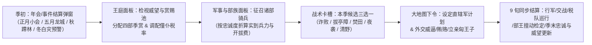

# S03 匈奴部族联盟、三次年会与僮仆税收系统规范（v1.0）

> **所属系统**：`S03_xiongnu_confederation.md`
> **所有者职责**：单于威望（`chanyu_prestige`）、赏赐池（`reward_pool` / 匈奴金钱收支总表）、四大部领（左贤王/右贤王/日逐王/犁汙王）与忠诚度、三次年会（正月诸长小会/五月龙城大会/秋季蹛林大会）、单于健康与继承危机（含阏氏干政）、部领擅自行动与浑邪/日逐王降汉事件链、僮仆都尉巡行征税与四档税率、白灾大雪瓦解链、匈奴季度战术卡、匈奴方行动与外交命令全集。
> **上位依据**：[00_bible.md](00_bible.md)（严格遵循 L1–L12 锁定决策与第 4 章十三节模板）。

---

## 1. 目的与支柱

### 1.1 服务体验支柱

本系统是匈奴方的核心内政—军事耦合引擎，直接支撑《设计圣经》四大体验支柱中的三根：

1. **支柱 3「帝国对联盟」（核心支柱）**：
   - 汉方玩家扮演“受朝廷信任与万里粮道束缚的持节孤臣”，而匈奴玩家扮演**“骑在猛虎背上的草原大单于”**。单于不是绝对君主，而是松散部族联盟的共主：单于本部仅直辖约 44% 的草原丁口（单于庭、赵信城、范夫人城合计 28.5 万口），其余 56% 的控弦之士掌握在**左贤王、右贤王、日逐王、犁汙王**四大部领手中（合计 36.5 万口）。
   - 换边即换游戏：汉方算的是“置邮时差、诏令合规、民夫吃粮”，匈奴算的是**“威望镇压、分赃不均、诸王抗命、大雪死畜”**。
2. **支柱 1「万里粮道」（镜像反制与牧场承载）**：
   - 匈奴骑兵出征依赖随军马群（1 骑 2 马，马乳自给），无须汉式民夫运粮；但草原并非无限提款机——冬季**白灾（大雪）**与草场超载（`horses / pasture_cap`）会成批冻毙战马与部众，冬季强行留军塞外更会触发灾难性的雪行军折损；西域赋税亦非瞬间到账的数字，而是由**僮仆都尉**率护卫骑兵沿天山北麓—焉耆—车师巡行押运的实体税队，可被汉军半途伏击截获。
3. **支柱 4「人与史」（有名有姓的草原政治史）**：
   - 从前 119 年漠北惨败后伊稚斜单于靠严刑重振王庭，到乌维、儿单于（乌师庐“年少好杀”）、呴犁湖、且鞮侯的频繁更迭，再到前 60 年日逐王先贤掸因夺位宿怨率众降汉、郑吉“并护北道”罢僮仆都尉——全部通过具名首领性格、立储承诺积怨与事件链自然涌现。

### 1.2 解决的旧版核心痛点（审计对齐）

在旧版代码（`core/economy.gd`、`core/diplomacy.gd`、`ai/xiongnu_ai.gd`）中，匈奴一侧存在三大结构性缺陷：
- **匈奴的“钱”完全没有用途**：旧版匈奴虽有属国月税与攻城劫掠收入，但所有花钱命令均为汉方专属，导致匈奴攒下数万金钱却无处可花，“调整税率”沦为只涨怨恨的伪决策。
- **草原铁板一块，无内部张力**：所有匈奴节点与骑兵由单于 100% 免费无条件直控，无部族分权，违背圣经 L1“匈奴的最大敌人是帐下诸王”。
- **AI 行为高度背板**：每年固定 4 月集结伊吾、8 月打河西，无年会节奏、无白灾扰动、无部王擅自出击，重玩轨迹高度收敛。

### 1.3 机制准入校验（圣经 L7：让哪个已有回合决策更难做）

| 新增/重构机制 | 让哪个已有回合决策更难做 | 核心两难张力（Trade-off） |
|---|---|---|
| **单于威望–赏赐池–四部忠诚闭环** | **征兵与分赃决策**：何时征调哪一部的骑兵？劫掠与税收所得分给谁？ | 赏赐池（金钱）既是冬季/正月安抚诸王的唯一筹码，又是秋季征召部族骑兵的开拔费与外交贿金。厚赏右贤王虽能换取西征主力，却会触发左贤王与日逐王的“攀比嫉妒”掉忠；若克扣分赏攒钱打仗，低忠部领不仅征发打折，还会在边塞擅自劫掠或私通汉使。 |
| **三次年会（正月/五月龙城/秋蹛林）** | **年度战略排期与兵力部署**：春季是否回师祭祖？秋季主攻河西还是西域？ | 五月龙城大会要求诸王亲至祭天先祖，若汉军趁五月突袭龙城或部领缺席，单于必须在“耗钱怀柔”与“强行问罪（冒反叛风险立威）”间抉择；秋季蹛林大会定下主攻方向后，若与部王偏好靶标冲突（如单于令攻车师，而犁汙王贪图酒泉），低忠部王可能抗命独走。 |
| **僮仆都尉实体税队与四档税率** | **西域属国剥削力度与护卫兵力分配**：税率设几档？派多少骑兵护税？ | 提高税率（2–3 档）能迅速充实赏赐池喂饱草原诸王，但会剧增西域城邦怨恨（推向汉方怀抱），且高额税银押运在途时一旦被汉军轻骑截获，不仅人财两空，还会重创日逐王忠诚度。 |
| **白灾瓦解链与宰马充粮** | **秋冬撤军时机与牧场蓄马上限**：深秋是否继续围城？入冬前是否宰马？ | 蓄养满额战马（逼近 `pasture_cap`）能支撑春季大规模动员，但高超载率一旦撞上冬季白灾就会引发“人畜什死六七→羁属瓦解”；入冬前主动宰马充粮可压低超载率并储备军粮，却直接削减来年春天的可用战马池。 |
| **单于健康、亲征与继承危机** | **名将/单于统兵决策与正月立储**：单于是否亲征？立亲子还是立长弟？ | 单于亲征享有高额战力加成与征召顺从度，但战败或冬季苦战会累加伤病风险；一旦单于暴毙，若生前强立年幼亲子（或阏氏秘不发丧矫诏立少），落选的强藩叔伯（如左贤王、日逐王）将暴涨宿怨，甚至重演“日逐王先贤掸降汉”的崩盘危机。 |
| **匈奴季度战术卡（五选一）** | **每季战役战术配合与路线选择**：本季用哪张战术卡配合主力计划？ | 每季从当前解锁池中三选一激活（如「诈败诱敌」「拔亭障」「焚田」「夜袭急击」「远遁清野」），强力卡牌带 2 季冷却与赏赐池/威望消耗，迫使玩家围绕卡牌窗口期规划攻势或诱敌深入。 |

---

## 2. 玩家视角

### 2.1 季度核心循环与界面触点

在默认**季制（WEGO，每季 = 3 个月 = 9 旬）**下，匈奴玩家每回合（季初下令阶段）按以下顺序感知局势并做出 3–5 个关键决策：



- **每季对应史实节律**：
  - **第 1 季（春，1–3 月，季初为正月）**：召开**正月诸长小会**（单于庭）→ 结算冬季白灾死伤与赈济、册立储君、发放岁首大分赏；春驹初生，战马恢复，但马瘦不宜远征。
  - **第 2 季（夏，4–6 月，季中含五月）**：召开**五月龙城大会**（龙城）→ 祭祀天地先祖、检定诸王是否亲至朝见、处置缺席抗命者、水草丰美牧场扩殖。
  - **第 3 季（秋，7–9 月，季中含八月）**：召开**秋季蹛林大会**（单于庭/蹛林）→ “课校人畜”清点各部丁口战马、收缴诸部蹛林贡马折钱、钦定秋季南下/西征主攻靶标、大举征召诸部控弦骑兵（享有蹛林动员折扣）。
  - **第 4 季（冬，10–12 月）**：收获秋掠战利品、主力撤回本部过冬、调整牧场蓄马（宰马充粮防灾）、季末（12 月下旬）执行**冬季白灾检定**。

---

### 2.2 具体回合示例（带完整数字演算）

#### 示例一：前 119 年第 2 季（夏，4–6 月）——漠北惨败后的「五月龙城大会」与分赏两难

- **季初局势（读档状态）**：
  - 剧本②《漠北之后》第 2 回合。单于**伊稚斜**在位，刚刚经历卫青、霍去病漠北之战重创，当前**单于威望 `chanyu_prestige = 35`**（偏低，低于基准线 40），**赏赐池 `reward_pool = 1,120` 钱**。
  - 四大部领当前状态：
    1. **左贤王部（驻 `long_cheng` 龙城，丁口 100,000，马 120,000）**：首领**乌维**（性格 `steady` 稳健，储君候选），当前忠诚 `loyalty = 68`，本季期望赏赐 $E_{\text{zuoxian}} = 240$ 钱。
    2. **右贤王部（驻 `youxian_wang` 右贤王庭，丁口 200,000，马 240,000）**：首领**右贤王·须卜奢**（性格 `calculating` 功利，手握西翼重兵 10,000 骑），当前忠诚 `loyalty = 54`，本季期望赏赐 $E_{\text{youxian}} = 360$ 钱。
    3. **日逐王部（驻 `hu_jie` 呼揭，兼辖焉耆僮仆都尉，丁口 50,000，马 60,000）**：首领**日逐王·呼衍骨**（性格 `calculating` 功利），当前忠诚 `loyalty = 58`，本季期望赏赐 $E_{\text{rizhu}} = 160$ 钱。
    4. **犁汙王部（驻 `yi_wu` 伊吾，直面敦煌前线，丁口 15,000，马 18,000）**：首领**犁汙王·休屠余**（性格 `wavering` 摇摆，畏汉兵威），当前忠诚 `loyalty = 42`（已亮黄灯！），本季期望赏赐 $E_{\text{lihu}} = 120$ 钱。
    - 四部期望赏赐总和 $\sum E_i = 240 + 360 + 160 + 120 = 880$ 钱。
- **阶段 1：五月龙城大会筹备决策**：
  - 系统弹出「五月龙城大会」筹备界面。由于当前威望仅 `35`，根据出席率公式（见 `S03-R05`），犁汙王（忠 42，驻伊吾距龙城遥远且受敦煌汉军威慑）的预计出席率仅为 $49\%$！一旦缺席，单于威望将再跌 `-4`。
  - 玩家面临**大会姿态三选一**：
    - 选项 A【刑威督责】（免费）：缺席者自动触发问罪检定，但威望 35 时问罪成功率仅 $47.5\%$，失败将倒扣威望 `-8` 并令犁汙王直接滑入 `"rebellious"`（抗命）！
    - 选项 B【厚币怀柔】（消耗赏赐池 `300` 钱）：全员出席率 `+25%`，出席者忠诚额外 `+3`。
    - 选项 C【循例常仪】（消耗赏赐池 `100` 钱）：祭天常礼，威望 `+3`，出席率无修正。
  - **玩家抉择**：为稳住刚败退的王庭并防止犁汙王缺席引发连锁崩盘，玩家忍痛选择 **选项 B【厚币怀柔】**（花费 `300` 钱，赏赐池余 `820` 钱），并加选 **【太牢盛祭】**（再花 `120` 钱，威望立即 `+5` 升至 `40`，赏赐池余 `700` 钱）。
  - **出席检定结果**：在怀柔 `+25%` 与威望回升至 `40` 加成下，左贤王（98%）、右贤王（86%）、日逐王（89%）、犁汙王（76%）四王全部亲至龙城会盟！全员到齐触发「四方来朝」奖励：单于威望额外 `+4`（升至 `44`），四部忠诚各 `+3`（分别变为 `71 / 57 / 61 / 45`），且四部真实忠诚度全部刷新为**精确可见**（消除 `±10` 迷雾区间）。
- **阶段 2：分赏池紧缺下的不对称分赃**：
  - 此时赏赐池仅剩 `700` 钱，而四部本季期望总额为 `880` 钱，还需预留 `100` 钱派使臣赴车师前国执行【巡行威逼】（`intimidate_city`）。可用于分赏的预算只有 `600` 钱（缺口 `280` 钱）！
  - 玩家在王庭面板拖动滑块分配 `600` 钱：
    - 给**犁汙王**足额再加码：`150` 钱（满足度 $r_{\text{lihu}} = 150 / 120 = 1.25$），因为伊吾是秋季进逼敦煌/楼兰的跳板，且其忠诚 `45` 最危险；
    - 给**右贤王**基本保底：`300` 钱（满足度 $r_{\text{youxian}} = 300 / 360 = 0.83$），稳住其 10,000 骑主力备战秋冬季；
    - 给**日逐王**略微克扣：`100` 钱（满足度 $r_{\text{rizhu}} = 100 / 160 = 0.625$），指望本季焉耆僮仆都尉巡行收税回来后分给他 20% 提成（预计约 `+90` 钱）来补齐；
    - 给**左贤王**大幅削减：`50` 钱（满足度 $r_{\text{zuoxian}} = 50 / 240 = 0.21$），仗着乌维忠诚高达 `71` 且性格稳健（`steady` 嫉妒系数低），先苦一苦太子！
- **阶段 3：季末结算反馈**：
  - 6 月下旬，僮仆都尉率 1,500 骑从车师前、焉耆、危须、尉犁收税返回焉耆大营，本季共征得西域税银 `460` 钱：其中日逐王截留 20%（`92` 钱，折合满足度回升至 $(100+92)/160 = 1.20$），其余 80%（`368` 钱）解送入单于赏赐池。
  - 季末四部忠诚结算（含分赏满足度、攀比嫉妒、威望 `44` 加成）：
    - **左贤王**：因分赏仅 21%，虽稳健少怨，忠诚仍下跌 `-6`（`71 → 65`）；
    - **右贤王**：分赏 83% 略亏，忠诚微跌 `-1`（`57 → 56`）；
    - **日逐王**：加上僮仆提成后超额满足，忠诚 `+3`（`61 → 64`）；
    - **犁汙王**：获超额分赏 `1.25x`，忠诚 `+4`（`45 → 49`，脱离濒危线）。
  - 赏赐池季末结余：`0（花光） + 368（西域税） + 180（本部牧产折钱） = 548` 钱，为第 3 季蹛林大动员做好了铺垫。

---

#### 示例二：前 118 年第 3 季（秋，7–9 月）——「秋季蹛林大会」征召骑兵与战术卡突袭河西

- **季初局势**：
  - 进入第 7 回合（前 118 年秋）。单于威望 `chanyu_prestige = 52`，赏赐池 `reward_pool = 1,240` 钱。
  - 四部忠诚：左贤王 `64`、右贤王 `62`、日逐王 `66`、犁汙王 `48`。
  - 情报显示：汉军主力（8,000 人）正由酒泉向敦煌推进，酒泉—张掖段粮道空虚，仅有一座新建烽燧。
- **阶段 1：秋季蹛林大会（课校人畜与主攻靶标钦定）**：
  - 季初触发「秋季蹛林大会」。四部全部出席，执行**【课校人畜】**：
    - 清点各部实有马群并征收“蹛林贡马税”：按出席四部总丁口 $365,000 \times 0.0012 = 438$ 钱入库，赏赐池升至 `1,678` 钱！
  - 玩家在蹛林大会钦定**本季会盟主攻方向**：选择 **【南掠河西·酒泉郡】（`target = jiu_quan`）**。
    - 检视各部靶标偏好：犁汙王偏好 `jiu_quan / zhang_ye`（完全契合，服从度 `+20%`）；右贤王偏好 `dun_huang / lou_lan`（相邻区域，无冲突）；日逐王偏好西域诸国（但因忠诚 `66 ≥ 60`，自动服从王庭号令）。
- **阶段 2：按忠诚曲线征召诸部控弦骑兵（`summon_tribe_army`）**：
  - 单于本部现有直辖骑兵 `8,000` 骑（驻单于庭—赵信城一线），玩家决定再从**右贤王部**与**犁汙王部**征调骑兵合击酒泉：
    1. **向犁汙王部（驻伊吾，忠 `48`）下达征召令**：
       - 犁汙王理论最大可征发额 $M_{\text{lihu}} = 3,000$ 骑。
       - 因忠诚 `48` 处于 $[40, 60)$ 区间，按应征率公式（`S03-R03`），实际肯借出的兵力比例为 $f(48) = 0.50 + 0.30 \times \frac{48-40}{20} = 62\%$，即最多出兵 **$1,860$ 骑**（取整 `1,800` 骑）。
       - 开拔费计算：基准每千骑 `80` 钱，忠诚 `48` 的溢价乘数为 $1.32\times$，但蹛林大会期间且靶标契合犁汙王偏好，享受 `0.75x` 蹛林动员折扣！故征召 `1,800` 骑实付：$1.8 \times 80 \times 1.32 \times 0.75 \approx 143$ 钱。
    2. **向右贤王部（驻右贤王庭，忠 `62`）下达征召令**：
       - 忠 `62 ≥ 60`，应征率达 $82\%$，玩家申请调用其驻地现役的 **`6,000` 骑**归入单于直辖指挥 2 个季度。
       - 开拔费：忠 `62` 乘数 $1.08\times$，叠蹛林折扣 `0.85x`，实付：$6.0 \times 80 \times 1.08 \times 0.85 \approx 441$ 钱。
    - 两笔征召合计花费 `584` 钱，赏赐池余 `1,094` 钱；单于瞬间获得 `6,000 + 1,800 = 7,800` 骑生力军前线控制权！
- **阶段 3：激活季度战术卡与下达作战计划**：
  - 玩家打开战术卡槽，本季随机刷出 3 张可用战术卡：【拔亭障】、【焚田】、【诈败诱敌】。
  - 玩家选择激活 **【焚田（焦土秋掠）】**（消耗赏赐池 `100` 钱，冷却 2 季）：本季所有匈奴部队执行 `burn`（焚毁农田）时，汉方农田开发度 `farm_dev` 损失翻倍（`-0.20 → -0.40`），且抢掠粮草与折算赏赐池金额提升 `+50%`！
  - 玩家向右贤王 `6,000` 骑与犁汙王 `1,800` 骑下达行军计划：经居延/伊吾南下突袭酒泉外围农田，执行 `burn` 后赶在 10 月初寒冬降临前撤回范夫人城与伊吾分赃。
- **阶段 4：结算战果与战利品分红**：
  - 9 月中旬，7,800 匈奴铁骑踏破酒泉屯田区，触发【焚田】强化效果：酒泉 `farm_dev` 重挫 `-0.40`，劫掠折合战利品高达 **`900` 钱**！
  - 按战利品分红规则（`S03-R04`）：参战部族自动分得战利品的 **40%（`360` 钱）** 按兵力比例直充右贤王（`+277` 钱等效赏赐）与犁汙王（`+83` 钱等效赏赐），使两部本季忠诚不降反升（右贤王 `+4`、犁汙王 `+5`）；其余 **60%（`540` 钱）** 归入单于赏赐池，单于威望亦因秋掠大捷暴涨 **`+6`**（升至 `58`）！

---

## 3. 状态变量

本系统拥有的全部状态变量挂载于 `GameState.tribes`（字典对象）及扩展的 `GameState.armies` / `GameState.relations` 字段中。所有静态配置与初值存放于新建数据文件 `data/tribes.json`（剧本特定覆盖项存于 `data/scenarios/*.json` 的 `tribes_init` 块）。

### 3.1 王庭全局状态变量表（`state.tribes`）

| 名称 | 所属对象 | 类型 | 取值范围 | 初值（剧本②漠北之后） | JSON 配置键（`data/tribes.json`） | 存档字段（`save.tribes.*`） |
|---|---|---|---|---|---|---|
| 单于威望 | `state.tribes` | `int` | `0..100` | `35`（剧本①`55` / 剧本③`48`） | `chanyu.prestige_initial` | `chanyu_prestige` |
| 赏赐池（即匈奴金钱） | `state.tribes` & `factions["xiongnu"]` | `int` | `0..999999` | `1000`（与 `factions.xiongnu.money` 强同步引用） | `economy.reward_pool_initial` | `reward_pool` |
| 在位单于人物 ID | `state.tribes` | `String` | 合法人物 ID | `"xn_yizhixie"`（伊稚斜） | `chanyu.initial_id` | `chanyu_id` |
| 单于年龄 | `state.tribes` | `int` | `1..90` | `50` | `chanyu.initial_age` | `chanyu_age` |
| 单于累计伤病值 | `state.tribes` | `int` | `0..100` | `10` | `chanyu.initial_wounds` | `chanyu_wounds` |
| 单于是否亲征中 | `state.tribes` | `bool` | `true/false` | `false` | —（运行时） | `chanyu_in_field` |
| 亲征所在军队 ID | `state.tribes` | `int` | `-1` 或合法 `army.id` | `-1` | —（运行时） | `chanyu_army_id` |
| 册立储君人物 ID | `state.tribes` | `String` | `""` 或合法人物 ID | `"xn_wuwei"`（乌维） | `chanyu.initial_heir_id` | `designated_heir_id` |
| 承诺继位者 ID（叔死弟袭） | `state.tribes` | `String` | `""` 或合法人物 ID | `""`（剧本③为 `"xn_xianxianshan"`） | `chanyu.promised_successor_id` | `promised_successor_id` |
| 继承危机持续季数 | `state.tribes` | `int` | `0..8` | `0` | —（运行时） | `succession_crisis_turns` |
| 上季分赏比例快照 | `state.tribes` | `Dictionary` | `{tribe_id: int}` | `{"zuoxian":240,"youxian":360,"rizhu":160,"lihu":120}` | `economy.default_distribution` | `last_reward_alloc` |
| 本季年会主攻靶标 | `state.tribes` | `String` | `""` 或节点 ID | `""` | —（运行时） | `autumn_target_node` |
| 龙城本年是否被焚/陷 | `state.tribes` | `bool` | `true/false` | `false` | —（运行时） | `longcheng_desecrated` |
| 僮仆都尉是否在位运作 | `state.tribes` | `bool` | `true/false` | `true`（日逐王降汉或阵亡未补时为 `false`） | `tongpu.initial_active` | `tongpu_active` |
| 僮仆都尉人物 ID | `state.tribes` | `String` | `""` 或人物 ID | `"xn_tongpu_duwei"` | `tongpu.initial_char_id` | `tongpu_char_id` |
| 僮仆都尉护卫军 ID | `state.tribes` | `int` | `-1` 或 `army.id` | `104`（驻 `yan_qi` 的 1500 骑） | `tongpu.escort_army_id` | `tongpu_army_id` |
| 僮仆都尉在途税银 | `state.tribes` | `int` | `0..50000` | `0` | —（运行时） | `tongpu_cargo_money` |
| 僮仆都尉巡行路线列表 | `state.tribes` | `Array[String]` | 西域属国节点 ID 数组 | `["yan_qi","wei_li","wu_lei","lun_tai","cheshi_qian"]` | `tongpu.default_patrol_nodes` | `tongpu_patrol_route` |
| 僮仆都尉复置冷却季数 | `state.tribes` | `int` | `0..12` | `0` | —（运行时） | `tongpu_cooldown_turns` |
| 白灾羁属瓦解剩余季数 | `state.tribes` | `int` | `0..8` | `0`（触发重度白灾后置 `8`） | —（运行时） | `white_collapse_turns` |
| 上次白灾严重度 | `state.tribes` | `String` | `"none"/"mild"/"severe"` | `"none"` | —（运行时） | `last_disaster_severity` |
| 连续诸部离散季数（供 S01） | `state.tribes` | `int` | `0..4` | `0`（达 `2` 时触发 `XN_SCATTER` 战败） | —（运行时） | `scatter_consecutive_turns` |
| 当前激活战术卡 ID | `state.tribes` | `String` | `""` 或战术卡 ID | `""` | —（运行时） | `active_tactic_card` |
| 本季候选战术卡池 | `state.tribes` | `Array[String]` | 长度为 3 的卡牌 ID 数组 | `["tactic_feigned_retreat","tactic_burn_fields","tactic_raze_beacons"]` | `tactics.initial_hand` | `candidate_tactic_cards` |
| 战术卡冷却字典 | `state.tribes` | `Dictionary` | `{card_id: int(0..4)}` | 全部为 `0` | `tactics.cooldowns_init` | `tactic_cooldowns` |

### 3.2 部领对象状态变量表（`state.tribes.units[tribe_id]`，共 4 部）

四大部领固定键名为：`"zuoxian"`（左贤王部）、`"youxian"`（右贤王部）、`"rizhu"`（日逐王部）、`"lihu"`（犁汙王部）。

| 名称 | 所属对象 | 类型 | 取值范围 | 初值（以右贤王 `"youxian"` 为例） | JSON 配置键（`data/tribes.json`） | 存档字段（`save.tribes.units[id].*`） |
|---|---|---|---|---|---|---|
| 部族唯一 ID | `tribe` | `String` | `"zuoxian"/"youxian"/"rizhu"/"lihu"` | `"youxian"` | `tribes[id].id` | `id` |
| 部族显示名称 | `tribe` | `String` | 本地化键 | `"右贤王部"` | `tribes[id].name_key` | `name` |
| 驻地核心节点 ID | `tribe` | `String` | 草原节点 ID | `"youxian_wang"` | `tribes[id].seat_node` | `seat_node` |
| 现任部王人物 ID | `tribe` | `String` | 人物 ID | `"xn_youxian_xubu"` | `tribes[id].leader_id` | `leader_id` |
| 部王性格标签 | `tribe` | `String` | `"steady"/"bold"/"calculating"/"wavering"` | `"calculating"` | `tribes[id].personality` | `personality` |
| 尊贵位阶系数 | `tribe` | `float` | `1.0..1.5` | `1.30`（左右贤王 1.3，日逐 1.2，犁汙 1.0） | `tribes[id].rank_mult` | `rank_mult` |
| 真实忠诚度 | `tribe` | `int` | `0..100` | `54`（左贤`68`/右贤`54`/日逐`58`/犁汙`42`） | `tribes[id].loyalty_initial` | `loyalty` |
| 玩家可见忠诚度是否精确 | `tribe` | `bool` | `true/false` | `true`（缺席最近一次年会置 `false`） | —（运行时） | `loyalty_exact` |
| 模糊忠诚度显示中值 | `tribe` | `int` | `10..90` | `54`（`loyalty_exact=false` 时显示 `[est-10, est+10]`） | —（运行时） | `loyalty_estimated` |
| 部领政治状态（与 S01 对齐） | `tribe` | `String` | `"normal"/"rebellious"/"defected_han"` | `"normal"` | `tribes[id].status_initial` | `status` |
| 降汉动摇窗口剩余旬数 | `tribe` | `int` | `0..9` | `0`（`>0` 表示正处于私通汉使接洽期） | —（运行时） | `wavering_turns_left` |
| 降汉接洽情报是否已泄露 | `tribe` | `bool` | `true/false` | `false`（为 `true` 时匈奴玩家收到告警） | —（运行时） | `wavering_detected` |
| 累计宿怨值（Grievance） | `tribe` | `int` | `0..100` | `0`（剧本③日逐王初值为 `45`） | `tribes[id].grievance_initial` | `grievance` |
| 连续缺席年会次数 | `tribe` | `int` | `0..10` | `0` | —（运行时） | `missed_assemblies` |
| 本季已收赏赐+分成总额 | `tribe` | `int` | `0..99999` | `0`（每季初清零，季末结算后归档） | —（运行时） | `season_reward_received` |
| 当前被单于征调中的骑兵数 | `tribe` | `int` | `0..30000` | `0` | —（运行时） | `levied_riders` |
| 已连续被征调季数 | `tribe` | `int` | `0..20` | `0`（`>2` 季每季触发久役怨言掉忠） | —（运行时） | `levied_seasons_count` |
| 本季是否已被单于严令弹压 | `tribe` | `bool` | `true/false` | `false`（防擅自出兵） | —（运行时） | `restrained_this_season` |
| 偏好劫掠靶标列表 | `tribe` | `Array[String]` | 节点 ID 数组 | `["dun_huang","lou_lan","cheshi_qian"]` | `tribes[id].preferred_targets` | `preferred_targets` |

### 3.3 挂载于现有对象（`Army` 与 `Relation`）的扩展字段

| 名称 | 所属对象 | 类型 | 取值范围 | 初值 | JSON 配置键 | 存档字段 |
|---|---|---|---|---|---|---|
| 军队所属部族 ID | `state.armies[i]` | `String` | `"chanyu"` 或 4 部 ID | 按驻地归属初始化 | `scenarios.*.armies[i].tribe_id` | `tribe_id` |
| 军队当前指挥权 | `state.armies[i]` | `String` | `"chanyu"` / `"tribe"` / `"tongpu"` | 本部军为 `"chanyu"`，部族军为 `"tribe"` | `scenarios.*.armies[i].command_owner` | `command_owner` |
| 征调剩余季数 | `state.armies[i]` | `int` | `-1`（永久）或 `1..4` | `-1` | —（运行时） | `summon_seasons_left` |
| 西域城邦距上次收税季数 | `state.relations[state_id]` | `int` | `0..2` | `1`（上限累加至 `2` 季拖欠） | `tribes.json → tongpu.initial_arrears` | `tax_seasons_uncollected` |
| 西域城邦匈奴税率档位 | `state.relations[state_id]` | `int` | `0..3`（免/轻/中/重） | 匈奴属国默认为 `2`（中税） | `scenario_mvp.json → relations.*.xn_tax` | `xn_tax`（沿用现有字段并重定义数值） |


---

## 4. 规则与公式

### 4.0 结算时序与流水线（Tick 0 / 季初 / 每旬 / 季末）

本系统的所有规则严格嵌入 `TurnResolver` 的时间步进循环中，先后顺序如下：

1. **每季开头（季初下令前，第 1/4/7/10 月上旬初）**：
   - **Step 1**：递减战术卡冷却（`tactic_cooldowns[k] = max(0, cd - 1)`）、白灾瓦解倒计时（`white_collapse_turns`）、继承危机倒计时（`succession_crisis_turns`）、僮仆都尉复置冷却（`tongpu_cooldown_turns`）；清零上一季 `active_tactic_card` 与各部 `restrained_this_season`；抽取本季 3 张候选战术卡（`S03-R10`）。
   - **Step 2**：触发当季专属**年会事件**（`S03-R05`）：
     - 春季（1 月初）：触发**正月诸长小会**（检定出席、结算冬季白灾赈济、开放立储）。
     - 夏季（4 月初）：触发**五月龙城大会筹备**（选择大会姿态与祭祀规格，5 月中旬结算出席率与问罪）。
     - 秋季（7 月初）：触发**秋季蹛林大会**（课校人畜收缴贡马税、钦定本季会盟主攻靶标 `autumn_target_node`）。
   - **Step 3**：向玩家/AI 开放季初命令阶段（分配季赏 `distribute_rewards`、征召部族骑兵 `summon_tribe_army`、激活战术卡 `select_tactic_card`、调整西域税率 `set_tax_rate`、下达直辖军计划等）。
2. **每旬结算（季中 1–9 旬，每 10 天一次）**：
   - **Step 1**：推进僮仆都尉护卫军沿 `tongpu_patrol_route` 行军与到站收税（`S03-R08`）；若与汉军同处一节点或路段，触发遭遇/伏击战。
   - **Step 2**：处于降汉动摇窗口（`wavering_turns_left > 0`）的部族递减窗口旬数，检定汉军是否抵达迎降节点或单于讨逆军是否抵达镇压（`S03-R07`）。
   - **Step 3**：季中第 2 旬（即每季第 1 个月中旬），对未被征调且未被弹压的低忠部族执行**擅自出兵（`rogue_raid`）**检定（`S03-R07`）。
3. **每季末尾（第 3/6/9/12 月下旬末）**：
   - **Step 1**：发放单于本部牧产基础折钱收入，结算在役征调骑兵的久役计数（`levied_seasons_count += 1`，冬季结束时超期未遣返者强制触发思归掉忠）。
   - **Step 2**：若为第 4 季末（12 月下旬），执行**冬季白灾大雪检定**（`S03-R09`）与**单于年度寿元/伤病生死检定**（`S03-R06`）。
   - **Step 3**：执行**四部季度忠诚度总更新**（`S03-R03`、`S03-R04`）与**单于威望自然回归**（`S03-R01`）。
   - **Step 4**：检定是否有部族新滑入 `"rebellious"` 或触发降汉动摇窗口（`S03-R07`）；重算匈奴全局威服值 $W$ 并执行 `XN_SCATTER`（诸部离散）战败检定（`S03-R11`）。

---

### S03-R01 单于威望（`chanyu_prestige`）规则与公式

单于威望 $P \in [0, 100]$ 衡量大单于对草原诸部的震慑力与天命合法性。

#### 1. 威望增减事件矩阵（即时或季末生效）

$$\begin{aligned}
P_{\text{new}} &= \operatorname{clamp}\!\Big(P_{\text{old}} + \Delta P_{\text{events}} + \Delta P_{\text{drift}},\; 0,\; 100\Big) \\
\Delta P_{\text{drift}} &= \operatorname{round}\!\big(k_{\text{p\_drift}} \cdot (P_{\text{eq}} - P_{\text{old}})\big)
\end{aligned}$$

- **自然回归参数**：均衡基线 $P_{\text{eq}} = 40$（JSON 键：`chanyu.prestige_equilibrium`，可调范围 `35..50`），每季回归速率 $k_{\text{p\_drift}} = 0.08$（JSON 键：`chanyu.prestige_drift_rate`，范围 `0.05..0.15`）。即威望高于 40 时若无新战功每季缓降 `1–4` 点，低于 40 时随时间缓慢止血回升 `1–3` 点。

| 触发事件类型 | 威望变化 $\Delta P$ 默认值 | 可调范围 | JSON 配置键（`data/tribes.json`） | 结算时机 |
|---|---|---|---|---|
| 野战大捷（歼灭汉军 $\ge 2,000$ 人） | `+8`（单于亲征额外 `+4`） | `+5..+15` | `chanyu.p_gain_major_victory` | 战斗结束即时 |
| 野战小胜（歼灭汉军 $500..1,999$ 人） | `+3` | `+2..+6` | `chanyu.p_gain_minor_victory` | 战斗结束即时 |
| 野战战败（折损 $\ge 2,000$ 骑或溃退） | `-8`（单于亲征额外 `-5`） | `-5..-15` | `chanyu.p_loss_major_defeat` | 战斗结束即时 |
| 攻陷汉河西郡城（武威/张掖/酒泉/敦煌/居延/陇西） | `+12` / 座 | `+8..+20` | `chanyu.p_gain_capture_hexi` | 攻城结算即时 |
| 焚掠汉屯田或拔除汉亭障/烽燧 | `+2` / 次（每季上限 `+6`） | `+1..+4` | `chanyu.p_gain_burn_or_raze` | 行动完成即时 |
| 破城迫使西域城邦臣服（`overlord = "xiongnu"`） | `+4` / 国 | `+2..+8` | `chanyu.p_gain_subjugate_state` | 外交变更即时 |
| 龙城或单于庭被汉军攻占/焚毁 | `-20`（并置 `longcheng_desecrated = true`） | `-15..-30` | `chanyu.p_loss_sacred_site_lost` | 节点失守即时 |
| 五月龙城大会四部全员出席（「四方来朝」） | `+4`（若选太牢盛祭额外 `+5`） | `+2..+6` | `chanyu.p_gain_longcheng_full` | 5月中旬大会结算 |
| 年会每有一部缺席 | 正月/蹛林 `-2`；龙城大会 `-4` | `-1..-6` | `chanyu.p_loss_assembly_absent` | 年会结算即时 |
| 龙城大会强行问罪缺席部王：成功 / 失败 | 成功 `+6`；失败 `-8` | `+4..+10` / `-5..-12` | `chanyu.p_punish_success` / `_fail` | 5月中旬大会结算 |
| 部领擅自出兵（`rogue_raid`）抗命发生 | `-3` / 次 | `-2..-6` | `chanyu.p_loss_rogue_raid` | 擅动发生即时 |
| 部领正式叛投汉朝（`status = "defected_han"`） | 日逐/左右贤王 `-15`；犁汙王 `-10` | `-8..-20` | `chanyu.p_loss_tribe_defect` | 降汉完成即时 |
| 冬季白灾爆发（轻灾 / 重灾瓦解） | 轻灾 `-4`；重灾 `-12` | `-3..-15` | `chanyu.p_loss_white_disaster` | 12月下旬白灾结算 |
| 单于更迭（新单于继位重算基准） | 正常继位 $P_{\text{new}} = \operatorname{round}(0.65 P_{\text{old}} + 12)$；危机夺位 $\operatorname{round}(0.45 P_{\text{old}} + 8)$ | — | `chanyu.succession_prestige_keep` | 单于继位即时 |

#### 2. 单于威望的全局修正效应

1. **对四部每季忠诚的牵引**：$\Delta L_{\text{prestige}} = \operatorname{round}\!\big(k_{\text{p\_loyalty}} \cdot (P - 45)\big)$，其中 $k_{\text{p\_loyalty}} = 0.12$（JSON 键：`chanyu.prestige_to_loyalty_mult`，范围 `0.08..0.20`）。当 $P = 80$ 时每季自动为四部提供 `+4` 忠诚向心力；当 $P = 20$ 时每季倒扣 `-3` 忠诚。
2. **对年会出席率的加成**：每点高于 40 的威望提升出席率 $+0.6\%$（低于 40 则降低）。
3. **对西域城邦威吓度（`intimidation`）自然衰减的抑制（导出给 S04）**：
   - 当 $P \ge 70$ 时，西域诸国对匈奴的 `intimidation` 每季自然衰减率减半（`×0.5`）；
   - 当 $P < 30$ 时，西域诸国对匈奴的 `intimidation` 每季额外流失 `-3` 点。

---

### S03-R02 赏赐池收支循环与 10 大花钱口（匈奴钱的收支总表）

为彻底根治旧版“匈奴金钱无用途”的顽疾，匈奴阵营的金钱（`state.factions["xiongnu"]["money"]`）在规则与 UI 中统一定义为**「单于赏赐池」（`reward_pool`）**——涵盖汉缯絮、金器、西域铁器、谷帛与贡马折银。

#### 1. 赏赐池四大收入源（Inflows）

| 收入项 | 计算公式（每季或事件触发） | 剧本②初期典型值（每季） | JSON 配置键（`data/tribes.json`） | 结算时机 |
|---|---|---|---|---|
| **① 单于本部牧产与互市折银** | $I_{\text{base}} = \operatorname{round}\!\Big(\text{pop}_{\text{chanyu}} \times r_{\text{home}} \times (1 - 0.4 \cdot \mathbb{I}_{\text{collapse}})\Big)$，其中本部丁口 $\text{pop}_{\text{chanyu}} = 285,000$，系数 $r_{\text{home}} = 0.00063$ | 正常期 **`180` 钱/季**（白灾瓦解期降至 `108` 钱/季） | `economy.home_income_per_pop`（默认 `0.00063`，范围 `0.0004..0.0010`） | 每季末（3/6/9/12 月底） |
| **② 僮仆都尉西域巡行岁币** | 护卫队巡行到站收取 $T_s = \operatorname{round}(\text{pop}_s \times \text{rate}(\text{tier}_s) \times m_{\text{overlord}} \times \text{seasons\_owed})$；返回焉耆后日逐王截留 $20\%$，其余 **$80\%$ 归入赏赐池**（详见 `S03-R08`） | 中税（档位 2）下约 **`350–480` 钱/季**（若被汉军截获或罢都尉则为 `0`） | `tongpu.chanyu_share_ratio`（默认 `0.80`，范围 `0.70..0.90`） | 税队返回 `yan_qi` 或匈奴节点即时 |
| **③ 秋季蹛林大会贡马折钱** | 每年第 3 季初，出席蹛林大会的部族按丁口缴纳贡马：$I_{\text{dailin}} = \sum_{i \in \text{attended}} \operatorname{round}(\text{pop}_i \times r_{\text{dailin}})$，其中 $r_{\text{dailin}} = 0.0012$ | 四部全出席时 **`438` 钱/年**（折合每季均值约 `110` 钱） | `assemblies.dailin_tribute_per_pop`（默认 `0.0012`，范围 `0.0008..0.0020`） | 每年第 3 季初蹛林大会 |
| **④ 攻城破郭、焚田劫掠与截获汉粮队** | 劫掠/焚田/破城总额 $G_{\text{loot}} = \operatorname{round}(\text{pop}_{\text{target}} \times r_{\text{raid}} + \text{grain\_looted} \times 0.005)$；若由部族军参战，**单于得 $60\%$，参战部族分 $40\%$**；单于本部军独战则 $100\%$ 入池 | 视战果浮动：小掠 **`150–300` 钱**，破河西大城 **`800–1,500` 钱** | `economy.loot_chanyu_share`（默认 `0.60`，范围 `0.50..0.80`） | 劫掠/破城/截获发生即时 |

> **收支紧平衡设计锚点**：在剧本②和平常态下，匈奴每季稳定收入约为 $180\text{（本部）} + 380\text{（西域中税）} + 110\text{（蹛林年均）} = \mathbf{670}$ **钱/季**（约 `2,680` 钱/年）。而四部每季期望分赏总额为 **`880` 钱/季**（`3,520` 钱/年）！这意味着：**如果不靠南下秋掠抢钱、或把西域税率拉到重税（档位 3，冒城邦叛乱风险），单于每季必然面临约 `210` 钱的财政赤字**，必须在“克扣某部忍受掉忠”与“出兵以战养战”之间抉择！

#### 2. 赏赐池十大花钱口（Outflows）

| 序号 | 支出项（命令/事件） | 消耗金额公式与默认值 | 核心战略回报 | JSON 配置键（`data/tribes.json`） |
|---|---|---|---|---|
| **1** | **四部季度分赏**（`distribute_rewards`） | 玩家自由分配 $\sum A_i$（全额满足四部期望需 **`880` 钱/季**） | 维持/提升四部忠诚度，防擅自出兵与叛投汉朝 | `economy.expected_reward_base` |
| **2** | **征召诸部控弦骑兵**（`summon_tribe_army`） | 每千骑基准 `80` 钱 $\times$ 忠诚溢价系数 $(0.75..1.60) \times$ 蹛林折扣 $(0.75..1.0)$ | 将部族驻军或新征弓骑划归单于直辖指挥 2 季 | `levy.cost_per_1000_riders`（默认 `80`） |
| **3** | **年会怀柔与祭祀仪轨**（`assembly_decision`） | 龙城【厚币怀柔】`300` 钱；【循例常仪】`100` 钱；【太牢盛祭】`120` 钱 | 提升全员出席率 `+25%`、恢复单于威望 `+3..+5` | `assemblies.conciliate_cost` 等 |
| **4** | **压制部王蠢动 / 紧急安抚动摇**（`restrain_tribe` / `pacify_wavering_tribe`） | 弹压本季擅动：`150` 钱；紧急安抚降汉动摇部王：`400` 钱 | 强制锁死本季擅自出兵概率为 `0`；或打断降汉接洽并回升忠诚 `+18` | `tribes.restrain_cost` / `pacify_cost` |
| **5** | **改立/重设部王与复置僮仆都尉**（`replace_tribe_leader` / `reappoint_tongpu_duwei`） | 改立部王：`350` 钱；复置僮仆都尉：`300` 钱 | 撤换离心首领换上亲信（新首领初忠 `65`）；恢复西域征税能力 | `tongpu.reappoint_cost`（默认 `300`） |
| **6** | **白灾开仓赈济诸部**（`relieve_white_disaster`） | 轻灾赈济：`250` 钱；重灾全面赈济：`500` 钱 | 抵消白灾造成的四部忠诚暴跌（挽回 `+8..+15` 忠）并缩短瓦解期 2 季 | `disaster.relief_cost_mild` / `_severe` |
| **7** | **西域外交：贿赂亲匈贵族**（`bribe_nobles`） | 小国 `120` 钱 / 大城邦（龟兹/焉耆/疏勒/于阗）`220` 钱 | 目标城邦匈奴威吓度 `+12`、削减汉方影响力 `-8`、降低怨恨 `-10` | `diplomacy.bribe_cost_small` / `_large` |
| **8** | **西域外交：废立亲匈王子（政变）**（`install_prince`） | `450` 钱（需目标城邦邻近有匈奴军驻扎） | 强行颠覆亲汉城邦政权，将其外交层级重置为匈奴属国并驱逐汉使 | `diplomacy.install_prince_cost`（默认 `450`） |
| **9** | **西域外交：与乌孙/康居/大月氏联姻和亲**（`marry_great_power`） | `400` 钱 | 阻止大国倒向汉朝，获得大国赠马 `+8,000` 匹及威望 `+5` | `diplomacy.marry_great_power_cost`（默认 `400`） |
| **10** | **激活季度战术卡 & 筑固赵信/范夫人粮城**（`select_tactic_card` / `fortify_stock_city`） | 战术卡：`0..150` 钱；筑固塞外粮城：`300` 钱 | 触发当季特殊战术加成；或提升赵信城/范夫人城城防 `walls +1` 及存粮上限 | `tactics.cards.*.cost_money` |

---

### S03-R03 四大部领初值、忠诚度公式与征发曲线

#### 1. 单于本部与四大部领初值总表（剧本②《漠北之后》基准）

| 部族 ID | 名称 | 核心驻地节点 | 初始丁口 (`pop`) | 初始战马 (`horses`) | 牧场上限 (`pasture_cap`) | 开局常备骑兵 | 剧本②首领 (`leader_id`) | 性格 (`personality`) | 尊贵系数 $w_{\text{rank}}$ | 初始忠诚 (`loyalty`) | 初始期望季赏 $E_i$ | 偏好劫掠靶标 (`preferred_targets`) |
|---|---|---|---|---|---|---|---|---|---|---|---|---|
| `"chanyu"` | **单于本部**（直辖） | `chanyu_ting` / `zhaoxin_cheng` / `fanfuren_cheng` | `285,000` | `336,000` | `560,000` | `10,000` 骑（驻单于庭） | 伊稚斜 (`xn_yizhixie`) | —（玩家扮演） | — | —（恒直辖） | `0` | — |
| `"zuoxian"` | **左贤王部**（东翼储贰） | `long_cheng`（龙城） | `100,000` | `120,000` | `200,000` | `6,000` 骑（驻龙城） | 乌维 (`xn_wuwei`) | `steady`（稳健） | `1.30` | **`68`** | **`240` 钱** | `["ju_yan", "wu_wei", "zhang_ye"]` |
| `"youxian"` | **右贤王部**（西翼强藩） | `youxian_wang`（右贤王部） | `200,000` | `240,000` | `400,000` | `10,000` 骑（驻右贤王部） | 须卜奢 (`xn_youxian_xubu`) | `calculating`（功利） | `1.30` | **`54`** | **`360` 钱** | `["dun_huang", "lou_lan", "cheshi_qian"]` |
| `"rizhu"` | **日逐王部**（西域监护） | `hu_jie`（呼揭，遥领焉耆僮仆） | `50,000` | `60,000` | `100,000` | `4,000` 骑（驻呼揭）+ 僮仆 `1,500` 骑（驻焉耆） | 呼衍骨 (`xn_rizhu_huyan`) | `calculating`（功利） | `1.20` | **`58`** | **`160` 钱** | `["cheshi_qian", "yan_qi", "lun_tai", "qiu_ci"]` |
| `"lihu"` | **犁汙王部**（南疆游锋） | `yi_wu`（伊吾） | `15,000` | `18,000` | `30,000` | `3,000` 骑（驻伊吾） | 休屠余 (`xn_lihu_xiutu`) | `wavering`（摇摆） | `1.00` | **`42`** | **`120` 钱** | `["dun_huang", "jiu_quan", "lou_lan"]` |

- **剧本①《楼兰姑师》（前 108 年）覆盖差异**：单于为**乌维**（威望 `55`），左贤王为**乌师庐**（性格 `bold` 桀骜，初忠 `62`），右贤王初忠 `60`，日逐王初忠 `64`，犁汙王初忠 `52`（驻伊吾，正威胁楼兰）。
- **剧本③《都护府》（前 68—前 60 年）覆盖差异**：单于为**虚闾权渠**（体弱多病 `chanyu_wounds = 45`，威望 `48`），日逐王为**先贤掸**（`xn_xianxianshan`，性格 `wavering`，因单于夺位未践约立其为储，初始宿怨 **`grievance = 45`**，初始忠诚仅 **`38`**，开局即处于高度降汉风险！）。

#### 2. 部王性格参数映射表（`data/tribes.json → personalities`）

| 性格枚举 | 中文名 | 贪婪乘数 $g_p$ | 攀比嫉妒系数 $\eta_p$ | 基线忠诚锚点 $L_{\text{base}}$ | 擅自出兵倾向 $b_{\text{rogue}}$ | 降汉倾向乘数 $m_{\text{defect}}$ | 年会出席修正 $a_p$ |
|---|---|---|---|---|---|---|---|
| `"steady"` | 稳健守礼 | `0.95` | `3.0` | `65` | `-0.08` | `0.60` | `+0.10` |
| `"bold"` | 桀骜好战 | `1.10` | `5.0` | `50` | `+0.15` | `0.75` | `-0.08` |
| `"calculating"` | 功利算计 | `1.15` | `7.0` | `52` | `+0.05` | `1.00` | `0.00` |
| `"wavering"` | 摇摆畏威 | `1.05` | `5.0` | `45` | `0.00` | `1.45` | `-0.05` |

#### 3. 季度忠诚度更新总公式

每季末（Step 3），对每个未降汉（`status != "defected_han"`）的部领 $i$，计算忠诚度变化 $\Delta L_i$：

$$\Delta L_i = \operatorname{clamp}\!\Big(\operatorname{round}\!\big(\Delta L_{i,\text{reward}} + \Delta L_{i,\text{envy}} + \Delta L_{\text{prestige}} + \Delta L_{i,\text{drift}} + \Delta L_{i,\text{war}} + \Delta L_{i,\text{han}}\big),\; -20,\; +15\Big)$$

$$L_{i,\text{new}} = \operatorname{clamp}\!\big(L_{i,\text{old}} + \Delta L_i,\; 0,\; 100\big)$$

各项精确定义如下：
1. **分赏满足度项 $\Delta L_{i,\text{reward}}$**（核心损失厌恶函数，见 `S03-R04`）：
   - 设本季部领 $i$ 实际获得的赏赐与战利品/税款分成之和为 $R_i$，期望赏赐为 $E_i$，满足比 $r_i = R_i / \max(1, E_i)$：
   $$\Delta L_{i,\text{reward}} = \begin{cases}
   -12 + 12 \cdot r_i, & 0 \le r_i < 1.0 \quad\text{（欠发线性重罚，0 分赏直扣 }-12\text{）} \\
   8 \cdot \ln(r_i), & 1.0 \le r_i \le 2.5 \quad\text{（超发对数边际递减，}1.25\times\text{ 得 }+1.8\text{，}2.0\times\text{ 得 }+5.5\text{）} \\
   8 \cdot \ln(2.5) \approx +7.3, & r_i > 2.5 \quad\text{（单季砸钱上限封顶）}
   \end{cases}$$
2. **同侪攀比嫉妒项 $\Delta L_{i,\text{envy}}$**（防单点喂饱支配策略）：
   - 设四部平均满足比为 $\bar{r} = \frac{1}{N_{\text{active}}} \sum_{j} r_j$。若某部领 $i$ 的满足比显著低于同侪均值（$\bar{r} - r_i > 0.15$）：
   $$\Delta L_{i,\text{envy}} = -\eta_{p(i)} \cdot \min\!\big(0.8,\; \max(0,\; \bar{r} - r_i - 0.15)\big)$$
   - 例：若单于把钱全砸给右贤王（$r_{\text{youxian}} = 1.8$），而克扣日逐王（$r_{\text{rizhu}} = 0.3$），四部均值 $\bar{r} = 1.0$，则日逐王（`calculating`，$\eta = 7.0$）除承受欠发罚分 $-8.4$ 外，还将额外承受攀比嫉妒罚分 $-7.0 \times (0.70 - 0.15) = -3.85$！
3. **单于威望牵引项 $\Delta L_{\text{prestige}}$**：
   $$\Delta L_{\text{prestige}} = 0.12 \cdot (P - 45)$$
4. **性格基线回归与宿怨侵蚀项 $\Delta L_{i,\text{drift}}$**：
   $$\Delta L_{i,\text{drift}} = 0.06 \cdot (L_{\text{base},i} - L_{i,\text{old}}) - 0.05 \cdot \text{grievance}_i$$
   - 若部领持有宿怨（如立储跳票、被强行问罪、战利品被吞），每 `20` 点 `grievance` 每季持续侵蚀 `-1` 忠诚。
5. **战损与久役怨言项 $\Delta L_{i,\text{war}}$**：
   - 部族骑兵在**单于直辖指挥下（`command_owner == "chanyu"`）**阵亡或饿死/冻死：每折损 `500` 骑，该部本季 $\Delta L_{i,\text{war}} \mathrel{-}= 2$（单于拿部下的命当炮灰会激起强烈反弹！）；
   - 久役不归惩罚：若 `levied_seasons_count > 2`，从第 3 季起每季额外扣 `-3` 忠；若冬季（第 4 季末）部族骑兵仍滞留塞外未归还本部节点，额外再扣 `-4` 忠。
6. **汉方兵威与策反压力项 $\Delta L_{i,\text{han}}$**：
   - 若距离该部驻地 `seat_node` $\le 45$ 行军日内存在 $\ge 5,000$ 人的汉军主力，或汉方本季对该部执行了策反密使，该部承受 `-2` 至 `-5` 的畏汉动摇罚分（`wavering` 性格翻倍）。

#### 4. 忠诚度对征发（`summon_tribe_army`）的折算与溢价曲线

当单于向部领 $i$ 下达征召令时，部领的最大理论可调兵上限为 $M_i = \operatorname{round}(\text{pop}_i \times 0.06)$（即左贤王 `6,000`、右贤王 `12,000`、日逐王 `3,000`、犁汙王 `900` 新募 + 现役 `3,000`）。实际肯借给单于的**应征比例 $f_{\text{levy}}(L_i)$** 与**每千骑开拔费乘数 $c_{\text{levy}}(L_i)$** 为分段线性函数：

| 忠诚度区间 $L_i$ | 政治态度分级 | 应征出兵比例上限 $f_{\text{levy}}(L_i)$ | 每千骑开拔费乘数 $c_{\text{levy}}(L_i)$（基准 `80` 钱/千骑） | 附加行为特征 |
|---|---|---|---|---|
| **$80 \le L_i \le 100$** | **死心塌地** | $100\%$ | $0.75\times$（`60` 钱/千骑） | 绝不擅自出兵；年会 100% 出席；可免费借道与护粮 |
| **$60 \le L_i < 80$** | **恭顺听命** | $80\% + 20\% \cdot \frac{L_i - 60}{20}$ | $1.10 - 0.35 \cdot \frac{L_i - 60}{20}$（`60..88` 钱/千骑） | 遵从蹛林主攻靶标；极低概率擅动 |
| **$40 \le L_i < 60$** | **阳奉阴违** | $50\% + 30\% \cdot \frac{L_i - 40}{20}$ | $1.50 - 0.40 \cdot \frac{L_i - 40}{20}$（`88..120` 钱/千骑） | 年会可能托病缺席；若靶标不合偏好易擅自劫掠 |
| **$25 \le L_i < 40$** | **离心抗命（`"rebellious"`）** | $0\%$（**拒绝一切征调！**） | —（不可征调） | 自动置 `status = "rebellious"`；高频擅自出兵；停止上缴蹛林贡马 |
| **$0 \le L_i < 25$** | **濒临叛降** | $0\%$（拒绝征调） | —（不可征调） | 一旦满足汉方接触条件，每季高概率触发**降汉动摇窗口**（`S03-R07`） |

---

### S03-R04 每季分赏决策、期望赏赐 $E_i$ 与战利品分成

#### 1. 部领期望季赏公式 $E_i$

每季初，各部领根据自身丁口规模、尊贵位阶、首领贪婪度及草原是否处于白灾瓦解期，计算出本季心理期望赏赐额 $E_i$：

$$E_i = \operatorname{round}\!\Big(\big(E_{\text{floor}} + \text{pop}_i \times r_{\text{expect}}\big) \times w_{\text{rank},i} \times g_{p(i)} \times m_{\text{crisis}}\Big)$$

- **参数默认值与范围（`data/tribes.json`）**：
  - 保底门槛 $E_{\text{floor}} = 95$ 钱（键：`economy.expect_floor`，范围 `60..120`，确保小部族犁汙王也有基本胃口）；
  - 丁口期望系数 $r_{\text{expect}} = 0.00075$ 钱/口（键：`economy.expect_per_pop`，范围 `0.0005..0.0012`）；
  - 危机乘数 $m_{\text{crisis}}$：常态为 `1.0`；若处于白灾瓦解期（`white_collapse_turns > 0`）或继承危机期（`succession_crisis_turns > 0`），诸王趁火打劫索求更多物资，$m_{\text{crisis}} = 1.25$（键：`economy.crisis_expect_mult`）。
- **剧本②开局常态校准值**（经取整至 10 的倍数）：
  - 左贤王部（10 万口，$w=1.30, g=0.95$）：$(95 + 75) \times 1.30 \times 0.95 = 210 \rightarrow$ 剧本校准值 **`240` 钱/季**；
  - 右贤王部（20 万口，$w=1.30, g=1.15$）：$(95 + 150) \times 1.30 \times 1.15 = 366 \rightarrow$ 剧本校准值 **`360` 钱/季**；
  - 日逐王部（5 万口，$w=1.20, g=1.15$）：$(95 + 37.5) \times 1.20 \times 1.15 = 183 \rightarrow$ 剧本校准值 **`160` 钱/季**；
  - 犁汙王部（1.5 万口，$w=1.00, g=1.05$）：$(95 + 11.25) \times 1.00 \times 1.05 = 112 \rightarrow$ 剧本校准值 **`120` 钱/季**；
  - **四部合计期望**：$\sum E_i = \mathbf{880}$ **钱/季**。

#### 2. 战利品与税款截留计入实收 $R_i$

部领 $i$ 本季的总实收 $R_i$ 不仅包含单于在王庭面板直接划拨的现金 $A_i$（`distribute_rewards`），还自动累加以下两项分成：
1. **秋掠/破城战利品分成（40%）**：凡有部族军队（`tribe_id == i`）参与的破城、焚田或劫掠，产生的总钱款 $G_{\text{loot}}$ 中有 $60\%$ 入单于赏赐池，$40\%$ 按参战各部兵力占比直接计入该部本季实收 $R_i$（若该部是擅自出兵 `rogue_raid`，则 $100\%$ 战利品归该部独吞，单于得 $0$！）。
2. **僮仆都尉西域税款截留（20%）**：每当僮仆都尉护卫军成功将西域税银 $T_{\text{total}}$ 押回 `yan_qi` 或匈奴节点时，**日逐王部（`"rizhu"`）**自动截留 $20\%$（$0.20 \cdot T_{\text{total}}$）计入其本季实收 $R_{\text{rizhu}}$，其余 $80\%$ 入单于赏赐池。这也是为什么日逐王视僮仆都尉为命根子——若汉军击杀僮仆都尉或截获税队，日逐王失去这笔外快，对单于的忠诚也会随之滑坡。

---

### S03-R05 三次年会（正月诸长小会 / 五月龙城大会 / 秋季蹛林大会）

《史记·匈奴列传》载：“岁正月，诸长小会单于庭，祠；五月，大会龙城，祭其先、天地、鬼神；秋，马肥，大会蹛林，课校人畜计。”本系统将三次年会转化为匈奴玩家的**年度三拍子战略节拍器**。

#### 1. 诸王年会出席率检定公式

每次年会召开时，对每个未降汉（`status != "defected_han"`）的部领 $i$ 独立检定出席概率 $p_{\text{attend},i}$：

$$p_{\text{attend},i} = \operatorname{clamp}\!\Big(0.35 + 0.0075 \cdot L_i + 0.006 \cdot (P - 40) - 0.005 \cdot \text{grievance}_i + b_{\text{meeting}} + a_{p(i)} + b_{\text{stance}},\; 0.05,\; 0.99\Big)$$

- **会议类型修正 $b_{\text{meeting}}$**：
  - 正月诸长小会：$+0.10$（岁首领赏，诸王乐于赴会）；
  - 五月龙城大会：$0.00$（政治考核最严）；
  - 秋季蹛林大会：$+0.05$（若该部驻地与当前汉军交战中，则 $-0.20$ 留守防区）。
- **缺席后果**：
  1. 未出席部领的 `missed_assemblies += 1`，且其忠诚度进入**迷雾模糊态**（`loyalty_exact = false`，UI 仅显示 `[est - 10, est + 10]` 区间，每次缺席额外叠加 `[-6, +6]` 随机漂移噪声）；出席则立即重置 `missed_assemblies = 0` 并刷新 `loyalty_exact = true`。
  2. 若任一部领**连续 2 次缺席五月龙城大会**（或累计缺席任意年会达 3 次），立即强制切换为 **`status = "rebellious"`（离心抗命）**！

#### 2. 三次年会的专属决策与结算规则

| 年会名称 | 触发时间与地点 | 玩家核心决策项 | 结算公式与数值效果 | JSON 配置键（`data/tribes.json`） |
|---|---|---|---|---|
| **① 正月诸长小会** | 第 1 季初（1 月上旬）<br/>地点：`chanyu_ting` | **A. 岁首封赏与白灾抚恤**<br/>**B. 册立/变更储君**（`designate_heir`，仅正月开放）<br/>**C. 许诺叔死弟袭**（`promise_lateral_succession`） | 1. 在正月小会发放的分赏，满足度转化效率享受 **`1.15x` 岁首礼遇加成**。<br/>2. 立储（`designate_heir`）：被立为储君的部王（如左贤王）立即获得 `loyalty +12`，但其他有资格的成年兄弟/叔伯部王产生 `grievance +15`。<br/>3. 许诺弟袭：向强藩兄弟（如右贤王/日逐王）许诺继位权，其 `loyalty +15` 且 `promised_successor_id` 锁定；若日后违约改立亲子，该王瞬间暴涨 `grievance +45` 并掉忠 `-25`（即先贤掸降汉成因）！ | `assemblies.new_year_reward_mult` (`1.15`)<br/>`assemblies.heir_loyalty_bonus` (`12`)<br/>`assemblies.broken_promise_grievance` (`45`) |
| **② 五月龙城大会** | 第 2 季初筹备，5 月中旬结算<br/>地点：`long_cheng` | **大会姿态三选一**：<br/>1. 【刑威督责】（`0` 钱）<br/>2. 【厚币怀柔】（`300` 钱）<br/>3. 【循例常仪】（`100` 钱）<br/>**附加可选**：【太牢盛祭】（`120` 钱） | 1. **特殊前置**：若 `long_cheng` 当前被汉军占领或本年内曾被汉军攻陷（`longcheng_desecrated == true`），龙城大会**被迫流会**！单于威望暴跌 `-12`，四部忠诚各 `-6`。<br/>2. **姿态效果**：【厚币怀柔】令 $b_{\text{stance}} = +0.25$，出席者忠 `+3`；【循例常仪】威望 `+3`；【刑威督责】令 $b_{\text{stance}} = +0.05$，且对缺席者自动执行**王庭问罪检定**：成功率 $p_{\text{punish}} = \operatorname{clamp}(0.25 + 0.0065 \cdot P, 0.15, 0.90)$。问罪成功则威望 `+6`、缺席部王被罚没 `100` 钱并强制归顺（忠 `+5`）；问罪失败则威望 `-8`，该部王直接置 `status = "rebellious"` 且 `grievance +20`！<br/>3. **四方来朝**：若四部全员出席，单于威望额外 `+4`。 | `assemblies.longcheng_conciliate_cost` (`300`)<br/>`assemblies.longcheng_sacrifice_cost` (`120`)<br/>`assemblies.punish_base_prob` (`0.25`) |
| **③ 秋季蹛林大会** | 第 3 季初（7 月上旬筹备，8 月中旬课校）<br/>地点：`chanyu_ting` | **A. 课校人畜力度**：<br/>1. 【严课实核】（正常收贡）<br/>2. 【宽免蓄力】（免收贡马）<br/>**B. 钦定秋季主攻靶标**（`autumn_target_node`） | 1. **课校人畜**：【严课实核】按出席部族总丁口收取 $0.0012 \times \text{pop}$ 贡马折钱（全出席得 `438` 钱），并消除所有出席部族的兵马数量迷雾；【宽免蓄力】放弃 `438` 钱收入，换取出席四部忠诚各 `+4` 且秋季战马繁殖恢复 `+5%`。<br/>2. **秋季征召折扣**：在第 3 季蹛林大会期间执行 `summon_tribe_army`，开拔费享受 **`0.85x` 基础折扣**；若钦定的 `autumn_target_node` 属于该部 `preferred_targets`，折扣进一步扩大至 **`0.75x`**！<br/>3. **主攻靶标服从度**：忠 $\ge 60$ 的部族 100% 配合主攻方向；忠 $< 60$ 且主攻靶标不在其 `preferred_targets` 内的部族，本季擅自出兵（`rogue_raid`）概率额外 `+20%`。 | `assemblies.dailin_tribute_per_pop` (`0.0012`)<br/>`assemblies.dailin_levy_discount` (`0.85`)<br/>`assemblies.dailin_match_discount` (`0.75`) |


---

### S03-R06 单于健康、亲征加成与继承危机（含阏氏干政）

《汉书·匈奴传》表明，自伊稚斜至宣帝神爵二年（前 60 年）的六十年间，匈奴共经历乌维、儿单于、呴犁湖、且鞮侯、狐鹿姑、壶衍鞮、虚闾权渠、握衍朐鞮等八次单于更迭，平均在位仅 7 年，每次更迭皆伴随**子弟争位、大阏氏与左大且渠秘不发丧矫诏立少、或落选强藩（如日逐王先贤掸）怀怨降汉**。

#### 1. 单于亲征加成与年度生死检定

1. **单于亲征（`toggle_chanyu_personal_command`）**：
   - 当单于亲率一支本部军（`chanyu_in_field = true`）时：
     - 该军野战攻击力与冲锋倍率获得 **`+15%`（`a_mult *= 1.15`）**，全图四部征召应征率上限临时 **`+10%`**；
     - **风险代价**：亲征期间若所在军队发生野战战败，单于累计伤病值 `chanyu_wounds += 20`（惨败 `+35`）；若冬季（第 4 季）亲征军滞留塞外苦寒之地，`chanyu_wounds += 10`。
2. **年度生死检定公式（每年第 4 季末，12 月下旬结算）**：
   $$p_{\text{death}} = \operatorname{clamp}\!\Big(0.015 + 0.008 \cdot \max(0,\; \text{age} - 45) + 0.006 \cdot \text{chanyu\_wounds} + 0.04 \cdot \mathbb{I}_{\text{severe\_disaster}},\; 0.005,\; 0.85\Big)$$
   - JSON 键：`chanyu.death_base_prob`（默认 `0.015`）、`chanyu.death_age_slope`（`0.008`）、`chanyu.death_wound_slope`（`0.006`）。
   - 例：52 岁的伊稚斜若带伤 `wounds = 25`，年死亡率为 $0.015 + 0.056 + 0.150 = 22.1\%$（期望约 4–5 年内病逝，高度贴合前 114 年去世史实）；剧本③虚闾权渠开局 `wounds = 45`，约 2–3 年内必触发单于驾崩与日逐王危机！

#### 2. 候选人支持度 $S_c$ 与继承危机抉择

当单于病逝或阵亡时，系统立即从 `data/characters.json` 的匈奴王族池中生成 **2–3 名继位候选人**（通常为：① 生前册立储君/亲子左贤王 $c_{\text{heir}}$；② 先单于长弟/叔父右贤王或左大将 $c_{\text{brother}}$；③ 先单于前任承诺继位者如日逐王 $c_{\text{promised}}$），并计算各候选人的草原贵族支持度 $S_c$：

$$S_c = 25 \cdot \mathbb{I}_{\text{designated}}(c) + 30 \cdot \mathbb{I}_{\text{promised}}(c) + 15 \cdot \mathbb{I}_{\text{adult\_brother}}(c) + 0.4 \cdot \text{char\_prestige}_c + \sum_{i \in \{4\text{部}\}} w_{\text{rank},i} \cdot \text{support}_{i \to c}$$

此时向玩家（或 AI）弹出**「单于驾崩·王庭拥立抉择」**事件（交由 S06 叙事包装，S03 执行数值结算），提供以下 2–3 个分支：

| 拥立选项 | 触发条件 | 威望重算公式 | 对四部忠诚与宿怨的冲击 | 附加政治后果 |
|---|---|---|---|---|
| **选项 A：循制拥立众望所归者**（支持度最高者 $\arg\max S_c$ 继位） | 恒可选 | $P_{\text{new}} = \operatorname{round}(0.65 P_{\text{old}} + 12)$ | 被拥立者原属部族忠 `+15`；若违背了生前 `promised_successor_id`（如未立先贤掸），被违约者 **`grievance +45`、忠 `-25`**；其余部族忠 `-4` | 平稳过渡，`succession_crisis_turns = 2`（新君磨合期 2 季） |
| **选项 B：大阏氏秘不发丧·矫诏立少/立私亲**（强立支持度较低的幼子或权臣派，如儿单于/握衍朐鞮） | 当存在幼子或颛渠阏氏干预时可选 | $P_{\text{new}} = \operatorname{round}(0.45 P_{\text{old}} + 8)$ | **全图哗然**：落选的强藩候选人所在部族 **`grievance +40`、忠 `-22`**（若其忠跌破 `35` 立即置 `status = "rebellious"`）；其余部族忠 `-10` | **获赠内廷私库补贴 `+350` 钱**入赏赐池；但 `succession_crisis_turns = 6`（持续 6 季危机，四部期望季赏 $\times 1.25$） |
| **选项 C：践约传位于先朝长弟/日逐王**（履行 `promised_successor_id`） | 当 `promised_successor_id != ""` 时可选 | $P_{\text{new}} = \operatorname{round}(0.60 P_{\text{old}} + 10)$ | 履约继位者原部族忠 `+25` 且清零 `grievance`；但原左贤王（先单于亲子）因失位产生 **`grievance +30`、忠 `-18`** | 彻底消除日逐王降汉隐患，但将内部矛盾转移至东翼左贤王部 |

---

### S03-R07 部领擅自行动（`rogue_raid`）与浑邪王/日逐王降汉事件链

#### 1. 部领擅自出兵（`rogue_raid`）检定与执行

每季第 2 旬初（第 1/4/7/10 月中旬），对每个满足以下全部前置条件的部领 $i$ 执行擅自出兵检定：
- `status != "defected_han"`，且 `restrained_this_season == false`（本季未被单于花钱弹压）；
- 该部驻地仍有归属部族指挥（`command_owner == "tribe"`）的现役骑兵 $\ge 1,500$ 骑。

**擅自出兵概率公式**：

$$p_{\text{rogue},i} = \operatorname{clamp}\!\Big(0.05 + b_{\text{rogue},p(i)} + 0.012 \cdot \max(0,\; 60 - L_i) + 0.20 \cdot \mathbb{I}_{\text{target\_mismatch}} + 0.15 \cdot \mathbb{I}_{\text{status}=\text{rebellious}},\; 0.0,\; 0.75\Big)$$

- 当 $L_i \ge 65$ 且非桀骜性格（`bold`）时，强制锁死 $p_{\text{rogue},i} = 0$。
- **触发后的自动行为与代价**：
  1. 该部抽调驻地 $70\%$ 的部族骑兵，无视单于指令，径直向其 `preferred_targets` 中防守最薄弱的汉境或西域节点发起为期 6 旬的劫掠/焚田计划（由部族局部 AI 控制）。
  2. **单于威望立即 `-3`**（号令不一下滑）；
  3. **战利品独吞**：该次擅自劫掠所得钱粮 **$100\%$ 归该部私吞**（计入其本季 $R_i$，单于赏赐池得 `0`）；
  4. **惨败归咎与畏罪**：若该部擅自出兵遭到汉军迎头痛击（折损 $\ge 40\%$ 兵力），部王畏惧单于按军法问斩（历史原型：**休屠王、浑邪王因频败畏单于诛而谋降汉**），立即额外叠加 **`grievance +25`、忠诚 `-15`**，直接将其推入下述**降汉动摇检定**！

#### 2. 部领叛投汉朝（`defection`）两阶段事件链

为还原史书“先私通汉使动摇→汉遣大军出塞迎降/单于发兵截杀”的戏剧张力，部领降汉绝非无预警暴死，而是分为**「阶段一：私通动摇窗口（`wavering`）」**与**「阶段二：迎降/截杀交锋结算」**。

##### 阶段一：季末触发「降汉动摇窗口」（`wavering_turns_left = 9` 旬，即 1 个完整季度）

每季末（Step 4），部领 $i$ 若同时满足以下 **3 项条件**，则按概率 $p_{\text{wavering},i}$ 进入降汉动摇期：
1. **低忠条件**：真实忠诚度 $L_i < 30$（JSON 键：`defection.loyalty_threshold`，默认 `30`，范围 `20..35`）；
2. **导火索条件（至少满足其一）**：① `grievance >= 35`（如立储违约、问罪失败、惨败畏诛）；② `status == "rebellious"`；③ 处于白灾瓦解期（`white_collapse_turns > 0`）或继承危机期；
3. **汉方地缘接触条件（必要条件）**：距离该部驻地 `seat_node`（日逐王额外包含 `yan_qi` 或 `cheshi_qian`）**$\le 60$ 行军日**内，存在汉方控制节点（`faction == "han"`）、或汉方霸权属国（`overlord == "han"`）、或兵力 $\ge 3,000$ 人的汉军部队。（注：若超过 60 日无汉军接触，如深处漠北的左贤王，则只会长期维持 `"rebellious"` 割据抗命，不会凭空飞越万里降汉）。

$$\text{触发概率}\quad p_{\text{wavering},i} = \operatorname{clamp}\!\Big(\big(0.18 + 0.025 \cdot (30 - L_i) + 0.008 \cdot \text{grievance}_i\big) \times m_{\text{defect},p(i)},\; 0.05,\; 0.85\Big)$$

- **一旦检定触发动摇窗口**：
  - 置 `tribe.wavering_turns_left = 9`（持续下一整季 9 旬），政治状态标记为 `status = "rebellious"`；
  - **汉方即时获知**：向汉方玩家/AI 触发重大情报事件 `evt_tribe_offers_surrender`（“某王遣密使诣塞下/幕府请降，乞汉军出塞迎之”）；
  - **匈奴方走漏风声检定**：季初有 $p_{\text{detect}} = 0.65$ 的基础概率（若汉方使团途经匈奴游骑覆盖区则升至 $0.90$）被单于侦知，置 `wavering_detected = true` 并向匈奴玩家弹出红色警报弹窗！

##### 阶段二：9 旬窗口期内的博弈与最终降汉结算

在 `wavering_turns_left > 0` 的 9 旬内，汉匈双方展开竞速：
- **匈奴单于的挽救手段（二选一）**：
  1. **【重币赦罪安抚】（`pacify_wavering_tribe`）**：消耗赏赐池 **`400` 钱** + 单于威望 **`-5`**（自损颜面下诏赦免），立即终止动摇窗口（`wavering_turns_left = 0`），该部 `loyalty += 18`、`grievance = max(0, grievance - 20)`，恢复 `status = "normal"`。
  2. **【发兵讨逆诛王】（`crush_wavering_tribe`）**：派单于直辖军（兵力需 $\ge$ 该部驻军 $1.2\times$）赶在汉军迎降前进入该部 `seat_node`，阵斩叛王、强行改立新王（新王初忠 `60`），但该部丁口与战马因内战折损 $25\%$，且其余三部因兔死狐悲承受 `loyalty -6`。
- **汉军的迎降触发条件**：
  - 在 9 旬窗口期内，只要有一支兵力 **$\ge 3,000$ 人的汉军（或持节使臣率领的西域诸国联军）** 抵达该部 `seat_node` 或其直接相邻节点（对日逐王而言，抵达 `yan_qi`、`cheshi_qian`、`wu_lei` 或 `hu_jie` 任一节点即视为接应到位；对犁汙王而言，抵达 `yi_wu` 或 `dun_huang` 即到位），立即在当旬触发**「迎降交割」**！

##### 阶段三：部领正式降汉（`status = "defected_han"`）的原子结算效果

一旦迎降成功，系统按严格原子顺序执行以下 5 项状态变更：
1. **部领状态终结与丁口南迁**：
   - 置 `tribe.status = "defected_han"`，`wavering_turns_left = 0`，`loyalty = 0`；
   - 该部首领人物（如 `xn_xianxianshan` 先贤掸、`xn_lihu_xiutu` 休屠余）阵营归属转为 `"han"`（封汉列侯，如归义侯）；
   - 该部驻地 `seat_node` 的 **$50\%$ 丁口与战马**随部王内附迁入汉境（转化为汉方国家马匹池 `state.han_horse_pool += round(horses * 0.35)` 及河西/西域属国骑兵兵源），其余 $50\%$ 溃散部众留在原节点归单于残部收拢，但该部在本局剩余时间内永久丧失部族建制（单于可在 4 季冷却后花 `350` 钱重建残部，但丁口与兵力上限永久减半）。
2. **单于威望与诸部连锁震荡**：
   - 单于威望重挫：日逐王/左右贤王降汉扣 **`-15` 威望**，犁汙王降汉扣 **`-10` 威望**；
   - 其余在位部领因唇亡齿寒，忠诚度立即各扣 **`-6`**。
3. **【核心接口：日逐王降汉专属原子效果】（严格对接 S01 与 S04）**：
   - 若本次降汉的部领为 **日逐王部（`tribe_id == "rizhu"`）**：
     - **① 原子罢免僮仆都尉**：立即置 **`state.tribes.tongpu_active = false`**，解散或收编驻焉耆的僮仆都尉护卫军，清空在途税银 `tongpu_cargo_money = 0`，并设复置冷却 `tongpu_cooldown_turns = 8`（至少 2 年内不可复置，且复置前必须重新攻占 `yan_qi` 或 `cheshi_qian`）；
     - **② 原子调用 S01 功业接口**：立即调用 **`Victory.on_rizhu_surrender(state)`**，向汉方授予 **`+15` 点永久功勋（日逐王降汉）** 与 **`+10` 点动态状态分（罢僮仆都尉，`tongpu_active == false`）**，合计瞬间助推汉方都护府功业值 **`+25` 点**！
     - **③ 西域威吓雪崩（对接 S04）**：天山北道与焉耆、龟兹、车师等全部西域城邦对匈奴的威吓度 `intimidation` 立即全面暴跌 **`-25` 点**！

---

### S03-R08 僮仆都尉巡行、四档税率与在途税队截获

《汉书·西域传》载：“西域诸国大率土著，有城郭田畜，与匈奴、乌孙异俗，故皆役属匈奴。匈奴西边日逐王置**僮仆都尉**，使领西域，常居焉耆、危须、尉犁间，赋税诸国，取富给焉。”

#### 1. 西域属国四档税率表（取代旧版 `balance.json` 伪决策税率）

匈奴玩家可在外交/王庭面板对每个臣服于匈奴的西域城邦（`overlord == "xiongnu"`）单独设定税率档位 `xn_tax` $\in \{0, 1, 2, 3\}$：

| 税率档位 `xn_tax` | 档位名称 | 每季每口税率系数 $r_{\text{tax}}(\text{tier})$ | 典型属国（焉耆+车师前+楼兰+东且弥+危须尉犁，合计约 `68,500` 口）每季理论税额 | 对该城邦每季怨恨（`resentment`）增量（导出给 S04） | 战略定位 |
|---|---|---|---|---|---|
| **`0`** | **免赋怀柔** | `0.0000` | **`0` 钱/季** | **`-6` / 季**（加速消解怨恨，防倒向汉朝） | 汉使正在重点策反的前线危城（如楼兰、车师前），免税稳住人心 |
| **`1`** | **轻徭薄赋** | `0.0035` | 约 **`240` 钱/季**（日逐截留 48，入池 192） | **`+2` / 季**（低于 S04 自然衰减 4/季，净怨恨缓降 `-2`） | 长期可持续的温和剥削，但不足以单独填平草原四部分赏缺口 |
| **`2`** | **常制岁币（默认）** | `0.0068` | 约 **`465` 钱/季**（日逐截留 93，入池 372） | **`+5` / 季**（略高于自然衰减，每季净涨 `+1` 怨恨） | 剧本默认档位，刚好支撑王庭日常运转，但数年后需派兵巡行威逼弹压 |
| **`3`** | **横征暴敛（竭泽）** | `0.0120` | 约 **`820` 钱/季**（日逐截留 164，入池 656） | **`+14` / 季**（怨恨飙升！3–4 季内必触发城邦求援汉军或杀匈奴使臣叛乱） | 战时或白灾破产期的杀鸡取卵手段，短期暴富但极易把城邦逼反 |

- **双重册封折半规则**：若某城邦虽保持 `overlord == "xiongnu"`，但同时已接受汉朝印绶册封（`han_enfeoffed == true`，墙头草状态），其向僮仆都尉缴纳的税额强制折半（$m_{\text{overlord}} = 0.50$）。
- **拖欠累加与上限**：每个属国维护 `tax_seasons_uncollected`（初值 `1`，每过 1 季未收税 `+1`，**硬上限为 `2` 季**）。即若上季因战乱未去收税，本季巡行抵达时可连收两季欠税（`seasons_owed = 2`），但超过两季的陈年旧账作废。

#### 2. 僮仆都尉实体税队巡行与汉军截获结算

1. **运作前置**：仅当 `state.tribes.tongpu_active == true` 且护卫军（默认驻 `yan_qi`，初始 `1,500` 弓骑，可由玩家增派日逐王部骑兵扩编至 `3,000` 骑）存活时运作。
2. **季度巡行收集逻辑**：
   - 每季第 1 旬，僮仆都尉护卫军从驻地 `yan_qi` 出发，沿玩家设定的 `tongpu_patrol_route`（默认顺序：`yan_qi → wei_li → wu_lei → lun_tai → cheshi_qian → yan_qi`，玩家可勾选是否冒险南下 `lou_lan`）依序行军。
   - 每抵达一个 `overlord == "xiongnu"` 且 `tax_seasons_uncollected >= 1` 的城邦节点 $s$，当旬立即收缴税款：
     $$T_s = \operatorname{round}\!\big(\text{pop}_s \times r_{\text{tax}}(\text{xn\_tax}_s) \times m_{\text{overlord}} \times \text{tax\_seasons\_uncollected}_s\big)$$
   - 税款暂存于护卫军随军辎重 **`tongpu_cargo_money += T_s`**，并将该城邦 `tax_seasons_uncollected` 置 `0`，同时通知 S04 增加该城邦 `resentment`。
3. **回营解送与二八分账**：
   - 当护卫军完成巡行返回 `yan_qi`（或任意匈奴直属节点 `hu_jie` / `yi_wu`）时，将随军携带的 `tongpu_cargo_money` 结算入库：
     - **日逐王截留 20%**：$\Delta R_{\text{rizhu}} = \operatorname{round}(0.20 \cdot \text{tongpu\_cargo\_money})$；
     - **单于赏赐池入账 80%**：$\Delta \text{reward\_pool} = \text{tongpu\_cargo\_money} - \Delta R_{\text{rizhu}}$；
     - 清零 `tongpu_cargo_money = 0`。
4. **汉军半途伏击与截获奖励（赋予汉方骑兵破袭玩法）**：
   - 若僮仆都尉护卫军在巡行途中被汉军（或汉方指挥的西域联军）拦截并击败：
     - **税银被夺**：随军携带的 `tongpu_cargo_money` 中，**$50\%$ 被汉军当场缴获**（直接充入汉使军资 `state.factions["han"]["money"]`），其余 $50\%$ 散落焚毁，清零 `tongpu_cargo_money = 0`；
     - **都尉伤亡检定**：战败时有 $40\%$ 概率（若汉军全歼护卫军则为 $100\%$）阵斩或生擒僮仆都尉！一旦都尉被杀/擒，立即置 **`tongpu_active = false`**、设冷却 `tongpu_cooldown_turns = 2`，日逐王因痛失钱袋子承受 `loyalty -8`，单于威望 `-4`，汉方额外获得 S01 战功奖励！
5. **复置僮仆都尉（`reappoint_tongpu_duwei`）**：
   - 当 `tongpu_active == false` 且 `tongpu_cooldown_turns == 0` 时，若日逐王未降汉（或已重建日逐王部），且匈奴控制或臣服了 **`yan_qi`（焉耆）或 `cheshi_qian`（车师前）** 至少一处，单于可消耗赏赐池 **`300` 钱** + 从日逐王/本部抽调 **`1,500` 骑**，重新任命僮仆都尉，置回 `tongpu_active = true`（同步扣除汉方 S01 动态状态分 `-10`）。

---

### S03-R09 白灾大雪瓦解链与牧场蓄马管理

《汉书·匈奴传》载：“会天大雨雪，一日深数尺，人民畜产冻死，还不能什一……于是丁令乘弱攻其北，乌桓入其东，乌孙击其西，凡三BG所杀数万级，马数万匹，牛羊甚众，又重以饿死，人民死者什三，畜产什五，匈奴大虚弱，诸国羁属者皆瓦解。”

#### 1. 冬季白灾检定与草场超载度公式

每年第 4 季末（12 月下旬，冬季结算步），系统执行一次草原全局气候检定：
1. **全局大雪触发概率**：
   - 基础概率 $p_{\text{snow}} = 0.22$（平均每 4–5 年一遇；剧本支持在 `scheduled_events` 中锚定历史大雪年窗口，同时保持随机性，且受 `S01-R12` 重大事件冷却间隔保护）。
2. **各草原节点灾情严重度 $D_n$ 计算**：
   - 一旦触发冬季大雪，对每个匈奴牧区节点 $n \in \{\text{long\_cheng}, \text{chanyu\_ting}, \text{youxian\_wang}, \text{hu\_jie}, \text{yi\_wu}\}$ 计算**草场超载率** $\rho_n = \frac{\text{horses}_n}{\max(1, \text{pasture\_cap}_n)}$：
   $$D_n = 0.30 + 0.85 \cdot \max(0,\; \rho_n - 0.55) + \epsilon_n, \quad \epsilon_n \sim \operatorname{Uniform}(-0.10, +0.15)$$
   - **分级判定与人畜折损**：
     - **$D_n < 0.45$（微雪无灾）**：战马折损 $3\%$，丁口无损；
     - **$0.45 \le D_n < 0.70$（轻度白灾 `"mild"`）**：该节点战马冻死 **$15\%\text{–}22\%$**，丁口冻饿死 **$3\%\text{–}5\%$**；
     - **$D_n \ge 0.70$（重度白灾 `"severe"`）**：该节点战马冻死 **$35\%\text{–}45\%$**，丁口冻饿死 **$10\%\text{–}15\%$**！
3. **冬季塞外滞留军队的「雪行军折损」**：
   - 无论是否触发全局白灾，每年 12 月下旬，凡停留在非本方城郭/非本部牧区节点（如滞留河西荒漠、天山山道、罗布泊）的匈奴野战军，随军战马与士卒强制承受 **$8\%$ 严寒非战斗减员**；若恰逢白灾年，减员率飙升至 **$25\%$**！这从机制上迫使匈奴玩家遵循“秋高马肥南下、入冬前撤回本部”的历史节律。

#### 2. 「羁属瓦解」连锁反应与玩家对冲手段

- **触发「羁属瓦解」状态（`white_collapse_turns = 8` 季，持续 2 年）**：
  - 当单次冬季白灾造成全草原累计战马损失 $\ge 150,000$ 匹（或任意 2 个核心牧区节点同时判定为 `"severe"` 重灾）时，触发史诗级灾难事件 **`evt_white_disaster_collapse`（「大雨雪·诸部羁属瓦解」）**：
    1. 单于威望立即 **`-12`**；四部忠诚度立即各 **`-10`**；
    2. 置 `white_collapse_turns = 8`：在此 8 季内，四部期望季赏乘数升至 $m_{\text{crisis}} = 1.25$，单于本部牧产收入减半（`×0.6`）；
    3. **周边乘弱寇边与西域离心**：乌孙、丁令、乌桓乘弱袭扰（由 S06 触发边患事件扣除北疆/西翼兵马），且西域所有城邦对匈奴的 `intimidation` 立即 **`-15`**，向汉方发出“匈奴大虚弱、天赐良机”的战略窗口信号！
- **匈奴玩家的两大主动防灾/救灾手段**：
  1. **事前预防——入冬前【宰马充粮】（`slaughter_horses_for_grain`）**：
     - 玩家可在第 3/4 季主动下令在指定牧区宰杀过剩战马（每次宰杀 `10,000–50,000` 匹）：每宰杀 `10,000` 匹马，转化为 **`15,000` 斛军粮**存入赵信城/范夫人城/伊吾（供步兵或围城消耗），同时将该节点草场超载率 $\rho_n$ 压低至 `0.55` 安全线以下，从根源上规避重度白灾！
  2. **事后止血——正月小会【开仓赈济诸部】（`relieve_white_disaster`）**：
     - 白灾发生后的次年正月小会，单于可耗资 **`250` 钱（轻灾）/ `500` 钱（重灾）** 赈济受灾部族：立即挽回四部忠诚 **`+10` 至 `+15` 点**，单于威望回升 **`+5`**，并将 `white_collapse_turns` 瓦解持续期直接缩短 **3 个季度**（`8 → 5` 季）。

---

### S03-R10 匈奴季度战术卡系统（五选三候选与一季一卡）

为体现匈奴“利则进，不利则退，不羞遁走，苟利所在，不知礼义”的游牧机动战术，每季初系统从以下 **5 张专属战术卡池**中，剔除正处于冷却期（`tactic_cooldowns[id] > 0`）的卡牌后，随机抽取 **3 张**作为本季候选（`candidate_tactic_cards`）。玩家每季最多可激活 **1 张**（命令：`select_tactic_card`）。

| 战术卡 ID | 名称 | 激活消耗 | 冷却季数 | 前置条件 | 激活后本季全局/指定区域效果（对接 S05 `Combat` / `Supply` / `PlanExecutor`） | JSON 配置键（`data/tribes.json`） |
|---|---|---|---|---|---|---|
| `tactic_feigned_retreat` | **【诈败诱敌】** | 赏赐池 `80` 钱 | `2` 季 | 至少有 1 支 $\ge 4,000$ 骑的直辖军在野 | 本季首场野战中，匈奴军队在第 1 阶段佯装退却诱使汉军追击：向 S05 战斗上下文注入 `ctx.xn_feigned_retreat = true`，使匈奴军包抄率（`flank`）提升 **`+35%`**、远程射击轮次 `+1`、自身承受近战伤害 **`-25%`**（若汉将具 `cautious` 谨慎特性则效果减半）。 | `tactics.cards.feigned_retreat` |
| `tactic_raze_beacons` | **【拔亭障】** | 赏赐池 `100` 钱 | `2` 季 | 目标路段有匈奴骑兵 $\ge 2,000$ 骑抵达 | 指定一条汉方建有烽燧/亭障的路段（`route_idx`）：本季匈奴骑兵抵达该路段时，拔除烽燧成功率提升至 **`90%`**（无视 1 级亭障阻拦），拔除后该路段汉方迷雾视野清零 2 季、文书截获率恢复无保护态，且单于获威望 **`+3`**、赏赐池回馈劫掠金 **`+120` 钱**。 | `tactics.cards.raze_beacons` |
| `tactic_burn_fields` | **【焦土秋掠】** | 赏赐池 `100` 钱 | `2` 季 | 仅限第 2、3 季（夏秋农忙/秋收季） | 本季所有匈奴部队执行 `burn`（焚田）指令时：目标节点农田开发度 `farm_dev` 削减量翻倍（**`-0.20 → -0.40`**），销毁汉军存粮比例提升 `+50%`，且焚田转化的战利品现金额度提升 **`+50%`**！ | `tactics.cards.burn_fields` |
| `tactic_night_harass` | **【夜袭急击】** | 赏赐池 `120` 钱 | `2` 季 | 单于威望 $P \ge 40$ | 专克汉军万里粮道与疲敝之师：本季匈奴骑兵攻击**缺粮状态（`supply_ratio < 0.5`）**或**民夫占比 $\ge 30\%$ 的汉军运输队/行军纵队**时，注入 `ctx.xn_night_ambush = true`，强制封锁汉军规避（`evade = 0`），且追击阶段（`pursuit`）杀伤与夺粮倍率 **`×1.8`**！ | `tactics.cards.night_harass` |
| `tactic_scorched_steppe` | **【远遁清野】** | 赏赐池 `0` 钱，但耗单于威望 **`-3`** | `3` 季 | 有汉军 $\ge 5,000$ 人进入塞外草原/瀚海路段 | 经典的“诱汉深入、疲师绝幕”战法：本季所有进入 `steppe` / `desert` 路段的汉军，每日行军粮耗与马匹非战斗损耗增加 **`+35%`**，且本季所有匈奴部队野战主动规避率（`evade`）提升至 **`85%`**（汉军极难捕捉决战，只能徒耗粮草空返）。 | `tactics.cards.scorched_steppe` |

---

### S03-R11 对接 S01 威服值 $W$、`XN_SCATTER` 提前战败与三档难度修正

#### 1. 匈奴威服值 $W$ 与 `XN_SCATTER`（诸部离散）检定（严格对齐 S01 接口）

每季末（Step 4），S03 向 S01 导出以下状态以供计算匈奴威服值 $W$ 及检定政治崩盘结局：
1. **导出字段**：
   - `state.tribes.chanyu_prestige`（0–100）；
   - 四部列表 `state.tribes.units[id].loyalty`（0–100）与 `status`（严格取值为 `"normal"` | `"rebellious"` | `"defected_han"` 三者之一）；
   - `state.tribes.tongpu_active`（`bool`）。
2. **`XN_SCATTER`（诸部离散·匈奴政治崩盘提前战败）检定规则**：
   - 每季末检查是否同时满足以下两项崩盘条件：
     - ① 单于威望极度破产： **`chanyu_prestige < 15`**；
     - ② 众叛亲离：四大部领中，处于 **`status != "normal"`（即 `"rebellious"` 或 `"defected_han"`）的部族数量 $\ge 3$ 个**。
   - 若同时满足，则 `scatter_consecutive_turns += 1`；否则重置 `scatter_consecutive_turns = 0`。
   - 当 **`scatter_consecutive_turns >= 2`**（即连续 2 个季度无法扭转威望 `<15` 且 $\ge 3$ 部叛离的局面）时，触发 **`XN_SCATTER`（诸部离散，五单于争立前兆）**，匈奴方立即宣告政治崩盘战败（S01 判定汉方获政治瓦解胜利）！

#### 2. 三档难度下的信息与 AI 行为修正（严格遵守圣经 L8：不靠资源作弊）

遵循圣经 L8“难度靠信息与 AI 行为，不靠资源作弊”，无论玩家选择哪一档难度，**匈奴的初始赏赐池（`1,000` 钱）、牧产税率、西域四档税率系数、四部期望季赏 $E_i$ 与征兵开拔费单价均 100% 恒定不变**。三档难度的差异仅体现在**信息透明度**与**部族/对手 AI 的博弈敏锐度**：

| 维度 | 轻车（Easy） | 持节（Normal，标准基准） | 虽远必诛（Hard） | JSON 配置键（`data/tribes.json`） |
|---|---|---|---|---|
| **缺席部领的忠诚度迷雾区间** | 窄区间 `±5`（信息几乎透明） | 标准区间 **`±10`** | 宽区间 **`±18`**（缺席部王心思极难揣测，需靠年会赴会刷新） | `difficulty.loyalty_fog_radius` |
| **部领私通汉使（`wavering`）情报泄露给单于的概率** | **$95\%$**（几乎必提前 1 季收到告警） | **$65\%$**（标准侦知率） | **$35\%$**（极易在单于毫无察觉时突然看到汉军出塞迎降！） | `difficulty.wavering_detect_prob` |
| **冬季白灾前兆预警（第 3 季末星象/牧民告警）** | 提前 1 季准确预告今冬是否有大雪 | 提前 1 季给出粗略气候倾向（准确率 $70\%$） | 无提前预警（必须常年做好牧场超载管理） | `difficulty.snow_forecast_accuracy` |
| **对手（汉 AI / 匈奴 AI）战术与截击敏锐度** | 汉 AI 不会主动推算僮仆都尉巡行路线设伏；匈奴 AI 分赏采用简单均分 | 汉 AI 会根据视野情报顺路拦截税队；匈奴 AI 按忠诚危机优先级动态分赏与选卡 | 汉 AI 会专门派遣轻骑在楼兰—车师北道设伏猎杀僮仆都尉，并精准向低忠部王派策反使臣；匈奴 AI 善用【诈败诱敌】与【夜袭急击】抓汉军断粮窗口 | 归口 S08 `ai_profiles.json` |


---

## 5. 命令（玩家 / AI 共用命令全集）

遵循圣经 L9“玩家与 AI 共用同一套命令接口，AI 无特权信息”，所有匈奴方动作统一注册在 `core/commands.gd` 中，由 `Commands.execute(state, "xiongnu", cmd)` 校验并执行。

### 5.1 王庭内政、年会与部族管理命令（S03 新增核心命令）

| 命令 ID | 参数 (`cmd` 字段) | 前置条件 | 消耗 | 效果 | 失败返回 (`{ok:false, err:...}`) |
|---|---|---|---|---|---|
| `distribute_rewards` | `alloc: Dictionary`（`{tribe_id: int}`，四部各自划拨金额） | 1. 仅季初下令阶段可执行；<br/>2. 各值 $\ge 0$ 且总和 $\sum \text{alloc}[i] \le \text{reward\_pool}$；<br/>3. 已降汉部族不可分配 | 赏赐池扣除 $\sum \text{alloc}[i]$ | 立即将划拨金额累加至各部本季 `season_reward_received`（正月小会期间额外乘 `1.15` 礼遇系数），更新 `last_reward_alloc` 快照 | `"ERR_INSUFFICIENT_POOL"` / `"ERR_TRIBE_DEFECTED"` |
| `summon_tribe_army` | `tribe_id: String`, `riders: int`（请求征调骑兵数，100 的倍数） | 1. `tribe.status == "normal"` 且真实忠诚 $L_i \ge 40$；<br/>2. `riders` $\le$ 该部当前最大应征额度 $M_i \cdot f_{\text{levy}}(L_i) - \text{levied\_riders}$；<br/>3. 该部驻地有足够战马（`horses >= riders * 2`） | 赏赐池扣除开拔费：$\operatorname{round}(\frac{\text{riders}}{1000} \cdot 80 \cdot c_{\text{levy}}(L_i) \cdot d_{\text{dailin}})$ | 优先将该部驻地现役 `"tribe"` 军队划归 `"chanyu"` 指挥（设为 `summon_seasons_left = 2`），不足部分从驻地丁口/战马新募弓骑；累加 `tribe.levied_riders += riders` | `"ERR_LOW_LOYALTY"` / `"ERR_EXCEED_LEVY_CAP"` / `"ERR_NO_HORSES"` / `"ERR_INSUFFICIENT_POOL"` |
| `release_tribe_army` | `army_id: int` | `army.faction == "xiongnu"` 且 `army.tribe_id != "chanyu"` 且 `army.command_owner == "chanyu"` | `0` | 将该军队指挥权交还部族（`command_owner = "tribe"`），自动寻路返回其 `seat_node`，扣减 `levied_riders`；若在冬季前按时归还，该部 `loyalty +2` | `"ERR_INVALID_ARMY"` |
| `assembly_decision` | `meeting_type: String` (`"new_year"/"longcheng"/"dailin"`), `option_id: String`, `target_node: String`（可选）, `extra_sacrifice: bool` | 处于对应季度的年会窗口期 | 视选项扣除赏赐池：`0..420` 钱 | 执行 `S03-R05` 对应年会结算：修正出席率、检定四方来朝或问罪、收缴蹛林贡马税、写入本季 `autumn_target_node` | `"ERR_NOT_ASSEMBLY_SEASON"` / `"ERR_LONGCHENG_LOST"` / `"ERR_INSUFFICIENT_POOL"` |
| `designate_heir` | `candidate_id: String`, `is_lateral_promise: bool` | 1. 仅限第 1 季（正月小会期间）；<br/>2. `candidate_id` 为合法存活匈奴王族人物 | 赏赐池 `100` 钱（册立庆典赏赐） | 若 `is_lateral_promise == false`：置 `designated_heir_id = candidate_id`，其所属部族 `loyalty +12`，其余候选人部族 `grievance +15`；若 раніше有 `promised_successor_id` 且不一致，触发违约暴怒（`grievance +45, loyalty -25`） | `"ERR_ONLY_NEW_YEAR"` / `"ERR_INVALID_CANDIDATE"` |
| `restrain_tribe` | `tribe_id: String` | `tribe.status != "defected_han"` 且 `restrained_this_season == false` 且单于威望 $P \ge 30$ | 赏赐池 `150` 钱 | 派遣单于骨都侯监部：置 `tribe.restrained_this_season = true`（本季擅自出兵率强制锁为 `0`），但该部因受辖制产生 `grievance +5` | `"ERR_PRESTIGE_TOO_LOW"` / `"ERR_INSUFFICIENT_POOL"` |
| `pacify_wavering_tribe` | `tribe_id: String` | `tribe.wavering_turns_left > 0`（正处于降汉动摇期） | 赏赐池 `400` 钱 + 单于威望 `-5` | 立即终止降汉动摇窗口（`wavering_turns_left = 0`），恢复 `status = "normal"`，`loyalty += 18`，`grievance = max(0, grievance - 20)` | `"ERR_NOT_WAVERING"` / `"ERR_INSUFFICIENT_POOL"` |
| `replace_tribe_leader` | `tribe_id: String`, `new_leader_id: String` | 1. 单于威望 $P \ge 55$；<br/>2. 单于直辖军駐扎于该部 `seat_node`（兵力 $\ge 4,000$）或该部处于战败待罪态 | 赏赐池 `350` 钱 | 强行废黜原部王，换上亲信 `new_leader_id`：重置该部 `loyalty = 65`、`grievance = 10`、`status = "normal"`；但其余三部因兔死狐悲承受 `loyalty -5` | `"ERR_NEED_GARRISON_OR_PRESTIGE"` / `"ERR_INSUFFICIENT_POOL"` |
| `reappoint_tongpu_duwei` | `base_node: String` (`"yan_qi"` 或 `"cheshi_qian"`), `escort_riders: int` (`1500..3000`) | 1. `tongpu_active == false` 且 `tongpu_cooldown_turns == 0`；<br/>2. `rizhu.status != "defected_han"`；<br/>3. `base_node` 为匈奴控制或匈奴属国 | 赏赐池 `300` 钱 + 从日逐王/本部调拨 `escort_riders` 骑兵 | 在 `base_node` 生成僮仆都尉护卫军，置 `tongpu_active = true`（同步通知 S01 扣除汉方罢僮仆状态分 `-10`），恢复西域巡行征税 | `"ERR_COOLDOWN_ACTIVE"` / `"ERR_RIZHU_DEFECTED"` / `"ERR_BASE_LOST"` |
| `set_tongpu_route` | `route_nodes: Array[String]` | `tongpu_active == true`，且列表中节点均为西域城邦（长度 `2..6`） | `0` | 更新 `state.tribes.tongpu_patrol_route`，下一旬起护卫军按新路线巡行收税 | `"ERR_TONGPU_INACTIVE"` / `"ERR_INVALID_NODES"` |
| `slaughter_horses_for_grain` | `node_id: String`, `horses_count: int`（`10000..50000`） | `node.faction == "xiongnu"` 且 `node.horses >= horses_count + 20000` | 扣除该节点战马 `horses_count` 匹 | 按 `1 马 = 1.5 斛` 转化为军粮存入最近塞外粮城（`zhaoxin_cheng` / `fanfuren_cheng` / `yi_wu`），直接降低该牧区超载率 $\rho_n$ 防范冬季白灾 | `"ERR_NOT_ENOUGH_HORSES"` |
| `relieve_white_disaster` | `relief_tier: String` (`"mild"/"severe"`) | 处于白灾发生后的次年第 1 季（正月小会），且 `last_disaster_severity != "none"` | 轻灾 `250` 钱 / 重灾 `500` 钱 | 四部忠诚各恢复 `+10`（轻）/`+15`（重），单于威望 `+5`，若处于 `white_collapse_turns > 0` 则直接缩短瓦解期 `-3` 季 | `"ERR_NO_DISASTER"` / `"ERR_INSUFFICIENT_POOL"` |

### 5.2 军事、战术卡与本部征募命令（沿用并扩展现有接口）

| 命令 ID | 参数 | 前置条件 | 消耗 | 效果 | 失败返回 |
|---|---|---|---|---|---|
| `select_tactic_card` | `card_id: String`, `target_route_or_node: Variant`（可选） | 1. `card_id in candidate_tactic_cards`；<br/>2. 本季尚未激活战术卡（`active_tactic_card == ""`）；<br/>3. 满足该卡专属前置（见 `S03-R10`） | 赏赐池 `0..120` 钱（或威望 `-3`） | 置 `active_tactic_card = card_id`，置 `tactic_cooldowns[card_id] = card.cooldown`，本季生效对应战斗/行军/焚田修正 | `"ERR_CARD_NOT_AVAILABLE"` / `"ERR_PRECONDITION_FAILED"` |
| `toggle_chanyu_personal_command` | `army_id: int`, `enable: bool` | `army.faction == "xiongnu"` 且 `army.tribe_id == "chanyu"`（仅限单于本部直辖军） | `0` | 开启或解除单于亲征（`chanyu_in_field = enable`）：开启时该军战力 `+15%`、全图征召上限 `+10%`，但战败/冬战累加 `chanyu_wounds` | `"ERR_NOT_CHANYU_ARMY"` |
| `recruit_nomad`（重构自旧命令） | `node_id: String`, `count: int` | **仅限单于本部 3 节点**（`chanyu_ting`/`zhaoxin_cheng`/`fanfuren_cheng`，四部节点必须走 `summon_tribe_army`！）；节点丁口与战马充足（1 骑耗 2 马） | 本部征募免现金，扣减节点 `horses -= count * 2` | 在该本部节点生成或扩编单于直辖弓骑部队（`tribe_id = "chanyu", command_owner = "chanyu"`） | `"ERR_MUST_USE_TRIBE_SUMMON"` / `"ERR_NO_HORSES"` |
| `fortify_stock_city` | `node_id: String` (`"zhaoxin_cheng"` 或 `"fanfuren_cheng"`) | 该节点归属匈奴且 `walls < 2` | 赏赐池 `300` 钱 | 徵调汉降人筑城：`node.walls += 1`，存粮安全上限提升 `+150,000` 斛（防卫青/赵破奴奇袭焚粮） | `"ERR_MAX_WALLS"` / `"ERR_INSUFFICIENT_POOL"` |
| `submit_plan` / `load_grain` / `disband` | 沿用 `core/commands.gd` | **新增校验**：仅允许对 `command_owner == "chanyu"` 的军队下达！（`"tribe"` 自主军与 `"tongpu"` 税队由系统规则驱动） | 沿用现有规则 | 设定行军、攻城、焚田（`burn`）、游骑伏击（`ambush`）计划 | `"ERR_NOT_CHANYU_COMMAND"` |

### 5.3 匈奴外交扩展 10 动作总表（对接 S04 `Diplomacy`）

针对审计报告指出的“旧版匈奴外交只有 2 个按钮（令其臣服、调税率）”，本规范将匈奴对西域城邦及大国的外交扩展为 **10 项动作**（其中 **7 项在 EA 完整实装**，**3 项标记为 1.0/DLC 预留接口**以严格遵守圣经 L6 范围冻结）：

| 序号 | 命令 ID | 动作名称 | 适用目标 | 前置条件 | 消耗（赏赐池/兵力/威望） | 效果（对接 S04 城邦状态变量） | 所属版本阶段 |
|---|---|---|---|---|---|---|---|
| **1** | `demand_submission` | **【令其臣服】**（沿用升级） | 西域城邦 | 目标 `intimidation >= 60` 且高于 `han_influence + 10` | 赏赐池 `50` 钱（遣骨都侯赐印） | 目标 `overlord = "xiongnu"`，自动开启默认 2 档岁币，单于威望 `+4` | **EA 实装** |
| **2** | `set_tax_rate` | **【核定岁币税档】**（重构） | 匈奴属国城邦 | `relation.overlord == "xiongnu"` | `0` | 将目标 `xn_tax` 设为 `0 / 1 / 2 / 3` 档（详见 `S03-R08` 税率与怨恨表） | **EA 实装** |
| **3** | `intimidate_city` | **【巡行威逼】**（兵威耀武） | 西域城邦 | 距离目标 $\le 2$ 跳内有匈奴骑兵 $\ge 2,000$ 骑 | 赏赐池 `60` 钱 | 目标对匈奴 `intimidation +15`，对汉 `han_influence -6`，但 `resentment +8` | **EA 实装** |
| **4** | `bribe_nobles` | **【贿赂亲匈贵族】**（金帛结纳） | 西域城邦 | 目标未被汉军直接占领 | 小城邦 `120` 钱 / 大城邦 `220` 钱 | 目标 `intimidation +12`、`han_influence -8`，且**消解怨恨 `resentment -10`**（唯一不涨怨恨反降怨恨的拉拢手段！） | **EA 实装** |
| **5** | `levy_vassal_infantry` | **【征发属国步兵】**（沿用升级） | 匈奴属国城邦 | `overlord == "xiongnu"` 且 `resentment < 70` | 免费征发（或花 `80` 钱安抚免涨怨恨） | 从城邦抽调 `1,000–3,000` 城邦步兵随匈奴攻城；若不花钱安抚则该国 `resentment +18` | **EA 实装** |
| **6** | `install_prince` | **【废立亲匈王子】**（武装政变） | 西域城邦 | 目标邻接节点有匈奴军 $\ge 3,000$ 骑，且目标 `intimidation >= 45` | 赏赐池 **`450` 钱** | 强行诛杀亲汉国君、拥立亲匈质子继位：强制将 `overlord` 置为 `"xiongnu"`、`han_enfeoffed = false`、`han_influence` 砍半，并触发汉方合法讨伐罪状（对接 S04 `crimes_against_han`） | **EA 实装** |
| **7** | `marry_great_power` | **【大国和亲联姻】**（嫁单于女） | 乌孙 / 康居 / 大月氏 | 单于威望 $P \ge 45$，冷却 8 季 | 赏赐池 **`400` 钱** | 向乌孙昆莫/康居王嫁单于女（如历史上乌孙左夫人）：阻止该大国在 6 季内协助汉军西征，匈奴获赠良马 **`+8,000` 匹**（入右贤王或单于庭）及威望 **`+5`** | **EA 实装** |
| **8** | `detain_han_envoy` | **【扣留/截杀汉使】** | 途经属国的汉使团 | 匈奴属国内有汉使团在场 | 单于威望 `-2`（或花 `80` 钱买凶） | 扣押或袭杀汉使，夺取使团随行金帛入赏赐池，直接赋予汉方对该城邦的**最高级讨伐罪状**（S04 罪状系统核心触发器） | **EA 实装** |
| **9** | `demand_hostage_competition` | *【索取质子与继承竞赛】* | 西域城邦 | — | — | *与汉方争夺城邦储君质子槽位* | *1.0 正式版（圣经 L6 暂缓）* |
| **10** | `request_han_heqin_market` | *【请和亲与开关市】* | 汉朝廷 | — | — | *向汉廷遣使请和亲岁币与边塞关市贸易* | *1.0 / DLC（圣经 L6 暂缓）* |

---

## 6. 与其他系统的接口

### 6.1 本系统导出的状态与函数（供其他 Spec 读取/调用）

| 导出项（函数或状态路径） | 读取方 | 类型与返回值 | 用途说明 |
|---|---|---|---|
| `state.tribes.chanyu_prestige` | **S01, S04, S07, S08** | `int (0..100)` | S01 计算匈奴威服值 $W$ 及检定 `XN_SCATTER`；S04 修正西域城邦威吓度自然衰减率；S07 顶部栏展示 |
| `state.tribes.units[id].loyalty` & `.status` | **S01, S06, S07, S08** | `int (0..100)` & `String ("normal"/"rebellious"/"defected_han")` | S01 计算部族平均忠诚与检定 $\ge 3$ 部非 normal 的 `XN_SCATTER` 战败；S06 触发部王传记与事件 |
| `state.tribes.tongpu_active` | **S01, S04, S07** | `bool` | S01 在 `tongpu_active == false` 时为汉方计入 `+10` 点“罢僮仆都尉”功业状态分；S04 判断西域属国是否承受岁币征缴 |
| `Tribes.get_visible_loyalty_range(state, tribe_id, viewer_faction) -> Vector2i` | **S07, S08** | `Vector2i(min_l, max_l)` | 供 UI 与 AI 读取部领忠诚度：若 `loyalty_exact == true`（且查看方为匈奴）返回 `(L, L)`；否则返回模糊估计区间 `[est - r, est + r]`（遵守 L9 AI 不读真实值） |
| `Tribes.get_active_combat_modifiers(state, army_a, army_b, route_or_node) -> Dictionary` | **S05** | `Dictionary` | 在战斗/行军/焚田结算前由 S05 调用，返回当前激活战术卡与单于亲征注入的修正项（如 `{"a_mult": 1.15, "xn_feigned_retreat": true, "burn_mult": 2.0}`） |
| `Tribes.on_tongpu_escort_defeated(state, han_army)` | **S05** | `void` | 当 S05 `Combat` 判定僮仆都尉护卫军战败时回调：将 $50\%$ `tongpu_cargo_money` 划归汉方，检定都尉阵亡并置 `tongpu_active = false` |
| `state.tribes.white_collapse_turns` | **S04, S06, S08** | `int (0..8)` | `>0` 表示匈奴正处于白灾「羁属瓦解」虚弱窗口，供汉 AI 发起大举北伐/西征决策 |

### 6.2 本系统导入的外部状态与接口（读取其他 Spec）

| 导入项 | 所有者 Spec | 用途说明 |
|---|---|---|
| `Victory.on_rizhu_surrender(state)` | **S01** | 当日逐王部正式完成降汉（`status = "defected_han"`）时由 S03 原子调用，授汉 `+15` 永久功勋与 `+10` 罢僮仆状态分 |
| `Diplomacy.add_resentment(state, state_id, delta)` & `Diplomacy.apply_xiongnu_action(...)` | **S04** | 僮仆都尉收税时按税率档位增加城邦怨恨；执行贿赂贵族、巡行威逼、废立王子、扣留汉使时修改城邦 `intimidation` / `han_influence` / `overlord` 及汉方罪状 |
| `Combat.resolve(...)` & `Pathfinding.days_to(...)` | **S05** | 检定汉军距离动摇部族驻地是否在 `60` 行军日以内；驱动僮仆都尉护卫军与擅自出兵部族军的行军与交战 |
| `Events.trigger_event(state, event_id, context)` & `Characters.get_char(state, char_id)` | **S06** | 触发单于驾崩继承抉择、日逐王/浑邪王请降、冬季白灾叙事弹窗；读取单于与部王人物生死及性格标签 |

### 6.3 本系统向其他 Spec 提出的接口需求（已登记至 `STATUS.md`）

1. **[S03→S01]**：S03 已完全对齐 S01 需求，导出 `state.tribes.chanyu_prestige`、四部 `loyalty` 与 `status`（`"normal"/"rebellious"/"defected_han"`）、`tongpu_active`，并在日逐王降汉时原子置 `tongpu_active = false` 及调用 `Victory.on_rizhu_surrender(state)`；需 S01 在 `Victory.check_end_conditions(state)` 中每季末读取 `state.tribes.scatter_consecutive_turns >= 2` 触发 `XN_SCATTER` 结局。
2. **[S03→S04]**：需 S04 在 `Diplomacy` 中提供：① 接收 S03 四档税率怨恨增量（0 档 `-6`、1 档 `+2`、2 档 `+5`、3 档 `+14`/季）；② 支持 S03 新增外交动作 `intimidate_city`、`bribe_nobles`、`install_prince`、`marry_great_power`、`detain_han_envoy` 的状态变更钩子；③ 当 S03 触发日逐王降汉或重度白灾瓦解时，调用 `Diplomacy.add_global_intimidation(state, -25 / -15)`。
3. **[S03→S05]**：需 S05 在 `Combat`、`PlanExecutor` 与 `Supply` 中：① 战斗前调用 `Tribes.get_active_combat_modifiers(...)` 接入【诈败诱敌】【夜袭急击】及单于亲征 `+15%` 修正；② 执行 `burn`（焚田）时若激活【焦土秋掠】则开发度损失与掠夺翻倍；③ 汉军进入塞外草原/沙漠时若匈奴激活【远遁清野】则粮耗与马损 `+35%`；④ 拦截击败 `command_owner == "tongpu"` 的护卫军时回调 `Tribes.on_tongpu_escort_defeated`。
4. **[S03→S06]**：需 S06 在 `data/characters.json` 中收录历代单于（伊稚斜、乌维、乌师庐、虚闾权渠、握衍朐鞮）与四部首领（须卜奢、呼衍骨、先贤掸、休屠余）及僮仆都尉条目，并提供 `evt_chanyu_succession`（单于继承三选一）、`evt_tribe_offers_surrender`（部王请降）、`evt_white_disaster_collapse`（大雨雪瓦解）的叙事模板。

---

## 7. AI 使用要点（供 S08 `xiongnu_ai.gd` 与 `han_ai.gd` 实现）

> 详细效用函数权重归口 `S08_ai.md`，本章定义 AI 操作本系统时的核心输入特征与禁止作弊边界。

1. **信息迷雾守则（圣经 L9）**：
   - 匈奴 AI 与汉 AI 在读取四部忠诚度时，**严禁直接读取 `tribe.loyalty`**，必须统一调用 `Tribes.get_visible_loyalty_range(state, tribe_id, ai_faction)`，取区间中值 `0.5 * (min_l + max_l)` 作为决策估计值 $\hat{L}_i$。
   - 当某部进入 `wavering`（私通汉使）时，匈奴 AI 只有在 `wavering_detected == true` 时才允许执行 `pacify_wavering_tribe` 或派兵讨逆；未侦知时匈奴 AI 不得提前反应。
2. **匈奴 AI 的季度分赏与花钱优先级（`ai_distribute_and_spend`）**：
   - **最高优先级（保命止血）**：若侦知某部 `wavering_detected == true` 且赏赐池 $\ge 400$ 钱，立即执行 `pacify_wavering_tribe`；若正逢次年正月且上季发生重度白灾，优先留出 `250–500` 钱执行 `relieve_white_disaster`。
   - **次高优先级（五月龙城防崩盘）**：第 2 季初若单于威望 $P < 42$ 或任意部领预计出席率 $< 65\%$，优先预留 `300` 钱选择龙城大会【厚币怀柔】。
   - **常规分赏优化算法**：将可用分赏预算按“边际忠诚收益 + 濒危权重”分配：对 $\hat{L}_i \in [30, 48]$ 的前线部族（如犁汙王、日逐王）优先补足 $1.0 \times E_i$；对准备在秋季征召的主力部族（如右贤王）提前在第 2、3 季给足 $1.1 \times E_i$ 以跨过 $\hat{L}_i \ge 60$ 折扣门槛；同时控制各部满足比极差 $\max_i r_i - \min_j r_j \le 0.50$ 以规避攀比嫉妒惩罚。
3. **匈奴 AI 的秋季蹛林动员与战术卡选择**：
   - 告别旧版“每年死板 4 月集结伊吾、8 月打河西”的背板逻辑！匈奴 AI 在第 3 季蹛林大会根据汉军防线弱点与部王 `preferred_targets` 投票选择主攻靶标（分为「东路袭居延/张掖」「西路争车师/楼兰」「南下掠敦煌/酒泉」三套战役模板），并搭配对应战术卡（袭粮道配【夜袭急击】、掠河西配【焦土秋掠】、诱击汉北伐大军配【诈败诱敌】或【远遁清野】）。
4. **汉 AI 对本系统的反制利用**：
   - 汉 AI 持续监控西域北道僮仆都尉护卫军的动向，当己方在敦煌/楼兰/轮台有闲置精锐骑兵（$\ge 2,000$ 骑）且税队携款估计值较高时，主动生成截击计划猎杀僮仆都尉；
   - 当收到 `evt_tribe_offers_surrender`（如犁汙王或日逐王请降）时，汉 AI 立即赋予“出塞迎降（抵达目标邻接节点）”最高效用评分，把握 9 旬黄金窗口完成迎降。

---

## 8. UI 需求（供 S07 `S07_ux_onboarding.md` 实现）

### 8.1 单于王庭与部族联盟主面板（文字线框草稿）

当玩家执掌匈奴（或点击顶部栏「王庭诸部」按钮）时，展开如下羊皮卷/青铜错金兽纹风格的王庭面板：

```text
+================================================================================+
| 【单于王庭·诸部羁属】  在位单于：伊稚斜 (51岁 | 伤病:轻 | [亲征未开启])        |
|  单于威望：[★★★★☆  44/100] (每季忠诚牵引: +0 | 西域威吓衰减: 正常)             |
|  单于赏赐池：【 1,120 钱 】(预计本季净收支: +550 入 / -880 期望分赏 = -330)    |
|  下次年会：五月龙城大会 (距今 2 旬)      储君：左贤王·乌维 [正月可改立]        |
+--------------------------------------------------------------------------------+
| 【四大部领帐幕】（拖动滑块分配本季赏赐，点击部族可下达征召 / 弹压 / 改立）     |
|                                                                                |
| 1. [东翼] 左贤王部 (驻:龙城)    首领:乌维 [稳健]       状态:[归心 normal]      |
|    丁口: 10.0万 | 战马: 12.0万/20万 (超载60%) | 现役骑兵: 6,000 (已征调: 0)    |
|    忠诚度: [███████░░░ 68/100 (精确)]   宿怨: 0    偏好靶标: 居延 / 武威       |
|    本季分赏: [====|------] 180 钱 / 期望 240 钱 (满足度 75% -> 预计季末忠 -3)  |
|    操作: [征召骑兵 (上限5,200 | 82钱/千骑)]  [严令弹压 (150钱)]                |
|                                                                                |
| 2. [西翼] 右贤王部 (驻:右贤王部) 首领:须卜奢 [功利]    状态:[归心 normal]      |
|    丁口: 20.0万 | 战马: 24.0万/40万 (超载60%) | 现役骑兵: 10,000 (已征调:0)    |
|    忠诚度: [█████░░░░░ 54/100 (精确)]   宿怨: 0    偏好靶标: 敦煌 / 楼兰       |
|    本季分赏: [========|--] 360 钱 / 期望 360 钱 (满足度100% -> 预计季末忠 +0)  |
|    操作: [征召骑兵 (上限7,100 | 98钱/千骑)]  [严令弹压 (150钱)]                |
|                                                                                |
| 3. [西域] 日逐王部 (驻:呼揭)    首领:呼衍骨 [功利]     状态:[归心 normal]      |
|    丁口:  5.0万 | 战马:  6.0万/10万 (超载60%) | 现役骑兵: 4,000 + 僮仆 1,500   |
|    忠诚度: [█████▒▒▒▒░ 约 48~68 (上季缺席未知!)] 宿怨: 15  靶标: 车师 / 焉耆   |
|    本季分赏: [======|----] 160 钱 / 期望 160 钱 (+预计僮仆截留 ~90 钱)         |
|    操作: [征召骑兵]  [严令弹压]  [查看僮仆都尉巡行路线 -> 焉耆在途税银: 210钱] |
|                                                                                |
| 4. [前锋] 犁汙王部 (驻:伊吾)    首领:休屠余 [摇摆]     状态:[⚠️动摇边缘!]      |
|    丁口:  1.5万 | 战马:  1.8万/3万  (超载60%) | 现役骑兵: 3,000 (已征调: 0)    |
|    忠诚度: [████░░░░░░ 42/100 (精确)]   宿怨: 10   偏好靶标: 敦煌 / 酒泉       |
|    本季分赏: [==========] 150 钱 / 期望 120 钱 (满足度125% -> 预计季末忠 +4)   |
|    操作: [征召骑兵 (上限1,560 | 112钱/千骑)] [严令弹压 (150钱)]                |
+--------------------------------------------------------------------------------+
| [一键沿用上季比例]   [按期望全额配平 (需880钱)]   [确认划拨分赏 (共 850 钱)]   |
+================================================================================+
```

### 8.2 关键视觉与交互组件要求

1. **顶部常驻资源栏（匈奴视角）**：
   - 显示：`单于威望 44/100`、`赏赐池 1,120 钱（+550/季）`、`四部状态指示灯（4 个狼头徽章：绿=忠≥60，黄=40..59，红=抗命<40，闪烁紫=私通汉使动摇中，灰碎=已降汉）`、`当前战术卡槽`、`僮仆都尉状态（运作中/在途税银 210 钱 / 已罢免）`。
2. **大地图可视化图层**：
   - **部族领地着色与军旗区分**：单于本部直辖军使用**金狼头玄旗**（玩家可直接框选下令）；四部自主驻军使用**各部副色狼旗（带锁链角标）**，悬停提示“右贤王部自主骑兵（需在王庭面板征召后方可由单于直辖调遣）”。
   - **僮仆都尉巡行轨迹线**：在天山北道—焉耆—尉犁—轮台—车师之间绘制**赭黄色虚线商队/税骑轨迹**，实时显示护卫军位置与头顶气泡 `💰在途岁币: 210 钱`（汉方在烽燧/侦察视野内同样可见该气泡，诱导汉玩家派兵设伏！）。
   - **牧场白灾超载预警环**：当入秋（第 3 季）某牧区节点 `horses / pasture_cap > 0.60` 时，节点外圈亮起冰蓝色雪花预警环，提示点击可执行【宰马充粮】。
3. **核心 Tooltip 规范（悬停必显精确拆解公式）**：
   - **悬停部领忠诚度条**：必须列出本季预计忠诚度变化的 6 项明细：`分赏满足度 (+1.8) + 同侪攀比 (0.0) + 单于威望牵引 (-0.1) + 性格基线与宿怨 (-0.5) + 战损与久役 (0.0) + 汉军接触威慑 (-2.0) = 预计季末净变化 -1`。
   - **悬停西域城邦税率档位**：显示“当前：2 档常制岁币 → 预计每季产税 `180` 钱（单于得 `144`，日逐王截留 `36`），每季令该国怨恨 `+5`（当前怨恨 `42/100`，达 `80` 将触发叛乱）”。


---

## 9. 玩家可见文本与本地化键表（`data/localization/zh_CN.json`）

遵循圣经 L10（史书视角、双方同等尊严）与 L11（所有玩家可见文本进本地化表），本系统全部 UI 标签、命令名称、战术卡与事件提示均通过以下本地化键引用：

| 本地化 Key | 中文源文本（`zh_CN`） | 英文参考翻译（`en_US`） | 出现位置 |
|---|---|---|---|
| `ui.tribes.panel_title` | `单于王庭·诸部羁属` | `Chanyu Court & Tribal Confederation` | 王庭主面板标题 |
| `ui.tribes.prestige_label` | `单于威望` | `Chanyu Prestige` | 顶部栏与王庭面板 |
| `ui.tribes.reward_pool_label` | `单于赏赐池` | `Chanyu Reward Pool` | 顶部栏与王庭面板（替代匈奴“金钱”） |
| `ui.tribes.tribe_zuoxian` | `左贤王部` | `Left Wise King Division` | 部族卡片标题 |
| `ui.tribes.tribe_youxian` | `右贤王部` | `Right Wise King Division` | 部族卡片标题 |
| `ui.tribes.tribe_rizhu` | `日逐王部` | `Rizhu King Division` | 部族卡片标题 |
| `ui.tribes.tribe_lihu` | `犁汙王部` | `Lihu King Division` | 部族卡片标题 |
| `ui.tribes.status_normal` | `归心听命` | `Obedient` | 部族状态标签（绿） |
| `ui.tribes.status_rebellious` | `离心抗命` | `Defiant` | 部族状态标签（红） |
| `ui.tribes.status_wavering` | `私通汉使·动摇中` | `Wavering (Secret Contact with Han)` | 部族状态标签（紫闪） |
| `ui.tribes.status_defected` | `已率众降汉` | `Defected to Han` | 部族状态标签（灰） |
| `ui.tribes.loyalty_exact_fmt` | `忠诚度：{0}/100（精确）` | `Loyalty: {0}/100 (Exact)` | 部族忠诚条 Tooltip |
| `ui.tribes.loyalty_fog_fmt` | `忠诚度：约 {0}–{1}（缺席年会，心意难测）` | `Loyalty: ~{0}–{1} (Absent from Assembly)` | 部族忠诚条模糊态 |
| `ui.tribes.prestige_tooltip` | `单于震慑诸部之天威（当前 {0}/100）。高于 45 时每季牵引诸部忠诚上升，高于 70 时减缓西域诸国威吓流失；低于 15 且三部叛离达两季将致「诸部离散」崩盘。` | `Prestige of the Chanyu ({0}/100)...` | 威望图标悬停 |
| `ui.tribes.reward_pool_tooltip` | `王庭积贮之汉缯絮、金器与西域岁币（当前 {0} 钱）。用于岁时分赏四部、征调控弦骑兵、厚币怀柔龙城大会及结纳西域贵族。` | `Royal treasury of silk, gold and tribute ({0})...` | 赏赐池图标悬停 |
| `ui.tribes.tongpu_status_active` | `僮仆都尉：在位巡行中（在途岁币：{0} 钱）` | `Tongpu Duwei: Active (Tribute in transit: {0})` | 王庭面板与西域图层 |
| `ui.tribes.tongpu_status_inactive` | `僮仆都尉：已罢免（西域岁币断绝，汉获 +10 功业）` | `Tongpu Duwei: Abolished (Western tribute cut)` | 王庭面板与西域图层 |
| `ui.tribes.tax_tier_0` | `免赋怀柔（0 钱/季，怨恨 -6/季）` | `Tax Exempt (0/season, Resentment -6)` | 城邦外交税率下拉框 |
| `ui.tribes.tax_tier_1` | `轻徭薄赋（低税，怨恨 +2/季）` | `Light Tribute (Low tax, Resentment +2)` | 城邦外交税率下拉框 |
| `ui.tribes.tax_tier_2` | `常制岁币（标准税，怨恨 +5/季）` | `Standard Tribute (Normal tax, Resentment +5)` | 城邦外交税率下拉框 |
| `ui.tribes.tax_tier_3` | `横征暴敛（重税，怨恨 +14/季，易激变）` | `Heavy Extortion (High tax, Resentment +14)` | 城邦外交税率下拉框 |
| `ui.assembly.new_year_title` | `正月·单于庭诸长小会` | `First Month: Minor Assembly at Chanyu Court` | 春季季初弹窗 |
| `ui.assembly.longcheng_title` | `五月·大会龙城祭天先祖` | `Fifth Month: Grand Assembly at Longcheng` | 夏季季初弹窗 |
| `ui.assembly.dailin_title` | `秋八月·大会蹛林课校人畜` | `Autumn: Dailin Assembly & Herd Census` | 秋季季初弹窗 |
| `ui.assembly.opt_strict` | `【刑威督责】申明军法，缺席者遣使问罪` | `[Enforce Discipline] Punish absentees` | 龙城大会选项 A |
| `ui.assembly.opt_conciliate` | `【厚币怀柔】倾赐金帛（-300 钱），广招诸王来朝` | `[Generous Conciliation] Spend 300 to boost attendance` | 龙城大会选项 B |
| `ui.assembly.opt_normal` | `【循例常仪】按旧制祠天地鬼神（-100 钱）` | `[Standard Rite] Perform customary sacrifice (-100)` | 龙城大会选项 C |
| `tactic.feigned_retreat.name` | `诈败诱敌` | `Feigned Retreat` | 战术卡槽 |
| `tactic.feigned_retreat.desc` | `佯北诱汉军脱离阵列的追击，首场野战包抄率 +35%、远程轮次 +1、近战承伤 -25%。` | `Lure pursuing enemies into a flanking trap...` | 战术卡描述 |
| `tactic.raze_beacons.name` | `拔亭障` | `Raze Watchtowers` | 战术卡槽 |
| `tactic.raze_beacons.desc` | `专袭汉军塞外烽燧亭障，拔除成功率升至 90%，致其迷雾致盲两季并掠得赏金 120 钱。` | `Destroy Han border beacon towers...` | 战术卡描述 |
| `tactic.burn_fields.name` | `焦土秋掠` | `Scorched Harvest Raid` | 战术卡槽 |
| `tactic.burn_fields.desc` | `趁秋收纵骑蹂躏汉屯田，本季焚田破坏力翻倍（开发度 -0.40），战利品折钱 +50%。` | `Double farm devastation and +50% raid loot...` | 战术卡描述 |
| `tactic.night_harass.name` | `夜袭急击` | `Night Harassment` | 战术卡槽 |
| `tactic.night_harass.desc` | `专袭缺粮或携民夫之汉军粮道，封死敌军规避且追击杀伤与夺粮翻 1.8 倍。` | `Deny evasion and 1.8x pursuit vs starving convoys...` | 战术卡描述 |
| `tactic.scorched_steppe.name` | `远遁清野` | `Steppe Evasion` | 战术卡槽 |
| `tactic.scorched_steppe.desc` | `自损 3 点威望全军远遁漠北，令入塞汉军粮耗马损 +35%，我军野战规避率升至 85%。` | `Trade 3 Prestige to evade combat and starve Han armies...` | 战术卡描述 |
| `msg.tribes.rogue_raid_alert` | `【军报】{0}不奉王庭号令，已擅率部众 {1} 骑径袭 {2}！` | `[Alert] {0} launched an unauthorized raid of {1} riders on {2}!` | 季中擅自出兵战报 |
| `msg.tribes.wavering_alert` | `【密报】侦知 {0} 首领 {1} 私遣密使诣汉塞请降！若九旬内汉军迎至，彼部恐将叛投！` | `[Secret] {0} is secretly negotiating surrender with Han!` | 动摇窗口侦知告警 |
| `msg.tribes.rizhu_defected` | `【惊变】日逐王率众迎汉军投降！西域僮仆都尉遂罢，诸国震动！` | `[Crisis] The Rizhu King has surrendered to Han! Tongpu Duwei is abolished!` | 日逐王降汉全屏通告 |
| `msg.tribes.white_disaster_severe` | `【灾异】今冬朔漠大雨雪深数尺，畜产什死四五，诸部饥困，羁属之势瓦解！` | `[Great White Disaster] Heavy snows decimate herds; tribal bonds unravel!` | 冬季重度白灾通告 |

---

## 10. 边界情况（Edge Cases 与异常保护，共 12 条）

实现本系统时，程序员必须在代码中逐条处理以下 **12 种边界情况**，确保无空指针、无负数溢出、无死锁：

1. **【边界 01】被单于征调中的部族骑兵（`command_owner == "chanyu"`），其所属部领突然触发降汉完成（`status = "defected_han"`）**：
   - **处理规则**：当部领正式降汉时，若该部仍有正由单于直辖指挥的远征分队在外，该分队立即原地触发哗变拆分——若该分队与单于本部军同处一节点，单于本部军强行吞并其 $50\%$ 兵力与战马，其余 $50\%$ 溃散消失；若该分队独立在外且邻近汉军，则直接倒戈转为汉方属国骑兵；绝不允许已降汉部族继续保留 `"xiongnu"` 阵营的 `"tribe"` 部队。
2. **【边界 02】单于亲征（`chanyu_in_field == true`）所在部队在野战中被汉军全歼，且恰逢 12 月下旬年度生死检定**：
   - **处理规则**：亲征部队被全歼时，单于有 $25\%$ 概率当场阵亡（直接触发 `S03-R06` 单于驾崩继承事件），$75\%$ 概率仅率数十骑突围溃逃回 `chanyu_ting`（强制置 `chanyu_in_field = false, chanyu_army_id = -1`，`chanyu_wounds += 35`）。若当场阵亡并由新单于继位，同年 12 月下旬跳过对新单于的首次年度病死检定（新君保护期 1 年）。
3. **【边界 03】僮仆都尉护卫军正在巡行途中，此时日逐王在北疆因继承危机或汉使策反直接降汉**：
   - **处理规则**：日逐王降汉的原子结算优先度高于税队行军。一旦 `rizhu.status` 变为 `"defected_han"`，立即在当旬将正在西域巡行的僮仆都尉护卫军就地解散（或随日逐王一同归汉），随军未解送的 `tongpu_cargo_money` 全额作为日逐王献给汉使的投名状转入 `state.factions["han"]["money"]`，并置 `tongpu_active = false`。
4. **【边界 04】僮仆都尉巡行路线（`tongpu_patrol_route`）中的某城邦在巡行途中倒向汉朝或被汉军占领**：
   - **处理规则**：每旬护卫军移动前动态检查下一站节点 $s$：若 $s$ 的 `overlord != "xiongnu"` 或驻有兵力高于护卫军 $1.2\times$ 的汉军，护卫军自动跳过该站前往路线中的下一个合法属国节点；若全部巡行节点均已失守，护卫军立即中止巡行退往 `hu_jie`（呼揭）或 `yi_wu`（伊吾）待命。
5. **【边界 05】五月龙城大会召开当旬（5 月中旬），`long_cheng` 节点正在发生围城战或已被汉军占领**：
   - **处理规则**：哪怕玩家在第 2 季初已预付了 `300` 钱【厚币怀柔】，只要 5 月中旬结算时刻 `state.nodes["long_cheng"].faction != "xiongnu"` 或存在未决汉军围城，大会强制判定为**「祭坛蒙尘·流会」**：不退还已付筹备金，单于威望扣除 `-12`，四部忠诚各扣 `-6`，且本季无法通过大会刷新缺席部领的真实忠诚度。
6. **【边界 06】储君或被承诺继位的部王（`designated_heir_id` / `promised_successor_id`）先于单于在战斗中阵亡或已降汉**：
   - **处理规则**：一旦检测到对应人物死亡或阵营变更为 `"han"`，系统立即自动清空 `designated_heir_id = ""`（或 `promised_successor_id = ""`），不触发“单于违约”的 `+45` 宿怨惩罚，并向玩家发送提示可在次年正月重新立储。
7. **【边界 07】赏赐池余额为 `0`（财政彻底破产）时的季初分赏与攀比计算**：
   - **处理规则**：当 `reward_pool == 0` 且四部本季无任何战利品/税款分成（即对所有 $i$ 有 $R_i = 0$）时，四部满足比均为 $r_i = 0$，各部均承受满额欠发惩罚 $\Delta L_{i,\text{reward}} = -12$；但此时四部均值 $\bar{r} = 0$，差距 $\bar{r} - r_i = 0$，故**不会额外触发同侪攀比嫉妒惩罚**（所谓“不患寡而患不均”，大家都没钱拿时只怨单于穷，不嫉妒同伴）。
8. **【边界 08】存档/读档发生在部领「降汉动摇窗口期」（`wavering_turns_left > 0`）或僮仆都尉运税途中**：
   - **处理规则**：`wavering_turns_left`、`wavering_detected`、`tongpu_cargo_money` 及护卫军当前所在节点/下一步路径索引必须完整写入存档字典 `save.tribes`；读档后无需重新掷骰检定 `wavering_detected`，严格保持存档时刻的已知/未知状态与剩余旬数，防止玩家通过反复 S/L（Save/Load）刷掉叛降检定。
9. **【边界 09】部领已处于 `wavering`（私通汉使）窗口期，此时又到季中第 2 旬的擅自出兵（`rogue_raid`）检定**：
   - **处理规则**：正处于 `wavering_turns_left > 0` 的部领一心等待汉军迎降，**跳过擅自出兵检定**（不会一边向汉朝请降、一边派兵去抢劫汉朝郡县自断后路），其部族驻军原地全员戒备等待接应。
10. **【边界 10】四大部领已有 3 部降汉或覆灭，仅剩 1 部在位时的同侪攀比与年会结算**：
    - **处理规则**：当在位未降汉部族数 $N_{\text{active}} == 1$ 时，同侪攀比项 $\Delta L_{\text{envy}}$ 恒为 `0`；但由于已有 3 部处于 `"defected_han"`（属于 `status != "normal"`），此时只要单于威望跌破 `15` 满 2 季，仍会正常触发 `S03-R11` 的 `XN_SCATTER` 提前战败！
11. **【边界 11】冬季白灾结算时，某牧区节点因先前大量征兵，当前留存战马已低于 `10,000` 匹**：
    - **处理规则**：白灾冻死战马按当前节点实有 `horses` 比例扣除，但设置生态保底底线 `min_horses_floor = 2,000` 匹（丁口保底 `5,000` 口），确保大灾后春季仍保留基础种马群得以自然繁衍，不会将牧区节点彻底清零成死地。
12. **【边界 12】玩家在同一季度先对某部下达 `summon_tribe_army` 抽空其驻地骑兵，随后该部在季末滑入 `"rebellious"`（抗命）**：
    - **处理规则**：部领滑入 `"rebellious"` 时，已被单于征调在外的骑兵不会瞬移回家，但会在下一季初拒绝继续听从单于的进攻计划，自动覆写行军计划为“脱离大军、径返本部 `seat_node`”，并在返回驻地后恢复 `command_owner = "tribe"`。

---

## 11. 调参旋钮与预期（供 S09 纸面模拟与平衡迭代）

以下 6 个核心旋钮位于 `data/tribes.json`，对 200 局 AI 对战的胜率分布与匈奴进攻节奏最为敏感：

| 旋钮 JSON 键名 | 默认值 | 推荐调参范围 | 调高（$\uparrow$）的预期全局效应 | 调低（$\downarrow$）的预期全局效应 |
|---|---|---|---|---|
| `economy.expect_per_pop`（四部每口期望季赏系数） | `0.00075`（四部总期望 `880` 钱/季） | `0.00050 .. 0.00110` | 匈奴和平期财政赤字扩大，迫使匈奴更频繁南下秋掠或拉高西域税率；若抢不到钱则四部掉忠加速，汉方更易触发策反胜利 | 匈奴靠本部牧产与轻税即可轻松喂饱四部，内部联盟过于稳固，匈奴可常年集结满编大军压死汉方 |
| `tongpu.tax_rates[2]`（常制 2 档岁币税率） | `0.0068`（每季约 `465` 钱） | `0.0045 .. 0.0095` | 西域成为匈奴超级金库，匈奴赏赐池充裕，且汉方截击僮仆都尉的单次缴获收益更高（北道破袭战更激烈） | 匈奴从西域获利微薄，重心被迫转向死磕河西四郡，西域北道争夺热度下降 |
| `levy.cost_per_1000_riders`（征召部族骑兵基准单价） | `80` 钱/千骑 | `50 .. 130` 钱/千骑 | 限制匈奴同时动员多部大军的能力，单于只能在秋季蹛林打折季发动一次重点攻势，给汉方喘息筑障窗口 | 匈奴可四季廉价拉起 2 万以上骑兵海，汉军野战与粮道压力剧增 |
| `defection.loyalty_threshold`（触发降汉动摇的忠诚阈值） | `30` | `20 .. 38` | 犁汙王与日逐王更容易进入私通汉使窗口，汉方通过“军事威慑+外交迎降”不战而屈人之兵的概率显著提升（提升汉主胜率） | 部王极难叛降，即使长期低忠也只是消极抗命，汉方必须靠硬啃城池才能攒够功业值 |
| `disaster.snow_annual_prob`（冬季白灾年发生率） | `0.22` | `0.12 .. 0.35` | 草原每 3 年就遭遇一次大雪洗牌，“羁属瓦解”频繁出现，战局逆转率与终局签名多样性大幅增加，但过高会让匈奴玩家挫败感过强 | 草原风调雨顺，匈奴马群常年满载，后期滚雪球效应明显 |
| `chanyu.prestige_to_loyalty_mult`（威望对忠诚牵引斜率） | `0.12` | `0.06 .. 0.20` | 形成强烈的“胜者通吃/败者雪崩”正反馈：打赢一仗威望高涨则诸王皆顺，打输一仗威望暴跌则诸部瞬间离心 | 军事胜负与内部忠诚解耦，分赏金钱成为唯一决定忠诚的因素 |

---

## 12. 验收测试（`Given / When / Then` 可执行断言）

以下 12 条验收测试可直接写入 `design_sim/test_s03_tribes.py` 及 Godot headless 测试套件中自动执行：

1. **[T03-01] 季赏满足度非对称曲线与攀比嫉妒测试**
   - **Given**：剧本②初始状态，`chanyu_prestige = 45`（威望牵引为 0），无战损与汉军接触；四部期望季赏分别为左贤 `240`、右贤 `360`、日逐 `160`、犁汙 `120`。
   - **When**：玩家执行 `distribute_rewards`，给右贤王超发 `720` 钱（$r = 2.0$），给日逐王仅发 `0` 钱（$r = 0.0$），左贤 `240`（$r = 1.0$），犁汙 `120`（$r = 1.0$），推进至季末结算。
   - **Then**：右贤王获得对数正收益 $\Delta L_{\text{reward}} = \operatorname{round}(8 \ln 2) = +6$（非双倍线性 `+12`）；日逐王不仅承受欠发满额罚分 `-12`，还因低于四部均值 $\bar{r} = 1.0$ 承受攀比嫉妒罚分 $\Delta L_{\text{envy}} \approx -4$，总忠诚下跌 $\ge 15$ 点。
2. **[T03-02] 忠诚度对征召兵力上限与开拔费折算测试**
   - **Given**：右贤王部理论最大可征发额 $M = 12,000$ 骑，当前 `levied_riders = 0`，非蹛林季（$d = 1.0$）。
   - **When**：分别在右贤王 `loyalty = 80`、`loyalty = 50`、`loyalty = 35` 三种状态下调用 `summon_tribe_army("youxian", 8000)`。
   - **Then**：① 当 `loyalty = 80` 时，应征上限为 $12,000$，成功征召 `8,000` 骑，扣费 $8 \times 80 \times 0.75 = 480$ 钱；② 当 `loyalty = 50` 时，应征比例上限为 $65\%$（即 `7,800` 骑），请求 `8,000` 骑返回 `"ERR_EXCEED_LEVY_CAP"`，改为请求 `6,000` 骑时成功且单价乘数为 $1.30\times$（扣费 `624` 钱）；③ 当 `loyalty = 35`（`<40`）时，直接返回 `"ERR_LOW_LOYALTY"` 拒绝一兵一卒。
3. **[T03-03] 五月龙城大会缺席、模糊忠诚与强行问罪测试**
   - **Given**：第 2 季五月龙城大会，单于威望 `chanyu_prestige = 30`，犁汙王 `loyalty = 40`，玩家选择【刑威督责】（免费），固定随机种子令犁汙王出席检定失败且问罪检定（概率 $44.5\%$）失败。
   - **When**：5 月中旬结算龙城大会。
   - **Then**：犁汙王 `missed_assemblies` 变为 `1`，`loyalty_exact` 变为 `false`（调用 `get_visible_loyalty_range` 返回宽度为 20 的模糊区间），单于威望因问罪失败扣除 `-8`（变为 `22`），犁汙王 `status` 立即变为 `"rebellious"` 且 `grievance += 20`。
4. **[T03-04] 秋季蹛林大会贡马税与靶标契合折扣测试**
   - **Given**：第 3 季初触发秋季蹛林大会，四部全部出席（总丁口 `365,000`），玩家选择【严课实核】并指定主攻靶标 `autumn_target_node = "dun_huang"`（属于右贤王与犁汙王的 `preferred_targets`）。
   - **When**：大会结算完毕后，玩家向右贤王（`loyalty = 60`）征召 `4,000` 骑。
   - **Then**：大会结算时赏赐池立即增加贡马税 $\operatorname{round}(365000 \times 0.0012) = 438$ 钱；征召右贤王 `4,000` 骑时开拔费享受 `0.75x` 蹛林靶标契合折扣，实扣 $4 \times 80 \times 1.10 \times 0.75 = 264$ 钱。
5. **[T03-05] 单于驾崩与违背「叔死弟袭」承诺触发先贤掸宿怨测试**
   - **Given**：单于生前已设定 `promised_successor_id = "xn_xianxianshan"`（日逐王先贤掸，`grievance = 0, loyalty = 60`），单于在 12 月下旬病逝。
   - **When**：玩家在继承事件中选择拥立先单于亲子（选项 A 或选项 B，非先贤掸）。
   - **Then**：日逐王先贤掸立即触发违约惩罚：`grievance` 暴涨 `+45`，`loyalty` 暴跌 `-25`（降至 `35`），直接满足降汉动摇的前置导火索条件。
6. **[T03-06] 部领擅自出兵（`rogue_raid`）独吞战利品与战败畏诛测试**
   - **Given**：犁汙王 `loyalty = 36`（`status = "rebellious"`），驻伊吾有 `3,000` 骑，`restrained_this_season = false`。
   - **When**：季中第 2 旬触发 `rogue_raid`，犁汙王率 `2,100` 骑擅自袭击敦煌外围：分支 A 为劫掠得手获 `200` 钱；分支 B 为遭汉军迎击折损 `1,200` 骑（$>40\%$）溃回。
   - **Then**：触发时单于威望立即 `-3`；分支 A 中 `200` 钱全部计入犁汙王 `season_reward_received`，单于 `reward_pool` 增加 `0`；分支 B 中犁汙王因畏单于军法诛杀，立即叠加 `grievance +25`、`loyalty -15`（跌至 `21`）。
7. **[T03-07] 日逐王降汉两阶段窗口与原子触发 S01 功业接口测试（核心跨系统测试）**
   - **Given**：日逐王 `loyalty = 22`，`grievance = 45`，汉方在轮台（`lun_tai`，距焉耆/呼揭 `<60` 日）驻有郑吉率领的 `4,000` 汉军；当前 `state.tribes.tongpu_active == true`，汉方都护府功业值为 `40`。
   - **When**：季末日逐王触发 `wavering_turns_left = 9`，下一季第 3 旬郑吉率 `4,000` 汉军推进抵达 `yan_qi`（焉耆）。
   - **Then**：当旬立即完成迎降交割：① `rizhu.status` 置为 `"defected_han"`；② 原子置 `state.tribes.tongpu_active = false` 并设 `tongpu_cooldown_turns = 8`；③ 原子调用 `Victory.on_rizhu_surrender(state)`，汉方功业值立即增加 `+15`（永久勋）`+ 10`（罢僮仆状态分）`= +25` 点（升至 `65`）；④ 单于威望扣 `-15`，西域诸国对匈奴 `intimidation` 全线扣 `-25`。
8. **[T03-08] 僮仆都尉巡行收税、日逐王二八分账与汉军半途截获测试**
   - **Given**：`tongpu_active = true`，护卫军（`1,500` 骑）从 `yan_qi` 出发巡行 `wei_li`、`wu_lei`、`cheshi_qian`，沿途共收得税款 `tongpu_cargo_money = 400` 钱。
   - **When**：分支 A：护卫军平安返回 `yan_qi`；分支 B：护卫军在 `cheshi_qian` 返回途中被汉军 `3,000` 骑伏击击败且都尉阵亡。
   - **Then**：分支 A 中，日逐王 `season_reward_received += 80`（20%），单于 `reward_pool += 320`（80%），`tongpu_cargo_money` 归零；分支 B 中，汉方 `factions["han"]["money"] += 200`（缴获 50%），`tongpu_cargo_money` 归零，`tongpu_active` 置为 `false`，日逐王 `loyalty -= 8`。
9. **[T03-09] 冬季白灾超载度与「宰马充粮」防灾对比测试**
   - **Given**：右贤王部节点 `pasture_cap = 400,000`，当前蓄马 `horses = 340,000`（超载率 $\rho = 0.85$，高危）。
   - **When**：对比组 1 不做处理直接遭遇冬季大雪（$\epsilon = 0$）；对比组 2 在入冬前连续执行 `slaughter_horses_for_grain` 宰马 `120,000` 匹（获粮 `180,000` 斛，$\rho$ 降至 `0.55`）后遭遇同种子大雪。
   - **Then**：对比组 1 计算灾情 $D = 0.30 + 0.85 \times 0.30 = 0.555$（判定为白灾，冻死战马 $\ge 51,000$ 匹并死伤丁口）；对比组 2 计算灾情 $D = 0.30 < 0.45$（微雪无灾，仅自然损耗 3% 且白得 18 万斛军粮）。
10. **[T03-10] 季度战术卡激活、战斗修正注入与冷却测试**
    - **Given**：第 3 季初候选池含 `tactic_feigned_retreat`（冷却 2 季，耗 80 钱），匈奴有 1 支 `6,000` 骑直辖军在野。
    - **When**：玩家执行 `select_tactic_card("tactic_feigned_retreat")`，随后该军与汉军发生野战，推进至第 4 季与次年第 1 季。
    - **Then**：激活时扣 `80` 钱，`active_tactic_card == "tactic_feigned_retreat"`；野战时 `Tribes.get_active_combat_modifiers` 返回 `xn_feigned_retreat = true` 令包抄率 `+35%`、近战承伤 `-25%`；第 4 季与次年第 1 季该卡 `cooldown > 0` 不会出现在 `candidate_tactic_cards` 中，次年第 2 季冷却归零重新入池。
11. **[T03-11] `XN_SCATTER`（诸部离散）连续两季政治崩盘战败测试**
    - **Given**：单于威望跌至 `12`（`<15`），且右贤王、日逐王处于 `"rebellious"`，犁汙王处于 `"defected_han"`（共 3 部 `status != "normal"`）。
    - **When**：第 1 个季末结算时未改善，第 2 个季末结算时威望仍为 `14` 且 3 部仍未恢复 `"normal"`。
    - **Then**：第 1 季末 `scatter_consecutive_turns == 1`（发出终极告警但未战败）；第 2 季末 `scatter_consecutive_turns == 2`，立即触发 `XN_SCATTER` 匈奴政治崩盘战败！若在第 2 季内单于花 `400` 钱安抚使其中一部恢复 `"normal"`（仅剩 2 部非 normal），则第 2 季末 `scatter_consecutive_turns` 重置为 `0`，成功避免崩盘。
12. **[T03-12] 三档难度零资源作弊校验测试（圣经 L8）**
    - **Given**：分别以 `difficulty = "easy"`、`"normal"`、`"hard"` 初始化剧本②。
    - **When**：读取三档难度下的 `reward_pool`、四部 `loyalty_initial`、四部期望季赏 $E_i$、牧产系数与西域税率系数。
    - **Then**：三档难度下上述全部经济与战力数值 **100% 恒等**；唯一差异为 `loyalty_fog_radius`（`5` vs `10` vs `18`）与 `wavering_detect_prob`（`0.95` vs `0.65` vs `0.35`）。

---

## 13. 未决问题（Open Questions，已登记至 `STATUS.md`）

1. **[Q-S03-01] 季制回合切分与旧版历法冬季月份的对齐方式【假设，待裁决 Q-S03-01】**：
   - 旧版 `calendar.gd` 将 11、12、1 月定义为 `winter`（冬季），而剧本默认季制回合按自然月每 3 个月切分（Q1=1–3 月、Q2=4–6 月、Q3=7–9 月、Q4=10–12 月）。S03 假设季制下 Q1 季初对应**正月诸长小会**、Q2 对应**五月龙城大会**、Q3 对应**秋季蹛林大会**、Q4 季末（12 月下旬）结算**冬季白灾与单于年度寿元检定**。请主策划与 S05 确认季制回合边界是否统一固定为 1/4/7/10 月初。
2. **[Q-S03-02] 剧本②《漠北之后》（前 119 年）日逐王与犁汙王的具名首领考据容差【假设，待裁决 Q-S03-02】**：
   - 史籍中“日逐王”封号首次明确记载于狐鹿姑单于时期（前 96—前 85 年），先贤掸活跃于前 60 年前后；前 121 年浑邪王降汉后河西右地空虚。为保证三个剧本共用同一套四部领 UI 与状态结构，S03 在前 119 年剧本②中沿用 `zuoxian / youxian / rizhu / lihu` 四部建制，将前 119 年的日逐王命名为世家姓氏“呼衍骨”（剧本③切换为历史真名“先贤掸”），将伊吾前锋部设定为历史上有据可查的“犁汙王部”。请确认此历史合理演进命名是否通过。
3. **[Q-S03-03] 汉军迎降动摇部王（`wavering`）时是否需要持节使臣随军在场【假设，待裁决 Q-S03-03】**：
   - S03 当前设定为：在 9 旬动摇窗口期内，只要有 $\ge 3,000$ 汉军（或持节使臣率领的西域联军）抵达目标驻地或邻接节点即可触发迎降交割；若汉军中有持节人物（如郑吉、霍去病）随行，迎降无哗变折损（100% 接收 50% 丁口），若无具名使臣/将领随行则有 25% 哗变损耗。请与 S02/S05 确认汉军将领随军判定字段。
4. **[Q-S03-04] 西域城邦「废立亲匈王子」（`install_prince`）与 S04 罪状系统的耦合数值【假设，待裁决 Q-S03-04】**：
   - S03 设定匈奴耗资 `450` 钱执行 `install_prince` 可强行将亲汉城邦翻转为 `overlord = "xiongnu"`，同时自动为汉方生成对该城邦的合法讨伐罪状（`crimes_against_han`），使汉方 subsequently 出兵讨伐该国时不触发 S02 矫诏惩罚且享 S01 `+4.0` 讨逆战功。请 S04 确认该接口字段名与冷却季数（建议同城邦冷却 8 季）。
