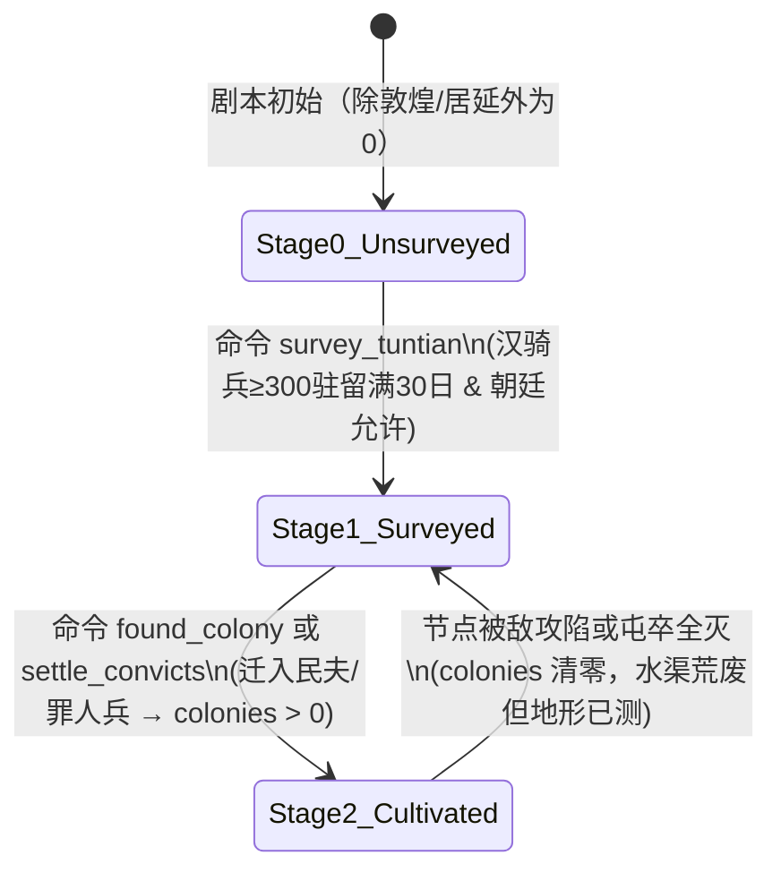

# S05 后勤 · 军事 · 迷雾（Logistics, Military & Fog）

> 所有者：S05（见 [00_bible.md](00_bible.md) 第 3 节）。本文是以下内容的**唯一**规范：补给线自动化、军队携粮/民夫/马匹、国家马匹池、大军供粮的**执行**、屯田（EA 两段）、烽燧/亭障/侦察/迷雾与估计值、战斗与围城的**改动**、兵种（含罪人兵）、预演（粮食曲线、敌军可达范围）。
>
> 战斗核心公式、围城、行军、寻路沿用现有代码（`core/combat.gd`、`core/siege.gd`、`core/plan_executor.gd`、`core/pathfinding.gd`、`core/supply.gd`），本文**只写改动**。凡本文未提到的现有行为，一律保持不变。
>
> 版本：v1 初稿（W1）。标注 `【假设，待裁决 Q-S05-xx】` 的条目已登记到 [STATUS.md](STATUS.md)。

## 0. 阅读指引与术语

| 术语 | 含义 | 代码对应 |
|---|---|---|
| 旬 / tick | 10 天；引擎每旬内逐日推进（`turn_resolver.gd::run_tick` 内 `for day in 10`） | `state.tick` |
| 步兵日 | 路段 `routes[i].days`，即速度 1.0 的军队走完该路段的天数 | `Path.travel_days(r, 1.0)` |
| 补给点 | `state.is_supply_node(node, f)` 为真的节点：己方直辖城、己方属国、长安（source） | 现有 |
| 储粮 | `state.stock(node, f)`：节点所属势力用 `node.grain`，其他势力用 `node.depot[f]` | 现有 |
| 民夫可征额 | `int(node.pop × han.laborer_levy_ratio) − node.levied_out` | 现有 `commands.gd` |
| 补给线（粮道） | 本文新增实体 `SupplyLine`：玩家只指定"源→终点"，系统自动拆段、派车 | 新增 `core/supply_lines.gd` |
| 段（leg） | 补给线路径上两个相邻**中转点**之间的部分 | `SupplyLine.legs[k]` |
| 估计值（Estimate） | 某势力对某支敌军的认知记录：位置、兵力区间、兵种、精度、时间 | 新增 `core/fog.gd` |
| 侦知等级 L | 0 未知 / 1 风闻 / 2 望见 / 3 察明 / 4 确知 | 见 §4.5 |
| 亭燧（烽燧） | 建在**路段**上的预警设施 | `routes[i].beacon` |

新增代码文件（实现建议，S10 拆工单时可调整）：`core/supply_lines.gd`、`core/forage.gd`、`core/horse_pool.gd`、`core/tuntian.gd`、`core/fog.gd`、`core/preview.gd`。新增数据段全部写入 `data/balance.json`（键名见各规则），新兵种写入 `data/units.json`。

---

## 1. 目的与支柱

### 1.1 服务的支柱

| 子系统 | 主支柱 | 次支柱 | 一句话 |
|---|---|---|---|
| 补给线自动化 | ①万里粮道 | ②将在外 | 把"6 段手工运粮"换成"一条看得见、会断、会红的粮道" |
| 大军供粮执行 | ①万里粮道 | ③帝国对联盟 | 兵多则沿途"莫不迎"，兵少则"坚城守"——后勤和外交接通 |
| 国家马匹池 | ①万里粮道 | ④人与史 | 漠北式大胜伴随十年虚弱；为天马打一场不划算的仗 |
| 屯田（EA 两段） | ①万里粮道 | ③帝国对联盟 | 屯田是粮仓，也是挑衅；民夫与屯卒争同一批人 |
| 烽燧/侦察/迷雾 | ②将在外 | ③帝国对联盟 | 情报成了能建、能拔、会过期的基础设施；AI 不再全知 |
| 战斗/围城改动、罪人兵 | ④人与史 | ①万里粮道 | 将领有分量；"饿死 X"被单列出来；七科谪是财政与兵源的互换 |
| 预演 | ①万里粮道 | ②将在外 | 在不确定中授权：下令前看见粮尽之日和敌骑可达之地 |

### 1.2 它让哪些回合决策更难做（L7 准入证明）

本表中的"回合决策"引用 [report_evolution.md §3.3](research/report_evolution.md) 的决策编号（汉 H1–H5、匈奴 X1–X5）。

| 机制 | 影响的已有决策 | 为什么更难（新的冲突） |
|---|---|---|
| 补给线 | H2 远征押注、H4 补给线往哪推 | 民夫来自沿线城市的可征额，**每征 1 名民夫，所在城秋收少 84 斛**（`farm_yield_per_worker_year`）。粮道越长、越红，越要在"前线屯粮"与"后方收成"之间取舍；沙漠段运输效率极低（§2.3 算例：玉门—楼兰每名民夫每月只能净运 0.8 斛），逼玩家去找沿途供粮或屯田 |
| 大军供粮执行 | H2 远征押注、H3 使团 | 带多少兵不再只看携粮：兵多→沿途城邦意愿高、出食给军，但民夫和中央军池吃紧；兵少→坚城守，只能征粮/抢粮/围城，换来怨恨与罪状 |
| 国家马匹池 | H2 远征押注 | 骑兵出征规模被马匹池卡住；沙漠和山道每月掉马，大胜后的缴获又能回补——"哪一年把马全押上" |
| 屯田两段 | H4 补给线与屯田往哪推 | 测地要占用一支骑兵一个月；屯田要拿走民夫（永久迁出原籍）；屯田越大，龟兹类邻国的"迫吾国而田"越高，可能引来刺杀与"征/不征" |
| 烽燧/迷雾 | H2、H4；X2 秋季攻势目标、X4 战术卡（拔亭障） | 汉要花钱和民夫修亭燧换"看得见"；匈奴要决定是先拔亭障致盲还是直接南下。估计值有误差带，"八千还是一万二"会改变是否迎战 |
| 统率修正 | H2（派谁领兵）、H5 事件抉择 | 好将领稀缺且在地图上有位置（S06），派他去西域就不能守河西 |
| 罪人兵 | H2 | 同一批罪人"赎钱"还是"发谪"；罪人兵免费但易逃亡，配贪将减员翻倍；战后可赦为屯田人口 |
| 预演 | 全部军事决策 | 预演只用**估计值**：情报越差，可达范围越大、越模糊，玩家越要留余量 |

### 1.3 设计边界（本 spec 不做的事）

- 不做区域动态粮价（E6"平价预购"）→ 1.0 待议，预留键 `army_forage.regional_price_enabled=false`。
- 不做断水源围城选项（C2"徙其城下水"）→ 1.0，预留节点字段 `has_well`。
- 不做马匹恢复渠道全集（官假马母、苜蓿、马复令）→ 1.0，只在 §4.3 预留键名。
- 不做屯田第 2–5 阶段（通渠/积谷/募民/列亭）→ 1.0。
- 不做疫病、诅军、月相（L6 明确不做）。"不过百日"疾疫减员（F3）→ 1.0 待议。
- 不做匈奴的亭燧网（瓯脱哨所）→ 1.0；EA 匈奴以牧地天然视野与游骑侦察补偿（§4.5.2）。

---
## 2. 玩家视角（Player Perspective）

### 2.1 玩家在什么时候、哪个界面、做什么决策

在默认**季制（1 回合 = 1 季 = 9 旬 = 90 天）**下，玩家每季首（正月/四月/七月/十月上旬）在三大视图中完成与本系统相关的决策，随后点击「下令行军」进入 9 旬逐日结算：

| 决策场景 | 所在界面 | 玩家看到的信号 | 玩家做出的选择 |
|---|---|---|---|
| **铺设/调整粮道** | 大地图「粮道图层」+ 左侧「补给线面板」 | 各城储粮月数（绿 ≥6 月 / 黄 3–6 月 / 红 <3 月）、各段线宽（实收流量）与颜色（绿畅通 / 黄民夫不足 / 红断流或遇袭）、沿线城市「秋收预计减产 −X 斛」提示 | 新建/删除 `SupplyLine`（源→终点）、调整优先级（高/中/低）、拖拽民夫配额滑条、指派护粮军、开启/关闭「不计损耗强运」 |
| **筹备远征与预演** | 军队选中态 →「作战计划与预演面板」 | **逐旬粮食曲线**（绿/黄/红三色分段，标注「第 X 旬粮尽」「返程缺口 Y 斛」）、沿途城邦头像旁的**供粮意愿徽章**（迎/市/闭/拒）、国家马匹池余量、**敌军可达威胁圈**（30/60/90 日三层阴影） | 混编步/弩/骑/罪人兵（受马匹池与罪人池约束）、加减随军民夫、设定沿途采买策略（平买/强征/掠食/秋毫弗犯）、修正行军路线或改选「立即强攻」 |
| **开拓西域屯田** | 节点详情面板 →「屯田与军垦」页签 | 节点 `farm_cap`、当前阶段（未勘测 / 已校猎测地 / 已开垦）、预计秋收净产粮、邻国（如龟兹/焉耆）新增「迫吾国而田」戒心值预告 | 第一步派 ≥300 骑驻扎 30 日执行 `survey_tuntian`（测地）；第二步运民夫至该城执行 `found_colony` 或赦免罪人兵 `settle_convicts`（开渠屯田） |
| **修筑亭燧与侦察** | 大地图「迷雾与亭燧图层」+ 路段浮窗 | 路段视野等级（L0 盲区斜纹 / L2 烽燧望见 / L3 驻军察明）、敌军算筹旁的不确定区间（如「匈奴游骑 6,000–10,000，20 日前望见」）、亭燧建造费与月维护费 | 汉方在咽喉路段下达 `build_beacon` 或派轻骑前出侦察；匈奴方对比汉军烽燧覆盖，决定是派游骑执行 `raze_beacon`（拔亭障致盲）还是绕道奇袭 |

---

### 2.2 具体回合算例 A：河西自动补给线与沙漠段极限（前 119 年夏，第 2 季）

**背景**：汉方玩家准备在**敦煌**集结 20,000 大军（步兵 10,000、弩兵 5,000、骑兵 5,000，配马 5,000 匹），目标是在敦煌囤够 **6 个月**安全储粮，并将前哨粮仓推至**阳关**与**楼兰**。

#### （1）各段基础运输效率计算
运输队（`is_convoy=true`）仅含民夫，基础行军速度 `laborer.speed = 0.75`，每人负重 `carry = 15.0` 斛，每人每月口粮 `food = 3.0` 斛（每日 $0.10$ 斛）。设路段步兵日为 $d_{\text{inf}}$，则：
- 单程天数 $t_{\text{one}} = d_{\text{inf}} / 0.75$，往返天数 $t_{\text{rt}} = 2 \cdot t_{\text{one}}$（含装卸损耗 1 日）；
- 单趟往返每名民夫自食口粮 $c_{\text{trip}} = 3.0 \times \frac{t_{\text{rt}} + 1}{30}$ 斛；
- 单趟每名民夫**净交割粮** $net_{\text{trip}} = \max(0,\, 15.0 - c_{\text{trip}})$ 斛；
- 每名民夫**月均净吞吐率** $\tau = net_{\text{trip}} \times \frac{30}{t_{\text{rt}}}$（斛/人/月）；
- **载荷放大系数** $LF = \frac{15.0}{net_{\text{trip}}}$（下游每要收到 1 斛净粮，上游起运点必须装车发出的毛粮倍数）。

河西干线至楼兰各段的真实数值如下表（里程与步兵日取自 `scenario_mvp.json`）：

| 段号 | 起点 → 终点 | 地形 | 步兵日 $d_{\text{inf}}$ | 运输单程 $t_{\text{one}}$ | 往返 $t_{\text{rt}}$ | 单趟自食 $c_{\text{trip}}$ | 单趟净交割 $net_{\text{trip}}$ | 月净吞吐 $\tau$ (斛/人/月) | 放大系数 $LF$ |
|---|---|---|---|---|---|---|---|---|---|
| Leg 1 | 长安 → 陇西 | 官道 | 24.0 日 | 32.0 日 | 64.0 日 | 6.50 斛 | 8.50 斛 | **3.98** | 1.765× |
| Leg 2 | 陇西 → 武威 | 官道 | 21.0 日 | 28.0 日 | 56.0 日 | 5.70 斛 | 9.30 斛 | **4.98** | 1.613× |
| Leg 3 | 武威 → 张掖 | 官道 | 13.0 日 | 17.3 日 | 34.7 日 | 3.57 斛 | 11.43 斛 | **9.89** | 1.312× |
| Leg 4 | 张掖 → 酒泉 | 官道 | 11.0 日 | 14.7 日 | 29.3 日 | 3.03 斛 | 11.97 斛 | **12.24** | 1.253× |
| Leg 5 | 酒泉 → 敦煌 | 官道 | 19.0 日 | 25.3 日 | 50.7 日 | 5.17 斛 | 9.83 斛 | **5.82** | 1.525× |
| Leg 6 | 敦煌 → 阳关 | 官道 | 3.75 日 | 5.0 日 | 10.0 日 | 1.10 斛 | 13.90 斛 | **41.70** | 1.079× |
| *对比* | *阳关 → 楼兰* | *沙漠* | *44.37 日* | *59.2 日* | *118.3 日* | *11.93 斛 + 沙漠损耗 1.19 斛* | **1.88 斛** | **0.48** | **7.98×** |

> **关键设计洞察（万里粮道）**：从长安一路接力运到敦煌，累计放大系数为 $1.765 \times 1.613 \times 1.312 \times 1.253 \times 1.525 = \mathbf{7.14\times}$（即史书所谓“千里馈粮，率十石而致一石”）；而一旦进入**阳关→楼兰**沙漠段（单程 59.2 天），民夫在路上吃掉并损耗近 9 成口粮，每人每月只能净运 **0.48 斛**！玩家一眼就能从预演面板看出：**不修屯田、不靠城邦供粮，纯靠内地民夫跨越沙海供养万人大军在数学上是不可能的**。

#### （2）敦煌集结与自动旬派车过程
1. **敦煌月需求与缺口**：
   - 敦煌常住人口 `22,000`（月食 `44,000` 斛）+ 集结军 `20,000` 人（月食 `60,000` 斛）+ 战马 `5,000` 匹（月食 `5,000` 斛）= **月总耗 `109,000` 斛**。
   - 玩家建立 `SupplyLine #1：长安 → 敦煌`，设定目标缓冲为 `target_months = 6.0`，即目标存粮 $G_{\text{target}} = 6 \times 109,000 = 654,000$ 斛。
   - 敦煌当前存粮 `560,500` 斛，本季（3 个月）净消耗缺口 + 库存差额为 $(654,000 - 560,500)/3 + (109,000 - 0) = 140,167$ 斛/月。
2. **就近抽粮与中转站缓冲（避免盲目从长安起运）**：
   - 系统从终点向起点逆推：先看上游邻城**酒泉**（`pop = 37,500`，本地月耗 `75,000` 斛，最低安全保留 `reserve_months = 3.0` 即 `225,000` 斛）。
   - 酒泉当前存粮 `798,000` 斛，可动用盈余高达 $798,000 - 225,000 = 573,000$ 斛！因此第 1 旬系统**只激活 Leg 5（酒泉→敦煌）**，无需立刻抽空张掖、武威的民夫。
3. **民夫配额与秋收的尖锐冲突**：
   - 要在 Leg 5（$\tau = 5.82$ 斛/人/月）满足每月 `34,600` 斛的补峰流量，理论需民夫 $34,600 / 5.82 \approx 5,945$ 人。
   - 酒泉可征民夫上限为 `37,500 × 0.10 = 3,750` 人，敦煌回程协运可征 `22,000 × 0.10 = 2,200` 人，两城合计最多派出 **5,950 名民夫**（第 1 旬即满额派发）。
   - **代价提示**：面板立刻标黄警告——「酒泉、敦煌共征发民夫 5,950 人，若持续至八月秋收，两郡今年秋收将减产 $5,950 \times 84 = \mathbf{499,800}$ 斛！」玩家必须在“五月出师速战速决、八月前遣散民夫归农”与“硬着头皮常年转运导致河西空虚”之间拍板。

---

### 2.3 具体回合算例 B：敦煌→楼兰远征逐旬粮食曲线与沿途供粮（前 108 年春）

**背景**：玩家以持节将领**赵破奴**（`command = 6`，统率修正 $+9\%$）率汉军自敦煌出征楼兰。
- **编制**：步兵 `4,000`、弩兵 `2,000`、骑兵 `2,000`（合计战兵 $S = 8,000$，从 `han_horse_pool` 领马 $H = 2,000$ 匹），随军征调民夫 $L = 6,000$ 人。
- **初始携粮与日耗**：
  - 携粮上限 $C_{\max} = 8,000 \times 3 + 6,000 \times 15 = \mathbf{114,000}$ 斛（敦煌粮仓满额装车）；
  - 初始每日总耗粮 $need_{\text{day}} = \frac{8,000 \times 3 + 6,000 \times 3 + 2,000 \times 1}{30} = \mathbf{1,466.7}$ 斛/日（理论满载续航 **77.7 天**）；
  - 因携带民夫，全军行军速度受限于 `laborer.speed = 0.75`。

#### （1）出征行军与逐旬粮食曲线（对比两条分支）
- **路线**：敦煌 $\xrightarrow{\text{官道 } 3.75\text{日}}$ 阳关 $\xrightarrow{\text{沙漠 } 44.37\text{日}}$ 楼兰（合计行军 **48.12 天**，即第 5 旬末抵达楼兰城下）。
- **沙漠非战斗损耗**（§4.3、§4.7）：沙漠段每月人员非战斗减员 `1.0%`、战马损耗 `3.0%`、粮草损耗 `1.0%`。

下表为「作战计划预演面板」给出的逐旬曲线与实盘结算对比：

| 旬次 (天数) | 所在位置/状态 | 战兵 $S$ | 民夫 $L$ | 战马 $H$ | 旬末余粮 (斛) | 预演与实盘说明 |
|---|---|---|---|---|---|---|
| **出发 (Day 0)** | 敦煌整装 | 8,000 | 6,000 | 2,000 | **114,000** | 满载出发，日耗 1,467 斛 |
| **第 1 旬 (Day 10)** | 过阳关入白龙堆沙漠 | 7,983 | 5,988 | 1,986 | **99,120** | 阳关未建仓，直接穿沙海；沙漠日耗+蒸发 |
| **第 2 旬 (Day 20)** | 沙漠行军中 | 7,957 | 5,968 | 1,966 | **84,210** | 累计掉马 34 匹（仍够 2,000 骑兵乘骑） |
| **第 3 旬 (Day 30)** | 沙漠行军中 | 7,930 | 5,948 | 1,947 | **69,360** | 骑兵缺马 53 匹，53 名骑兵自动转为「下马步战」 |
| **第 4 旬 (Day 40)** | 沙漠行军中 | 7,904 | 5,928 | 1,927 | **54,570** | 预演黄线提示：已过不归点，无补给不可原路空返 |
| **第 5 旬 (Day 48.1)** | **抵达楼兰城下** | **7,883** | **5,912** | **1,912** | **43,948** | **关键分水岭：余粮仅够再撑 30.5 天！** |

#### （2）抵达楼兰后的三种决策结局对比
楼兰城防：`pop = 7,000`，城墙 `walls = 1`（城防 HP `2,000`），城内储粮 `133,950` 斛，民兵守军约 `525` 人。

- **错误方案（按默认计划久围不攻）**：
  - 汉军每旬攻城器械伤害仅 `100` 点（每日 10 点），要把城防磨到 `50%`（1,000 HP）触发默认强攻需 **100 天**！
  - 第 8 旬（Day 79）汉军余粮归零；第 9–15 旬陷入绝粮（每旬饿死 `5%` 战兵与民夫，战力乘 `0.60`），未等破城已饿死逾 **2,600 人**，战报单列「饿死二千六百余人」，朝廷信任暴跌。
- **方案甲（军事强攻 + 破城就食）**：
  - 玩家在计划中勾选 `assault_threshold = 1.0`（抵达次日立即强攻）。
  - 汉军有效战力（含赵破奴统率 $+9\%$）对楼兰民兵形成压倒优势，1 日破城，汉军仅阵亡约 `180` 人。
  - 破城缴获楼兰半数存粮 `66,975` 斛入汉仓；楼兰变为汉方补给点，汉军补满余粮至 `110,000` 斛，休整 1 旬后第 6 旬末从容返程，第 11 旬平安归还敦煌。
- **方案乙（先遣使团 + 沿途供粮免战，适用于借道楼兰远征车师/大宛）**：
  - 若汉军目标是借道楼兰北攻**车师前部**，S04 传入楼兰对汉军的**供粮意愿 $W$**：
    - 当汉军兵威充足（8,000 人对楼兰小国威慑极高）且汉影响力 ≥ 45 时，$W = 78 \ge 75$（**第 1 档：箪食壶浆/迎军**），楼兰主动无偿献粮 `15,000` 斛，并允许汉军以 `10` 钱/百斛平价再购 `30,000` 斛（耗资仅 `3,000` 钱），汉军不费一兵一卒补满粮袋继续北上！
    - 反之，若像前 104 年李广利初次伐大宛那样只带轻兵数千、沿途小国视汉军单弱（$W = 22 < 30$，**第 4 档：坚壁清野**），沿途郁成、仑头皆闭城拒供，汉军要么顿兵坚城之下攻城掠食（每掠一城耗时耗兵且给 S04 记「汉军掠食」怨恨 +25），要么在返程途中活活饿垮（复现史书“往来二岁，至敦煌士不过什一二”）。

---

### 2.4 具体回合算例 C：烽燧传警 vs 拔亭障致盲（前 115 年秋，第 3 季）

- **有烽燧覆盖**：汉方已在「居延 ↔ 张掖」（步兵日 14 日，约 420 km）耗资 `252` 钱、民夫 `1,260` 人修成 1 级亭燧网。八月中旬匈奴右贤王率 `8,000` 骑自漠南踏入居延路段：
  - 当日（Day 1）亭燧即捕捉到 L2（望见）情报，举三积薪火号，沿河西亭燧链 **1 日内**传警至张掖、酒泉；
  - 玩家与张掖驻军的 `enemy_near` 触发器在 **Day 2** 即获得估计值：「敌骑约 6,500–9,500（大举），正在居延道南下，距张掖约 5 日骑程」，张掖守军立即进入城防戒备，城外运输队自动暂停装车避险。
- **匈奴先拔亭障**：若匈奴先派 `1,500` 游骑在七月末执行 `raze_beacon`（驻留该段 5 日拔除亭燧），该段变为 `status = "destroyed"`（视野降为 L0 盲区）：
  - 八月匈奴主力 `8,000` 骑南下时，唯有居延城头守军在敌骑逼近至 3 日步程内才望见，且因烽燧已毁，只能派单骑信使（速度 2.0）狂奔 **7 日**报往张掖——等张掖收到警报时，匈奴铁骑已抵达张掖城下并截杀了路上两支运粮队。

---

## 3. 状态变量（State Variables）

本节列出 S05 拥有并持久化的全部状态变量。所有新增配置项统一存放在 `data/balance.json` 对应分段下，兵种存放在 `data/units.json`。

### 3.1 补给线实体 `SupplyLine`（存于 `state.supply_lines[line_id]`）

| 名称 | 所属对象 | 类型 | 取值范围 | 初值 | JSON 键（默认配置） | 存档字段 |
|---|---|---|---|---|---|---|
| `id` | `SupplyLine` | `String` | `"line_1".."line_N"` | 自增生成 | — | `supply_lines[i].id` |
| `faction` | `SupplyLine` | `String` | `"han"` / `"xiongnu"` | `"han"` | — | `supply_lines[i].faction` |
| `source` | `SupplyLine` | `String` | 合法补给节点 id | 必填 | — | `supply_lines[i].source` |
| `terminus` | `SupplyLine` | `String` | 合法节点 id | 必填 | — | `supply_lines[i].terminus` |
| `priority` | `SupplyLine` | `int` | `1`（低）/ `2`（中）/ `3`（高） | `2` | `supply_line.default_priority = 2` | `supply_lines[i].priority` |
| `target_months` | `SupplyLine` | `float` | `1.0 .. 12.0` | `6.0` | `supply_line.default_target_months = 6.0` | `supply_lines[i].target_months` |
| `reserve_months` | `SupplyLine` | `float` | `1.0 .. 6.0` | `3.0` | `supply_line.relay_reserve_months = 3.0` | `supply_lines[i].reserve_months` |
| `max_laborers` | `SupplyLine` | `int` | `0 .. 50000` | `10000` | `supply_line.default_max_laborers = 10000` | `supply_lines[i].max_laborers` |
| `escort_army_id` | `SupplyLine` | `String` | 军队 id 或 `""` | `""` | — | `supply_lines[i].escort_army_id` |
| `ignore_danger` | `SupplyLine` | `bool` | `true` / `false` | `false` | `supply_line.default_ignore_danger = false` | `supply_lines[i].ignore_danger` |
| `status` | `SupplyLine` | `String` | `"active"` / `"throttled"` / `"paused_danger"` / `"cut"` / `"orphan"` | `"active"` | — | `supply_lines[i].status` |
| `legs` | `SupplyLine` | `Array[Dict]` | `[{from, to, route_ids, assigned_laborers, desired_flow_month, delivered_30d}]` | 自动拆段 | — | `supply_lines[i].legs` |
| `losses_30d` | `SupplyLine` | `int` | `0 .. 99`（近30日被劫车队数） | `0` | `supply_line.auto_pause_losses = 2` | `supply_lines[i].losses_30d` |

### 3.2 军队扩展字段（存于 `state.armies[army_id]`）

| 名称 | 所属对象 | 类型 | 取值范围 | 初值 | JSON 键（默认配置） | 存档字段 |
|---|---|---|---|---|---|---|
| `commander_id` | `Army` | `String` | 人物 id 或 `""` | `""` | `combat.unassigned_commander_stat = 2` | `armies[id].commander_id` |
| `forage_policy` | `Army` | `String` | `"auto"` / `"buy"` / `"requisition"` / `"plunder"` / `"none"` | `"auto"` | `army_forage.default_policy = "auto"` | `armies[id].forage_policy` |
| `line_id` | `Army` | `String` | `SupplyLine.id` 或 `""`（仅自动车队） | `""` | — | `armies[id].line_id` |
| `leg_idx` | `Army` | `int` | `-1 .. 15` | `-1` | — | `armies[id].leg_idx` |
| `dismounted_cav` | `Army` | `int` | `0 .. 50000`（缺马下马骑兵数） | `0` | `horse_pool.dismount_as_infantry = true` | `armies[id].dismounted_cav` |
| `starved_losses` | `Army` | `int` | `0 .. 100000`（本军累计饿死人数） | `0` | — | `armies[id].starved_losses` |
| `foraged_this_tick` | `Army` | `Array[String]` | 本旬已执行供粮的节点 id 列表 | `[]` | — | `armies[id].foraged_this_tick` |

### 3.3 节点与路段扩展字段（存于 `state.nodes[nid]` 与 `state.routes[i]`）

| 名称 | 所属对象 | 类型 | 取值范围 | 初值 | JSON 键（默认配置） | 存档字段 |
|---|---|---|---|---|---|---|
| `tuntian_stage` | `Node` | `int` | `0`（未测）/ `1`（已校猎测地）/ `2`（已开渠屯田） | 依剧本（西域默认 `0`） | `tuntian.max_stage_ea = 2` | `nodes[id].tuntian_stage` |
| `tuntian_survey_days` | `Node` | `int` | `0 .. 30` | `0` | `tuntian.survey_days_needed = 30` | `nodes[id].tuntian_survey_days` |
| `tuntian_founded_tick` | `Node` | `int` | `-1 .. 9999`（首年产量折半判定用） | `-1` | `tuntian.first_year_yield_mult = 0.5` | `nodes[id].tuntian_founded_tick` |
| `colonies` | `Node` | `int` | `0 .. farm_cap`（在耕屯田卒/民人数） | `0`（现有字段复用） | `tuntian.colony_cap_ratio = 0.60` | `nodes[id].colonies` |
| `has_well` | `Node` | `bool` | `true` / `false`（1.0 断水源预留） | `true` | — | `nodes[id].has_well` |
| `beacon` | `Route` | `Dictionary` | `{level: 0..1, hp: 0..100, owner: String, status: String, build_days_left: int}` | `{level:0, hp:0, owner:"", status:"none", build_days_left:0}` | `fog.beacon_max_hp = 100` | `routes[i].beacon` |

### 3.4 全局后勤、马政、罪人兵与迷雾状态（存于 `GameState` 顶层）

| 名称 | 所属对象 | 类型 | 取值范围 | 初值 | JSON 键（默认配置） | 存档字段 |
|---|---|---|---|---|---|---|
| `han_horse_pool` | `GameState` | `int` | `0 .. 60000` | 依剧本（前119漠北后为 `8000`） | `horse_pool.initial_default = 8000` | `han_horse_pool` |
| `han_horse_pool_cap` | `GameState` | `int` | `10000 .. 60000` | `30000` | `horse_pool.cap = 30000` | `han_horse_pool_cap` |
| `tianma_breed_bonus` | `GameState` | `bool` | `true` / `false`（获大宛天马后解锁） | `false` | `horse_pool.tianma_speed_bonus = 0.10` | `tianma_breed_bonus` |
| `han_convict_pool` | `GameState` | `int` | `0 .. 30000`（七科谪/罪人池） | `4000` | `convict.initial_pool = 4000` | `han_convict_pool` |
| `convicts_levied_year` | `GameState` | `int` | `0 .. 30000`（当年已发谪人数） | `0` | `convict.trade_penalty_threshold = 5000` | `convicts_levied_year` |
| `tuntian_pressure` | `GameState` | `Dict[String, float]` | `state_id -> 0.0 .. 100.0`（邻国屯田戒心） | `{}` | `tuntian.pressure_event_threshold = 60.0` | `tuntian_pressure` |
| `intel_estimates` | `GameState` | `Dict[String, Dict]` | `faction -> {est_id -> IntelEstimate}` | `{"han":{}, "xiongnu":{}}` | — | `intel_estimates` |
| `pending_reports` | `GameState` | `Array[Dict]` | `[{observer, deliver_day, payload}]` | `[]` | — | `pending_reports` |
| `node_intel` | `GameState` | `Dict[String, Dict]` | `faction -> {nid -> {grain_band, pop, seen_day, level}}` | `{"han":{}, "xiongnu":{}}` | — | `node_intel` |
| `stats` | `GameState` | `Dictionary` | `{han_total_deaths, han_combat_deaths, han_starved_deaths, han_march_deaths, han_deserted, xn_total_deaths, xn_starved_deaths}` | 全 `0` | — | `stats` |

其中单条敌情估计记录 `IntelEstimate` 的内部结构如下：
```json
{
  "est_id": "est_han_104",
  "true_army_id": "army_12",
  "faction": "xiongnu",
  "loc": {"node": "ju_yan"},
  "heading_to": "zhang_ye",
  "level": 2,
  "est_size": 8200,
  "size_min": 6150,
  "size_max": 10250,
  "unit_class": "mounted",
  "seen_day": 145,
  "reported_day": 146,
  "source_type": "beacon",
  "is_decoy": false,
  "departed": false
}
```
> **注（防 AI 作弊隔离）**：`true_army_id` 仅供 `core/fog.gd` 内部更新合并同一支敌军的观测记录时使用；向 UI 与 `S08` AI 暴露的接口 `Fog.get_perceived_armies(state, faction)` **剥离 `true_army_id`**，只返回 `est_id` 与区间估计值。

---
## 4. 规则与公式（Rules & Formulas）

### 4.0 结算时机与先后顺序总表

在 `turn_resolver.gd::run_tick(state)`（每旬 10 日循环）及月/季/年钩子中，S05 各子系统严格按以下顺序执行：

| 时机 | 顺序 | 执行函数 | 说明 |
|---|---|---|---|
| **每旬首日 (Day 0)** | 1 | `SupplyLines.dispatch_tick(state)` | 补给线逆推流量、分配/遣散车队、清空 `foraged_this_tick` |
| **每日 (Day 0..9)** | 2 | `PlanExecutor.step_day(state)` | 军队按日移动；抵达非己方补给点时触发 `Forage.try_forage_on_arrival` |
| **每日 (Day 0..9)** | 3 | `Combat.resolve_encounters(state)` | 同点/同路遭遇战（含护粮军参战、统率修正、缺马步战折算） |
| **每日 (Day 0..9)** | 4 | `Siege.step_day(state)` | 围城推进（含守军食城粮、断粮饿死单列、强攻判定） |
| **每日 (Day 0..9)** | 5 | `Supply.step_day(state)` | 扣日口粮、地形减员、**战马日损耗**、**罪人兵逃亡**、断粮饿死统计 |
| **每日 (Day 0..9)** | 6 | `Tuntian.step_day(state)` | 校猎测地天数累加、破塞拔亭障天数累加、亭燧建造天数递减 |
| **每日 (Day 0..9)** | 7 | `Fog.step_day(state)` | 投递到期信使报告、刷新视野传感器、生成新报告入队 |
| **每日 (Day 0..9)** | 8 | `PlanExecutor.check_triggers(state)` | 军队触发器检查（`enemy_near` 读取本军即时视野 + 本方已送达估计值） |
| **月末 (每 3 旬)** | 9 | `SupplyLines.month_end(state)` | 更新 30 日滚动运量 `delivered_30d`、扣亭燧月维护费、更新 `tuntian_pressure` |
| **八月末 (秋收)** | 10 | `Economy.autumn_harvest(state)` | 农田与屯田秋收（扣除被征民夫 `levied_out` 后的净劳力产粮） |
| **正月初 (岁首)** | 11 | `HorsePool.year_start(state)` | 国家马匹池与七科谪罪人池年度自然恢复、重置 `convicts_levied_year` |

---

### 4.1 规则 `S05-R01`：补给线自动化（SupplyLine Automation）

#### （1）路径拆段（Leg Decomposition）
当玩家或 AI 创建 `SupplyLine(source, terminus)` 时，系统调用 `Path.dijkstra(state, source, 0.75, avoid_hostile=true, ignore_closed=false)` 求最短运输路径，并将路径上所有满足 `is_relay_node(node, faction)`（己方直辖城、己方关隘 `pass`、己方已建仓属国/屯田点）的节点作为中转站，拆分为 $K$ 个连续段 `legs[0 .. K-1]`：
$$\text{Leg } k: \quad u_k \xrightarrow{R_k} v_k, \quad k = 0, 1, \dots, K-1 \quad (u_0 = \text{source},\; v_{K-1} = \text{terminus})$$
- 对每个段 $k$，记其步兵日总和为 $D_k = \sum_{r \in R_k} r.\text{days}$，则民夫单程天数 $t_{\text{one},k} = D_k / v_{\text{convoy}}$（默认 $v_{\text{convoy}} = 0.75$），往返周期 $t_{\text{rt},k} = 2 \cdot t_{\text{one},k}$。
- 单名民夫单趟净交割粮 $net_k$、月吞吐率 $\tau_k$、载荷放大系数 $LF_k$ 计算公式如下：
$$c_{\text{trip},k} = f_{\text{lab}} \cdot \frac{t_{\text{rt},k} + 1}{30} + C_{\text{carry}} \cdot \eta_{\text{desert},k}$$
$$net_k = \max\bigl(0,\; C_{\text{carry}} - c_{\text{trip},k}\bigr), \qquad \tau_k = net_k \cdot \frac{30}{t_{\text{rt},k}}, \qquad LF_k = \begin{cases} \frac{C_{\text{carry}}}{net_k}, & net_k > 0.5 \\ \infty, & net_k \le 0.5 \end{cases}$$
其中 $\eta_{\text{desert},k}$ 为段内沙漠路段累计蒸发率（每 30 沙漠日损耗 `0.01`）。

#### （2）逆向流量求解与就近抽粮控制器
每旬首日（Day 0），对所有状态非 `"cut"` / `"orphan"` 的补给线，按 `priority` 降序（同优先级按创建先后）依次从终点段 $k = K-1$ 向起点段 $k = 0$ 逆推所需月净流量 $F_k$（单位：斛/月）：
1. **终点需求（$v_{K-1}$）**：
   - 计算终点月消耗 $M_{\text{term}} = \text{pop}(v_{K-1}) \cdot f_{\text{civ}} + \sum_{a \in \text{armies\_at}(v_{K-1})} \text{need\_month}(a)$；
   - 目标存粮 $G_{\text{target}} = \text{line.target\_months} \times M_{\text{term}}$；
   - 终点缺口月流量（按 1 季 = 3 个月平滑）：
     $$F_{K-1} = \max\left(0,\; \frac{G_{\text{target}} - \text{stock}(v_{K-1}) - \text{inbound}(v_{K-1})}{3.0} + M_{\text{term}}\right)$$
2. **中转站就近抽粮与上游传递（$u_k$，当 $k$ 从 $K-1$ 递减至 $1$）**：
   - 设中转节点 $u_k$ 的本地月消耗为 $M(u_k)$，安全保底存粮为 $G_{\text{res}}(u_k) = \text{line.reserve\_months} \times M(u_k)$；
   - 下游段 $k$ 要求从 $u_k$ 装车发出的**毛月流量**为 $F_k^{\text{gross}} = F_k \cdot LF_k$；
   - $u_k$ 当前可动用自由余粮为 $S_{\text{free}}(u_k) = \max\bigl(0,\; \text{stock}(u_k) - G_{\text{res}}(u_k)\bigr)$；
   - 若 $S_{\text{free}}(u_k) \ge 3.0 \times F_k^{\text{gross}}$（即中转站自身余粮足够支撑下游 1 整季），则**截断上游需求** $F_{k-1} = 0$（直接抽酒泉存粮供敦煌，不惊动张掖、武威）；否则：
     $$F_{k-1} = \max\left(0,\; F_k^{\text{gross}} - \frac{S_{\text{free}}(u_k)}{3.0} + \max\left(0, \frac{G_{\text{res}}(u_k) - \text{stock}(u_k)}{3.0}\right)\right)$$

#### （3）每旬派车、30% 迟滞带与装车避险伪代码

```gdscript
# core/supply_lines.gd
static func dispatch_tick(state: GameState) -> void:
    var lines = state.supply_lines.values()
    lines.sort_custom(func(a, b):
        if a.priority != b.priority: return a.priority > b.priority
        return a.id < b.id
    )
    for line in lines:
        if line.status in ["cut", "orphan"]:
            continue
        _update_line_legs_and_flow(state, line)
        var line_lab_used := _count_line_laborers(state, line.id)
        for k in range(line.legs.size() - 1, -1, -1):
            var leg: Dictionary = line.legs[k]
            if leg.tau <= 0.01:
                leg.desired_laborers = 0
                continue
            var raw_need_lab := int(ceil(leg.desired_flow_month / leg.tau))
            var room_in_line := maxi(0, line.max_laborers - line_lab_used + leg.assigned_laborers)
            var target_lab := mini(raw_need_lab, room_in_line)
            var diff := target_lab - leg.assigned_laborers

            # 1) 缺口 >= 500 人：从起点 u_k（不足时兼从终点 v_k）征发民夫生成新 loop_convoy
            if diff >= state.bal.supply_line.min_convoy_batch: # 默认 500
                if not line.ignore_danger and _is_leg_threatened_by_fog(state, line.faction, leg):
                    line.status = "paused_danger"
                    continue
                var spawn_lab := _levy_from_endpoints(state, leg.from, leg.to, diff)
                if spawn_lab >= state.bal.supply_line.min_convoy_batch:
                    _spawn_leg_convoy(state, line, k, spawn_lab)
                    leg.assigned_laborers += spawn_lab
                    line_lab_used += spawn_lab

            # 2) 超配 > 30%（迟滞带防抖）：回收正处于装车点待命的车队并归还 levied_out
            elif leg.assigned_laborers > int(target_lab * (1.0 + state.bal.supply_line.hysteresis_ratio)):
                var excess := leg.assigned_laborers - target_lab
                var released := _disband_idle_convoys_on_leg(state, line.id, k, excess)
                leg.assigned_laborers -= released
                line_lab_used -= released
```

- **单趟装车下限与待命（Wait Phase）**：车队回到段起点 $u_k$ 准备装车时，计算可装数量 $G_{\text{load}} = \min\bigl(L \cdot 15.0,\; \max(0, \text{stock}(u_k) - G_{\text{res}}(u_k)),\; F_k^{\text{gross}}\bigr)$。若 $G_{\text{load}} < 0.20 \times (L \cdot 15.0)$，车队本旬不发车，停留在 $u_k$（由节点承担口粮，不损耗车载粮），直至上游补粮到位或被迟滞带回收。
- **护粮军协同（Escort Rule）**：每条补给线可绑定 1 支非车队己方野战军 `escort_army_id`。当该补给线所属的任一车队在路段 $r$ 或端点遭遇敌军触发 `Combat.resolve_encounters` 时，若护粮军当日位于同一路段 $r$ 或该路段的任一端点（`r.a` / `r.b`），**护粮军立即并入防守方共同作战**。
- **遇袭自动熔断与断线重算**：
  - 车队被劫灭时 `line.losses_30d += 1`；若 `losses_30d >= 2` 且 `ignore_danger == false`，该线自动切为 `"paused_danger"` 并弹出战报提醒玩家。
  - 若中转节点失守，系统立即重跑 Dijkstra 绕开敌占节点；若仍可达则重拆 `legs`，原在途车队退回最近己方节点；若不可达则置 `line.status = "cut"`。若终点 `terminus` 失守，置 `line.status = "orphan"`，所有在途车队退回倒数第二站卸粮待命；若 90 日内未收复终点，自动解散该线并归还全部 `levied_out`。

#### （4）本节参数表（`data/balance.json → supply_line`）

| JSON 键 | 默认值 | 可调范围 | 含义 |
|---|---|---|---|
| `supply_line.default_target_months` | `6.0` | `2.0 .. 12.0` | 终点默认目标存粮月数 |
| `supply_line.relay_reserve_months` | `3.0` | `1.0 .. 6.0` | 中转站本地安全保留月数（高于此值才向平级/下游抽调） |
| `supply_line.min_convoy_batch` | `500` | `200 .. 2000` | 单次增派车队的最小民夫批量 |
| `supply_line.hysteresis_ratio` | `0.30` | `0.15 .. 0.50` | 回收车队的超配迟滞比例（防止每旬反复征发/遣散） |
| `supply_line.min_load_ratio` | `0.20` | `0.10 .. 0.50` | 低于最大载重该比例时不发车、原地待命 |
| `supply_line.auto_pause_losses` | `2` | `1 .. 5` | 30 日内损失多少支车队后自动暂停发车 |
| `supply_line.orphan_cleanup_days` | `90` | `30 .. 180` | 终点陷落后保留孤立补给线的天数 |

---

### 4.2 规则 `S05-R02`：大军沿途供粮执行（Army Forage Execution）

> **所有权边界**：城邦对某支军队的**供粮意愿值 $W \in [0, 100]$** 的计算公式归 **S04** 所有（S04 综合汉影响力、匈奴威吓、怨恨、城邦存粮富余度、以及由本系统传入的军队有效威慑力 `army_awe` 算出 $W$）；**S05 负责读取 $W$，并在军队途经或驻留西域城邦时执行装粮、扣钱、强征、掠食及结果回写**。

#### （1）触发时机与防刷限制
当非车队野战军 $A$（`army_size(A) >= 500`）在行军或驻留中位于非己方直辖的城邦节点 $N$（`node.type == "citystate"` 或 `"great_power"`），且 $N \notin A.\text{foraged\_this\_tick}$、$A.\text{grain} < 0.90 \times C_{\max}(A)$ 时，触发沿途供粮判定，并将 $N$ 记入 $A.\text{foraged\_this\_tick}$（**同一支军队在同一城邦每旬最多执行 1 次**）。

记军队当前粮袋缺口为 $\Delta G_{\text{need}} = C_{\max}(A) - A.\text{grain}$，城邦可动用余粮上限为：
$$G_{\text{avail}}(N) = \max\bigl(0,\; N.\text{grain} - \text{pop}(N) \times f_{\text{civ}} \times 3.0\bigr)$$
（即城邦至少保留本国居民 3 个月口粮，除非遭到武力掠食）。

#### （2）四档意愿区间与策略执行表
调用 `W = Diplomacy.get_forage_willingness(state, N.id, A)`，结合军队的 `forage_policy`（`"auto"` / `"buy"` / `"requisition"` / `"plunder"` / `"none"`；若为 `"none"` 则直接跳过）按以下四档执行：

| 意愿档位 | $W$ 范围 | 史实对应 | `"auto"` / `"buy"` 行为 | `"requisition"`（强征）行为 | `"plunder"`（攻掠野谷）行为 |
|---|---|---|---|---|---|
| **第 1 档：迎军** | $W \ge 75$ | “莫不迎，出食给军” | **无偿献粮** $G_{\text{gift}} = \min(\Delta G_{\text{need}},\, 0.25 G_{\text{avail}},\, 15000)$；仍有缺口则按**属国平价** `10` 钱/百斛继续平买至满载。回写：汉影响力 `-1`（微耗国力） | 同左，额外无偿索取上限提至 `30,000` 斛；回写：怨恨 `+6`、汉影响力 `-3` | 禁止对 $W \ge 75$ 的迎军属国直接掠食（需先下达讨伐/围城） |
| **第 2 档：开市** | $50 \le W < 75$ | 遣贵人犒军，许诺互市 | 无免费献粮；允许按**普通市价** `15` 钱/百斛（册封国 `12` 钱/百斛）购买，上限 $\min(\Delta G_{\text{need}},\, 0.40 G_{\text{avail}},\, 35000)$ | 强行按半价 `7.5` 钱/百斛征购上限 `25,000` 斛；回写：怨恨 `+12`、汉影响力 `-6` | 抢掠城外野谷 $G_{\text{plunder}} = \min(\Delta G_{\text{need}},\, 0.20 N.\text{grain},\, 20000)$，军队轻伤减员 `1.5%`；回写：怨恨 `+25`、记「汉军掠食」 |
| **第 3 档：闭籴** | $30 \le W < 50$ | 疑惧观望，仅售高价零星粮 | `"buy"` 仅能按**高价** `22.5` 钱/百斛买到零星粮 $\min(\Delta G_{\text{need}},\, 0.15 G_{\text{avail}},\, 8000)$；若 `"auto"` 且缺粮危急（余粮 `<15` 日）自动降级尝试强征 | 强征检定：当 `army_size(A) >= 2.5 × militia(N)` 时成功，无偿征得 $\min(\Delta G_{\text{need}},\, 0.25 G_{\text{avail}},\, 18000)$，回写怨恨 `+18`、影响力 `-8`；兵少则被拒 | 同上抢掠野谷，但城邦民兵出击抗击，汉军减员 `3.0%`，抢得 $\min(\Delta G_{\text{need}},\, 0.15 N.\text{grain},\, 15000)$；回写：怨恨 `+30`、记「汉军掠食」 |
| **第 4 档：拒守** | $W < 30$ | “闭城不肯给食”（郁成/轮台） | **完全拒市**（获得 `0` 斛，弹出「某国坚壁不给食」战报） | **强征失败**（除非兵力 $\ge 5 \times \text{militia}(N)$ 可威逼榨出 `5,000` 斛，怨恨 `+20`） | 唯一不破城获粮手段：野战微损 `4.0%` 兵力，强割城外青苗/野谷 $\min(\Delta G_{\text{need}},\, 0.10 N.\text{grain},\, 10000)$；回写：怨恨 `+35`、立刻敌对 |

- **国库扣款与钱不足折算**：凡涉及买粮（平买/高价/半价强征），调用 S02 接口 `Court.spend_military_market(state, cost_money, note)` 从汉方国库 `state.han_money` 扣钱；若国库余额不足，则按当前可用钱数等比例缩减本次实购粮数。
- **匈奴方对称执行**：匈奴军队途经 `overlord == "xiongnu"` 的属国时，维持现有 `Supply.step_day` 的属国征粮逻辑，但统一改走 `Diplomacy.get_forage_willingness`：当 $W \ge 50$ 时每旬无偿征调上限 `12,000` 斛（怨恨 `+4`）；当 $W < 50$（属国离心）时无偿征调量减半且怨恨 `+10`。

#### （3）本节参数表（`data/balance.json → army_forage`）

| JSON 键 | 默认值 | 可调范围 | 含义 |
|---|---|---|---|
| `army_forage.band_welcome` | `75` | `65 .. 85` | 第 1 档「迎军无偿献粮」意愿阈值 |
| `army_forage.band_market` | `50` | `40 .. 60` | 第 2 档「开市平买」意愿阈值 |
| `army_forage.band_reluctant` | `30` | `20 .. 40` | 第 3 档「闭籴高价/可强征」意愿阈值 |
| `army_forage.welcome_free_cap` | `15000` | `5000 .. 30000` | 迎军档单旬无偿献粮上限（斛） |
| `army_forage.price_vassal_per_100` | `10.0` | `5.0 .. 20.0` | 属国/迎军平买粮价（钱/百斛） |
| `army_forage.price_normal_per_100` | `15.0` | `8.0 .. 30.0` | 普通开市粮价（钱/百斛） |
| `army_forage.price_reluctant_per_100` | `22.5` | `15.0 .. 45.0` | 闭籴高价粮价（钱/百斛） |
| `army_forage.plunder_casualty_rate` | `0.03` | `0.01 .. 0.08` | 强行掠食野谷造成的本军轻伤减员率 |

---

### 4.3 规则 `S05-R03`：国家马匹池、远征马耗与天马（Horse Pool & Attrition）

#### （1）汉方国家马匹池 `han_horse_pool` 收支闭环
1. **招募扣马**：汉方执行 `recruit` 招募 `cavalry`（含中央军骑兵与郡国胡骑）时，除校验人力池与钱外，**必须按 `1 骑兵 : 1 匹马` 从 `state.han_horse_pool` 扣除战马**，写入 `army.horses += count`。若 `han_horse_pool < count`，命令校验失败返回 `"insufficient_horses"`。
2. **年度恢复与郡国牧苑**：
   - 每年正月初（岁首），汉方太仆苑马自然恢复：`han_horse_pool = min(han_horse_pool_cap, han_horse_pool + base_yearly_regen + (500 if tianma_breed_bonus else 0))`，默认 `base_yearly_regen = 1800` 匹/年。
   - 河西各郡节点的 `node.horses` 按现有 `economy.gd` 春季牧场繁殖（`pasture_cap * pasture_horse_rate`）；新增命令 `requisition_horses(node_id, amount)` 允许玩家将河西直辖城的 `node.horses` 免运费调入 `han_horse_pool`（或直接补给驻该城的缺马汉军）。
3. **缴获与遣散归池**：
   - 野战击败匈奴或攻破城邦时，按歼灭敌骑数的 `capture_horse_ratio = 0.25` 缴获战马，优先补齐本军缺马骑兵，超出部分在军队返回汉方直辖城或执行 `disband` 时并入 `han_horse_pool`。

#### （2）远征行军马耗与「缺马下马步战」
每日在 `Supply.step_day` 中，对每支含战马（`army.horses > 0`）的军队计算日马耗率 $\lambda_{\text{horse,day}} = \lambda_{\text{terrain,month}} / 30.0$：

| 所在地形 / 状态 | 汉军月马耗率 $\lambda_{\text{han,month}}$ | 匈奴军月马耗率 $\lambda_{\text{xn,month}}$ | 说明 |
|---|---|---|---|
| 草原 / 河谷 (`steppe` / `valley`) | `0.5%` / 月 | **`0.0%` / 月** | 匈奴马群随水草自养，无额外掉马 |
| 官道 / 平原 (`road` / `plain`) | `0.5%` / 月 | `0.5%` / 月 | 常规蹄铁与劳损 |
| 山道 (`mountain`) | **`2.0%` / 月** | **`1.5%` / 月** | 葱岭、天山栈道坠崖与寒冷损耗 |
| 沙漠 (`desert`) | **`3.0%` / 月** | **`2.5%` / 月** | 白龙堆、莫贺延碛乏水草，战马大量倒毙 |
| **绝粮期附加** (`army.grain <= 0`) | **`+5.0%` / 月** | **`+3.0%` / 月** | 士卒「杀马以食」，战马加速耗尽 |

- **缺马下马步战（Dismounted Cavalry）**：
  - 每次马耗或战损后，实时计算缺马骑兵数：
    $$A.\text{dismounted\_cav} = \max\bigl(0,\; A.\text{units.get("cavalry", 0)} - A.\text{horses}\bigr)$$
  - 在 `Combat.army_speed` 与 `Combat._side_stats` 中，这 `dismounted_cav` 名骑兵**临时视为普通步兵 `infantry`**（行军速度由 `2.0` 降为 `1.0`、攻击由 `2.5` 降为 `1.0`、冲击加成为 `0`），但保留骑兵建制；一旦军队在己方节点补充 `army.horses`，立即自动恢复骑兵属性。

#### （3）大宛天马与乌孙善马接口
- 当汉军攻破 `dayuan`（大宛/贵山城）或 `ershi`（贰师城），或通过 S04 外交条约/事件达成「大宛献天马」时，调用 `HorsePool.grant_tianma(state, horses_gained = 3000)`：
  1. `state.han_horse_pool = min(han_horse_pool_cap, han_horse_pool + horses_gained)`；
  2. 若 `state.tianma_breed_bonus == false`，将其置为 `true`：**全图汉军骑兵基础速度永久乘以 `1.10`（由 `2.0` 提升至 `2.2`）**，年度马池恢复永久 `+500` 匹，并通知 S01 记入关键历史事件、通知 S02 朝廷信任 `+15`。

#### （4）本节参数表（`data/balance.json → horse_pool`）

| JSON 键 | 默认值 | 可调范围 | 含义 |
|---|---|---|---|
| `horse_pool.initial_default` | `8000` | `4000 .. 20000` | 汉方开局国家马匹池（前119漠北战后紧缺） |
| `horse_pool.cap` | `30000` | `15000 .. 60000` | 国家马匹池上限 |
| `horse_pool.yearly_regen` | `1800` | `800 .. 4000` | 每年岁首太仆苑马自然恢复量 |
| `horse_pool.loss_desert_month` | `0.03` | `0.01 .. 0.06` | 沙漠段每月战马非战斗损耗率 |
| `horse_pool.loss_mountain_month` | `0.02` | `0.01 .. 0.05` | 山道段每月战马非战斗损耗率 |
| `horse_pool.loss_road_month` | `0.005` | `0.0 .. 0.02` | 官道每月战马非战斗损耗率 |
| `horse_pool.starve_extra_loss_month` | `0.05` | `0.02 .. 0.10` | 绝粮时杀马充饥的额外月马耗率 |
| `horse_pool.capture_ratio` | `0.25` | `0.10 .. 0.50` | 击败敌骑时的战马缴获比例 |
| `horse_pool.tianma_speed_bonus` | `0.10` | `0.05 .. 0.20` | 获得大宛天马后汉骑兵速度加成 |

---

### 4.4 规则 `S05-R04`：屯田 EA 两段式与邻国戒心（Tuntian & Neighbor Pressure）

#### （1）EA 两段式状态机
西域及边塞节点的 `node.tuntian_stage` 分为 `0`（未勘测）→ `1`（已校猎测地）→ `2`（已开渠屯田）：



1. **第一段：校猎测地（`survey_tuntian`）**：
   - **前置条件**：节点 $N$ 为汉方直辖（`N.faction == "han"`）或汉方驻军已取得控制权的屯田候选点（`N.farm_cap > 0`），`N.tuntian_stage == 0`，节点内有汉方骑兵总数 $\ge 300$，且调用 S02 接口 `Court.can_build_tuntian(state, N.id)` 返回 `true`（若朝廷正处于「轮台诏」休养生息限制期且 $N$ 为玉门关外远距节点，S02 将拦截或要求玩家走「矫诏立屯」流程）。
   - **推进与完成**：下令后，只要节点内维持 $\ge 300$ 汉骑且无围城/野战，每日 `N.tuntian_survey_days += 1`；满 `30` 日后，`N.tuntian_stage = 1`，消耗军费 `100` 钱，生成「某地水草可田」简报。
2. **第二段：开渠屯田（`found_colony` / `settle_convicts`）**：
   - **前置条件**：`N.tuntian_stage >= 1`。
   - **人口迁入与容量上限**：通过车队带民夫执行 `found_colony` 或将驻地罪人兵执行 `settle_convicts`，将人员转入 `N.colonies`。单节点最大屯田容量为：
     $$C_{\text{col,max}}(N) = \max\bigl(0,\; \lfloor N.\text{farm\_cap} \times \text{colony\_cap\_ratio} \rfloor - \lfloor N.\text{pop} \times \text{farm\_worker\_ratio} \rfloor\bigr)$$
     默认 `colony_cap_ratio = 0.60`。首次使 `N.colonies > 0` 时，置 `N.tuntian_stage = 2` 并记录 `N.tuntian_founded_tick = state.tick`。
3. **产粮、口粮与原籍民夫永久占用**：
   - **原籍冲突**：由 `found_colony` 转化的民夫**不退回**原籍城的 `levied_out`（代表永久迁徙实边），直到 1 年（36 旬）后每岁首按 `10%` 比例逐步落户转化为当地常住 `pop` 并释放原籍 `levied_out`。
   - **屯卒月耗粮**：在耕屯卒每月每人消耗口粮 `2.0` 斛（同平民），从该节点汉粮仓 `stock(N, "han")` 扣除；若汉仓断粮，每月 `5%` 屯卒逃散（`colonies` 减少）。
   - **秋收产出**：每年八月末秋收时，若 `state.tick - N.tuntian_founded_tick < 36`（开垦不满 1 年），首年产量乘以 `first_year_yield_mult = 0.50`（即每人产 `42` 斛，扣除全年口粮 `24` 斛后净余 `18` 斛）；次年起全额每人产 `84` 斛（净余 `60` 斛/人/年），全部入该节点汉方粮仓。

#### （2）导出给 S01 与 S04/S06 的屯田接口
1. **西域屯田自养存粮（供 S01 都护府功业值计算）**：
   - 提供 `Tuntian.get_western_tuntian_stats(state) -> Dictionary`，汇总所有位于玉门关/阳关以西且 `tuntian_stage == 2`、`colonies >= 500` 的节点数量 `active_nodes` 与其汉方存粮总和 `total_grain`（S01 据此计算 $G_{\text{tuntian}} = \min(15,\, \lfloor \text{total\_grain} / 20000 \rfloor)$）。
2. **邻国「迫吾国而田」戒心值 `tuntian_pressure`（供 S04 外交与 S06 事件）**：
   - 每月末，对每个西域城邦 $S$，遍历距其图距离 $d_{\text{hop}}(S, N) \le 2$ 且 `N.tuntian_stage == 2` 的汉屯田节点 $N$，更新戒心值 $P(S) = \text{state.tuntian\_pressure.get}(S, 0.0)$：
     $$\Delta P_{\text{month}}(S) = \sum_{N:\, d_{\text{hop}}(S,N)=1} 4.0 \cdot \frac{N.\text{colonies}}{1000} + \sum_{N:\, d_{\text{hop}}(S,N)=2} 1.5 \cdot \frac{N.\text{colonies}}{1000} - \text{decay}_{\text{month}}$$
     $$P(S) \leftarrow \text{clamp}\bigl(P(S) + \Delta P_{\text{month}}(S),\; 0.0,\; 100.0\bigr)$$
     默认自然衰减 `decay_month = 2.0`。
   - **效果联动**：
     - **S04 读取**：当 $P(S) \ge 30$ 时，城邦 $S$ 每月对汉怨恨额外增加 $\lfloor P(S) / 20 \rfloor$（若 $S$ 已成为汉属国 `overlord == "han"` 且驻有汉使，增长率减半）；
     - **S06 事件钩子**：当任意邻国 $P(S) \ge 60.0$ 且其 `overlord != "han"` 时，向 S06 抛出触发信号 `evt_trigger_tuntian_backlash(state_id=S, node_id=N)`（对应史实前 77 年龟兹贵人姑翼怂恿楼兰王、或渠犁屯田校尉赖丹被杀事件，逼迫汉玩家做出「发兵讨罪 / 忍辱撤屯」抉择）。

#### （3）本节参数表（`data/balance.json → tuntian`）

| JSON 键 | 默认值 | 可调范围 | 含义 |
|---|---|---|---|
| `tuntian.survey_cavalry_min` | `300` | `100 .. 1000` | 校猎测地所需最少驻扎骑兵数 |
| `tuntian.survey_days_needed` | `30` | `10 .. 60` | 校猎测地所需累计驻留天数 |
| `tuntian.survey_cost_money` | `100` | `0 .. 300` | 测地完成消耗军费（钱） |
| `tuntian.colony_cap_ratio` | `0.60` | `0.30 .. 1.00` | 单城屯田人数占 `farm_cap` 的最大比例 |
| `tuntian.first_year_yield_mult` | `0.50` | `0.25 .. 1.00` | 开渠首年秋收产量折算乘数 |
| `tuntian.colonist_food_month` | `2.0` | `1.5 .. 3.0` | 屯卒每月人均口粮（斛） |
| `tuntian.pressure_hop1_per_1000` | `4.0` | `2.0 .. 8.0` | 1 跳邻国每千名屯卒每月的戒心增量 |
| `tuntian.pressure_hop2_per_1000` | `1.5` | `0.5 .. 4.0` | 2 跳邻国每千名屯卒每月的戒心增量 |
| `tuntian.pressure_decay_month` | `2.0` | `0.5 .. 5.0` | 戒心值每月基础自然衰减 |
| `tuntian.pressure_event_threshold` | `60.0` | `40.0 .. 85.0` | 触发「迫吾国而田」袭杀屯田校尉事件的阈值 |
---

### 4.5 规则 `S05-R05`：烽燧/亭障、侦察、迷雾与估计值（Fog of War & Beacons）

#### （1）五级侦知等级（L0–L4）与误差模型
系统对每支敌军维护观测方的认知等级 $L \in \{0, 1, 2, 3, 4\}$：

| 等级 | 名称 | 兵力相对误差幅度 $e_L$ | 暴露信息内容 | 触发来源示例 |
|---|---|---|---|---|
| **L0** | 未知 | —（不可见） | 地图不显示（或仅保留 >30 日前的灰色残影） | 无任何传感器覆盖 |
| **L1** | 风闻 | $\pm 50\%$（`0.50`） | 仅知「某区域有敌军活动」及粗略规模档位（小股/数千/万骑），不知具体兵种与去向 | 2 跳外中立商旅传闻、过期 30–90 日的旧情报 |
| **L2** | 望见 | $\pm 25\%$（`0.25`） | 所在节点/路段、移动方向 `heading_to`、主兵种类别（骑/步/车队）、兵力区间 $[S_{\min}, S_{\max}]$ | **1 级亭燧（烽燧）**、轻骑前出侦察、匈奴牧地视野、属国急报 |
| **L3** | 察明 | $\pm 10\%$（`0.10`） | 准确节点/路段、各兵种粗分数量、是否携带民夫、将领旗号 | 己方城池 3 日步程内、野战军 2 日步程内 |
| **L4** | 确知 | $\pm 0\%$（`0.00`） | 精确人数、精确余粮月数、将领姓名与特性 | 同节点/同路段交战接触（接触后保持 L4 共 `10` 日） |

- **防抖伪随机误差公式**：为避免玩家每旬看到同一支敌军的估计人数乱跳，误差系数 $\xi \in [-1, +1]$ 由确定性哈希生成，仅在 `(observer_faction, true_army_id, L, floor(tick / 3))` 变化（即等级改变或跨月）时重抽：
  $$\hat{S} = \text{round}\bigl(S_{\text{true}} \cdot (1 + \xi \cdot e_L \cdot m_{\text{diff}}),\; 100\bigr), \qquad [S_{\min},\, S_{\max}] = \bigl[\text{round}(\hat{S}(1 - e_L m_{\text{diff}}), 100),\; \text{round}(\hat{S}(1 + e_L m_{\text{diff}}), 100)\bigr]$$
  其中 $m_{\text{diff}}$ 为难度信息修正乘数（轻车 `0.5` / 持节 `1.0` / 虽远必诛 `1.25`）。
- **设伏隐蔽（Ambush Concealment）**：处于 `ambush` 状态的军队，其被敌方传感器探测到的有效等级自动 **`-1`**（例如 L2 降为 L1、L1 降为 L0 不可见），**唯二例外**：① 敌军已踏入同一节点/路段发生遭遇；② 该路段建有观测方正常运作的**亭燧**（亭燧居高临下望尘，不受设伏 `-1` 影响）。

#### （2）传感器半径（按步兵日距离 $d_{\text{inf}}$ 判定）
每日 `Fog.step_day` 计算双方全部传感器的覆盖范围（两点间距离采用预计算的 全点对最短步兵日矩阵 `dist_inf[u][v]`）：

| 传感器类型 | 所属方 | 探测半径（步兵日） | 基础侦知等级 | 备注 |
|---|---|---|---|---|
| 己方直辖城池 / 关隘 | 汉 / 匈奴 | `3.0` 日（驻军 $\ge 1000$ 时本点 L4） | **L3** | 城头望楼与近郊巡逻 |
| 野战军（无骑兵或骑兵 $< 500$） | 汉 / 匈奴 | `2.0` 日 | **L3** | 营门斥候 |
| 汉军骑兵侦察（军中 `cavalry >= 500`） | 汉 | `2.0` 日内 **L3**；`6.0` 日内 **L2** | **L2 / L3** | 汉轻骑远探 |
| 匈奴游骑侦察（军中 `horse_archer >= 500`） | 匈奴 | `2.5` 日内 **L3**；**`8.0` 日内 L2** | **L2 / L3** | 草原控弦游骑天然远距侦察优势 |
| 匈奴草原/牧地节点（`pasture_cap >= 3000`） | 匈奴 | **`5.0` 日** | **L2** | 牧民与游动瓯脱天然眼线（补偿匈奴无亭燧） |
| 路段亭燧（`route.beacon.status == "active"`） | 汉 | **本路段全段 + 两端节点各外延 `3.0` 日** | **L2** | 昼举燧、夜举烽，识敌多寡 |
| 己方属国城邦（`overlord == faction`） | 汉 / 匈奴 | 本节点及相邻 `2.0` 日 | **L2** | 若属国为「两属」（倾向中立），情报延迟加倍 |

#### （3）情报传递时差与烽燧链 1 日传警
1. **即时视野（0 延迟）**：
   - 己方直辖城自身的传感器；
   - 与任一己方直辖城通过**连续未中断的激活亭燧路段**相连的亭燧（火号接力，固定延迟 **`1` 日** 送达全河西与持节者）；
   - 野战军自身周围 `2.0` 日内的 L3/L4 接触（供本军触发器当即响应）。
2. **信使传递延迟（Courier Delay）**：
   - 孤立在塞外的属国、断链的孤立亭燧、或远征军前出斥候探得的情报，必须生成信使报告 `{observer, deliver_day, payload}` 推入 `state.pending_reports`，经过 $\Delta t_{\text{report}}$ 天后才写入 `state.intel_estimates`：
     $$\Delta t_{\text{report}} = \lceil \text{Path.courier\_days}(u_{\text{sensor}},\, V_{\text{cmd}}(f)) \rceil$$
   - 其中 $V_{\text{cmd}}(f)$ 为观测方最近的指挥中枢集合（汉方为任意河西直辖郡城或持节者所在节点；匈奴为单于庭或任意部王驻地）。
   - **同时满足 S02 文书寻路接口 `Path.courier_dijkstra`**：信使在建有激活亭燧或河西官道（`hexi_commandery` 间）的路段上走置邮速度 `relay_speed = 4.0`（且**忽略**山道/沙漠对骑兵的 `mounted_speed_cap`），在无亭燧塞外路段走单骑速度 `courier_speed = 2.0`。
   - **同时满足 S02 文书截获率接口 `Supply.has_beacon_cover(state, route_idx)`**：当 `routes[route_idx].beacon.status == "active"` 且 `owner == "han"` 时返回 `true`（S02 据此将该段诏令/奏疏被匈奴游骑截获的概率乘以 `0.35`）。

#### （4）汉修亭燧（`build_beacon`）与匈奴拔亭障（`raze_beacon`）
1. **修筑亭燧（汉方专属命令 `build_beacon(route_idx)`）**：
   - **前置条件**：路段 $r$ 至少有一个端点为汉方直辖城/关隘，或已连接至某条 `beacon.status == "active"` 的路段；该段当前无敌军；`r.beacon.level == 0` 或 `status == "destroyed"`。
   - **成本与工期**（按路段步兵日 $d = r.\text{days}$ 折算，每 10 步兵日约合 300 km）：
     $$\text{Cost}_{\text{money}} = \lceil 18.0 \times d \rceil, \qquad \text{Laborers}_{\text{temp}} = \lceil 90.0 \times d \rceil, \qquad T_{\text{build}} = \lceil 3.0 \times d \rceil \text{ 日}$$
     （如张掖↔居延 $d = 14$ 日：耗钱 `252`、就近端点征调临时民夫 `1,260` 人、工期 `42` 日；建成后民夫自动归还 `levied_out`）。
   - **月维护费与断烟**：建成后每月末通过 S02 国库接口扣除维护费 $\text{Upkeep}_{\text{month}} = \lceil 0.9 \times d \rceil$ 钱/月。若汉方国库破产无法支付，该段亭燧降为 `status = "no_smoke"`（失效），直至下月补足经费。
2. **破塞拔亭障（匈奴命令 / 战术行动 `raze_beacon(army_id, route_idx)`）**：
   - 当匈奴军队（兵力 $\ge 1,000$）位于建有汉亭燧的路段 $r$（或下达 `raze_beacon` 计划步）时，在该路段驻留破坏：每日削减 `r.beacon.hp -= 20`（满值 `100`，即驻留 **5 日** 拔除）。
   - **末次举火告警**：亭燧开始受袭的首日，自动向汉方发出最后一次 L2 告警（「某段亭燧遭匈奴约 X 骑围攻」）；5 日后 `r.beacon.status = "destroyed"`，该段视野归零，且匈奴军获得掠夺赏赐池 `+30` 钱（回调 S03 接口）。

#### （5）本节参数表（`data/balance.json → fog`）

| JSON 键 | 默认值 | 可调范围 | 含义 |
|---|---|---|---|
| `fog.err_l1` / `fog.err_l2` / `fog.err_l3` | `0.50` / `0.25` / `0.10` | `0.05 .. 0.60` | L1 / L2 / L3 兵力相对误差幅度 |
| `fog.stale_days` / `fog.expire_days` | `30` / `90` | `15 .. 120` | 情报变旧（虚影）与彻底过期的天数 |
| `fog.contact_l4_hold_days` | `10` | `5 .. 30` | 交战接触后保持 L4 精确感知的天数 |
| `fog.han_cav_scout_days` | `6.0` | `4.0 .. 10.0` | 汉骑兵（≥500）L2 前出侦察步兵日半径 |
| `fog.xn_cav_scout_days` | `8.0` | `5.0 .. 12.0` | 匈奴骑射（≥500）L2 天然侦察步兵日半径 |
| `fog.xn_pasture_scout_days` | `5.0` | `3.0 .. 8.0` | 匈奴牧地节点 L2 天然眼线步兵日半径 |
| `fog.relay_speed` / `fog.courier_speed` | `4.0` / `2.0` | `1.5 .. 6.0` | 置邮/亭燧道信使速度 与 塞外单骑信使速度 |
| `fog.beacon_cost_per_day` | `18.0` | `10.0 .. 35.0` | 亭燧每步兵日造价（钱） |
| `fog.beacon_labor_per_day` | `90.0` | `50.0 .. 150.0` | 亭燧每步兵日施工期间临时占用民夫数 |
| `fog.beacon_build_days_per_day` | `3.0` | `1.5 .. 5.0` | 亭燧每步兵日所需施工天数 |
| `fog.beacon_upkeep_per_day_month` | `0.9` | `0.3 .. 2.0` | 亭燧每步兵日每月维护费（钱） |
| `fog.beacon_raze_days` | `5` | `3 .. 10` | 匈奴千骑拔除一段亭燧所需天数 |

---

### 4.6 规则 `S05-R06`：战斗与围城增量改动（Combat & Siege Modifications）

除以下 4 项增量改动外，`core/combat.gd` 与 `core/siege.gd` 现有公式保持不变：

#### （1）将领统率与特性修正（读取 S06 人物属性）
在 `Combat._side_stats(state, armies)` 与 `Siege.step_day` 中，取参战诸军中统率值 `command`（取值 `0 .. 10`）最高的在场将领（若全军均无将领，取默认 `unassigned_commander_stat = 2`）：
- **野战攻防乘数**：
  $$M_{\text{cmd}} = 1.0 + 0.03 \times (\text{command} - 3) \quad \in [0.91,\; 1.21]$$
  （无将领 `command = 2` 时为 `0.97×`；卫青/霍去病级名将 `command = 10` 时为 `1.21×`）。
- **攻城器械伤害乘数**：
  $$M_{\text{siege\_cmd}} = 1.0 + 0.04 \times (\text{command} - 3) \quad \in [0.88,\; 1.28]$$
- **人物特性钩子（S06 `traits`）**：
  - `trait_greedy`（贪虐，如李广利/暴利长）：本军沙漠/山道非战斗减员率、绝粮饿死率、罪人兵逃亡率一律 **`×1.50`**；
  - `trait_ambusher`（善伏）：本军处于 `ambush` 状态触发首轮冲击时，冲击加成额外 **`+0.15`**；
  - `trait_stern`（治军严明，如赵充国）：本军绝粮期战力惩罚由 `0.60` 缓和为 `0.75`，且罪人兵逃亡率 **`×0.50`**。

#### （2）围城期间守军食城粮与断粮崩解（修复现有漏洞）
在 `Siege.step_day(state)` 中，处于被围困状态（`node.siege != null`）的城池 $N$，每日必须从城池储粮 `N.grain` 中扣除守城军民口粮：
$$\text{DailyCityNeed}(N) = \frac{\text{pop}(N) \times 2.0 + \text{militia}(N) \times 2.0 + \sum_{a \in \text{def\_armies}} \text{need\_month}(a)}{30.0}$$
- 当 `N.grain > 0` 时，围城驻军直接食 `N.grain`（不扣驻军自身 `army.grain`）；
- 一旦 `N.grain <= 0`（**城内断粮**）：
  1. 城防工事无人修缮，每日自然损耗 `N.siege.wall_hp -= 0.008 * max_wall_hp`（每旬掉 `8%`）；
  2. 城内民兵与守军每日按 `0.005`（每旬 `5%`）饿死减员，计入防守方 `starved_deaths`；
  3. 若该城为西域城邦且 `N.grain <= 0` 持续满 10 日，无论城墙是否跌破 `50%`，立即触发开城乞降判定。

#### （3）饿死单列、分势力统计与战功回调
1. **修复 `starve_losses` 混记**：在 `Supply.step_day` 中，当 `army.grain <= 0` 产生断粮减员时，按 `army.faction` 分别累加至 `state.stats.han_starved_deaths` 或 `state.stats.xn_starved_deaths`，同时累加至该军队自身的 `army.starved_losses` 与总死亡 `state.stats.han_total_deaths`（供 S01 终局评定使用）。
2. **战报与季报单列格式**：任何战报与季度纪事（供 S06/S07 渲染）必须将减员拆为四项：**「战殁 $a$、饿死 $b$、道殁（地形非战斗）$c$、逃亡 $d$」**。
3. **S01 重大战功回调**：单场野战结束后，若一方歼敌总数 $\ge 2,000$（大捷）或一方全军覆没且原兵力 $\ge 3,000$，调用 `Victory.record_battle_milestone(state, winner_faction, enemy_killed, commander_id)`。

---

### 4.7 规则 `S05-R07`：七科谪与罪人兵完整规则（Convict Levy — 解答设计文档 Q3）

为还原汉武帝天汉年间“发七科谪及勇敢士、弛刑徒”远征大宛与车师的历史机制，新增汉方专属兵种 `convict`（罪人兵/弛刑徒）与国家罪人池 `state.han_convict_pool`。

#### （1）`convict` 兵种基础属性（写入 `data/units.json`）

| 字段 | `convict`（罪人兵） | 对比：`infantry`（郡国步兵） | 设计说明 |
|---|---|---|---|
| `cost_money_per_1000` | **`0`** | `200` | **免招募军费**（财政危机时的救命兵源） |
| `attack` / `defense` | **`0.75`** / **`0.80`** | `1.00` / `1.00` | 战力略逊正规材官 |
| `range_attack` / `charge` | `0.0` / `0.0` | `0.0` / `0.0` | 无远射与冲击 |
| `siege_power` | **`1.10`** | `1.00` | 擅长挖地道、填壕、蚁附攻城（敢死先登） |
| `speed` | `1.0` | `1.0` | 标准步兵行速 |
| `food_per_month` | **`2.5`** | `3.0` | 刑徒口粮标准低于正卒 |
| `carry` | **`5.0`** | `3.0` | 可兼负部分军械口粮 |

#### （2）罪人池收支与「发谪 vs 赎钱」互斥抉择
1. **池容量与恢复**：`han_convict_pool` 初始 `4,000` 人（上限 `20,000`），每年正月初自然补充 `+1,500` 人；S02 朝廷下达《发七科谪诏》或触发大狱事件时可一次性注入 `+4,000 .. +8,000` 人。
2. **抉择一：发谪从军（`recruit` 选 `source = "convict"`）**：
   - 仅限在**长安**或**河西四郡直辖城**（武威/张掖/酒泉/敦煌）招募，从 `han_convict_pool` 1:1 扣除，耗钱为 `0`。
   - **过量发谪的商税副作用**：每年累计发谪人数记入 `state.convicts_levied_year`。由于七科谪包含“贾人、故有市籍、父母有市籍”，若当年 `convicts_levied_year > 5,000`，商贾恐慌逃匿，**汉方接下来 4 个季度的丝路商税收入乘以 `0.85`**（导出 `Convict.get_trade_tax_mult(state)` 供 S02/S04 商税公式调用）。
3. **抉择二：入赎纳钱（新命令 `ransom_convicts(amount)`）**：
   - 玩家不征发罪人当兵，而是允许其按汉律“入羊/入钱赎罪”：每从 `han_convict_pool` 消耗 `1,000` 名罪人，立即通过 S02 接口向汉国库注入 **`+150` 钱**（每季最多赎免 `4,000` 人，即 `+600` 钱）。

#### （3）罪人兵逃亡、士气惩罚与战后赦免实边
1. **日常与绝粮逃亡**：
   - 在塞外（玉门关/阳关/居延以西或以北）行军或驻扎时，`convict` 兵种每旬发生逃亡减员：正常供粮下月逃亡率为 `1.5%`（每旬 `0.5%`）；**断粮（`army.grain <= 0`）时月逃亡率暴增至 `10.0%`（每旬 `3.33%`）**；若领兵将领带 `trait_greedy`，逃亡率再 `×1.50`。逃亡人数记入 `state.stats.han_deserted`。
2. **高占比溃退惩罚**：
   - 当一支军队中 `convict` 人数占战兵总数比例 $> 50\%$ 时，野战单轮承伤溃退阈值（原为单轮死伤 `> 15%` 溃退）恶化为 **`> 11%` 即溃退**（掺入正规步骑保持混编 `≤ 50%` 可压制哗变）。
3. **战后赦免为屯田民（命令 `settle_convicts(army_id, count)`）**：
   - 当含 `convict` 的汉军位于已测地（`tuntian_stage >= 1`）的西域节点时，玩家可下达 `settle_convicts` 将至多 `count` 名幸存罪人兵就地免罪，1:1 转为该节点的 `node.colonies` 屯田人口！
   - **战略价值**：既免除了罪人兵返程的口粮消耗，又**完全不占用河西四郡的民夫可征额 `levied_out`**（完美解决河西秋收减产痛点），且每安置 `1,000` 名罪人兵奖励朝廷信任 `+2`。

---

### 4.8 规则 `S05-R08`：作战计划预演——逐旬粮食曲线与敌军可达范围（Plan Preview）

预演模块（`core/preview.gd`）在玩家编辑作战计划或悬停敌军算筹时实时运行，**严禁读取迷雾后的真实敌军状态，一律只读 `Fog.get_perceived_state`**。

#### （1）逐旬粮食曲线模拟伪代码
```gdscript
# core/preview.gd
static func simulate_food_curve(state: GameState, army: Dictionary, plan_steps: Array, max_ticks := 18) -> Dictionary:
    var sim := {
        "soldiers": float(state.army_size(army)),
        "laborers": float(army.laborers),
        "horses": float(army.horses),
        "grain": float(army.grain),
        "loc": army.loc.duplicate(true),
        "forage_policy": army.get("forage_policy", "auto")
    }
    var curve := [] # 每旬记录: {tick_offset, day, loc_name, grain, soldiers, laborers, horses, zone, event_note}
    var starve_day := -1
    var point_of_no_return_tick := -1

    for t in range(1, max_ticks + 1):
        var note := ""
        for d in range(10):
            var day_idx := (t - 1) * 10 + d + 1
            # 1) 推进计划步移动、更新地形与所在节点
            var step_info := _advance_sim_one_day(state, sim, plan_steps)
            # 2) 若在己方补给点，补满携粮上限；若在西域城邦且本旬未采买，按估计意愿 W_est 预估补粮
            if step_info.at_friendly_supply:
                sim.grain = _sim_carry_cap(sim)
                note = "己方粮仓补满"
            elif step_info.just_arrived_citystate != "":
                var gained := _estimate_forage_gain(state, step_info.just_arrived_citystate, sim)
                sim.grain = minf(_sim_carry_cap(sim), sim.grain + gained.grain)
                note = gained.note
            # 3) 扣除日口粮与地形蒸发/减员/掉马
            var daily_need := (sim.soldiers * 3.0 + sim.laborers * 3.0 + sim.horses * 1.0) / 30.0
            sim.grain -= daily_need
            _apply_sim_terrain_attrition(sim, step_info.terrain)
            if sim.grain <= 0.0 and starve_day < 0:
                starve_day = day_idx
                sim.grain = 0.0

        # 4) 计算从当前模拟位置返回最近己方补给点所需返程口粮 return_grain_needed
        var return_days := Path.days_to_nearest_supply(state, sim.loc, army.faction, _sim_speed(sim))
        var return_need := return_days * ((sim.soldiers * 3.0 + sim.laborers * 3.0 + sim.horses * 1.0) / 30.0)
        var safety_buffer := 15.0 * ((sim.soldiers * 3.0 + sim.laborers * 3.0) / 30.0) # 15日安全余量
        var zone := "green"
        if sim.grain <= 0.0:
            zone = "red"
        elif sim.grain < return_need + safety_buffer:
            zone = "yellow"
            if point_of_no_return_tick < 0:
                point_of_no_return_tick = t
        curve.append({
            "tick_offset": t, "day": t * 10, "loc": sim.loc.duplicate(),
            "grain": int(sim.grain), "return_need": int(return_need),
            "soldiers": int(sim.soldiers), "horses": int(sim.horses),
            "zone": zone, "note": note
        })
    return {
        "curve": curve,
        "starve_day": starve_day,
        "point_of_no_return_tick": point_of_no_return_tick,
        "summary_light": "red" if starve_day > 0 else ("yellow" if point_of_no_return_tick > 0 else "green")
    }
```

#### （2）敌军可达威胁圈算法（基于迷雾估计值与滞后外扩）
对 `Fog.get_perceived_armies(state, viewer_faction)` 中的每条非过期估计记录 $E$：
1. **估计行军速度 $\hat{v}(E)$**：若 `E.unit_class == "mounted"`，取 `2.0`（匈奴骑射/汉骑兵）；否则取 `1.0`。
2. **情报滞后补偿天数 $\Delta t_{\text{stale}}$**：记当前总日数为 $D_{\text{now}}$，该情报最后目击日为 $E.\text{seen\_day}$，则自目击以来敌军可能已经秘密移动了：
   $$\Delta t_{\text{stale}} = \min\bigl(30,\; \max(0,\; D_{\text{now}} - E.\text{seen\_day})\bigr) \text{ 日}$$
3. **三层可达圈生成**：对预测窗口 $H \in \{30, 60, 90\}$ 日，以 $E.\text{loc}$ 为起点、速度 $\hat{v}(E)$ 运行受季节封山约束的 Dijkstra，凡满足最短到达天数：
   $$d_{\text{travel}}(E.\text{loc} \to x) \le \min\bigl(H + \Delta t_{\text{stale}},\; \hat{T}_{\text{food}}(E)\bigr)$$
   的节点与路段 $x$，归入该敌军的 $H$ 日可达威胁圈（其中 $\hat{T}_{\text{food}}(E)$ 为按兵种估算的敌军携粮极限天数：匈奴游骑在草原/属国区为 `90` 日，深入河西农耕区无补给为 `45` 日）。
4. **交汇告警**：若玩家正在规划的本军路线在未來第 $t$ 日经过节点 $x$，且某支敌军估计 $E$ 到 $x$ 的最早可能到达日 $d_{\text{travel}}(E \to x) - \Delta t_{\text{stale}} \le t$，预演面板在该节点旁高亮交叉双剑图标：**「可能遭遇：匈奴骑兵约 6,100–10,200（最早第 X 日抵达）」**。

---
## 5. 命令（Commands）

玩家与 AI 共用以下命令接口（写入 `core/commands.gd::validate` 与 `apply`）。旧命令 `convoy` 仍保留底层兼容供 `SupplyLines` 内部生成车队调用，但从玩家手动 UI 隐藏，由 `create_supply_line` 全面替代。

| 命令 ID | 参数 | 前置条件 | 消耗 | 效果 | 失败返回码 |
|---|---|---|---|---|---|
| `create_supply_line` | `source: String`, `terminus: String`, `priority: int = 2`, `target_months: float = 6.0`, `max_laborers: int = 10000` | `source` 为己方补给点；`terminus` 与 `source` 间存在不经敌占节点的连通路径；同起点同终点未重复建线；当前补给线总数 `< 8` | 立即无消耗（每旬 Day 0 自动按需征调民夫与装粮） | 在 `state.supply_lines` 新增一条 `SupplyLine` 并自动拆段计算 `legs` | `"invalid_source"`, `"no_valid_path"`, `"duplicate_line"`, `"max_lines_reached"` |
| `update_supply_line` | `line_id: String`, `priority: int`, `target_months: float`, `max_laborers: int`, `escort_army_id: String`, `ignore_danger: bool` | `line_id` 存在且属于本势力；若指定 `escort_army_id`，须为本方非车队野战军 | 无 | 更新对应字段；下旬 Day 0 按新配额增减车队 | `"line_not_found"`, `"invalid_escort_army"` |
| `delete_supply_line` | `line_id: String` | `line_id` 存在且属于本势力 | 无 | 标记该线删除；线上所有在途车队改计划为返回各自 `convoy_home` 卸粮并自动解散归还 `levied_out` | `"line_not_found"` |
| `set_forage_policy` | `army_id: String`, `policy: String` (`"auto"`/`"buy"`/`"requisition"`/`"plunder"`/`"none"`) | `army_id` 属于本方且非车队 | 无 | 更新 `army.forage_policy`，实时刷新预演粮食曲线 | `"army_not_found"`, `"invalid_policy"` |
| `requisition_horses` | `node_id: String`, `amount: int`, `target_army_id: String = ""` | 汉方专属；`node_id` 为汉直辖城；`0 < amount <= node.horses` | `node.horses -= amount` | 若指定同城 `target_army_id` 则直接加给 `army.horses` 并重算 `dismounted_cav`；否则并入 `state.han_horse_pool` | `"not_han_city"`, `"insufficient_node_horses"` |
| `survey_tuntian` | `node_id: String` | 汉方专属；`node.faction == "han"`；`node.farm_cap > 0`；`node.tuntian_stage == 0`；节点内汉骑兵 `>= 300`；`Court.can_build_tuntian(state, node_id) == true` | 完成后扣军费 `100` 钱 | 开启该节点校猎测地计时，驻满 30 日后 `node.tuntian_stage = 1` | `"already_surveyed"`, `"need_300_cavalry"`, `"blocked_by_luntai_edict"`, `"insufficient_money"` |
| `found_colony` *(改动)* | `army_id: String` | 车队位于 `node`；**新增校验：`node.tuntian_stage >= 1`** 且 `node.colonies < C_col_max(node)` | 消耗车队民夫转入 `node.colonies` | `node.tuntian_stage = 2`，车队车载余粮入汉仓，若首次开垦记录 `tuntian_founded_tick` | `"tuntian_not_surveyed"`, `"colony_cap_full"` |
| `ransom_convicts` | `amount: int` | 汉方专属；`amount >= 1000` 且为 `1000` 整数倍；`amount <= state.han_convict_pool`；本季累计赎免 `<= 4000` | `han_convict_pool -= amount` | 按每千人 `+150` 钱调用 `Court.add_treasury(state, amount * 0.15, "convict_ransom")` | `"insufficient_convicts"`, `"season_ransom_cap"` |
| `settle_convicts` | `army_id: String`, `count: int` | 汉方专属；军队位于 `tuntian_stage >= 1` 的汉控节点；`0 < count <= army.units.get("convict", 0)`；不超过节点剩余屯田容量 | `army.units["convict"] -= count` | `node.colonies += count`；`node.tuntian_stage = 2`；每千人獎勵朝廷信任 `+2` | `"tuntian_not_surveyed"`, `"no_convicts_in_army"`, `"colony_cap_full"` |
| `build_beacon` | `route_idx: int` | 汉方专属；路段至少一端为汉直辖城/关隘或已连激活亭燧；路段上无敌军；`beacon.level == 0` 或 `status == "destroyed"` | 扣钱 `ceil(18 * d)`；从端点临时征调民夫 `ceil(90 * d)` | `route.beacon.status = "building"`，`build_days_left = ceil(3 * d)`；竣工后置 `"active"` 并归还民夫 | `"route_not_connected"`, `"enemy_on_route"`, `"insufficient_money_or_labor"` |
| `raze_beacon` | `army_id: String`, `route_idx: int` | 匈奴专属；军队位于 `route_idx`（或作为计划步目标）且 `army_size >= 1000`；该路段有汉方亭燧 | 军队驻留该段 `5` 日 | 触发末次烽火告警；5 日后 `beacon.status = "destroyed"`，匈奴赏赐池 `+30` 钱 | `"no_beacon_on_route"`, `"army_too_small"` |
| `recruit` *(改动)* | `node: String`, `source: String`, `units: Dict`, `commander_id: String = ""` | 原有校验 + ① 募骑兵时校验 `han_horse_pool >= cav_count`；② `source == "convict"` 时校验 `han_convict_pool >= count` 且节点为长安/河西四郡；③ 调 `Court.check_recruit_quota` | 原有消耗 + 扣 `han_horse_pool` / `han_convict_pool` | 生成或补充军队，写入 `commander_id`，累加 `convicts_levied_year` | `"insufficient_horses"`, `"insufficient_convicts"`, `"court_quota_exceeded"` |

---

## 6. 与其他系统的接口（Interfaces）

### 6.1 S05 导出的接口（供其他 spec 调用）

| 消费方 | 导出函数 / 字段 | 签名与返回值 | 用途说明 |
|---|---|---|---|
| **S01** | `Tuntian.get_western_tuntian_stats` | `(state) -> {active_nodes: int, total_grain: float}` | 汇总玉门/阳关以西 `tuntian_stage == 2` 节点的汉方存粮，计算都护府功业值 $G_{\text{tuntian}}$ |
| **S01** | `state.han_horse_pool` / `state.stats` | `int` / `Dictionary` | 到期计分读取国家马匹池（每千匹 `1.2` 分）；终局评定与附传读取 `han_total_deaths`、`han_starved_deaths` |
| **S02** | `Path.courier_dijkstra` | `(state, from_id, ignore_closed := true) -> Dict` | 文书/诏令传递寻路：河西及有激活亭燧路段速度 `4.0`（忽略 `mounted_speed_cap`），塞外无亭燧速度 `2.0` |
| **S02** | `Supply.has_beacon_cover` | `(state, route_idx: int) -> bool` | 判断路段是否有激活汉亭燧（有则文书被匈奴游骑截获率 `×0.35`） |
| **S02/S04** | `Convict.get_trade_tax_mult` | `(state) -> float` | 当年发七科谪 `convicts_levied_year > 5000` 时返回 `0.85`，否则返回 `1.0` |
| **S04** | `Combat.calc_army_awe` | `(state, army: Dictionary) -> float` | 计算过境大军对城邦的兵威值（含兵力、骑兵比例、将领统率），供 S04 计算供粮意愿 $W$ |
| **S04/S06** | `state.tuntian_pressure` | `Dict[String, float]` | 各西域城邦当前的「迫吾国而田」戒心值（0–100） |
| **S06** | 事件效果执行钩子 | `HorsePool.add_horses`, `Convict.add_pool`, `Fog.inject_false_intel`, `Fog.reveal_army` | 供 S06 事件词表增减马池/罪人池、注入匈奴「疑兵」假情报或强行揭开视野 |
| **S07/S08** | `Fog.get_perceived_state` | `(state, faction: String) -> PerceivedView` | 返回剥离了真实 ID 的敌军估计列表 `intel_estimates[faction]` 与节点情报 `node_intel[faction]` |
| **S07/S08** | `Preview.simulate_food_curve` / `compute_enemy_reach` | 见 §4.8 | 供 UI 绘制预演曲线与威胁圈，供 S08 AI 评估远征可行性与防线威胁 |

### 6.2 S05 导入的接口（读取其他 spec）

| 提供方 | 导入函数 / 字段 | 用途说明 |
|---|---|---|
| **S01** | `Victory.record_battle_milestone(state, winner, killed, cmd_id)` | 野战歼敌 $\ge 2000$、全军覆没 $\ge 3000$ 或获天马时通知 S01 记功 |
| **S02** | `Court.spend_military_market(state, cost, note)` / `Court.add_treasury(...)` | 沿途军市购粮、亭燧造价与月维护费扣款，以及罪人赎钱入库 |
| **S02** | `Court.can_build_tuntian(state, node_id)` / `Court.validate_plan_authorization(state, army, plan)` | 校验轮台诏远距屯田限制、出塞将领在场要求与未授权行动矫诏标记 |
| **S03** | `Tribes.add_reward_pool(state, money)` | 匈奴军队成功 `raze_beacon` 拔除汉亭燧时向单于赏赐池注入 `+30` 钱 |
| **S04** | `Diplomacy.get_forage_willingness(state, state_id, army) -> float` | 返回城邦对过境军队的供粮意愿 $W \in [0, 100]$ |
| **S04** | `Diplomacy.apply_forage_feedback(state, state_id, faction, delta_inf, delta_resent, crime_tag)` | 沿途供粮（献粮/平买/强征/掠食）执行完毕后回写城邦影响力、怨恨与「汉军掠食」标签 |
| **S06** | `Characters.get_commander_stats(state, char_id) -> {command: int, traits: Array, at_node: String}` | 读取将领统率值（0–10）与 `trait_greedy` / `trait_ambusher` / `trait_stern` 特性 |

---

## 7. AI 使用要点（AI Integration Notes — 细节归 S08）

1. **用 `SupplyLine` 彻底替换 `han_ai.gd::_logistics` 手工单跳车队**：
   - 汉 AI 开局自动维护主干线 `SupplyLine("chang_an", "dun_huang", priority=2, target_months=6.0)` 与支线 `SupplyLine("zhang_ye", "ju_yan", priority=1, target_months=4.0)`；
   - 当汉 AI 筹备对西域某城（如楼兰/车师前）的远征时，将 `dun_huang` 的 `priority` 提至 `3`、`target_months` 提至 `8.0`，并在攻下阳关/楼兰后自动新建前推补给线；战役结束后调回默认，避免常年吸干河西秋收劳力。
2. **AI 严格只读迷雾估计值（圣经 L9）**：
   - `ai_utils.gd::enemy_threat_at` 改为只遍历 `Fog.get_perceived_armies(state, ai_faction)` 中的 `est_size`（保守型 AI 取 `size_max`，激进型 AI 取 `est_size`）及 `Preview.compute_enemy_reach` 的可达距离，**严禁直接遍历 `state.armies`**。
3. **远征出兵前的预演硬门槛**：
   - 汉 AI 在 `_expedition` 生成进攻计划后，先调用 `Preview.simulate_food_curve(state, candidate_army, plan)`：若返回 `summary_light == "red"`（途中必断粮饿死），AI 必须：① 增加随军民夫；或 ② 将沿途城邦策略改为 `"requisition"`；或 ③ 改道先打最近的中转城邦；若仍为 `"red"` 则本季放弃出征，绝不盲目送死。
4. **匈奴 AI 的亭燧反制**：
   - 匈奴 AI 在规划秋季南下攻势（X2）前，检查目标路线是否有 `beacon.status == "active"`：若有，优先派 `1,500` 轻骑提前 1 旬执行 `raze_beacon` 致盲汉军，或选择无亭燧的侧翼山道/沙漠绕行。

---

## 8. UI 需求（UI Requirements — 细节归 S07）

1. **大地图「粮道图层」**：
   - 每条 `SupplyLine` 绘制为连接各段中转点的带箭头流光带，线宽 $w = \text{clamp}(2 + 2 \cdot \log_{10}(\max(100, \text{delivered\_30d})),\, 2,\, 10)$ px；
   - **色彩编码**：正常供粮为**汉竹简金绿色**；因民夫可征额不足导致实际流量 $< 70\%$ 需求时为**琥珀黄色**；因敌情暂停（`paused_danger`）或被劫断流（`cut`）时为**朱红闪烁虚线**。
2. **城池储粮与「就食」标识**：
   - 己方驻军停留在己方补给城池时，军队卡片粮袋图标显示青色 **「就食城仓」** 徽章（提示当前消耗本地城粮、不耗随军车载粮），并在城池名牌下直接显示 `local_months`（如 `储粮可支 7.4 月`）。
3. **作战计划预演浮窗**：
   - 底部绘制 `0–18 旬` 折线图：纵轴为余粮（斛），背景按绿（可安全往返）、黄（已过不归点，必须破城或沿途获粮）、红（断粮饿死区）三色渲染；折线拐点处自动打标：「第 5 旬抵楼兰（预计开市买粮 +18,000 斛）」「第 8 旬粮尽」。
4. **迷雾与敌军算筹显示**：
   - L3/L4 敌军显示实心算筹与准确数字；L2 敌军显示半透明算筹与区间（如 `匈奴骑 6,000–10,000`）；超过 30 日未刷新的旧情报显示为**灰色虚影算筹**并标注 `40日前望见于居延`，悬停时展开 30/60/90 日三层同心可达威胁圈；未被任何传感器在近 30 日内覆盖的路段铺设淡墨斜纹（未侦察区）。
5. **关键 Tooltip 草稿**：
   - 民夫配额滑条 Tooltip：`当前占用河西民夫 {lab} 人。每征发 1,000 名民夫跨八月不遣返，原籍郡县当年秋收将减产 84,000 斛。`
   - 供粮意愿徽章 Tooltip：`【{state_name}】供粮意愿：{W}/100（{band_name}）。当前策略【{policy}】预计可获粮 {est_grain} 斛，耗钱 {cost}，怨恨变动 {resent}。`

---

## 9. 玩家可见文本（Localization Strings）

所有玩家可见文本均抽入本地化表（中文源语言，键名前缀 `ui.s05.` / `log.s05.`）：

| 本地化 Key | 中文源文本草稿 |
|---|---|
| `ui.s05.supply_line.title` | 粮道与转运司 |
| `ui.s05.supply_line.status.active` | 畅通（近一月运抵 {grain} 斛） |
| `ui.s05.supply_line.status.throttled` | 民夫吃紧（仅达目标运量 {pct}%，秋收预计减产 {harvest_loss} 斛） |
| `ui.s05.supply_line.status.paused_danger` | 畏敌停运（前方一跳内望见敌骑，车队待命于 {node}） |
| `ui.s05.supply_line.status.cut` | 粮道断绝（中转城 {node} 失守，无路可绕） |
| `ui.s05.forage.band.welcome` | 箪食壶浆（无偿献粮，平价互市） |
| `ui.s05.forage.band.market` | 开市平籴（许诺按市价售粮） |
| `ui.s05.forage.band.reluctant` | 疑惧闭籴（仅售高价零星粮，可强征） |
| `ui.s05.forage.band.refuse` | 坚壁清野（闭城拒不给食！） |
| `log.s05.forage.welcome` | {army} 抵 {node}，国人迎军，献粮 {gift} 斛，复以平价市粮 {bought} 斛。 |
| `log.s05.forage.refuse` | {army} 抵 {node}，其王恃远闭城，不肯给食！士卒饥疲。 |
| `log.s05.forage.plunder` | {army} 于 {node} 城外强刈野谷，获粮 {grain} 斛，折损士卒 {loss} 人，彼国大怨。 |
| `ui.s05.horse.pool_label` | 太仆苑马池：{cur} / {cap} 匹（岁首孳生 +{regen}） |
| `ui.s05.horse.dismount_warn` | 军中缺马 {count} 匹，{count} 名骑兵已下马步战（行速与冲击下降）。 |
| `log.s05.horse.tianma_gained` | 得大宛汗血天马 {count} 匹入太仆！自今汉家铁骑脚力倍增（骑速 +10%）。 |
| `ui.s05.tuntian.stage.0` | 未勘水草（需遣三百骑驻留三十日校猎测地） |
| `ui.s05.tuntian.stage.1` | 沃野已测（可迁民夫或赦免弛刑徒开渠立屯） |
| `ui.s05.tuntian.stage.2` | 良田在耕（屯卒 {colonies}/{cap} 人，旁国戒心：{pressure}） |
| `log.s05.tuntian.survey_done` | {node} 校猎测地毕，水草丰美，可开渠屯田。 |
| `ui.s05.fog.est_army_fmt` | {faction} {unit_class} · 约 {min}–{max} 人（{days_ago}日前{source}） |
| `ui.s05.fog.est_army_hardcore_fmt` | {faction} {unit_class} · 约 {est} 人（{days_ago}日前{source}） |
| `log.s05.beacon.alarm` | 【烽火急报】{route_name} 亭燧举火！望见敌骑约 {min}–{max} 人向 {heading} 移动！ |
| `log.s05.beacon.razed` | 匈奴游骑攻拔 {route_name} 亭障，塞外耳目遂绝！ |
| `ui.s05.convict.pool_label` | 七科谪弛刑池：{cur} 人（本年已发谪 {levied} 人） |
| `ui.s05.convict.trade_warn` | 本年发谪逾五千，商贾惊匿，丝路商税暂减一成五。 |
| `log.s05.casualties.season_summary` | 本季我军减员共 {total} 人：战殁 {combat}、饿死 {starved}、道殁 {march}、亡散 {deserted}。 |
| `ui.s05.preview.no_return_warn` | 第 {tick} 旬过不归点：此后若不在前方破城或得城邦供粮，余粮不足原路返还！ |

---

## 10. 边界情况（Edge Cases）

1. **补给线中转城在车队半途时被敌攻陷**：
   - 当日 `SupplyLines.on_node_captured` 立即触发：正驶向该失守城的本线车队立刻在当前路段掉头（`phase = "return_abort"`），退回出发端卸粮；同时重跑 Dijkstra 寻找绕行线，无绕行线则置 `status = "cut"`。
2. **补给线终点 `terminus` 被敌攻陷**：
   - 置 `line.status = "orphan"`，在途车队全部退回倒数第二个己方中转站卸粮并解散归还 `levied_out`；若 90 日内重新夺回终点，补给线自动恢复 `"active"`，否则 90 日届满自动彻底删除。
3. **车队原籍城 `convoy_home` 被攻陷后车队解散**：
   - 若车队解散时其原籍城 `convoy_home` 已非己方控制，不再归还该城的 `levied_out`，改为直接将这批民夫就地转化为当前所在己方城池的 `pop`（难民落户）。
4. **领兵将领在行军途中病故、阵亡或被朝廷《槛车召还令》带走**：
   - S02/S06 移除 `army.commander_id`（置为 `""`），军队**不会原地消失或中断计划**，而是由副校尉代领（统率值立即回落至默认 `unassigned_commander_stat = 2`，战力乘数变为 `0.97×`），并在战报提示「主将离营，副校代领」。
5. **两支军队执行 `merge_army`（合兵）或 `split_army`（分兵）**：
   - 合兵时：`horses`、`grain`、`starved_losses` 直接相加，重算 `dismounted_cav`；若两军均有将领，保留 `command` 较高者为主将，另一将领留在当前节点待命；迷雾系统中被合并消失的旧 `army_id` 对应的敌方 `IntelEstimate` 合并至存留军队。
   - 分兵时：`horses` 按分出骑兵比例分配（优先保证分出骑兵有马）；`foraged_this_tick` 原样复制给子军队（**严禁通过原地分兵再合兵刷同一城邦的每旬无偿献粮！**）。
6. **多支己方军队在同一旬先后抵达同一西域城邦求粮**：
   - 除检查 `army.foraged_this_tick` 外，城邦自身维护本旬已售/已献粮总额 `node.foraged_out_this_tick`，单旬对所有过境军队提供的总粮不得超过第 4.2 节对应档位的单城单旬上限（先到先得，后到者只能买剩余额度）。
7. **冬季封山（十月至十二月）对补给线与信使的影响**：
   - 带有 `winter_closed = true` 的天山/葱岭山道在冬季阻断普通车队通行，经过该段的 `SupplyLine` 在十月初自动进入冬季停运待命（不解散车队，正月解冻即发）；但 `Path.courier_dijkstra` 的单骑信使允许以减速 `0.5×` 翻越封山路段传递紧急军情与诏令。
8. **汉方国库余额为 0 或负数（财政破产）**：
   - 月末结算时，所有激活亭燧无法支付维护费，统一降为 `status = "no_smoke"`（失去 L2 预警与 1 日传警能力，但建筑本体保留，不需重建，下月有钱即恢复 `"active"`）；野战军途经城邦 `"buy"` 买粮时，因可用钱为 `0`，实购粮数为 `0`（迎军档的无偿献粮部分仍可照常领取）。
9. **存档/读档发生在信使报告 `pending_reports` 在途期间**：
   - `pending_reports` 与 `intel_estimates` 完整写入存档 JSON；读档后在同一日继续倒计时投递，且误差哈希由 `(observer, true_army_id, L, tick // 3)` 确定性算出，读档前后估计人数完全一致（防 S/L 刷迷雾人数）。
10. **罪人兵在塞外逃亡殆尽导致军队战兵归零**：
    - 若一支纯由 `convict` 组成的军队因逃亡/饿死导致 `army_size(army) == 0`：若随军仍有 `laborers > 0`，该军队自动降格为纯运输队（`is_convoy = true`）并自动寻路退回最近己方节点；若民夫亦为 0，则直接移除该军队实体。
11. **屯田节点在测地（`tuntian_stage == 0 -> 1`）中途遭遇敌军围城或骑兵调走**：
    - 当日驻城汉骑兵 `< 300` 或处于交战/被围状态时，测地进度 `tuntian_survey_days` **暂停累加但不清零**；待击退敌军或补足 300 骑后继续累加至 30 日。
12. **骑兵在沙漠掉马后又在战场上阵亡步战骑兵**：
    - 战斗结算扣除 `cavalry` 伤亡时，优先扣除无马的 `dismounted_cav`（因为步战骑兵在阵前肉搏伤亡率更高），从而使幸存骑兵的配马率自然回升。

---

## 11. 调参旋钮与预期（Tuning Knobs）

| 旋钮参数（`data/balance.json`） | 默认值 | 调高会发生什么 | 调低会发生什么 |
|---|---|---|---|
| `han.laborer_levy_ratio` | `0.10` | 河西可征民夫增多，长途补给线更容易拉满，但玩家若不节制会导致八月秋收崩盘更剧烈 | 敦煌/酒泉民夫极快见底，逼迫玩家更早依赖西域屯田与沿途城邦供粮 |
| `supply_line.relay_reserve_months` | `3.0` | 各中转郡城更惜粮，补给线会更快传导至长安，全线征发民夫变多 | 酒泉/张掖存粮更容易被抽空前运，前线补粮快，但后方郡城遇匈奴奇袭时易断粮 |
| `army_forage.band_welcome` / `band_market` | `75` / `50` | 城邦更难无偿迎军或平价售粮，汉军远征大宛/车师必须先花更多回合派使团铺垫外交 | 汉军只需带大兵压境即可一路白吃白拿，削弱 S04 使团铺垫的必要性 |
| `horse_pool.yearly_regen` | `1800` | 汉方骑兵补充加快，可频繁发动漠北/天山远征，大宛天马的吸引力相对下降 | 汉方每次骑兵战损都极其肉痛，天马与河西牧苑的价值显著上升 |
| `horse_pool.loss_desert_month` | `0.03` | 穿白龙堆沙漠掉马极重，到楼兰/大宛时大量骑兵变步兵，凸显沿途绿洲休整重要性 | 骑兵可无伤横穿沙海，削弱沙漠地形的战略阻隔感 |
| `tuntian.pressure_hop1_per_1000` | `4.0` | 在轮台/渠犁大规模屯田会迅速激怒龟兹与焉耆，频繁触发袭杀屯田校尉事件 | 屯田变成无外交副作用的纯种田收益，失去“屯田即挑衅”的历史张力 |
| `fog.beacon_cost_per_day` / `upkeep` | `18.0` / `0.9` | 汉方无力铺满全图烽燧，只能在居延、玉门咽喉擇要修筑，留给匈奴更多盲区穿插空间 | 汉方轻易实现全图 L2 监控，匈奴必须频繁拔亭障才能打出奇袭 |
| `convict.desert_rate_starve_month` | `0.10` | 罪人兵一旦断粮瞬间溃散，严惩不做好后勤就拿免费罪人兵孤军深入的投机玩法 | 罪人兵变成廉价且耐饿的超级炮灰，挤压正规郡国步兵的出场空间 |

---

## 12. 验收测试（Acceptance Tests — Given / When / Then）

以下 10 条断言可直接由 Python 纸面模拟器（`S09`）或 Godot headless 测试脚本自动验证：

1. **AT-S05-01（补给线逆推与就近抽粮）**：
   - **Given**：开局第 1 旬，酒泉存粮 `798,000` 斛（高于 3 个月安全保留 `225,000` 斛），敦煌存粮 `560,500` 斛且驻有 `20,000` 汉军（目标 6 个月存粮 `654,000` 斛），创建 `SupplyLine("chang_an", "dun_huang")`。
   - **When**：执行 `SupplyLines.dispatch_tick(state)`。
   - **Then**：第 1 旬仅在 `Leg 5 (jiu_quan -> dun_huang)` 生成运粮车队（`assigned_laborers > 0`），而上游 `chang_an -> long_xi -> wu_wei -> zhang_ye` 各段因酒泉自由余粮充足，`assigned_laborers == 0`。
2. **AT-S05-02（民夫征发对秋收的挤占）**：
   - **Given**：酒泉 `pop = 37500`、`farm_cap = 19200`，在八月下旬（秋收 tick）处于外派车队中的 `levied_out = 3750`。
   - **When**：执行八月末 `Economy.autumn_harvest(state)`。
   - **Then**：酒泉实际务农人数较无外派时减少 `3,750` 人，当年秋收产粮精确减少 `3,750 × 84 = 315,000` 斛。
3. **AT-S05-03（大军沿途供粮四档执行与防刷）**：
   - **Given**：汉军 `8,000` 人（缺粮 `40,000` 斛）抵达楼兰，S04 返回供粮意愿 $W = 80$（迎军档），汉国库有 `1,000` 钱。
   - **When**：在同一旬内连续调用两次 `Forage.try_forage_on_arrival`。
   - **Then**：第一次调用获得无偿献粮 `15,000` 斛 + 平价购粮 `10,000` 斛（扣国库 `1,000` 钱），楼兰记入 `foraged_this_tick`；第二次调用因本旬已执行而直接跳过（获粮 `0`）。
4. **AT-S05-04（国家马匹池约束与缺马下马步战）**：
   - **Given**：`state.han_horse_pool = 1200`，玩家尝试在武威招募 `2,000` 骑兵；随后改为招募 `1,000` 骑兵出征沙漠，途中掉马 `200` 匹。
   - **When**：依次执行 `Commands.validate` 与 `Supply.step_day`、`Combat._side_stats`。
   - **Then**：招募 `2,000` 骑兵返回 `"insufficient_horses"`；招募 `1,000` 骑兵后 `han_horse_pool == 200`；掉马 `200` 匹后 `army.dismounted_cav == 200`，该 200 名骑兵在战斗与行速计算中按 `infantry` 折算。
5. **AT-S05-05（屯田 EA 两段式与邻国戒心）**：
   - **Given**：轮台（`lun_tai`）为汉控且 `tuntian_stage == 0`，1 跳邻国龟兹（`qiu_ci`）初始 `tuntian_pressure == 0`。
   - **When**：先尝试直接执行 `found_colony`，再派 `500` 骑执行 `survey_tuntian` 驻满 30 日后迁入 `3,000` 屯卒并推进 1 个月。
   - **Then**：未测地前 `found_colony` 拒绝并返回 `"tuntian_not_surveyed"`；测地 30 日后 `tuntian_stage == 1`；迁入屯卒后 `tuntian_stage == 2`，月末龟兹的 `tuntian_pressure` 精确增加 `4.0 × 3 - 2.0 = 10.0`。
6. **AT-S05-06（烽燧 1 日传警 vs 拔亭障后信使延迟）**：
   - **Given**：居延↔张掖（步兵日 14 日）建有激活汉亭燧，匈奴 `8,000` 骑踏入该路段。
   - **When**：推进 1 日；对比先由匈奴执行 `raze_beacon` 驻留 5 日拔除亭燧后再踏入该路段。
   - **Then**：有亭燧时，张掖在 Day 1 即收到 L2 敌情估计（误差带 $\pm 25\%$）；拔除亭燧后，该路段变为 L0 盲区，直到敌军逼近居延 3 日内并经单骑信使（速度 2.0，延迟 7 日）才送达张掖。
7. **AT-S05-07（围城守军食城粮与断粮崩解）**：
   - **Given**：某城 `pop = 6000`、守军 `1000`、初始 `grain = 500` 斛（仅够 1 旬），被敌军围困。
   - **When**：推进 2 旬（20 日）。
   - **Then**：第 1 旬末 `node.grain == 0`；第 2 旬内城防 `wall_hp` 额外衰减 `8%`，守军与民兵发生 `5%` 断粮饿死并计入防守方 `starved_deaths`。
8. **AT-S05-08（七科谪发谪商税惩罚与战后赦免屯田）**：
   - **Given**：`han_convict_pool = 7000`，敦煌招募 `6,000` 名 `convict` 远征至已测地的轮台，战后幸存 `4,000` 人执行 `settle_convicts`。
   - **When**：检查 `Convict.get_trade_tax_mult(state)` 与轮台 `colonies`、敦煌 `levied_out`。
   - **Then**：因当年 `convicts_levied_year = 6000 > 5000`，商税乘数返回 `0.85`；执行 `settle_convicts` 后轮台 `colonies += 4000`，且河西四郡 `levied_out` 增量为 `0`。
9. **AT-S05-09（预演粮食曲线不归点与红灯阻断）**：
   - **Given**：敦煌 `8,000` 战兵 + `2,000` 民夫（携粮 `54,000` 斛）计划穿沙漠赴楼兰（单程 48 日，日耗 `1,000` 斛）且楼兰意愿 $W = 20$（拒守）、策略设为 `"buy"`。
   - **When**：调用 `Preview.simulate_food_curve(state, army, plan)`。
   - **Then**：返回 `summary_light == "red"`，`starve_day` 介于 `52..56` 日之间，且第 3 旬被打标为 `point_of_no_return_tick`。
10. **AT-S05-10（AI 迷雾隔离不作弊验证）**：
    - **Given**：汉军一支 `10,000` 人主力在敦煌集结，距匈奴所有传感器与属国均超过 15 步兵日（处于匈奴 L0 未知区）。
    - **When**：调用 `Fog.get_perceived_state(state, "xiongnu")` 及匈奴 AI 决策函数。
    - **Then**：返回的感知列表中不包含该支敦煌汉军（或仅含 >30 日前的旧残影），匈奴 AI 不会因汉军在敦煌秘密集结而提前在无情报下回调右贤王。

---

## 13. 未决问题（Open Questions — 已同步登记至 STATUS.md）

- **`【假设，待裁决 Q-S05-01】` 大军供粮意愿 $W$ 与执行分档的所有权切分**：本文按圣经 §3 切分——S04 拥有并返回意愿值 $W \in [0, 100]$，S05 拥有 $75 / 50 / 30$ 四档执行表（献粮/平买/强征/掠食）并通过 `Diplomacy.apply_forage_feedback` 把影响力/怨恨/罪状增量回写给 S04。请与 S04 确认阈值是否一致。
- **`【假设，待裁决 Q-S05-02】` 将领统率属性量纲（0–10 整数）与特性 ID**：本文假设 S06 的人物模型中将领军事统率 `command` 为 `0..10` 整数（无将默认 `2`，卫霍级名将为 `9..10`），且提供 `trait_greedy`、`trait_ambusher`、`trait_stern` 三个战斗/后勤相关特性标签。请与 S06 最终对齐。
- **`【假设，待裁决 Q-S05-03】` 七科谪罪人兵的招募地点**：本文设定 `source = "convict"` 允许在**长安**及**河西四郡直辖城**直接招募（代表朝廷槛车押送弛刑徒至河西编入军营），而非只能在长安招募后再步行 88 天走到敦煌，以确保季制下远征节奏紧凑。
- **`【假设，待裁决 Q-S05-04】` 补给线单段民夫的双向征调**：当某段起点 `from`（如酒泉）可征民夫已满，而终点 `to`（如敦煌）尚有闲置可征民夫时，本文允许该段合并使用两端点的可征民夫额（回程空车顺带拉人）。
- **`【假设，待裁决 Q-S05-05】` 难度分档对 AI 迷雾感知的规则**：遵照圣经 L8（难度靠信息与 AI 行为）与 L9（AI 只读估计值），本文设定 AI 始终读取标准 `1.0×` 误差带的迷雾估计值；玩家在「轻车」难度下误差减半（`0.5×`），在「虽远必诛」难度下误差 `1.25×` 且隐藏上下界 `[min, max]` 只显示单点估计值 `est_size`。
