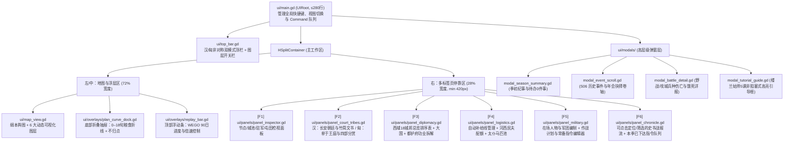

# S07 — 信息架构、界面线框、新手教学与本地化规范（UX, Onboarding & Localization Specification）

> **所有权声明（遵循 [00_bible.md](00_bible.md) §3）**：
> - 本文件（`S07`）唯一拥有：**全局信息架构与 `ui/main.gd` 拆分为 6 个独立子面板的组件树规范、全部界面文字线框（顶栏汉/匈非对称双模式、回合摘要弹窗、竹简封泥文书与矫诏生死时速环、单于王庭四部分赏与年会、18 城邦外交总览排序表与功业拆解、地图可视化图层、计划编辑器逐旬粮食曲线与不归点、可点击史书式战报与断粮单列、CK3 式 3 层嵌套 Tooltip 规范）、剧本①《楼兰姑师》5 课逐步交互教学脚本、三档难度【轻车/持节/虽远必诛】UI 表现差异、`tr()` + CSV 中英双语本地化工程规范、字体回退与多槽位带版本号存档界面**。
> - 引用关系：胜利与功业/威服公式引用 [S01_victory_scenarios.md](S01_victory_scenarios.md)；汉廷信任、诏令、奏疏与矫诏引用 [S02_han_court.md](S02_han_court.md)；单于威望、赏赐池、四部忠诚与三次年会引用 [S03_xiongnu_confederation.md](S03_xiongnu_confederation.md)；城邦外交、罪状、使团与供粮意愿引用 [S04_citystates_diplomacy.md](S04_citystates_diplomacy.md)；自动补给线、大军携粮、烽燧迷雾、算筹估计值与预演曲线引用 [S05_logistics_military_fog.md](S05_logistics_military_fog.md)；事件弹窗、人物卡片、本季纪事与史官附传模板引用 `S06_events_characters_narrative.md`；AI 难度参数引用 `S08_ai.md`。

---

## 1. 目的与支柱

### 1.1 解决的核心痛点（对应 [report_audit.md](research/report_audit.md) §3.3、§7、§8、§9）

在现有原型中，底层后勤与古道里程规则虽扎实，但 UI/UX 与新手引导存在 6 处致命短板，直接阻碍其达到商业策略游戏标准：
1. **零引导与开局误导**：启动直接进局，无主菜单、无教程、无目标拆解；汉方开局因商路被楼兰阻断而陷入“11 个月没钱发呆期”；河西守军实际就地食城粮，UI 却标红显示“携粮 0、可支撑 0.0 月”，严重误导新手以为守军即将饿死。
2. **单文件巨石 UI 与信息平铺**：`ui/main.gd` 单文件长达 1,153 行，每次 `refresh()` 销毁并重建整个右侧滚动栏；城市、外交、征召、运输、计划、待发命令全部塞在同一垂直列表，缺乏分页与全局总览（无 18 城邦排行表、无都护府功业拆解、无粮道流向图）。
3. **战报不可读、死因成黑箱**：`log_box` 仅是一条纯文本滚动框，不可点击定位、不可按类型筛选、无战斗兵种伤亡明细、更未单列占汉军总伤亡约 70% 的“断粮饿死”人数；常备指令触发直接打印代码 ID（如 `触发【supply_low】`），破坏汉代史书沉浸感。
4. **预演维度残缺与回放锁死交互**：作战计划预演仅有一行“粮草够/不够”文字，看不到逐旬余粮折线、不归点（Point of No Return）与沿途城邦给食拐点，也看不到敌军 30/60/90 日可达威胁圈；季制 90 天 WEGO 回放期间右侧栏被 `side_blocker` 完全锁死，等待成本极高。
5. **汉匈同质化顶栏**：汉与匈奴共用同一套简陋顶栏，未能体现汉方“持节使臣受制于长安诏令时差”与匈奴“单于靠赏赐池维系四大部族”的非对称核心幻想。
6. **无本地化、单槽裸存档**：全仓库硬编码中文字符串（仅 1 处 `tr()`），存档仅单槽位 `user://xiyu_save.txt` 且无版本号校验。

### 1.2 服务的体验支柱

| 体验支柱 | S07 的 UX 与视觉支撑方式 |
|---|---|
| **支柱 1：万里粮道** | 大地图直接绘制带流光箭头的自动补给线（带宽映射月运量、琥珀黄映射民夫吃紧、朱红闪断映射畏敌停运/断流）；计划编辑器底部内嵌 **0–18 旬逐旬余粮折线图 + 不归点红线 + 沿途城邦迎军给食拐点**；守军显示青色「就食城仓」徽章；战报将「饿死 X 人」以醒目朱红单列。 |
| **支柱 2：将在外** | 诏令与奏疏做成**带封泥的汉简实物 UI**，标注发自长安日期与驿传计程；大地图古道上实时奔跑黄绫诏书、青囊羽书与玄甲召还令棋子；悬停【持节矫诏】时在地图上绘制**红绿双线「生死时速环」**（我军破敌露布回奏 vs 廷尉槛车追抵前线的时间差预演）。 |
| **支柱 3：帝国对联盟** | **顶栏与主抽屉采取汉/匈非对称双模式设计**：执汉看「节钺、朝廷信任、岁首拨款、在途诏疏、都护府功业 $G$」；执匈奴看「单于威望、赏赐池、四部狼头忠诚灯（含缺席模糊区间）、下次年会倒计时、单于威服 $W$」。 |
| **支柱 4：人与史** | 每季初弹出《汉书》编年体**「本季纪事 + 待办 3 件事」回合摘要**（支持文言/白话一键切换）；全界面采用绢本舆图、居延汉简、汉画像石与草原错金兽纹人工美术风格；终局生成可导出 1080×1920 竖版分享卡的**「太史公曰 / 草原碑铭」五档列传评定**。 |

### 1.3 L7 机制准入检验（UX 如何让回合决策更深刻而非代劳）

遵循圣经 L7，S07 的一切自动化与可视化都遵循 **“消除机械记账，凸显战略权衡”** 原则：
1. **自动补给线 UI + 民夫秋收折损预警**：免去每季手工点 6 次河西运粮的机械操作，但拖动补给线优先级与民夫配额滑块时，Tooltip 与粮道颜色实时警告“跨八月征发民夫将令酒泉秋收减产 X 万斛”，迫使玩家在**前线远征供粮**与**后方秋收蓄积**之间做痛苦取舍。
2. **逐旬粮食折线 + 不归点红线**：不替玩家决定是否出兵，而是把“第 5 旬过不归点后必须指望楼兰开市或破城夺粮，否则第 8 旬全军饿死于白龙堆”的风险直观摊在桌面上，让**远征押注与常备指令（`supply_low` 阈值）**成为真正的博弈。
3. **矫诏生死时速环**：将 S02 的驿传路程公式转化为地图上的红绿赛跑环，玩家一眼看清“我军破城需 40 日，捷报回长安需 72 日，比槛车召还令快 24 日；但若久攻不下超 25 日即满盘皆输”，使**奉诏/讨价/矫诏**的决策张力拉满。
4. **迷雾算筹区间 + 30/60/90 日威胁圈**：不给全图透视，而是将最后望见敌骑的位置渲染为带时间戳的“灰色虚影算筹”与三层同心威胁圈，逼迫玩家决策**是否派轻骑侦察、是否修筑烽燧、或是否提前收缩粮道**。

---

## 2. 玩家视角

### 2.1 新玩家首局 30 分钟体验流（First-Time User Experience, FTUE）

新玩家首次启动游戏时，不再直接抛入毫无提示的 240 回合沙盒，而是经历一条严密编排的 30–40 分钟叙事引导流：


- **前 3 分钟（认知建立）**：玩家在主菜单点击高亮的【初入西域：楼兰姑师（教学篇章）】，默认锁定「执汉 · 轻车难度 · 按季下令（12季）」。开场三片汉简展开：“元封三年春，楼兰、姑师当空道，攻劫汉使王恢……天子拜尔为从票侯赵破奴副使，持节出玉门。”直接确立**“我是持节使臣，不是皇帝”**的身份认知。
- **第 3–15 分钟（核心循环破冰）**：通过第 1–3 课（详见 §4.11 `S07-R11`），玩家亲手点开「本季纪事」定位被劫地点，拉通第一条自动补给线，并在计划编辑器中**故意触发一次“步兵 5,000 人远征楼兰 → 第 6 旬断粮饿死”的红色折线报警**，从而彻底领悟万里粮道与 $T_{\max}$ 的残酷；随后切换为“赵破奴 700 轻骑 + 携 150 日粮 + 设【粮尽即返】常备指令”，在 90 天 WEGO 快进回放中亲眼看着金绿色算筹奇袭楼兰、虏楼兰王。
- **第 15–35 分钟（外交、诏令与自主决胜）**：通过第 4–5 课学会查看「18 城邦外交总览」与「都护府功业 $G$」，并在长安竹简诏书《诏：一年内破姑师》送达时，体验【上书讨价】与【持节矫诏】的生死时速环，最终在 12 季内达成剧本目标，收获第一张带有自己决策烙印的《太史公曰》结局分享卡，并被自然引导至主沙盒剧本《漠北之后》。

---

### 2.2 标准局一季（1 回合 = 9 旬 = 90 日）4 步交互流与具体回合示例

在标准剧本《漠北之后》（按季下令，每季目标操作时长 3–5 分钟，下达 3–5 个有意义指令）中，玩家每一季的交互严格遵循 **「读 → 决 → 演 → 观」** 四步闭环：

#### 具体回合示例：前 115 年第 2 季（元鼎二年夏，4–6 月，T18，玩家执汉）

1. **第一步：读 —— 季初「本季纪事 + 在途文书」摘要弹窗（约 30 秒）**
   - 回合开始时，屏幕中央展开绢帛卷轴式**【本季纪事与待办摘要】**（玩家可随时按 `Tab` 重开）：
     - **编年纪事（文言模式，悬停或点按钮可切白话）**：「元鼎二年夏四月，敦煌转运司运粟一万八千斛入阳关。乌孙昆莫猎骄靡遣使献良马百匹，谢汉赐公主。同月中旬，阳关烽燧望见匈奴右贤王游骑三千出没于白龙堆北，粮道告警。」
     - **竹简诏书送达**：一道加盖“皇帝信玺”封泥的竹简在弹窗右侧展开——《诏：通乌孙结盟》（剩余期限 6 季，达成赏信任 `+15`、库银 `+1,500` 钱）。
     - **本季待办 3 件事（带一键跳转按钮）**：
       1. 📜 **【待复诏令】**《诏：通乌孙结盟》已抵敦煌，需在本季择定【奉诏 / 上书讨价 / 推辞】→ `[点此批阅]`
       2. ⚠️ **【粮道告警】**「敦煌→楼兰」补给线因白龙堆望见匈奴游骑（约 2,000–3,500 骑）已自动转为`畏敌停运`，楼兰驻军余粮仅支 4.2 旬 → `[定位白龙堆]`
       3. 🏛️ **【城邦动摇】**「渠犁」对匈怨恨升至 38、汉影响力达 28，差 2 点影响力即可遣使【纳为两属】→ `[打开外交表]`

2. **第二步：决 —— 在独立子面板中下达本季 4 条关键指令（约 90 秒）**
   - **决策 1（文书面板 `F2`）**：点击待办 1 打开右侧「长安朝廷与文书」面板，审视《诏：通乌孙结盟》。因当前北道仍有匈奴游骑，玩家点击 **【上书讨价】**，勾选诉求「宽限期限 +2 季」与「请附拨专款 +1,000 钱」，勾选核验属实理由「北道有敌骑阻截（成功率 +15%）」，总成功率 `80%`，消耗信任 `-3`（当前信任 `64 → 61`），点击 **【拜表发往长安】**（生成青囊羽书棋子，计程 22 日抵长安）。
   - **决策 2（外交面板 `F3`）**：按 `F3` 呼出「西域十八国总览表」，按“距下一层级差值”排序，置顶看到「渠犁（当前亲汉倾向 +12）」。点击派出一支 **【募使团】**（免占具名人物槽，配预算 `200` 钱，自楼兰出发计程 18 日抵渠犁）。
   - **决策 3（后勤面板 `F4`）**：点击地图上的「敦煌→楼兰」红色虚线粮道，在右侧「粮道与转运司」面板中将护卫策略从“遇敌即停”调整为“由赵破奴部沿途护粮”，并微调民夫配额滑块至 `2,500` 人（Tooltip 提示：未超河西免损阈值，秋收减产 `0` 斛）。
   - **决策 4（军队与计划面板 `F5`）**：选中驻守阳关的持节副使 **赵破奴军（3,000 骑 + 1,000 弩，统率 78）**，点击打开计划编辑器，规划步骤：`1. 移动至楼兰（16日） → 2. 设伏于楼兰–车师道（60日）`，常备指令预设选 **【见利则进（aggressive）】**。

3. **第三步：演 —— 检查逐旬粮食曲线、威胁圈与生死时速环（约 30 秒）**
   - 在计划编辑器底部，**逐旬余粮折线图**实时重算：
     - 赵破奴军随军携粮 `12,000` 斛（可支 40 日 / 4.0 旬）；
     - 折线在第 0–1.6 旬下降至 `7,200` 斛（绿色安全区）；
     - 第 2 旬抵达己方属国「楼兰」时，折线出现绿色向上阶梯拐点标注：**「第 2 旬抵楼兰：🟢 箪食壶浆（献粮 +3,000 斛，就食城仓）」**，余粮拉回 `10,200` 斛，全程处于绿色安全带（无饿死风险，不归点在第 7 旬）。
   - 同时地图上展开白龙堆匈奴游骑的 **30/60/90 日橙红同心威胁圈**，玩家确认赵破奴第 16 日即可抢在匈奴游骑（预计 22 日抵楼兰）之前进入设伏位置。
   - 顶栏右侧显示：`本季已下达指令：4 令 | 剩余可用钱：1,450 | [ 结束本季 · 奉令行事 (Space) ]`。

4. **第四步：观 —— 90 日 WEGO 结算回放与史书战报（约 30 秒）**
   - 玩家按下 `Space` 进入 90 日逐日推演（默认开启 **「只播关键事件 + ×4 倍速」**，且**右侧面板不锁死**，玩家可在回放途中自由翻看城邦详情与人物列传）：
     - 第 16 日：赵破奴骑兵进入楼兰北道设伏；青囊羽书途经张掖；
     - 第 24 日：**【关键事件自动暂停 1.5 秒 / 弹微缩战报卡】** 匈奴右贤王游骑 2,800 人踏入赵破奴伏击圈！地图在楼兰北道亮起金戈交鸣动效，底部史书战报流打印：`「元鼎二年五月上旬，从票侯赵破奴伏兵于楼兰北道，邀击匈奴右贤王游骑，大破之，斩首六百二十级，获马八百匹，余众北遁。」`
     - 点击该条战报中的 `[赵破奴伏兵于楼兰北道]` 链接，展开 **【交战详报弹窗】**，清晰列出双方参战将领统率加成、三回合远程/冲击伤亡、俘获战马 `+800` 匹、以及 `断粮饿死：汉 0 人 / 匈奴 140 人`。
     - 第 54 日：长安批答黄绫木牍送达敦煌：「天子准奏，宽限《通乌孙结盟》二季，赐少府钱一千！」
   - 第 90 日季末结算完毕，自动切入下一季（元鼎二年秋）的「本季纪事」弹窗。

---

## 3. 状态变量与设置项表

S07 不拥有游戏规则层的模拟状态（模拟状态严格归属 S01–S06 的 `GameState`），但唯一拥有 **UI 运行时视图状态（`UIState`）**、**新手教学进度状态（`TutorialState`，随存档序列化）** 与 **玩家全局偏好设置（`UISettings`，持久化于 `user://settings.json`）**。

### 3.1 UI 运行时与教学存档状态表（`UIState` & `TutorialState`）

| 名称 | 所属对象 | 类型 | 取值范围 | 初值 | JSON 键 / 配置路径 | 存档字段（`state.ui_meta`） |
|---|---|---|---|---|---|---|
| 当前激活侧栏标签页 | `UIState` | `String` | `"inspector"` / `"court_or_tribes"` / `"diplomacy"` / `"logistics"` / `"military"` / `"chronicle"` | `"inspector"` | `ui.default_tab` | `ui_meta.active_tab` |
| 地图可视化图层掩码 | `UIState` | `Dictionary` | `{supply: bool, fog: bool, threat: bool, courier: bool, trade: bool, tribe_zone: bool}` | 全 `true`（`threat` 默认悬停显示，勾选后常驻） | `ui.map_layers_default` | `ui_meta.map_layers` |
| 当前选中节点 ID | `UIState` | `String` | `""` 或 42 个合法节点 ID | `""` | — | `ui_meta.sel_node` |
| 当前选中军队 ID | `UIState` | `String` | `""` 或合法 `army_id` | `""` | — | `ui_meta.sel_army` |
| 计划编辑草稿表 | `UIState` | `Dictionary` | `army_id -> {steps: Array, preset: String, preview_cache: Dict}` | `{}` | — | `ui_meta.drafts` |
| 威胁圈检视目标军 ID | `UIState` | `String` | `""` 或敌军 `army_id` / 虚影 ID | `""` | — | 不入档 |
| 矫诏时速环预演激活态 | `UIState` | `bool` | `true` / `false` | `false` | — | 不入档 |
| 战报筛选器状态 | `UIState` | `Dictionary` | `{faction: "all"/"han"/"xiongnu", category: "all"/"battle"/"supply"/"court"/"diplomacy"/"event"}` | `{faction: "all", category: "all"}` | — | `ui_meta.log_filter` |
| 外交总览表排序列与方向 | `UIState` | `Dictionary` | `{col: String, desc: bool}`（列含 `tilt`/`han_inf`/`xn_threat`/`forage_w`/`tier_gap`） | `{col: "tier_gap", desc: false}` | — | `ui_meta.diplo_sort` |
| 嵌套 Tooltip 锁死层级 | `UIState` | `int` | `0..3`（`0` 为未锁定，`1..3` 为当前锁定的嵌套层数） | `0` | `ui.tooltip_max_depth` | 不入档 |
| 教学剧本激活标志 | `TutorialState` | `bool` | `true` / `false`（仅剧本① `loulan_gushi` 且开启引导时为 `true`） | `false` | `scenarios.loulan_gushi.is_tutorial` | `tutorial.active` |
| 当前教学课次编号 | `TutorialState` | `int` | `1..5`（`6` 表示全部完成） | `1` | `tutorial.initial_lesson` | `tutorial.lesson_idx` |
| 当前课内步骤序号 | `TutorialState` | `int` | `1..8` | `1` | `tutorial.initial_step` | `tutorial.step_idx` |
| 第 3 课失败预演已体验标志 | `TutorialState` | `bool` | `true` / `false`（记录玩家是否已在计划编辑器看到过一次红线断粮警告） | `false` | — | `tutorial.seen_starvation_preview` |
| 教学已完成历史集合 | `UISettings` | `Array[String]` | 已通关的课次 ID 列表（如 `["L1", "L2", "L3", "L4", "L5"]`） | `[]` | `settings.completed_tutorials` | 存入 `user://settings.json` |

### 3.2 全局玩家设置项表（`user://settings.json` & `data/ui_config.json`）

| 名称 | 所属对象 | 类型 | 取值范围 | 初值 | JSON 键（`settings.json`） | 说明与作用机制 |
|---|---|---|---|---|---|---|
| 界面与文本语言 | `UISettings` | `String` | `"zh_CN"` / `"en_US"` | `"zh_CN"` | `settings.locale` | 切换 Godot `TranslationServer.set_locale()`，实时刷新全界面 `tr()` 文本 |
| 叙事文风模式 | `UISettings` | `String` | `"classical"`（浅文言史书体） / `"vernacular"`（现代白话注释体） | `"classical"` | `settings.narrative_style` | 控制「本季纪事」、事件正文、诏书正文与终局附传的显示模板（支持在弹窗内一键切换） |
| WEGO 回放默认倍速 | `UISettings` | `float` | `1.0` / `2.0` / `4.0` / `8.0` | `4.0` | `settings.replay_speed` | 季制 90 日回放默认采用 `4.0x`（每旬约 0.3 秒，无事件时 90 日约 2.7 秒走完） |
| 只播关键事件开关 | `UISettings` | `bool` | `true` / `false` | `true` | `settings.replay_key_events_only` | 开启时无交战/无断粮/无文书送达/无城陷的平淡日以 `8.0x` 疾进，遇关键事件自动降为 `1.0x` 并高亮聚焦 1.5 秒 |
| 回放中自动定位镜头 | `UISettings` | `bool` | `true` / `false` | `true` | `settings.replay_auto_pan` | 回放触发野战、攻城、使团抵达或部王叛离时，地图镜头平滑插值（`0.25s`）移至事发节点 |
| 悬停 Tooltip 锁定延迟 | `UISettings` | `float` | `0.3..1.5` 秒（或按 `Alt` / 中键立即锁定） | `0.6` | `settings.tooltip_lock_delay_sec` | 鼠标悬停满 `0.6` 秒后，Tooltip 边框变为铜金实线锁定态，允许鼠标移入内部点击下划线词条展开第 2/3 层 |
| 色盲辅助与高对比模式 | `UISettings` | `String` | `"off"` / `"deuteranopia"`（红绿） / `"protanopia"` / `"high_contrast"` | `"off"` | `settings.colorblind_mode` | 开启后：汉/匈阵营色由红/青改为**朱金（`#E69F00`）vs 靛蓝（`#0072B2`）**；粮道绿/黄/红全数叠加形状纹理（实线/斜纹/叉号虚线）与文字角标 |
| 全局字号缩放档位 | `UISettings` | `float` | `0.9`（紧凑） / `1.0`（标准 1080p） / `1.15`（大字） / `1.30`（2K/4K/Deck） | `1.0` | `settings.font_scale` | 动态缩放 `Theme.default_font_size`（基准正文 `16px`，标题 `22px`，微缩角标不低于 `13px`） |
| 自动存档保留季数 | `UISettings` | `int` | `1..5`（每季初自动轮转保存 `autosave_q1..q5.sav`） | `3` | `settings.autosave_keep_count` | 防止玩家误操作矫诏或断粮覆没后无法回退 |
| 季末漏令二次确认提醒 | `UISettings` | `bool` | `true` / `false` | `true` | `settings.warn_unspent_actions` | 若有待复诏书未批、单于赏赐池未分、或主力军处于闲置且无计划，点「结束本季」时弹出轻提示 |


---

## 4. 规则与公式（界面架构、线框规范、教学脚本与本地化）

### 4.1 `S07-R01` 全局信息架构与 `ui/main.gd` 模块化拆分规范

#### 1. 解决单文件巨石 UI 的工程重构原则
现有 `ui/main.gd`（1,153 行）将顶栏、地图交互、节点检视、外交、征兵、运输、计划编辑、回放控制全部耦合在单一脚本中，且每次调用 `refresh()` 均执行 `for c in side.get_children(): c.queue_free()` 全量销毁重建，导致滚动条位置丢失、悬停闪烁且无法扩展。

重构后，`ui/main.gd` 瘦身为**不超过 280 行的顶层布局容器与事件总线协调器（`UIRoot`）**，右侧功能区拆分为 **6 个按需局部刷新的独立子面板（`ui/panels/*.gd`）**，辅以 4 个模态/半模态浮层控制器（`ui/modals/*.gd`）：



#### 2. 6 个独立子面板职责与脏标记局部刷新协议（Dirty-Flag Partial Refresh）

| 面板脚本路径 | 快捷键 | 执汉标题 | 执匈奴标题 | 绑定的数据源（只读） | 触发局部刷新的信号（禁止全树销毁） |
|---|---|---|---|---|---|
| `ui/panels/panel_inspector.gd` | `F1` | 【城塞与人物检视】 | 【牧场与城塞检视】 | `state.nodes[sel_node]`、`state.characters` | `signal node_selected(node_id)`、`orders_changed` |
| `ui/panels/panel_court_tribes.gd` | `F2` | 【长安朝廷·节钺文书】 | 【单于王庭·诸部羁属】 | 汉：`state.court`；匈：`state.tribes` | `signal court_updated` / `tribes_updated`、`orders_changed` |
| `ui/panels/panel_diplomacy.gd` | `F3` | 【西域诸国·都护功业】 | 【西域诸国·僮仆威服】 | `state.relations`、`state.envoys`、`Victory` | `signal diplomacy_updated`、`sort_col_changed` |
| `ui/panels/panel_logistics.gd` | `F4` | 【万里粮道·转运屯田】 | 【草场载畜·岁币巡行】 | `state.supply_lines`、`state.han_horse_pool` | `signal logistics_updated`、`orders_changed` |
| `ui/panels/panel_military.gd` | `F5` | 【诸军节度·行军预演】 | 【控弦铁骑·行军预演】 | `state.armies[sel_army]`、`UIState.drafts` | `signal army_selected(army_id)`、`draft_modified` |
| `ui/panels/panel_chronicle.gd` | `F6` | 【太史竹帛·本季军令】 | 【草原纪事·本季军令】 | `state.event_logs`、`UIRoot.orders` | `signal log_appended`、`filter_changed`、`orders_changed` |

- **回放期间“可浏览、禁改令”规则**：废除原有的全屏透明遮罩 `side_blocker`。在 90 日 WEGO 回放（`replaying == true`）期间，右侧 6 个标签页**全部允许自由点击切换、滚动与悬停查看 Tooltip**；仅将产生 `Command` 的操作按钮置为 `disabled = true`（悬停提示 `「推演结算中，待下一季初方可下令」`），彻底消除 90 日回放的枯燥等待感。

---

### 4.2 `S07-R02` 顶栏汉/匈非对称双模式文字线框（Asymmetric Top Bar）

顶栏固定高度 `76px`（分上下两行：上行为核心权力与战略资源栏，下行为地图图层开关与主进度/回放栏），严格按当前扮演阵营切换视觉皮肤（汉：玄漆朱金竹简纹；匈奴：苍青错金狼首纹）：

#### 模式 A：执汉顶栏（持节使臣 / 西域都护视角）

```text
+========================================================================================================================+
| [节] 博望侯·张骞 (驻:敦煌 ⇄长安22日) | 朝廷信任:[██████░░ 62/100 正常委任] (风向:武帝·拓边) | 国库:3,450钱 (+1,500/季) |
| 太仆官马: 5,800/10,000匹 | 中央军额度: 2,500/3,500人 | 具名将使: 4/5人 | 在途文书: 📜诏1 📨疏1 | 【都护功业 81/100】[████░]|
+------------------------------------------------------------------------------------------------------------------------+
| 图层: [x]粮道带宽 [x]烽燧迷雾 [x]使团驿骑 [ ]敌威胁圈 [x]商路 | 前115年夏(4月上旬·第18季) | 已下4令 [ 结束本季 (Space) ]|
+========================================================================================================================+
```

#### 模式 B：执匈奴顶栏（撑犁孤涂单于视角）

```text
+========================================================================================================================+
| [狼] 伊稚斜单于 (51岁·驻:单于庭 [亲征未开]) | 单于威望:[★★★★☆ 44/100] | 单于赏赐池: 1,120钱 (预计本季入+550/期望分-880)|
| 四部忠诚: [左贤🟢68] [右贤🟡54] [日逐🌫️48~68] [犁汙🔴42⚠️] | 下次年会:五月龙城(2旬后) | 战术卡:[诈败诱敌] | 【威服 58/100】|
+------------------------------------------------------------------------------------------------------------------------+
| 图层: [x]部族牧区 [x]僮仆税道 [x]迷雾侦察 [ ]汉威胁圈 [x]白灾预警 | 前115年夏(4月上旬·第18季)| 已下3令 [ 结束本季(Space)]|
+========================================================================================================================+
```

- **顶栏交互要点**：
  1. 点击汉方 `[节] 博望侯·张骞` 或 `在途文书: 📜诏1` 直接切至 `[F2 长安朝廷]` 并居中持节者所在城池；
  2. 点击匈奴方任意一个狼头徽章（如 `[日逐🌫️48~68]` 或 `[犁汙🔴42⚠️]`）直接打开 `[F2 单于王庭]` 并高亮对应部族帐幕；
  3. 右侧 `【都护功业 81/100】` 或 `【威服 58/100 (河西 1/4)】` 悬停立即弹出 S01 定义的 9 项分项拆解与破局指引 Tooltip，点击则切至 `[F3 西域诸国]` 面板。

---

### 4.3 `S07-R03` 季初「本季纪事 + 待办 3 件事」回合摘要弹窗线框

每季第 1 日（Tick 0 / 9 / 18...）结算完季初触发器后，自动在屏幕中央弹出半模态竹帛卷轴 `ModalSeasonSummary`（按 `Esc` 或点击【披阅毕·入局筹策】关闭，局内按 `Tab` 可随时重阅）：

```text
+=======================================================================================+
|                 【 元 鼎 二 年 夏 （前115年4月 · 第18季） 太 史 纪 事 】               |
|                                                      [文风: ●史书文言 ○现代白话] [×]  |
+---------------------------------------------------------------------------------------+
|  📖 【上季青史纪要】                                                                  |
|  「元鼎二年春，汉遣从票侯赵破奴将属国骑三千出阳关。楼兰王惧汉兵威，箪食壶浆迎军于白   |
|    龙堆。三月，匈奴右贤王部游骑入寇且末北道，劫汉募使，夺金二百。敦煌太守急修烽燧。」 |
|   (💡 切换白话：1-3月赵破奴率3000骑出阳关，楼兰王献粮迎军；3月匈奴游骑在且末北道劫掠  |
|    了汉朝募使团，抢走200钱，触发【杀/劫汉使】合法讨伐罪状。)                          |
+-------------------------------------------+-------------------------------------------+
|  📊 【本季国计收支与态势变动】            |  🎯 【本季亟待决断之要务（最多3项）】     |
|  · 国库变动：3,150 → 3,450 钱 (+300)     |                                           |
|    (春首拨款 +0 | 商税 +450 | 亭燧 -150)  |  1. 📜 [诏令待复] 《诏：通乌孙结盟》已抵  |
|  · 朝廷信任：64 → 62 (-2，募使被劫受辱)   |     敦煌，限6季内促成乌孙结盟。           |
|  · 河西总存粮：41.2万斛 (+1.8万)          |     -> [立即批阅诏书 (跳转F2)]            |
|  · 粮道状态：2条畅通 / 1条畏敌停运(⚠️)    |                                           |
|  · 都护功业：75 → 81 (+6，新增楼兰属国)  |  2. ⚠️ [粮道受阻] 「敦煌→楼兰」线因白龙堆 |
|  · 敌情异动：白龙堆北望见匈奴骑(约2-3.5千)|     望见敌骑暂停，楼兰军余粮仅支 4.2 旬！ |
|                                           |     -> [定位白龙堆并派兵护粮 (跳转地图)]  |
|                                           |                                           |
|                                           |  3. ⚖️ [新获罪状] 「且末」纵容匈奴劫汉使，|
|                                           |     已获合法讨伐罪状（免矫诏，战功+4）！  |
|                                           |     -> [查看且末外交与讨伐选项 (跳转F3)]  |
+-------------------------------------------+-------------------------------------------+
|  [ ] 本局不再自动弹出季初摘要（仍可按 Tab 查阅）           [ 披阅毕 · 入局筹策 (Enter) ] |
+=======================================================================================+
```

- **「待办 3 件事」生成优先级算法（`SummaryAdvisor.get_top_3_todos(state, faction)`）**：
  系统从以下候选池中按权重取前 3 条展示，确保新手绝不会陷入“不知道这回合该干嘛”的迷茫：
  1. **P0（生死红线，权重 100）**：有《槛车召还令》在途 / 朝廷信任 `< 25` / 匈奴 ≥2 个部族处于 `rebellious` 或 `wavering`（私通汉使）状态；
  2. **P1（必办政务，权重 80）**：有新送达未表态的竹简诏令（汉） / 本季为正月小会、五月龙城或秋蹛林年会且赏赐池未分配（匈奴）；
  3. **P2（断粮与劫道预警，权重 60）**：有野战军预计本季内断粮 / 自动补给线处于 `paused_danger` 或 `cut` / 河西四郡或单于庭 2 跳内出现敌军主力；
  4. **P3（破局机会窗口，权重 40）**：某城邦刚产生合法讨伐罪状 / 某城邦差 `≤ 5` 点影响力即可升级外交层级 / 检测到匈奴发生冬季白灾或日逐王怨望事件。

---

### 4.4 `S07-R04` 竹简封泥式「诏令/奏疏与矫诏生死时速环」UI 线框（对应 S02）

#### 1. 右侧 `[F2 长安朝廷·节钺文书]` 抽屉面板与「矫诏生死时速环」线框

当玩家点击顶栏朝廷区或按 `F2` 时，右侧停靠区展示汉简编绳视觉风格的朝廷面板；当玩家准备发起未经授权的出塞攻城、立屯或发诸国兵，将鼠标悬停于 **【持节矫诏】** 按钮时，面板底部与大地图同步激活 **「矫诏生死时速环（Life-or-Death Courier Race Ring）」**：

```text
+===========================================================================+
| 【长安朝廷 · 节钺与竹简文书】                         [快捷键: F2]        |
+---------------------------------------------------------------------------+
| 持节使臣：博望侯·张骞 [辞令88 | 谨慎65]   驻地：轮台 (距长安驿程 58 日)   |
| 朝廷信任：[██████░░░░ 62/100] 【正常委任】 (下档<50将派侍御史监军!)       |
| 朝廷风向：【武帝·拓边开疆】(拨款×1.20 | 战功信任+25% | 容忍矫诏度较高)    |
| 矫诏先例：累计 1 次 (当前朝堂抵触值: 15% -> 胜利封侯检定尚无降格风险)     |
+---------------------------------------------------------------------------+
| 📜 【当前奉行诏令】(上限 2 道)                                            |
|  ┌─────────────────────────────────────────────────────────────────────┐  |
|  │ [皇帝信玺] 《诏：一年内击破车师前王》(ED04)       剩余: 3季 (27旬)  │  |
|  │ 目标: 攻占车师前王庭 或 令其纳质内属 | 赏: 信任+16, 钱+1,500       │  |
|  │ 状态: 已奉诏行事 (解锁对[车师前]合法讨伐权)   [上疏自陈展期 (-4信)]│  |
|  └─────────────────────────────────────────────────────────────────────┘  |
| 📨 【古道在途文书】(地图上实时显示驿骑位置与截获风险)                     |
|  · 🔵《请增拨河西转运钱疏》: 张掖→武威段 | 置邮速4.0 | 预计 11 日抵长安   |
|  · 🟡《圣旨批答·乌孙结盟》 : 陇西→张掖段 | 置邮速4.0 | 预计 19 日抵轮台   |
+---------------------------------------------------------------------------+
| ⚡ 【拜表上疏 & 持节独断操作】                                            |
|  [上疏请款 (+1000钱 | 耗58日 | 需信≥45)]  [上疏请调中央军 (+3000额度)]    |
|  [以节发2跳内属国兵 (最高4,500人)]        [预发《上疏自劾表》 (罚减半)]   |
+---------------------------------------------------------------------------+
| 🔥 【持节矫诏 · 生死时速环预演】(悬停【矫诏讨伐：龟兹】时实时演算)        |
|  ┌─────────────────────────────────────────────────────────────────────┐  |
|  │ 动作：未奉诏书且无罪状，强行矫诏发兵攻打【龟兹】！                  │  |
|  │ 立即代价：朝廷信任 -12 (若同步勾选[随军拜表自劾]则仅扣 -6 信任)     │  |
|  │ ─────────────────────────────────────────────────────────────────── │  |
|  │ 🏇 【红线 · 朝廷追责槛车线】 总耗时：约 126 日 (12.6 旬)            │  |
|  │    监军密奏自轮台发长安(58日) + 朝堂廷议(10日) + 槛车追抵前线(58日) │  |
|  │ ⚔️ 【绿线 · 我军破敌露布线】 预计耗时：约 102 日 (10.2 旬)          │  |
|  │    轮台行军抵龟兹(14日) + 预计围城破城(30日) + 露布捷报飞驰长安(58日)│  |
|  │ ─────────────────────────────────────────────────────────────────── │  |
|  │ ✅ 【时差裁定：绿线比红线快 24 日（2.4 旬）！】                     │  |
|  │    若在 44 日内攻克龟兹，露布将在槛车发出前抵长安，达成【矫诏立功， │  |
|  │    赎罪不问】！若围城久顿超 68 日，槛车先至，将被锁拿入京！         │  |
|  │    [x] 同步发出《自劾请罪表》(-6信任，失败免族诛)  [ 拔剑持节矫诏 ] │  |
|  └─────────────────────────────────────────────────────────────────────┘  |
+===========================================================================+
```

---

### 4.5 `S07-R05` 匈奴「单于王庭·四部分赏与三次年会」UI 线框（对应 S03）

#### 1. 右侧 `[F2 单于王庭·诸部羁属]` 面板（含精确忠诚 vs 缺席模糊区间视觉规范）

- **模糊忠诚度渲染规则（对齐 `S03` 迷雾规则）**：
  - 当某部首领出席最近一次龙城/蹛林年会时，其忠诚度槽渲染为**实心铜金格**，标注 `[精确 68/100]`；
  - 当某部首领因忠诚 `< 40` 或路途遥远**缺席上次年会**时，单于失去对其心意的精确掌握，忠诚度槽在 `[est_min, est_max]`（如 `48~68`）区间内渲染为**紫色斜纹迷雾浮动带（`▒▒▒`）**，并标注 `[🌫️ 缺席未知：约 48~68]`，直到单于派亲信巡视或其再次奉诏赴会才恢复精确显示。
- **一键分赏辅助按钮**：底部固定提供 `【沿用上季比例】` 与 `【按期望全额配平】` 两个快捷按钮，消除每季逐一拖滑块的机械操作，玩家只需在此基础上决定“本季要刻意饿哪一部、喂饱哪一部”。

#### 2. 匈奴三次年会（正月小会 / 五月龙城 / 秋季蹛林）模态议事卷轴线框

每逢 Q1（正月单于庭诸长小会）、Q2（五月龙城祭天大会）、Q3（秋季蹛林算畜大会）季初，自动弹出苍狼毡帐风格的年会决策卷轴：

```text
+===================================================================================+
|               【 草原盛会 · 秋 季 蹛 林 大 会 （绕林算畜·共议秋掠） 】            |
|          地点：蹛林草场   |   当前单于威望：48/100   |   单于赏赐池：1,450 钱      |
+-----------------------------------------------------------------------------------+
|  【诸部赴会点卯】                                                                 |
|  · [东翼] 左贤王·乌维  ：🟢 率部赴会 (献马 800 匹，忠诚 68 精确可见)              |
|  · [西翼] 右贤王·须卜奢：🟢 率部赴会 (献马 1,200 匹，忠诚 54 精确可见)            |
|  · [西域] 日逐王·呼衍骨：🔴 称疾不至！(威望 -4，其忠诚变为模糊区间 [约 35~55])    |
|  · [前锋] 犁汙王·休屠余：🟡 勉强赴会 (忠诚 42，满腹怨言，索求额外赏赐 +100 钱)    |
+-----------------------------------------------------------------------------------+
|  【蹛林大会核心议题：钦定今秋南下主攻方向与战术卡】                               |
|                                                                                   |
|  1. 择定【今秋会盟靶标】（顺应部领偏好可令其忠诚 +6、免费出兵）：                 |
|     (●) 主攻【敦煌 / 阳关】 —— 契合右贤王、犁汙王偏好 (两部忠 +6，合计出骑 8,500) |
|     ( ) 主攻【居延 / 酒泉】 —— 契合左贤王偏好 (左贤忠 +6，右贤因西路空虚忠 -4)    |
|     ( ) 西压【乌垒 / 轮台】 —— 强令支援日逐王 (诸部嫌远无利，左/右贤忠各 -5)      |
|     ( ) 今秋休牧不出，杀马备冬 —— 赏赐池无劫掠进账，全军过冬白灾损耗 -40%         |
|                                                                                   |
|  2. 颁赐【本季单于王庭战术卡】（三选一，本季全局生效）：                          |
|     [● 诈败诱敌 (伏击伤害+30%，诱汉军深入断粮)]                                   |
|     [○ 拔除亭障 (拆毁汉烽燧赏金翻倍，令汉视野致盲)]                               |
|     [○ 焦土秋掠 (焚毁河西农田与劫掠金收益 ×2.0)]                                  |
+-----------------------------------------------------------------------------------+
|  💡 警告：日逐王称疾缺席！可在会后打开[F2王庭]择定【遣使厚币抚慰】或【削藩问罪】。|
|                                              [ 杀白马盟誓 · 颁行草原 (Enter) ]    |
+===================================================================================+
```


---

### 4.6 `S07-R06` 18 城邦外交总览排序表与都护府功业 $G$ 进度拆解线框（对应 S01 / S04）

右侧 `[F3 西域诸国·都护功业]` 面板将原本散落在 42 个地图节点上的外交信息汇总为**一表统览、支持按任意列点击排序**的全局决策台，并在面板顶部常驻显示 **都护府功业 $G$（汉）/ 单于威服 $W$（匈奴）构成进度条**：

```text
+===================================================================================================+
| 【西域都护府 · 功业进度与十八国总览】                                              [快捷键: F3]   |
+---------------------------------------------------------------------------------------------------+
| 🏆 【都护府功业 G：81 / 100】 [████████░░]  状态：距奏请立府尚差 19 点 (立府后需维持 4 季/12月)   |
| ┌───────────────────────────────────────────────────────────────────────────────────────────────┐ |
| │ 属国(8×6): +48/66 | 册封(4×2): +8/12 | 乌垒/车师枢纽: +10/20 | 屯田自养: +12/15 | 抑匈威: +0 │ |
| │ 大国盟(乌孙): +4  | 罢僮仆: +0/10    | 近期战功: +4.0        | 历史大勋: +0     | 河西罚: -0 │ |
| │ 💡 破局捷径：攻克或招抚【车师前】可得 +16 功业；促【日逐王来降】立得 +25 功业并罢僮仆！       │ |
| └───────────────────────────────────────────────────────────────────────────────────────────────┘ |
+---------------------------------------------------------------------------------------------------+
| 筛选: [●西域十八城邦(18)] [○葱岭外五大国(5)] | 排序: [距晋升差值▲] [倾向▼] [供粮意愿▼] [有罪状优先]|
| 在途使团 (2/3 募使额, 1 具名正使): 🚩张骞精使团→乌孙(余42日)  🏇敦煌募使→渠犁(余18日, 携200钱)    |
+---------------------------------------------------------------------------------------------------+
| 国名(道) | 宗主状态     | 倾向Tilt | 汉影I | 匈威X | 怨(汉/匈)| 供粮意愿W(对当前主力)| 罪状/快捷令|
|----------+--------------+----------+-------+-------+----------+----------------------+------------|
| 渠犁(北) | ⚪独立(动摇) |  +18 亲汉|   28  |   18  |  0 / 38  | 🟢 78 箪食献粮       | [遣募使200]|
| 楼兰(南) | 🔴汉属国     |  +42 亲汉|   65  |   22  |  5 / 20  | 🟢 84 箪食献粮       | [赐印册封] |
| 精绝(南) | ☯️汉匈两属   |   +4 中立|   36  |   34  |  0 / 26  | 🟡 56 开市平籴       | [纳为专属] |
| 且末(南) | 🐺匈属(禁商) |  -24 亲匈|   14  |   48  | 10 / 12  | 🔴 18 坚壁拒守       | ⚖️劫使[讨伐]|
| 乌垒(北) | 🔴汉属(治所) |  +55 亲汉|   72  |   15  |  0 / 30  | 🟢 90 箪食献粮       | ★枢纽+10已得|
| 龟兹(北) | 🐺匈属(大国) |  -38 亲匈|   12  |   62  | 15 / 18  | 🟠 34 疑惧闭籴       | [派精使400]|
| 车师前   | 🐺匈属(耳目) |  -52 亲匈|    8  |   75  | 20 / 10  | 🔴 12 坚壁拒守       | 📜奉诏讨伐 |
| 焉耆(北) | 🐺匈僮仆驻地 |  -46 亲匈|   10  |   70  |  8 / 25  | 🔴 15 坚壁拒守       | 💰驻僮仆都尉|
| ...(支持滚轮浏览全部18城邦与5大国，点击任意行地图镜头立即平滑移至该城邦并展开详细外交卡)...       |
+===================================================================================================+
```

---

### 4.7 `S07-R07` 大地图 6 层可视化规范（补给线、五级迷雾、威胁圈、在途实体）

`ui/map_view.gd` 在保留绢本古舆图底图的基础上，严格按 **Z-Index 由底向上分 6 层渲染**，玩家可通过顶栏复选框或快捷键 `1–5` 独立开关各层：

| Z 层级 | 图层名称 | 快捷键 | 视觉渲染与数学公式规范（严格对齐 S02/S03/S04/S05） |
|---|---|---|---|
| **Z1** | **疆域与牧场白灾环** | `5` | · 汉直辖郡县绘朱红双线框；匈奴四大部族牧区绘半透明领地底纹（左贤青、右贤褐、日逐紫、犁汙赭）；<br/>· **白灾超载预警环（S03）**：秋季（Q3）当牧区 `horses / pasture_cap > 0.60` 时，节点外圈绘制**冰蓝色呼吸雪花环**，悬停提示「载畜超标，今冬白灾死伤率翻倍，点击可宰马备冬」。 |
| **Z2** | **五级烽燧迷雾层** | `2` | · **L4（直辖/大军同格）& L3（烽燧/属国1跳）**：绢本原色高亮，显示精确兵力与城池储粮；<br/>· **L2（斥候/两属/商队2跳）**：轻度水墨暗角，敌军显示为半透明算筹与区间；<br/>· **L1（过期旧情报，30–90日前）**：中度茶墨遮罩，显示**灰色虚影算筹**与最后望见时间戳；<br/>· **L0（未知绝域）**：浓墨云纹覆盖（未侦察路段铺设 `45°` 淡墨斜纹），仅见城池古名与地形，隐去一切敌情。 |
| **Z3** | **丝路商道与僮仆税道** | `4` | · **丝路南北道（S04）**：自敦煌起畅通前缀绘制**鎏金驼队虚线**；遇 `trade_banned` 城邦绘制红色「禁商木牌」截断标；<br/>· **僮仆都尉巡行税道（S03）**：北道焉耆—轮台—车师间绘制**赭黄税骑轨迹线**，护卫军头顶常驻气泡 `💰在途岁币: 210钱`。 |
| **Z4** | **万里粮道流光带** | `1` | · 每条 `SupplyLine` 绘制带流光箭头的有向曲线，线宽公式：$w = \text{clamp}(2 + 2\log_{10}(\max(100, \text{delivered\_30d})), 2, 10)\text{ px}$；<br/>· **三态色彩 + 色盲纹理**：<br/>  - 🟢 **畅通（`active`，运量 $\ge 70\%$）**：汉竹简金绿实线（`#68B88E`）；<br/>  - 🟡 **民夫吃紧（`throttled`，运量 $< 70\%$）**：琥珀黄斜纹带（`#E5A93C`），中点标 `[民夫不足]`；<br/>  - 🔴 **畏敌停运/断流（`paused_danger` / `cut`）**：朱红高频闪烁叉号虚线（`#DF5A4E`），断口标 `[⚠️畏敌待命]` 或 `[❌粮道断绝]`。 |
| **Z5** | **敌军 30/60/90 日威胁圈** | `3` | · 当鼠标悬停于任意敌军算筹（含 L1 灰色旧情报虚影）或勾选顶栏 `[x]敌威胁圈` 时，调用 `Preview.compute_enemy_reach` 绘制三层同心等时线多边形：<br/>  - **内圈（30日 / 3旬可达）**：深红实线半透明填充（`rgba(220,60,50,0.22)`），代表**本季上旬即刻受袭区**；<br/>  - **中圈（60日 / 6旬可达）**：橙黄虚线框（`rgba(230,150,50,0.14)`）；<br/>  - **外圈（90日 / 1季极限可达）**：浅黄点线框（考虑冬季封山与沙漠减速后的本季最大半径）。 |
| **Z6** | **军队算筹、在途文书与使团** | 常驻 | · **军队算筹**：L3/L4 绘实心竹筹与精确人数（如 `赵破奴 4,000`）；L2 绘半透明竹筹与区间（`匈骑 6,000~10,000`）；L1 绘灰色虚影（`👻 40日前望见于居延`）；<br/>· **在途文书棋子（S02）**：古道上移动的 🟡黄绫木牍（诏令）、🔵青囊羽书（奏疏）、🔴玄甲黑牍（召还令，带红色脉冲圈）；<br/>· **在途使团棋子（S04）**：🚩金节华盖车（具名精使团）、🏇素幡单骑（小吏募使团）。 |

---

### 4.8 `S07-R08` 计划编辑器「逐旬粮食曲线 + 不归点 + 就食城仓修正」线框（对应 S05）

#### 1. 彻底修复“守军携粮 0 月标红”的新手误导（对应审计 §3.3、§5.3）
- **旧版缺陷**：驻守在敦煌、酒泉的守军因随军运输车 `carry_grain == 0`，被旧 UI 用公式 `carry_grain / daily_need` 算成 `可支撑 0.0 月` 并标红报警，导致新手第一回合惊慌失措去给守军装粮。
- **`S07-R08` 修正规则**：
  1. 凡己方军队处于己方直辖城、屯田城或供粮意愿 $W \ge 75$（`WELCOME`）的属国同格，且当前未下达出城移动指令时，军队卡片粮草栏**严禁显示随军携粮 0.0 月**，统一显示青色徽章：**`[🟢 就食城仓 · 城储可支 14.2 月]`**（读取所在城池 `node.grain / total_garrison_daily_need`）。
  2. 仅当玩家在计划编辑器中添加了离开该城池的移动步骤（`step.kind == "move"`）时，UI 才自动切换为检查随军携粮，并提供一键按钮 **`[ 出征前自动装满随军粮草 (上限 X 斛) ]`**。

#### 2. 计划编辑器底部「0–18 旬逐旬余粮折线图 + 不归点红线」线框

当玩家在 `[F5 诸军节度]` 中选中一支军队并编辑作战计划时，地图底部展开 `PlanPreviewOverlay`（调用 S05 `Preview.simulate_food_curve`）：

```text
+==================================================================================================================+
| 【行军与粮道预演】 从票侯·赵破奴军 (3,000骑+2,000步 | 随军民夫:1,500 | 携粮:18,000斛 | 日耗:180斛)  [自动满载粮] |
| 计划步骤: [1.移至阳关(6日)] -> [2.移至楼兰(16日)] -> [3.移至精绝(24日)] -> [4.围攻且末(40日)]     [清空最后一步] |
+------------------------------------------------------------------------------------------------------------------+
| 余粮(斛)                                                                                                         |
| 18,000 | ●(起:敦煌)                                                                                              |
| 14,000 |   \                 🟢 [第2.2旬抵楼兰: 属国献粮+3,000斛]                                                |
| 10,000 |     \──────●══════▲ (拉升至15,200斛)                                                                    |
|  6,000 |                    \           ⚠️ [第5.0旬: 跨越不归点(PNR)! 此后余粮不足返程至最近补给点楼兰]          |
|  2,000 |  (绿色:可安全往返)   \─────────╫─ ─ ─ ─ ─ 🟡 [第4.6旬抵精绝: 开市平籴+2,000斛]                          |
|      0 +--------------------------------╫──────────────────────●═══════════════════════×=====================>   |
|        0旬   1旬   2旬   3旬   4旬   5旬(PNR)  6旬   7旬   8旬(粮尽!)  9旬(本季末)  10旬(预计饿死 1,420 人!)     |
|        [████████ 绿色安全往返区 ████████][▒▒▒▒▒▒ 黄色破釜沉舟区 ▒▒▒▒▒▒][░░░░░░ 🔴 第8.2旬断粮饿死区! ░░░░░░]     |
+------------------------------------------------------------------------------------------------------------------+
| 🧭 【常备指令预设 (Standing Orders)】: [● 谨慎保军 (cautious) ▾]                                                 |
|    触发器中文说明：当【随军余粮低于返程所需 ×1.20 (即第4.8旬)】或【遇优势敌军】或【战损逾20%】时，立即中止围攻、 |
|    自动掉头退回最近己方粮仓（楼兰）！ -> ✅ 开启此预设后，本军将在第 4.8 旬安全班师，预计饿死人数降为 0 人。     |
|                                                                      [ 保存草稿 ]    [ 传檄发令 (下达计划) ]     |
+==================================================================================================================+
```

---

### 4.9 `S07-R09` 可点击定位/筛选的史书式战报与「断粮饿死」单列规范

#### 1. 右侧 `[F6 太史竹帛·战报流]` 交互与中文化规则
1. **严禁输出代码 ID**：全面清理 `plan_executor.gd::_react`、`combat.gd`、`siege.gd` 中的裸代码标识。原 `触发【supply_low】` 统一按本地化模板渲染为：`「【常备令·粮尽班师】{army_name} 行至 {node_name}，余粮仅支 {days} 日，将校依令引兵退返 {retreat_target}。」`
2. **双维度筛选器**：顶部提供阵营筛选（`全部 / 汉 / 匈奴`）与 6 类事件标签（`全部 / ⚔️兵戈 / 🌾粮道 / 📜朝堂 / 🤝邦交 / 🌟天命异变`）。
3. **富文本超链接定位**：战报中所有 `[地名]`、`[人物/部队名]` 均渲染为铜金色带下划线的 BBCode 链接（`[url=node:lou_lan]楼兰[/url]`），左键点击立即将地图镜头平滑移至该节点并高亮闪烁 2 次；点击 `[查阅交战详报]` 则弹出 `ModalBattleDetail`。

#### 2. 野战/围城「交战详报弹窗（`ModalBattleDetail`）」—— 强制朱红单列「断粮饿死」

审计报告 §6 指出：**汉军总伤亡中约 70% 死于断粮饿死，而非战场格杀**，但旧 UI 从未告诉玩家士兵是怎么死的。因此，在战报详情弹窗与季末汇总中，**必须将「断粮/瀚海减员（饿死）」与「临阵战殁」并列且以朱红色高亮单列**：

```text
+===================================================================================+
|                 【 兵 戈 详 报 · 白 龙 堆 北 道 遭遇战 】                         |
|                    时间：元鼎二年五月上旬（前115年 · 第18季第34日）               |
+-----------------------------------------+-----------------------------------------+
| 🚩 【汉 · 贰师前锋军】 (主将: 李广利)   | 🐺 【匈奴 · 右贤王游骑】 (主将: 须卜奢) |
| 统率修正: 统率52 (+0%) | 士气: 74       | 统率修正: 统率76 (+15%夜袭) | 士气: 88  |
+-----------------------------------------+-----------------------------------------+
| 【参战兵力与三回合交锋折损】            | 【参战兵力与三回合交锋折损】            |
|  · 材官步卒：4,000 人 -> 阵亡  -380 人  |  · 控弦弓骑：3,500 骑 -> 阵亡  -210 骑  |
|  · 强弩手  ：1,500 人 -> 阵亡  -110 人  |  · 属国轻骑：1,000 骑 -> 阵亡   -95 骑  |
|  · 河西轻骑：1,000 骑 -> 阵亡   -90 骑  |                                         |
|  -------------------------------------  |  -------------------------------------  |
|  ⚔️ 临阵格杀阵亡小计：         -580 人  |  ⚔️ 临阵格杀阵亡小计：         -305 人  |
|  💀 【本旬断粮/沙漠渴死单列】：-1,420 人!|  💀 【本旬断粮/风雪减员单列】：    0 人  |
|     (⚠️ 占本军总减员 71.0%！因粮道断绝) |                                         |
|  🐎 战马折损/被俘：            -450 匹  |  🐎 缴获汉军官马：             +320 匹  |
+-----------------------------------------+-----------------------------------------+
| 📜 太史公记：「贰师前锋深入白龙堆，乏食三日，士卒饥疲死者千四百余人；遇右贤王骑， |
|               力战不利，触发【伤亡过重】常备令，引残兵退保阳关。」                |
|                                        [ 定位至白龙堆 ]       [ 关闭详报 (Esc) ]  |
+===================================================================================+
```

---

### 4.10 `S07-R10` CK3 式 3 层嵌套 Tooltip 规范与核心公式拆解模板

#### 1. 3 层嵌套交互状态机（Tooltip-in-Tooltip State Machine）
为实现“零黑箱、一切隐藏公式皆可悬停拆解”（防线 2），`ui/tooltip_manager.gd` 实现《Crusader Kings III》同款的三层嵌套锁定机制：
- **浮动态（Unpinned）**：鼠标移入任何带数值的 UI 控件或地图徽章，立即（`0.1s`）显示第 1 层 Tooltip；右上角显示浅灰进度环（`0.6s` 计时）及提示 `[悬停 0.6s 或按 Alt 锁定]`。
- **锁定态（Pinned Layer 1..3）**：当悬停满 `0.6s`（或玩家按下 `Alt` / 鼠标中键）时，Tooltip 边框发出轻微竹简磕碰声并变为**双层铜金实线框（`#C8AA6A`）**。此时玩家可将鼠标移入第 1 层 Tooltip 内部，悬停在任何带有**铜色虚线下划线**的专有词条（如 `【朝廷信任】`、`【武帝·拓边】`、`【大军供粮意愿】`、`【不归点】`）上，在其侧方展开第 2 层乃至第 3 层子 Tooltip（上限 3 层）。
- **解锁关闭**：鼠标移出所有已展开的 Tooltip 矩形并停留 `0.25s` 后，或按下 `Esc`，由第 3 层向第 1 层级联关闭。

#### 2. 全作 6 大核心公式的标准 Tooltip 拆解模板（严禁只显示结果不显示加减项）

| 公式编号 | 悬停目标控件 | 第 1 层 Tooltip 强制显示的完整加减项拆解结构 | 可下钻的第 2 层词条链接 |
|---|---|---|---|
| **TT-01** | **汉方：朝廷信任与季度拨款** | `当前信任：62/100 【正常委任 (50–79)】`<br/>`───────────────`<br/>`· 上季结转基准：64`<br/>`· [前115年3月] 募使于且末被劫：-2`<br/>`· 连续无功季数：1/2 季（本季末不衰减）`<br/>`───────────────`<br/>`💰 【下季岁首/季度拨款预估：+1,500 钱】`<br/>`  = 基础拨款 (1,250) × 信任乘数 (1.00) × 风向【武帝·拓边】(1.20) × 司农充裕 (1.00)` | `【正常委任】`、`【武帝·拓边】`、`【槛车征还】` |
| **TT-02** | **汉方：都护府功业 $G$** | 完整列出 S01 9 项分值与单项上限：`属国 (+48/66) + 册封 (+8/12) + 乌垒/车师 (+10/20) + 西域屯田 (+12/15) + 威吓压制 (+5/10) + 大国结盟 (+4/10) + 罢僮仆 (+0/10) + 近期战功 (+4.0) + 永久大勋 (+0) - 河西失守 (-0) = 81.0 / 100` | `【西域屯田自养】`、`【罢僮仆都尉】`、`【日逐王来降】` |
| **TT-03** | **匈奴：部领季末忠诚度变动** | `【右贤王部 · 须卜奢】当前忠诚：54/100`<br/>`───────────────`<br/>`· 本季分赏满足度 (360/360钱 = 100%)：+0.0`<br/>`· 同侪攀比修正 (无部族超120%)：+0.0`<br/>`· 单于威望牵引 (威望 44)：-0.1`<br/>`· 首领性格【功利】与宿怨 (0)：-0.5`<br/>`· 部族战损与久役疲劳：+0.0`<br/>`· 汉军接触威慑：+0.0`<br/>`───────────────`<br/>`▶ 预计本季末忠诚度：54 -> 53 (-1)` | `【分赏满足度】`、`【离心抗命】`、`【私通汉使】` |
| **TT-04** | **外交：城邦政治倾向 $\text{Tilt}$** | 完整列出 S04 6 项加权：`汉影响力与匈奴威吓差 (-40.0) + 对匈怨恨与对汉怨恨差 (+6.8) + 汉军同格/邻格军威 (+0.0) + 王室派系偏置 (-7.5) + 地缘门户偏置 (+0.0) + 未决罪状 (0.0) = -18.0（偏匈奴）` + **下一外交层级还差多少点** | `【汉匈两属】`、`【合法讨伐罪状】`、`【禁绝汉商】` |
| **TT-05** | **后勤：大军供粮意愿 $W$** | `【龟兹 · 供粮意愿：78/100 (🟢 箪食壶浆)】`<br/>`───────────────`<br/>`· 我军兵威震慑 (兵力比 4.2x，统率78)：+52.0`<br/>`· 汉朝影响力 (+35) 与军威：+18.5`<br/>`· 匈奴威吓 (-20) 与对汉怨恨 (-5)：-12.5`<br/>`· 外交层级加值 (两属国)：+20.0`<br/>`───────────────`<br/>`▶ 预计抵城效果：无偿献粮 +3,200 斛，并允许平价籴粮上限 4,500 斛（0.04钱/斛）` | `【箪食壶浆】`、`【强征硬籴】`、`【坚壁清野】` |
| **TT-06** | **后勤：河西民夫与秋收折损** | `当前河西征发民夫：6,500 / 12,000 人`<br/>`───────────────`<br/>`· 免农损安全阈值 (总劳力 30%)：3,600 人`<br/>`· 超额占用壮丁：2,900 人`<br/>`───────────────`<br/>`⚠️ 【秋收减产预警】：若此 2,900 名超额民夫跨八月（Q3秋收季）仍未遣返，河西四郡今年秋收将减产 243,600 斛（每千人减产 84,000 斛）！` | `【自动补给线】`、`【回程空车协运】` |


---

### 4.11 `S07-R11` 剧本①《楼兰姑师》5 课逐步交互教学脚本（Onboarding Walkthrough Script）

#### 1. 教学架构设计原则：叙事驱动、非阻塞高亮、亲手试错
- **拒绝连篇累牍的说明书弹窗**：剧本①《楼兰姑师》（元封三年春，前 108 年，共 12 季 / 36 月）将 5 堂教学课无缝编织进“汉使王恢被劫 → 赵破奴七百骑破楼兰 → 困破姑师”的真实历史脉络中。
- **非阻塞式聚光灯引导框（`ModalTutorialGuide`）**：引导框固定停靠在屏幕左上或左下空白处（宽度 `380px`），通过金色动态箭头与呼吸高亮框（`HighlightRect`）指向目标控件 ID；除第 3 课“故意试错预演”步骤锁死错误发兵按钮外，其余时间允许玩家自由缩放地图与悬停查看 Tooltip。

#### 2. 5 课逐步交互脚本总表（精确到触发时机、控件 ID、旁白文案与完成断言）

| 课次与主题 | 步骤 ID | 触发时机（Trigger） | 高亮控件 ID（`highlight_id`） | 强制 / 引导操作（Guided Action） | 史官/副使旁白文案（`zh_CN` 草稿） | 步骤完成断言（`completion_assert`） |
|---|---|---|---|---|---|---|
| **第 1 课**<br/>**认罪状与点将**<br/>*(T1 元封三年春)* | `L1_S1` | T1 季初进入场景，开场竹简播毕后 | `modal_season_summary.btn_todo_1` | 点击季初纪事弹窗中的待办第 1 项：`[⚖️ 楼兰攻劫汉使王恢，点击查看罪状]` | 「大人持节出玉门，首务在于审势。今春楼兰、姑师数遮汉道，攻劫王恢！请点击纪事中之【待办要务】，查阅楼兰罪状。」 | `UIState.active_tab == "diplomacy" and UIState.sel_node == "lou_lan"` |
| 同上 | `L1_S2` | 外交面板已定位至「楼兰」行 | `panel_diplomacy.row_lou_lan.badge_crime` | 鼠标悬停于楼兰名牌上的朱砂 **「罪」** 字印并锁定 Tooltip（`0.6s`） | 「名不正则言不顺。凡城邦有【杀使/劫使】罪状者，我军出塞讨伐即属奉天讨罪，**免扣朝廷信任、免算矫诏**，破城更得 +4 战功！请悬停审视此印。」 | `TooltipManager.last_pinned_key == "crime_lou_lan"` |
| 同上 | `L1_S3` | 罪状 Tooltip 已审阅 | `panel_inspector.dun_huang.btn_recruit_cavalry` | 选中「敦煌」，在驻军栏见绿标 `[🟢 就食城仓]`，并为具名将领 **从票侯·赵破奴** 征召 `1,000` 河西轻骑 | 「敦煌守军就地食城仓之粟，不耗随军车载粮。然出塞远征，非名将不可统兵！请为驻敦煌之【赵破奴】增募一千河西轻骑。」 | `has_order("recruit", {node: "dun_huang", unit: "cavalry"})` |
| **第 2 课**<br/>**拉通万里粮道**<br/>*(T1 元封三年春)* | `L2_S1` | `L1_S3` 完成后立即触发 | `top_bar.tab_btn_logistics` (`F4`) | 点击右侧 `[F4 万里粮道]` 标签页，点击 **【+ 新建自动补给线】** | 「兵马未动，粮草先行。昔日逐段手派驴车，劳民伤财；今设转运司，大人只需钦定起点与终点，官府自当按旬派车。」 | `UIState.active_tab == "logistics" and UIState.pick.kind == "supply_line_src"` |
| 同上 | `L2_S2` | 处于补给线取点模式 | `map_view.node_jiu_quan` → `map_view.node_yang_guan` | 依次点击地图上的「酒泉/敦煌」与前线门户「阳关」，将优先级设为 **【高】** 并确认 | 「请点选【敦煌】为源、【阳关】为终，拉通首条补给线。你看舆图之上，金绿流光带即刻贯通！悬停可见民夫占用尚在免农损安全线内。」 | `state.supply_lines.size() >= 1 and has_supply_line("dun_huang", "yang_guan")` |
| 同上 | `L2_S3` | 补给线已建立 | `top_bar.btn_end_turn` (`Space`) | 按 `Space` 或点击 **【结束本季】**，观看第 1 季 90 日 WEGO 回放（集结与运粮入阳关） | 「首季筹策已毕！请击鼓传令（按空格键），观摩九十日内兵马集结阳关、粮车络绎于途之实况。回放途中，大人仍可翻阅右侧竹帛。」 | `state.turn_index == 2`（进入 T2 元封三年夏） |
| **第 3 课**<br/>**不归点试错与**<br/>**七百轻骑奔袭**<br/>*(T2 元封三年夏)* | `L3_S1` | T2 季初摘要关闭后（赵破奴已率步骑驻阳关） | `panel_military.army_zhao_ponu.btn_edit_plan` | 选中驻阳关的「赵破奴军（含 4,000 步卒 + 700 轻骑）」，打开作战计划编辑器 | 「阳关至楼兰，中隔白龙堆大沙卤，乏水草！若率四千重步卒强渡，粮草几何？**请先试拟一令：率全军步骑自阳关直趋楼兰，观预演曲线之吉凶！**」 | `UIState.drafts.has(zhao_army_id)` 且目标包含 `"lou_lan"` |
| 同上<br/>*(★核心试错步)* | `L3_S2` | 玩家把「移至楼兰 → 围攻楼兰」加入含步兵大军的草稿后 | `plan_curve_dock.red_starvation_zone` | **【故意触发失败预演】** 底部粮食折线图在第 5.5 旬跌破 0 进入**刺目朱红饿死区**（预计饿死 2,100 人），此时【传檄发令】按钮被教学锁保护性置灰 | 「⚠️ **大人明鉴！请看下方朱红折线！** 步卒日行迟缓，携粮至第 4 旬即越过【不归点（PNR）】，尚未破楼兰，全军已于第 6 旬断粮饿死于白龙堆！这就是西域用兵之铁律：$T_{\max}$ 不可违！」 | `TutorialState.seen_starvation_preview == true` |
| 同上 | `L3_S3` | 玩家点击预演图上的 `[我已知晓断粮之危，重新编组]` | `panel_military.btn_detach_light_cavalry` | 点击 **【分兵留步 · 仅率七百轻骑】** 按钮（将 4,000 步卒留守阳关食城粮，赵破奴独率 700 精骑满载粮草），并将常备指令设为 **【粮尽即返（cautious）】** | 「太史公云：『破奴将属国骑及郡兵数万至匈河水，欲攻胡，胡皆去。明年，击姑师，破奴以七百骑先至，虏楼兰王！』轻骑日行倍速，请看折线已全然化为翠绿！再设【谨慎保军】常备令，即可传檄发兵！」 | `zhao_army.units.infantry == 0 and zhao_army.units.cavalry >= 700 and draft.preset == "cautious"` |
| **第 4 课**<br/>**破城善后、质子**<br/>**与外交总览**<br/>*(T3 元封三年秋)* | `L4_S1` | T2 回放中赵破奴 700 骑攻破楼兰，触发 `on_citystate_captured` 三选一弹窗 | `modal_capture_policy.opt_install_pro_han` | 在破城善后弹窗中对比【立亲汉王室并纳质子】、【威逼迫降】、【屠城立威（红字警告扣信任与永世仇恨）】，点选 **【立亲汉王室·遣质子入侍】** | 「七百骑果建奇功，楼兰王已伏擒！今破城善后有三策：屠城虽快，却损朝廷信任且令诸国寒心；唯有【册立亲汉王室、令遣质子入侍长安】，方可得属国、通商路！请择善而从。」 | `state.relations["lou_lan"].overlord == "han" and state.relations["lou_lan"].hostage_sent_han == true` |
| 同上 | `L4_S2` | 进入 T3 秋季初 | `top_bar.widget_merit_g` & `panel_diplomacy` (`F3`) | 悬停顶栏 **【都护功业 G】** 查看楼兰归附带来的 `+6` 属国与 `+2` 质子战功，随后打开 `[F3 西域诸国]` 查看丝路南道商税恢复 | 「楼兰既服，丝路南道豁然贯通，每季商税源源入库！大人可在【西域诸国总览表】中统观十八国之倾向（Tilt）与供粮意愿（W）。」 | `UIState.active_tab == "diplomacy"` |
| **第 5 课**<br/>**竹简诏书、讨价**<br/>**与矫诏生死环**<br/>*(T4 元封三年冬)* | `L5_S1` | T4 冬季初，长安驿骑送达《诏：一年内击破姑师（车师前）》竹简弹窗 | `modal_edict_arrived.btn_bargain` | 在竹简诏书弹窗中，因当前正值冬月北道封山，点击 **【上书讨价】**，勾选诉求「宽限期限 +2 季」与实情「冬月山道封闭 (+10%)」，拜表发往长安 | 「长安羽书至矣！天子严诏限四旬内击破姑师。然今值隆冬，天山北道大雪封山！大人切莫盲目奉诏，可点【上书讨价】，据实陈奏『冬月封山』以求宽限！」 | `has_order("respond_edict", {mode: "bargain"})` |
| 同上 | `L5_S2` | T5 春，发现匈奴日逐王先锋正欲抢占乌垒（无诏书授权） | `panel_court.btn_preview_forged_edict` | 选中乌垒讨伐目标，鼠标悬停于 **【持节矫诏】** 按钮，观察大地图展开的 **红绿双线「生死时速环」**，勾选 `[x] 同步拜表自劾` 后发动奇袭（或按诏书稳步破姑师直至通关） | 「将在外，君命有所不受！若战机稍纵即逝而诏书未至，大人可悬停【持节矫诏】审视红绿时速环：只要我军破城露布比廷尉槛车早抵长安，便可矫诏立功！今五课皆毕，请大人挥师北上，克定姑师，博取封侯之赏！」 | `TutorialState.lesson_idx == 6`（解锁自由操作直至达成剧本①胜利条件） |

---

### 4.12 `S07-R12` 三档难度【轻车 / 持节 / 虽远必诛】UI 与信息表现差异（对应圣经 L8 / 裁决 R-05）

遵循圣经 L8 与主策划裁决 **[R-05]**，三档难度**严禁给 AI 作弊增加初始金钱、粮草、兵力或战斗力乘数**，100% 依靠**玩家侧信息透明度、朝廷诏令宽限度、UI 辅助预警与 AI 战术行为复杂度**拉开梯度：

| 维度 | 【轻车】（新手 / 史册体验档） | 【持节】（标准 / 推荐默认档） | 【虽远必诛】（硬核 / 铁血档） | JSON 配置键（`balance.json → difficulty`） |
|---|---|---|---|---|
| **1. 烽燧迷雾误差乘数** | 误差幅度 **`×0.50`**（区间极窄，如真实 8,000 骑显示为 `7,200–8,800`） | 标准误差 **`×1.00`**（如真实 8,000 骑显示为 `6,000–10,000`） | 误差幅度 **`×1.25`**，且**隐藏区间上下界**，只显示带偏差的单点估计（如 `约 9,500 骑`） | `difficulty.fog_error_mult` (`0.5 / 1.0 / 1.25`)<br/>`difficulty.fog_hide_bounds` (`false / false / true`) |
| **2. 敌军 30/60/90 日威胁圈** | 地图常驻自动高亮所有已知敌军的 30 日红色急袭圈 | 鼠标悬停敌军算筹或手动勾选图层时显示 30/60/90 日威胁圈 | 仅对 L2+ 实时视野内敌军显示威胁圈；**L1 过期旧情报虚影不再自动替玩家画威胁半径**，需玩家凭里程心算 | `difficulty.auto_threat_ring_l1` (`true / true / false`) |
| **3. 计划预演「不归点」保护** | 当计划折线踏入红色饿死区且未挂 `cautious` 常备令时，点「传檄发令」弹出**二次确认模态拦截框** | 折线图正常渲染绿/黄/红三色与不归点红线，不弹模态框打断操作 | 折线图仅绘随军携粮基础消耗线，**城邦预估给食拐点不再给出精确斛数，仅标模糊姿态图标（🟢/🟡/🔴）** | `difficulty.starvation_confirm_modal`<br/>`difficulty.exact_forage_curve` |
| **4. 朝廷诏令期限与初始信任** | 诏令基准期限 **`+50%`**（向上取整季），上书讨价成功率 `+15%` | 标准诏令期限（`1.0x`），标准讨价率 | 诏令基准期限 **`-1 季`**（最少 3 季），逾期扣信任惩罚 `×1.25` | `difficulty.edict_deadline_mult` (`1.5 / 1.0 / 0.8`) |
| **5. 存档与回退规则** | 支持 5 手动槽 + 3 季度自动槽 + **「回退至本季初」一键悔棋按钮** | 支持 5 手动槽 + 3 季度自动槽 | 默认启用 **「青史铁人模式（Ironman 可选）」**：单槽自动覆盖存档，不可回退上一季 | `difficulty.allow_season_rewind`<br/>`difficulty.ironman_default` |

---

### 4.13 `S07-R13` `tr()` + CSV 中英双语本地化工程规范与多槽位存档界面

#### 1. 零硬编码与 `tr()` + CSV/JSON 本地化工程规范（对应圣经 L11）
1. **代码红线**：自 P1 阶段起，`ui/` 与 `core/` 下所有 GDScript 文件严禁出现任何裸中文字符串字面量（CI 静态检查脚本 `tools/check_localization.py` 扫描到非注释中文字符即报错阻断合并）。
2. **双格式源表与命名占位符机制**：
   - 主翻译表维护于 `data/localization/loc_strings.csv`（列：`key,zh_CN,en_US,context_note`），并在构建时自动同步生成 `data/localization/zh_CN.json` 与 `en_US.json`。
   - 鉴于中英文语序差异极大（如中文「元鼎二年夏，赵破奴于楼兰斩首六百级」 vs 英文 `"In Summer 115 BCE, Zhao Ponu decapitated 600 enemies at Loulan"`），**严禁使用 `+` 拼接句子片段**，一律调用全局辅助单例 `Loc.t(key: String, params: Dictionary = {}) -> String`：
     ```gdscript
     # 正确示范（支持中英文自由调换 {year}、{general}、{node}、{kills} 语序）：
     var text = Loc.t("log.battle.victory_summary", {
         "year": Cal.format_season(state.tick),
         "general": Loc.t("char." + gen_id),
         "node": Loc.t("node." + node_id),
         "kills": kills_count
     })
     ```
3. **生僻古地名注音（Pinyin Ruby）与英文专名规范**：
   - 在中文（`zh_CN`）模式下，针对易读错的西域/匈奴古地名与官名，在节点检视面板标题与首次出现的百科词条中内置拼音括注（可在设置中关闭）：
     - **蹛林（Dài Lín）**、**罽宾（Jì Bīn）**、**龟兹（Qiū Cí）**、**焉耆（Yān Qí）**、**且末（Qiě Mò）**、**渠犁（Qú Lí）**、**休屠（Xiū Chú）**、**撑犁孤涂（Chēng Lí Gū Tú）**。
   - 在英文（`en_US`）模式下，采用「威妥玛/汉语拼音专名 + 史学通用意译括注」双轨显示，确保海外策略玩家一眼看懂功能属性：
     - `Chanyu (Supreme Steppe Ruler)`、`Tongpu Duwei (Commandant of Slaves / Western Tribute Collector)`、`Tally-Holding Envoy (Chijie Shizhe)`、`Loulan (Krorän)`、`Jushi (Gushi / Turpan Basin)`。

#### 2. 字体栈与跨平台回退规范（`ui/font_provider.gd`）
- **标题与竹简诏书字体（Header / Edict Font）**：优先加载项目内置开源商用免费字体 `SourceHanSerifSC-Bold.otf`（思源宋体粗体 / 霞鹜文楷）以呈现汉简碑刻刀锋感；
- **正文与密集表格字体（Body / Table Font）**：使用高屏显可读性的 `SourceHanSansSC-Regular.otf`，数字列强制启用等宽数字特性（`font_features = "tnum=1"`），确保 18 城邦总览表与粮道数字上下严格对齐；
- **英文模式字体栈**：标题自动切换为 `Cinzel-SemiBold.ttf` / `NotoSerif-Bold.ttf`，正文切换为 `Inter-Regular.ttf`，彻底避免中文字体渲染拉丁字母时的字距松散问题。

#### 3. 多槽位带版本号与平衡表校验的「竹策存档界面（`ModalSaveLoad`）」线框

废除单槽位裸文本 `user://xiyu_save.txt`，改为存放于 `user://saves/` 目录下的 **5 个手动槽位（`slot_1..5.sav`）+ 3 个季度轮转自动槽位（`autosave_q1..q3.sav`）**，每个存档头部包含 `save_schema_version`（当前为 `2`）与 `balance_sha256`：

```text
+===================================================================================+
|                     【 金 匮 石 室 · 封 存 与 披 阅 竹 策 】                      |
|                         模式：[● 封存当前进度]   [○ 披阅旧档]               [×]   |
+-----------------------------------------------------------------------------------+
|  槽位 | 剧本与扮演阵营          | 史历进度            | 核心态势摘要    | 版本校验 |
|-------+-------------------------+---------------------+-----------------+----------|
| [自动1]| 《漠北之后》· 执汉     | 前115年夏 (第18季初)| 功业81 | 信62   | ✅ v2.0  |
| [自动2]| 《漠北之后》· 执汉     | 前115年春 (第17季初)| 功业75 | 信64   | ✅ v2.0  |
| [自动3]| 《漠北之后》· 执汉     | 前116年冬 (第16季初)| 功业69 | 信60   | ✅ v2.0  |
|-------+-------------------------+---------------------+-----------------+----------|
| [槽位1]| 《楼兰姑师》· 执汉     | 前106年秋 (第11季初)| 功业92 | 信78   | ✅ v2.0  |
|       | 备注：赵破奴奇袭姑师前夕                      | 2026-10-18 00:45|          |
| [槽位2]| 《漠北之后》· 执匈奴   | 前113年秋 (第27季初)| 威服74 | 池920  | ⚠️平衡表异|
|       | 备注：蹛林大会准备南寇酒泉 (💡旧版balance快照已随档内嵌，可安全原样续玩)   |
| [槽位3]| —— 空置竹策槽位 ——     |                     |                 |          |
| [槽位4]| —— 空置竹策槽位 ——     |                     |                 |          |
| [槽位5]| —— 空置竹策槽位 ——     |                     |                 |          |
+-----------------------------------------------------------------------------------+
|  自定义签条备注：[ 元鼎二年夏·上书讨价乌孙诏后________________________ ]          |
|                    [ 封存至此竹策 (覆盖) ]     [ 删除所选旧档 ]     [ 返 回 (Esc) ]|
+===================================================================================+
```

- **平衡表快照内嵌防漂移规则（修复审计 §8 存档隐患）**：
  保存存档时，将开局加载的 `balance.json` 关键系数摘要一并序列化入 `save_data.embedded_balance`；读档时若检测到当前磁盘 `balance.json` 的哈希与存档不一致，UI 显示 `⚠️平衡表异` 徽章，并让玩家选择 **`[按存档内嵌参数原样续玩（推荐）]`** 或 **`[迁移至最新平衡参数]`**，彻底杜绝更新补丁后旧档行为静默突变。


---

## 5. 命令与全局快捷键表（UI Actions & Hotkeys）

遵循圣经 L9（玩家与 AI 共用同一套命令接口），UI 层自身**绝不直接修改 `GameState` 的任何模拟数值**。玩家的交互操作分为两类：
1. **模拟命令投递（Simulation Command Dispatch）**：点击面板按钮后，通过 `Cmd.validate(state, faction, cmd)` 校验合法性，合法则推入本回合待发队列 `UIRoot.orders`（支持在点「结束本季」前随时撤销 `undo_order`）；
2. **纯视图控制指令（View-Only UI Action）**：切换面板、开关地图图层、调整回放倍速、锁定 Tooltip、存取档与修改 `UISettings`。

### 5.1 全局键盘快捷键与视图指令表

| 动作 ID | 默认快捷键 | 所属模块 | 触发前置条件 | 交互效果与状态变更 |
|---|---|---|---|---|
| `ui_end_turn` | `Space` | `top_bar.gd` | `replaying == false` | 若有漏令风险且开启提醒则弹确认框；否则提交 `UIRoot.orders` 调用 `TurnResolver.resolve()` 并启动 90 日 WEGO 回放 |
| `ui_toggle_replay_pause` | `Space` / `P` | `replay_bar.gd` | `replaying == true` | 在 WEGO 回放途中切换 `replay_paused`（暂停 / 继续推演） |
| `ui_cycle_replay_speed` | `]` / `[` | `replay_bar.gd` | `replaying == true` | 在 `1.0x / 2.0x / 4.0x / 8.0x` 之间增减回放倍速 |
| `ui_jump_next_event` | `N` | `replay_bar.gd` | `replaying == true` | 立即快进至本季下一个关键事件发生日（交战/破城/断粮/文书送达）并暂停 |
| `ui_open_season_summary` | `Tab` | `main.gd` | 局内任意时刻 | 重新打开/关闭本季 `ModalSeasonSummary`（本季纪事与待办 3 件事弹窗） |
| `ui_switch_tab_1..6` | `F1` – `F6` | `main.gd` | 局内任意时刻 | 依次切换右侧停靠区至：`F1`检视 / `F2`朝廷或王庭 / `F3`外交总览 / `F4`粮道后勤 / `F5`军队计划 / `F6`史书战报 |
| `ui_toggle_layer_1..5` | `1` – `5` | `map_view.gd` | 非文本输入焦点态 | 独立开关大地图图层：`1`粮道流光带 / `2`烽燧迷雾 / `3`敌军威胁圈 / `4`商路与税道 / `5`疆域与白灾环 |
| `ui_pin_tooltip` | `Alt` / `鼠标中键` | `tooltip_manager.gd` | 当前存在悬停 Tooltip | 立即锁定当前层 Tooltip 边框（无需等待 `0.6s`），允许鼠标移入内部下钻第 2/3 层词条 |
| `ui_toggle_narrative_style` | `V` | 全局 | 纪事/事件/诏书弹窗打开时 | 在「史书浅文言（`classical`）」与「现代白话注释（`vernacular`）」之间即時切换正文显示 |
| `ui_quick_save` / `ui_quick_load` | `F5(Ctrl)` / `F8` | `modal_save_load.gd` | `replaying == false` | 快速封存至 `slot_1.sav` / 快速读取最近一次手动或季度自动存档 |
| `ui_cancel_or_menu` | `Esc` | `main.gd` | 局内任意时刻 | 优先关闭已锁定的嵌套 Tooltip → 关闭顶层模态弹窗 → 退出地图取点模式 `pick` → 打开系统主菜单 |

### 5.2 各子面板按钮投递至 S02–S05 模拟命令的映射总表

| 所属面板 | UI 按钮名称 | 投递的底层 `Command.kind`（归属 Spec） | 禁用态（`disabled`）自动前置校验与悬停原因显示（`Cmd.validate`） |
|---|---|---|---|
| `[F2] 朝廷` | 【奉诏 / 上书讨价 / 推辞】 | `respond_edict`（`S02`） | 诏令已表态或已逾期时禁用；讨价需校验 `trust >= 3` |
| `[F2] 朝廷` | 【拜表请款 / 请调中央军】 | `petition_court`（`S02`） | 校验冷却期、朝廷信任阈值及是否已有同类奏疏在途 |
| `[F2] 朝廷` | 【拔剑持节矫诏】 | `forged_edict_action`（`S02`） | 必须有持节使臣/副使在场；悬停时强制激活地图「生死时速环」预演 |
| `[F2] 王庭` | 【确认划拨四部赏赐】 | `distribute_rewards`（`S03`） | 分配总额 `> state.tribes.reward_pool` 时禁用并标红差额 |
| `[F2] 王庭` | 【征召部族控弦骑 / 严令弹压】 | `levy_tribe` / `suppress_tribe`（`S03`） | 部族处于 `rebellious`/`defected_han` 或赏赐池不足时禁用，Tooltip 列出原因 |
| `[F3] 外交` | 【遣精使团 / 遣募使团】 | `send_envoy`（`S04`） | 精使需校验同格有空闲具名使臣且钱足；募使需校验当年配额 `< 3` 批 |
| `[F3] 外交` | 【赐印册封 / 纳为属国 / 迫令两属】 | `enfeoff` / `vassalize` / `demand_dual`（`S04`） | 校验影响力 $I$、威吓 $X$、倾向 $\text{Tilt}$ 阈值，差值直接在按钮 Tooltip 标明 |
| `[F4] 后勤` | 【新建 / 调整自动补给线】 | `set_supply_line`（`S05`） | 校验起点与终点间存在己方控制/借道通路；滑块实时回显河西民夫秋收折损 |
| `[F4] 后勤` | 【校猎测地 / 开渠立屯 / 修筑烽燧】 | `survey_tuntian` / `build_tuntian` / `build_beacon`（`S05`） | 轮台诏期间若目标属远距西域节点，由 `Court.can_build_tuntian` 拦截并提示诏令限制 |
| `[F5] 军事` | 【传檄发令（提交作战计划）】 | `submit_plan`（`S05`） | 出塞远征必须校验有具名将领随军（或已勾选矫诏），底部实时同步 0–18 旬粮食折线 |

---

## 6. 与其他系统的接口

### 6.1 S07 导出的接口（供 `main.gd`、测试框架与 S06/S09 调用）

| 导出函数 / 信号签名 | 所属脚本 | 用途说明 |
|---|---|---|
| `Loc.t(key: String, params: Dictionary = {}) -> String` | `ui/localization.gd` | 全局本地化格式化入口，供全部 UI 面板、战报生成与事件文本渲染调用 |
| `TooltipManager.register_target(ctrl: Control, schema_id: String, ctx: Dictionary)` | `ui/tooltip_manager.gd` | 为任意 UI 控件挂载支持 3 层嵌套锁定的结构化公式拆解 Tooltip |
| `SummaryAdvisor.get_top_3_todos(state: GameState, faction: String) -> Array[Dictionary]` | `ui/summary_advisor.gd` | 生成每季初「亟待决断之 3 件事」（亦可作为 S09 CLI 文字试玩的顾问提示） |
| `TutorialController.on_ui_event(event_tag: String, payload: Dictionary)` | `ui/tutorial_controller.gd` | 监听玩家的选点、切换面板、预演与发令动作，驱动剧本① 5 课步骤状态机 |
| `ShareCardExporter.export_ending_card(state: GameState, path: String) -> Error` | `ui/share_card_exporter.gd` | 将终局「太史公曰 / 草原碑铭」五档评定与核心数据渲染为 `1080×1920` 竖版 PNG 分享图 |

### 6.2 S07 导入的只读数据接口（需 S01–S06 提供）

| 来源 Spec | S07 调用的只读接口 / 状态字段 | 在 UI 中的消费位置 |
|---|---|---|
| **S01** | `Victory.get_han_merit_breakdown(state)`、`Victory.get_xn_prestige_breakdown(state)`、`Victory.get_historian_evaluation(state)` | 顶栏主进度条、`[F3]` 功业拆解框、TT-02 悬停框、终局五档评定全屏弹窗 |
| **S02** | `state.court`（`trust`, `wind`, `active_edicts`, `couriers_in_transit`, `precedent`）、`Court.preview_forged_edict_race(state, target_node, army_id)` | 汉顶栏、季初竹简诏书弹窗、`[F2]` 朝廷面板、地图在途文书棋子与**矫诏红绿生死时速环** |
| **S03** | `state.tribes`（`chanyu_prestige`, `reward_pool`, 四部列表）、`Tribes.get_visible_loyalty_range(state, tribe_id)`、`Tribes.preview_loyalty_delta(state, tribe_id, alloc_money)` | 匈奴顶栏、`[F2]` 王庭面板四部滑块与迷雾区间条、三次年会模态卷轴、地图税骑气泡 |
| **S04** | `state.relations[sid]`、`Diplomacy.get_tilt_breakdown(state, sid)`、`Diplomacy.get_forage_willingness_breakdown(state, sid, army)`、`state.envoys` | `[F3]` 18 城邦排序总览表、大地图城邦名牌四元徽章、在途使团棋子、TT-04 / TT-05 |
| **S05** | `state.supply_lines`、`Fog.get_perceived_state(state, faction)`、`Preview.simulate_food_curve(state, army_id, draft_plan)`、`Preview.compute_enemy_reach(state, ghost_or_army_id)` | 大地图粮道流光带、五级迷雾与虚影算筹、30/60/90 日威胁圈、`[F5]` 底部 0–18 旬粮食折线图与不归点 |
| **S06** | `Characters.get_roster(state, faction)`、`Events.get_season_chronicle_text(state, style)`、`Events.get_pending_modal_events(state)` | 季初「本季纪事」文言/白话正文、人物卡片与统率/辞令徽章、历史事件抉择卷轴 |

---

## 7. AI 使用要点

- **UI 与 AI 严格解耦**：AI（`S08`）在后台直接读取 `Fog.get_perceived_state` 并构造 `Command` 字典数组，不经过任何 UI 节点。
- **难度分档参数共享**：`UISettings` / 新局界面选定的难度档位（`easy` 轻车 / `normal` 持节 / `hard` 虽远必诛）写入 `state.difficulty`：
  - **玩家侧视图（`S07`）** 读取 `difficulty.fog_error_mult`（`0.5 / 1.0 / 1.25`）与 `fog_hide_bounds` 渲染敌军算筹区间；
  - **AI 侧决策（`S08`）** 恒定读取标准 `1.0x` 迷雾估计值（严禁透视），但根据 `state.difficulty` 调整战术卡使用积极度与多军协同阈值。
- **S09 文字试玩 CLI 复用**：`SummaryAdvisor.get_top_3_todos` 与 `Preview.simulate_food_curve` 的文字摘要直接供 `S09` 的 LLM 文字试玩器输出每季态势提示。

---

## 8. 信息层级与可读性视觉准则（Visual Hierarchy & Accessibility Guidelines）

1. **三层视觉优先级法则（3-Tier Information Hierarchy）**：
   - **第一眼（0.5 秒内，顶栏与地图高亮）**：只放生死攸关的全局指标——汉看「朝廷信任、国库、功业 $G$、在途召还令红灯」，匈看「单于威望、赏赐池、四部狼头灯、威服 $W$」，地图看「粮道绿/黄/红流光带、敌军威胁圈」。
   - **第二眼（点击切换 `[F1–F6]` 面板）**：结构化表格与滑块操作台，所有数字右对齐并启用等宽字体 `tnum=1`。
   - **第三眼（悬停 `0.6s` 锁定嵌套 Tooltip）**：完整数学公式、6 项加减拆解、历史典故出处（标注「据《汉书·西域传》/ 居延汉简释读」）。
2. **色彩语义与色盲双通道冗余规范（Colorblind-Safe Dual Encoding）**：
   - 任何时候**严禁仅凭颜色区分状态**，必须同步绑定**图标形状 + 线条纹理**：
     - 🟢 **安全/迎军/归心**：翠竹绿（`#68B88E`）+ 实心圆/实线；
     - 🟡 **警告/平籴/吃紧**：琥珀金（`#E5A93C`）+ 斜纹填充/长虚线 + `[!]`；
     - 🔴 **危险/断粮/拒守/抗命**：朱砂红（`#DF5A4E`）+ 叉号点线/呼吸闪烁框 + `[⚠️]`；
     - 🌫️ **迷雾/缺席未知**：茶紫灰（`#8E7CC3`）+ 半透明问号波纹。
3. **美术资产合规红线（对应进化报告 §4.2、§7.1 坑 6）**：
   - 现有原型中的 AI 生成底图与插画必须在 Steam 商店页公开前**全部替换为人工绘制的汉代绢本设色舆图（仿马王堆《地形图》风格）、居延汉简木纹材质与汉画像石线刻**；地理标注严格采用西汉古地名（如大宛、康居、乌孙、单于庭、居延），不画任何现代国界与现代地名（圣经 L10）。

---

## 9. 玩家可见文本（通用 UI 与教学本地化表草稿）

> S01–S06 的专属业务字符串已各自收录于对应 Spec 的第 9 章；本表列出 S07 独占的**全局框架、回合摘要、计划预演、教程旁白、难度与系统设置**本地化键值（存放于 `data/localization/loc_strings.csv`）：

| 本地化 Key | 中文源文本（`zh_CN`） | 英文参考翻译（`en_US`） |
|---|---|---|
| `ui.tab.inspector` | `城塞检视 (F1)` | `Inspector (F1)` |
| `ui.tab.court_han` | `长安朝廷 (F2)` | `Imperial Court (F2)` |
| `ui.tab.court_xn` | `单于王庭 (F2)` | `Chanyu Court (F2)` |
| `ui.tab.diplomacy` | `西域诸国 (F3)` | `Western States (F3)` |
| `ui.tab.logistics` | `万里粮道 (F4)` | `Grain Lines (F4)` |
| `ui.tab.military` | `诸军节度 (F5)` | `Armies & Plans (F5)` |
| `ui.tab.chronicle` | `太史竹帛 (F6)` | `Chronicles (F6)` |
| `ui.summary.modal_title` | `{era_year}（第 {turn} 季）太史纪事` | `Court Chronicle — {era_year} (Season {turn})` |
| `ui.summary.style_classical` | `史书文言` | `Classical Chronicle` |
| `ui.summary.style_vernacular` | `现代白话` | `Plain Vernacular` |
| `ui.summary.todos_header` | `本季亟待决断之要务` | `Urgent Decisions This Season` |
| `ui.garrison.eat_city_grain` | `🟢 就食城仓 · 城储可支 {months} 月` | `🟢 Fed by City Granary ({months} mos left)` |
| `ui.preview.pnr_marker` | `⚠️ 第 {decade} 旬：跨越不归点（余粮不足返程至 {node}）` | `⚠️ Decade {decade}: Point of No Return (Cannot return to {node})` |
| `ui.preview.starvation_marker` | `🔴 第 {decade} 旬粮尽！预计本季饿死 {deaths} 人` | `🔴 Out of Grain at Decade {decade}! Est. {deaths} starved` |
| `ui.preset.cautious` | `谨慎保军（余粮近返程线或战损逾二成即班师）` | `Cautious (Retreat near Point of No Return or >20% loss)` |
| `ui.preset.aggressive` | `见利则进（强渡瀚海，非粮绝或溃败不退）` | `Aggressive (Press on until grain exhausted)` |
| `ui.battle.starvation_row` | `💀 本旬断粮/瀚海饥渴死难单列：-{deaths} 人（占总减员 {pct}%）` | `💀 Starvation & Desert Attrition: -{deaths} ({pct}% of total losses)` |
| `ui.diff.easy` | `轻车（迷雾误差减半 · 诏书宽限五成 · 断粮拦截提醒）` | `Light Chariot (Easy: -50% Fog Error, +50% Edict Time)` |
| `ui.diff.normal` | `持节（标准史实体验 · 双方无任何资源作弊）` | `Tally Holder (Standard: Authentic Fog & AI)` |
| `ui.diff.hard` | `虽远必诛（重度迷雾隐去上下界 · 朝廷严旨 · 铁人可选）` | `Punish Afar (Hard: Single-Point Fog Estimate, Strict Court)` |
| `ui.replay.readonly_tip` | `九十日推演结算中，可自由翻阅竹帛；待下季初方可传檄下令` | `Season resolving (90 days). Browse freely; issue orders next season.` |

---

## 10. 边界情况（Edge Cases，共 12 条）

1. **90 日 WEGO 回放期间玩家点击右侧面板或地图节点**：允许正常切换 `[F1–F6]`、滚动列表、查看 3 层 Tooltip 及打开交战详报弹窗；但一切会向 `UIRoot.orders` 写入命令的按钮统一置灰并提示 `ui.replay.readonly_tip`，且禁止在回放中途打开存档覆盖界面（防止保存半季中间态）。
2. **驻城守军从“就地驻守”切换为“出塞远征”的瞬间**：当玩家在计划编辑器中为驻敦煌守军（原显示 `🟢 就食城仓`、`carry_grain == 0`）添加第 1 步 `move` 指令时，若不自动装粮，预演曲线会在第 0.1 旬直接判定断粮；因此编辑器在插入首个 `move` 步骤时，**默认自动在命令队列前置插入一条满载 `load_grain` 指令**（从敦煌城仓拨入随军携粮上限），并在预演曲线起点实时体现。
3. **3 层嵌套 Tooltip 在屏幕边缘（如最右侧停靠栏）展开时的越界裁剪**：当第 1 层 Tooltip 位于右侧 `[F3]` 面板右缘时，第 2、第 3 层子 Tooltip 自动改为**向左侧瀑布流展开（Left-ward Cascade）**，且单层最大高度不超过 `520px`（超出时启用内部滚轮），确保在 `1280×720`（Steam Deck）分辨率下绝不溢出屏幕。
4. **在途文书或使团正处于古道路段中途时存档并读档**：存档完整保留文书/使团的 `{edge_id, progress_km, total_km}`；读档后 `MapView` 立即按插值坐标 `lerp(node_a.pos, node_b.pos, progress_km / total_km)` 将黄绫诏书或金节马车绘制在古道曲线的精确位置上，不发生瞬移回起点。
5. **同一节点堆叠多支军队、在途使团与文书棋子时的防遮挡（Badge Fan-out）**：当敦煌或楼兰同格存在 `≥ 2` 支算筹及文书图标时，`MapView` 自动将其沿节点上方圆弧扇形展开，或在折叠角标上显示 `[+3 军/使]`，鼠标移入时展开悬浮选择轮盘。
6. **剧本①《楼兰姑师》教学中玩家提前达成后续课程目标（Sequence Break）**：例如玩家在第 2 课结束前就已经顺手把赵破奴派往楼兰并在 T2 直接攻克了楼兰，教学控制器 `TutorialController` 在每步开始前先检查 `completion_assert`；若已满足，则自动播放一句赞许旁白（「大人用兵神速，已先期克定楼兰！」）并平滑快进至第 4 课，绝不卡死在已无法触发的旧按钮上。
7. **玩家在计划编辑器中将最后一步删除或目标城邦在回放中途易手**：每次增删计划步骤时，`Preview.simulate_food_curve` 在 `< 5ms` 内同步重算；若回放途中目标城邦被第三方攻占触发 `target_lost` 常备令，战报流输出史书语句「闻前途城陷，依常备令引军驻足」，不再输出裸代码 `target_lost`。
8. **平衡表 `balance.json` 热更新或版本升级后读取旧版本手动存档**：`ModalSaveLoad` 对比 `save.balance_sha256` 与当前文件哈希；若不一致，默认从 `save.embedded_balance` 恢复当局系数，保证回放确定性（Determinism）与预演曲线 100% 吻合。
9. **冬季（11–1 月）规划翻越葱岭或天山北道封山路段**：当计划跨入冬季月份且途经带 `winter_closed` 属性的山道时，计划编辑器的逐旬折线图在该路段标出**冰蓝色「❄️冬月大雪封山·驻足待春」水平停滞段**，准确计入等待春融期间的额外口粮消耗，防止玩家因忽略封山而全军冻饿。
10. **超宽屏（21:9 `3440×1440`）与掌机小屏（16:10 `1280×800`）自适应布局**：右侧停靠栏采用 `clamp(viewport_width * 0.28, 400, 560)` 动态宽度；当分辨率宽度 `< 1366px` 时，自动将全局字号缩放设为 `0.95` 并将左侧纪事摘要转为折叠抽屉。
11. **同一季内同时到达多道竹简诏书或触发多条历史事件**：模态弹窗队列 `ModalQueue` 按优先级排序（`召还令/继承危机 > 诏书送达 > 历史事件 > 季初纪事摘要`），并在弹窗右上角显示队列页码 `[待批文书 1/3]`，避免多个弹窗层叠遮挡。
12. **英文（`en_US`）长单词在紧凑按钮与表格列中的截断防护**：所有表格列头与按钮设定最小宽度并开启 `autowrap_mode = AUTOWRAP_WORD_SMART` 或缩写词条（如英文表头用 `Tilt` / `Han Inf.` / `XN Awe` / `Forage W.`，悬停展开全称）。

---

## 11. 调参旋钮与预期（Tunable UX Parameters）

所有 UX 节奏与视觉阈值统一收纳于 `data/ui_config.json`，支持无需重编译微调手感：

| 参数 JSON 键 | 默认值 | 可调范围 | 调高预期效果 | 调低预期效果 |
|---|---|---|---|---|
| `ui.replay.base_tick_duration_sec` | `0.12` | `0.04..0.30` | 回放更从容，适合观察每日算筹移动，但一季耗时变长 | 回放极快，90 日在 2 秒内扫完，适合老手冲局 |
| `ui.replay.event_pause_hold_sec` | `1.50` | `0.50..3.00` | 关键交战/破城时镜头停留更久，史诗感强 | 回放更连贯，减少打断感 |
| `ui.tooltip.pin_delay_sec` | `0.60` | `0.25..1.20` | 防止鼠标快速划过地图时误锁定弹窗 | 极速锁窗，方便频繁查阅第 2/3 层公式 |
| `ui.preview.max_decades_shown` | `18` | `9..27` | 折线图可预演长达 2–3 季（180–270 日）的超远征（如伐大宛） | 折线图聚焦本季 9 旬（90 日）内的精细波动 |
| `ui.supply_line.width_log_scale` | `2.0` | `1.0..4.0` | 主干粮道与支线粮道的粗细对比极其强烈 | 粮道线条更纤细，减少对底图古道文字的遮挡 |
| `ui.advisor.max_todos_per_season` | `3` | `2..5` | 给玩家提供更详尽的待办清单，但可能造成信息过载 | 极简聚焦，每季只提醒最要命的 2 件事 |

---

## 12. 验收测试（Acceptance Tests — `Given / When / Then`）

以下 12 条验收断言可由 `tests/run_ui_regressions.gd`（Headless UI 节点树与状态断言）及 `tools/check_localization.py` 自动验证：

1. **AT-S07-01（模块化拆分与局部刷新不丢滚动条）**
   - **Given** 主界面 `ui/main.gd` 已初始化且玩家在 `[F3 西域诸国]` 面板将 18 城邦列表滚动至底部（`scroll_vertical = 240`）；
   - **When** 玩家点击「且末」行的【遣募使】按钮投递一条 `send_envoy` 命令并触发面板局部刷新；
   - **Then** `PanelDiplomacy` 的子节点实例未被 `queue_free()` 重建，`scroll_vertical` 保持 `240` 不变，且顶栏命令计数变为 `已下 1 令`。

2. **AT-S07-02（汉/匈非对称顶栏模式切换）**
   - **Given** 玩家在剧本选择界面分别以 `player = "han"` 与 `player = "xiongnu"` 开局；
   - **When** 读取 `TopBar` 的可见控件树；
   - **Then** 执汉时顶栏显示 `朝廷信任`、`在途文书`、`都护府功业 G` 且隐藏 `单于赏赐池` 与 `四部忠诚灯`；执匈奴时顶栏显示 `单于威望`、`单于赏赐池`、`四部狼头徽章` 与 `单于威服 W`。

3. **AT-S07-03（守军「就食城仓」修正，消除 0.0 月红字误导）**
   - **Given** 新局 T1 驻守于「敦煌」的汉军 `carry_grain == 0`，而敦煌城仓存粮 `> 50,000` 斛且该军无出城移动步骤；
   - **When** 检视该军队卡片的粮草状态文本与颜色；
   - **Then** 粮草栏显示青绿色 `🟢 就食城仓 · 城储可支 X 月`（`color != RED`），绝不出现红色的 `可支撑 0.0 月`。

4. **AT-S07-04（计划编辑器 0–18 旬粮食曲线、不归点与自动装粮）**
   - **Given** 驻阳关的 5,000 步兵选中目标「楼兰 → 精绝 → 且末」加入草稿计划 `UIState.drafts`；
   - **When** 调用 `PlanPreviewOverlay.update_curve()`；
   - **Then** 返回包含 `0..18` 旬的 `grain_points` 数组、精确标出 `pnr_decade`（不归点旬数）与 `starvation_decade`（粮尽旬数），且当玩家将常备指令切为 `cautious` 时，预计饿死人数 `est_starvation_deaths` 降为 `0`。

5. **AT-S07-05（矫诏「生死时速环」红绿双线时差预演）**
   - **Given** 汉方持节者驻「轮台」（距长安驿程 58 日），未奉诏书且「龟兹」无罪状，玩家悬停于针对龟兹的【持节矫诏】按钮；
   - **When** 触发 `UIState.forged_edict_preview_active = true`；
   - **Then** 面板与地图同步计算出红线（朝廷追责槛车线总天数 `T_red`）与绿线（我军破敌露布回奏总天数 `T_green`），并明确显示差值 `ΔT = T_red - T_green` 日。

6. **AT-S07-06（匈奴缺席部领模糊忠诚区间渲染）**
   - **Given** 玩家执匈奴，日逐王部 `attended_last_assembly == false`，真实忠诚为 `52`；
   - **When** 渲染顶栏狼头灯与 `[F2 单于王庭]` 日逐王卡片；
   - **Then** UI 绝不显示真实数字 `52`，而是调用 `Tribes.get_visible_loyalty_range` 显示紫色迷雾条与区间文本 `约 42–62（缺席年会，心意难测）`。

7. **AT-S07-07（战报流零代码 ID 与「断粮饿死」单列）**
   - **Given** 一支汉军因断粮减员 `1,200` 人、交战阵亡 `400` 人并触发 `supply_low` 常备指令撤退；
   - **When** 检查 `[F6 太史竹帛]` 战报文本与 `ModalBattleDetail` 弹窗字段；
   - **Then** 战报中不包含子串 `"supply_low"` 或 `"target_lost"`，且详报弹窗中独立存在朱红色字段 `💀 本旬断粮/瀚海饥渴死难单列：-1,200 人（占总减员 75.0%）`。

8. **AT-S07-08（WEGO 90 日回放期间侧栏可浏览、命令按钮只读锁）**
   - **Given** 玩家按下 `Space` 进入 `replaying == true` 状态；
   - **When** 模拟点击 `[F3 西域诸国]` 标签页并点击某城邦行的排序表头，再尝试点击【遣募使】按钮；
   - **Then** 标签页正常切换且表格正常重排，但【遣募使】按钮处于 `disabled == true` 状态，`UIRoot.orders` 长度保持为 `0`。

9. **AT-S07-09（CK3 式 3 层嵌套 Tooltip 锁定与下钻）**
   - **Given** 鼠标悬停于顶栏 `【朝廷信任 62/100】` 满 `0.6s`（或按下 `Alt`）；
   - **When** 第 1 层 Tooltip 进入 `pinned == true` 状态，随后鼠标移入其内部悬停词条 `【武帝·拓边】`，再移入第 2 层内部悬停 `【轮台悔诏】`；
   - **Then** 屏幕上同时存在 3 层处于打开状态的 Tooltip 实例（`TooltipManager.active_layers.size() == 3`），且各自完整展示公式拆解。

10. **AT-S07-10（剧本①《楼兰姑师》5 课状态机完整通关）**
    - **Given** 以 `scenario = "loulan_gushi"` 且 `tutorial.active = true` 启动新局；
    - **When** 自动化测试脚本依次执行第 1 课（查罪状募骑）、第 2 课（建敦煌→阳关补给线）、第 3 课（先拟步兵计划触发 `seen_starvation_preview == true`，再改 700 轻骑出击）、第 4 课（立楼兰亲汉质子）、第 5 课（对姑师诏书上书讨价并体验矫诏预演）；
    - **Then** `TutorialState.lesson_idx` 依次从 `1` 推进至 `6`（全部完成），期间无任何死锁或未定义控件 ID 报错。

11. **AT-S07-11（三档难度迷雾显示差异与零资源作弊校验）**
    - **Given** 同一随机种子分别以 `easy`（轻车）、`normal`（持节）、`hard`（虽远必诛）初始化《漠北之后》；
    - **When** 检查双方初始国库、粮草、兵力及 L2 视野下敌军算筹显示格式；
    - **Then** 三档难度下汉与匈奴的初始钱、粮、兵完全相等（零资源作弊）；而 L2 敌军在 `easy` 下显示窄区间、在 `normal` 下显示标准区间、在 `hard` 下仅显示单点模糊估计 `约 X 人`。

12. **AT-S07-12（100% 本地化外置与多槽位存档平衡表哈希保护）**
    - **Given** 运行 `python3 tools/check_localization.py` 扫描 `ui/` 与 `core/`，并测试修改 `data/balance.json` 后读取旧存档 `slot_1.sav`；
    - **When** 切换 `UISettings.locale = "en_US"` 或加载带旧 `balance_sha256` 的存档；
    - **Then** 静态扫描返回 `0` 处硬编码中文；英文模式下全界面无中文残留；读档界面准确亮起 `⚠️平衡表异` 徽章并成功使用 `save.embedded_balance` 还原旧档数值。

---

## 13. 未决问题

> 经核对 [00_bible.md](00_bible.md) 与 [STATUS.md](STATUS.md) 已裁决条目 **[R-01] 至 [R-05]**，S07 与 S01–S05 的接口及规则已全部闭环对齐。仅留存以下 2 项低风险表现层细化项登记于看板，按本规范默认方案直接实施：

- **[Q-S07-01] 终局 1080×1920 竖版分享卡（`ShareCardExporter`）是否包含地图疆域缩略图**：S07 默认设定在竖版分享卡上半部绘制当前终局时刻的西域 42 节点势力着色缩略图与万里粮道轨迹，下半部绘制「太史公曰 / 草原碑铭」五档评定印章、本局三大关键史事与终局签名二维码/种子号，以便玩家在 B 站、小红书、微博与 Reddit 一图晒局。
- **[Q-S07-02] Steam Deck（`1280×800`）手柄/触控板按键映射**：S07 已通过 `font_scale` 与动态侧栏宽度保证 `1280×800` 可读性；手柄原生键位提示图标（如 `RB/LB` 切标签页、`Y` 打开季初纪事）默认列为 P2（新品节 Demo 后）可访问性增强项。
