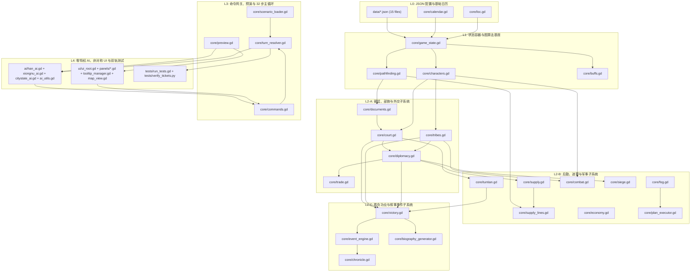
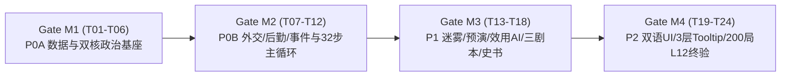

# S10 — 终极工程实施计划与傻瓜式工单总纲（Master Implementation Plan）

> **文档版本**：v1.0（W4 工程冻结版）  
> **上位依据**：[`00_bible.md`](file:///Users/xtxsinan/.gemini/antigravity/scratch/xiyu_strategy/docs/design_v1/00_bible.md)（设计圣经）、[`STATUS.md`](file:///Users/xtxsinan/.gemini/antigravity/scratch/xiyu_strategy/docs/design_v1/STATUS.md)（`R-01`~`R-05` 主策划拍板）、[`01_cross_review_and_registry.md`](file:///Users/xtxsinan/.gemini/antigravity/scratch/xiyu_strategy/docs/design_v1/01_cross_review_and_registry.md)（W3 全局符号注册表与唯一权威字典）。  
> **配套工单分册**（位于 `docs/design_v1/tickets/`）：
> 1. [`P0A_data_and_state_tickets.md`](file:///Users/xtxsinan/.gemini/antigravity/scratch/xiyu_strategy/docs/design_v1/tickets/P0A_data_and_state_tickets.md)（`T01`–`T06`：JSON 数据层、GameState 扩展、人物、胜负功业、汉廷诏令、匈奴部族）
> 2. [`P0B_diplomacy_logistics_events_tickets.md`](file:///Users/xtxsinan/.gemini/antigravity/scratch/xiyu_strategy/docs/design_v1/tickets/P0B_diplomacy_logistics_events_tickets.md)（`T07`–`T12`：城邦外交与罪状、供粮意愿闭环、自动补给线与屯田、马匹池与罪人兵、事件引擎、32 步主循环与全命令集成）
> 3. [`P1_fog_ai_scenarios_tickets.md`](file:///Users/xtxsinan/.gemini/antigravity/scratch/xiyu_strategy/docs/design_v1/tickets/P1_fog_ai_scenarios_tickets.md)（`T13`–`T18`：烽燧迷雾、余粮预演与威胁圈、汉 AI、匈奴与城邦 AI、三大剧本与教学状态机、本季纪事与终局附传）
> 4. [`P2_ui_loc_verification_tickets.md`](file:///Users/xtxsinan/.gemini/antigravity/scratch/xiyu_strategy/docs/design_v1/tickets/P2_ui_loc_verification_tickets.md)（`T19`–`T24`：双语本地化与版本化存档、UIRoot 非对称重构、汉廷与匈奴王庭专属面板、外交/粮道/预演/战报面板、3 层 Tooltip 与地图迷雾图层、全量回归与 200 局 L12 自动验收）

---

## 1. 全局工程架构与文件变更总图

### 1.1 架构设计铁律（Zero-Ambiguity Engineering Rules）

1. **唯一真源（SSOT）**：所有 `GameState` 字段名、命令 `type` 字符串、跨模块静态函数签名、人物/事件/诏令/节点语义标签 ID、以及 `TurnResolver` 的 32 步结算时序，100% 锁定为 [`01_cross_review_and_registry.md`](file:///Users/xtxsinan/.gemini/antigravity/scratch/xiyu_strategy/docs/design_v1/01_cross_review_and_registry.md) 中的 Canonical 定义，严禁任何工单执行者自行发明别名或更改参数顺序。
2. **无状态静态服务层（Stateless Static Services）**：`core/*.gd`（除 `GameState` 外）与 `ai/*.gd` 全部采用无状态 `static func` 编写，所有持久化数据唯一存储在 `GameState` 实例中，确保回放快照（Snapshot）、分支预演（`Preview.simulate_food_curve`）与存档读写零副作用。
3. **玩家与 AI 同构接口（圣经 L9）**：UI 面板与 AI 决策模块只能通过 `Commands.make / validate / apply` 下达指令，且在迷雾上线后（`T13` 起），AI 与 UI 威胁圈一律只读 `Fog.get_perceived_state(state, faction)` 与 `Tribes.get_visible_loyalty_range(state, tribe_id, viewer_faction)`，严禁直接读取敌方 `state.armies` 真值或 `tribe.loyalty` 精确值。
4. **100% 数据驱动与双语解耦（圣经 L11）**：所有平衡常数写入 `data/*.json`，所有玩家可见字符串写入 `data/loc_zh.json` 与 `data/loc_en.json`，代码中统一调用 `Loc.t(key, params)`。
5. **全确定性随机数（圣经 §5）**：禁止调用 GDScript 全局 `randf()` / `randi()` 或 `Array.shuffle()`；一切随机抽样与同优先级命令洗牌必须调用 `state.rng.randf()` / `state.rng.randi_range()`。

---

### 1.2 现有文件修改清单 vs 新建文件清单

#### （A）数据层文件清单（`data/`，共 15 个文件：3 扩展 + 12 新建）

| 文件路径 | 操作类型 | 所属工单 | 对应 Spec | 核心职责与顶层键结构 |
|---|---|---|---|---|
| [`data/balance.json`](file:///Users/xtxsinan/.gemini/antigravity/scratch/xiyu_strategy/data/balance.json) | **修改（扩展）** | `T01` | S01, S04, S05, S06 | 保留现有 10 个顶层键，新增/扩展 `victory`, `diplomacy`, `embassy`, `grievance`, `punitive`, `supply_will`, `supply_line`, `army_forage`, `horse_pool`, `convict`, `tuntian`, `fog`, `events`, `chronicle` |
| [`data/units.json`](file:///Users/xtxsinan/.gemini/antigravity/scratch/xiyu_strategy/data/units.json) | **修改（扩展）** | `T01` | S05 | 保留现有 6 兵种，新增汉方七科谪罪人兵 `"convict"`（`cost_money:15`, `food_per_day:0.022`, `atk:0.75`, `def:0.70`, `desertion_daily_outside:0.0015`） |
| [`data/ai_profiles.json`](file:///Users/xtxsinan/.gemini/antigravity/scratch/xiyu_strategy/data/ai_profiles.json) | **修改（重构）** | `T01`, `T15`, `T16` | S08 | 保留向后兼容权重，新增 `global_utility`, `han_base`, `xiongnu_base`, `personalities`（6 套性格）, `difficulty_modifiers`（3 档难度）, `citystate_ai`, `node_semantics`（42 节点 16 标签映射） |
| `data/court.json` | **新建** | `T01` | S02 | 汉廷信任五档阈值、迟滞缓冲、四朝风向、武帝悔意、财匮度、矫诏先例、季度拨款、四类奏请参数、岁献上限、监军否决参数 |
| `data/edicts.json` | **新建** | `T01` | S02 | 15 道诏令模板（`ED01`~`ED15`）完整定义：类别、期限、授予权限、奖励/惩罚、讨价还价空间 |
| `data/tribes.json` | **新建** | `T01` | S03 | 单于初始威望、赏赐池、四大部领（`zuoxian`, `youxian`, `rizhu`, `lihu`）座次与期望权重、三次年会选项、僮仆都尉巡行路线与四档税率、5 张匈奴战术卡 |
| `data/characters.json` | **新建** | `T01`, `T03` | S06 | EA 25 名核心历史人物 + 4 名匈奴世系继任者 + 3 名剧本扩展人物 + 史书风候补生成池 + 40 个特性 Tag 完整定义 |
| `data/events.json` | **新建** | `T01`, `T11` | S06 | EA 40 条叙事事件完整定义（触发器谓词树、选项条件、原子效果列表、事件链挂载、`is_major_quota`、`key_event_tag`） |
| `data/ui_config.json` | **新建** | `T19` | S07 | 默认面板页签、地图图层默认掩码、3 层 Tooltip 锁定时长、4 套无障碍色板（标准/红绿盲/蓝黄盲/高对比）、5 课教学脚本配置 |
| `data/scenarios/scenario_01_loulan_108bc.json` | **新建** | `T17` | S01, S07 | 剧本①《楼兰姑师》（前 108 年，12 季 / 36 月教学与破局剧本）Delta 配置與 3 项专项胜利目标 |
| `data/scenarios/scenario_02_mobei_119bc.json` | **新建** | `T17` | S01 | 剧本②《漠北之后》（前 119 年，40 季 / 120 月标准主沙盒，可选 60 季）Delta 配置 |
| `data/scenarios/scenario_03_protectorate_68bc.json` | **新建** | `T17` | S01 | 剧本③《都护府》（前 68 年，36 季 / 108 月后期决战剧本，`lun_tai`/`lou_lan` 节点显示名重映射）Delta 配置 |
| `data/loc_zh.json` | **新建** | `T19` | S07 | 简体中文源语言全量词表（UI、诏令、事件、纪事、附传、Tooltip、教程、错误码） |
| `data/loc_en.json` | **新建** | `T19` | S07 | 英文同步本地化全量词表（键值与 `loc_zh.json` 100% 镜像对齐） |

---

#### （B）核心逻辑层文件清单（`core/`，共 24 个文件：12 修改 + 12 新建）

| 文件路径 | 操作类型 | 所属工单 | 对应 Spec | 核心新增/修改职责 |
|---|---|---|---|---|
| [`core/game_state.gd`](file:///Users/xtxsinan/.gemini/antigravity/scratch/xiyu_strategy/core/game_state.gd) | **修改** | `T02`, `T19` | 全系统 | 扩展 `SAVE_KEYS` 全部新增顶层字典，实现 `XIYU_SAVE_3` 序列化与 `XIYU_SAVE_2` 向后兼容迁移补齐，同步 `stats` 14 键恒等式与 `winner` 镜像 |
| [`core/scenario_loader.gd`](file:///Users/xtxsinan/.gemini/antigravity/scratch/xiyu_strategy/core/scenario_loader.gd) | **修改** | `T02`, `T17` | S01 | 支持 `base_scenario` + `scenarios/*.json` 增量 Delta 合并加载，初始化 42 节点语义标签、屯田/烽燧字段、23 国 `relations` 新字段与 `Phase 0` 七步调用 |
| `core/characters.gd` | **新建** | `T03` | S06, S02 | 人物花名册加载、在场锁（`locked_action`/`assigned_to`）、`get_commander_stats`（含 `command_tier`）、`get_envoy_modifiers`、战败命运检定、年度寿元检定、候补生成 |
| [`core/victory.gd`](file:///Users/xtxsinan/.gemini/antigravity/scratch/xiyu_strategy/core/victory.gd) | **修改（重写）** | `T04` | S01 | 汉都护府功业值 $G$、匈奴威服值 $W$、双路径维持月数、政治崩盘失败（`HAN_RECALL`/`XN_SCATTER`）、到期连续计分、史官五档评定、终局签名与边际功业图 |
| `core/documents.gd` | **新建** | `T05` | S02 | 文书实体（`edict`/`memorial`/`report`/`recall`）创建、驿传天数估算 `estimate_courier_days`、每日沿路移动与烽燧防截获检定 |
| `core/court.gd` | **新建** | `T05` | S02 | 朝廷信任五档与迟滞、四朝风向转换、武帝悔意与轮台诏、首季/每季拨款、15 诏令生成与讨价、矫诏与自劾生死时速环、四类奏请、监军否决 |
| `core/tribes.gd` | **新建** | `T06` | S03 | 单于威望、赏赐池与阵营金钱强同步、四部忠诚与嫉妒公式、三次年会、单于继承危机、冬季白灾瓦解链、僮仆都尉巡行税队、日逐王降汉链、5 张战术卡 |
| [`core/diplomacy.gd`](file:///Users/xtxsinan/.gemini/antigravity/scratch/xiyu_strategy/core/diplomacy.gd) | **修改（扩展）** | `T07`, `T08` | S04 | 23 国影响力锚点衰减、精使/募使预算制与在途移动、10 类罪状、讨伐与破城三策善后、供粮意愿 $W \in [0,100]$ 与反馈、以节发属国兵、匈奴威压动作 |
| [`core/trade.gd`](file:///Users/xtxsinan/.gemini/antigravity/scratch/xiyu_strategy/core/trade.gd) | **修改** | `T07`, `T10` | S04, S05 | 软禁商 35% 渗漏率、劫商生成 `rob_caravan` 罪状、接入 `Supply.get_trade_tax_mult`（七科谪超征商税 `×0.85`） |
| `core/supply_lines.gd` | **新建** | `T09` | S05 | 自动补给线 `SupplyLine` 创建/更新/删除、多跳自动拆段（`legs`）、每旬 Day 0 逆推流量派车、终点闲置民夫回程协运、30 日连劫自动暂停 |
| `core/tuntian.gd` | **新建** | `T09` | S05 | 两段式屯田（阶段 0→1 校猎测地 30 日，阶段 1→2 车队立屯或罪人兵落户）、首年秋收 `×0.5`、西域屯田存粮统计、邻国 `tuntian_pressure` 累积 |
| [`core/supply.gd`](file:///Users/xtxsinan/.gemini/antigravity/scratch/xiyu_strategy/core/supply.gd) | **修改（扩展）** | `T08`, `T10` | S05 | 抵达城邦四档自动就食（`75/50/30` 献粮/平买/强征/掠食）、国家马匹池与缺马下马步战（`dismounted_cav`）、七科谪罪人池与塞外日逃亡、断粮饿死单列统计 |
| [`core/economy.gd`](file:///Users/xtxsinan/.gemini/antigravity/scratch/xiyu_strategy/core/economy.gd) | **修改** | `T09` | S05 | 八月末秋收接入 `node.colonies` 屯田加成（含 `trait_tuntian_master` `+25%` 与首年 `×0.5`）及外派民夫 `levied_out` 劳力扣减 |
| [`core/combat.gd`](file:///Users/xtxsinan/.gemini/antigravity/scratch/xiyu_strategy/core/combat.gd) | **修改** | `T06`, `T08`, `T10` | S03, S05, S06 | 实现 `calc_army_awe`；野战接入将领 `command_tier` 与特性、匈奴战术卡与单于亲征修正、下马骑兵按步兵折算；战后触发里程碑、将领命运与僮仆护卫军击溃回调 |
| [`core/siege.gd`](file:///Users/xtxsinan/.gemini/antigravity/scratch/xiyu_strategy/core/siege.gd) | **修改** | `T07` | S04, S05 | 城破时回调 `Diplomacy.on_citystate_captured(state, sid, attacker, policy)` 与 `SupplyLines.on_node_captured` |
| [`core/pathfinding.gd`](file:///Users/xtxsinan/.gemini/antigravity/scratch/xiyu_strategy/core/pathfinding.gd) | **修改** | `T13` | S02, S05 | 统一类名 `Pathfinding`（兼容 `Path`），新增 `courier_dijkstra`（河西置邮 `4.0` 忽略 `mounted_speed_cap`，塞外单骑 `2.0`）与 `shortest_safe_route` |
| `core/fog.gd` | **新建** | `T13` | S05 | 五级战争迷雾、烽燧修筑/拔除/月维护、斥候与烽火延迟传递、`IntelEstimate` 误差生成、`get_perceived_state`（强制剥离 `true_army_id`）、疑兵假情报注入 |
| [`core/plan_executor.gd`](file:///Users/xtxsinan/.gemini/antigravity/scratch/xiyu_strategy/core/plan_executor.gd) | **修改** | `T08`, `T13` | S05 | 行军入城回调 `Supply.try_forage_on_arrival`；`burn` 接入【焦土秋掠】翻倍；`enemy_near` 触发器改为只读 `Fog.get_perceived_armies` |
| `core/preview.gd` | **新建** | `T14` | S05 | 0–18 旬行军余粮曲线推演 `simulate_food_curve`（输出不归点、断粮旬、红黄绿灯）与敌军 30/60/90 日可达威胁圈 `compute_enemy_reach` |
| `core/event_engine.gd` | **新建** | `T11` | S06, S01 | 18 类触发谓词求值器、28 类原子 Effect 执行器、S01-R12 中期大事件保底配额（T1–T5 保护期，T10–T32 保底 1–3 次）、事件链调度 |
| `core/chronicle.gd` | **新建** | `T18` | S06 | 《汉书》体本季纪事生成器（文言/白话双模板渲染，每季精选 3–6 条存入 `chronicle.season_entries`） |
| `core/biography_generator.gd` | **新建** | `T18` | S06, S01 | 终局《汉书·西域传/匈奴传》附传五段式拼装器与 1080×1920 战报长图数据导出 |
| `core/loc.gd` | **新建** | `T19` | S07 | 核心层轻量本地化字典查询器（供 `core/*.gd` 生成战报日志与 UI 层 `ui/localization.gd` 共用） |
| [`core/commands.gd`](file:///Users/xtxsinan/.gemini/antigravity/scratch/xiyu_strategy/core/commands.gd) | **修改（扩展）** | `T12` | 全系统 | 挂载全部 72 条命令（含兼容别名）的 `make / validate / apply` 路由表，并在 `set_plan`、`recruit` 中接入汉廷授权/额度与匈奴指挥权校验 |
| [`core/turn_resolver.gd`](file:///Users/xtxsinan/.gemini/antigravity/scratch/xiyu_strategy/core/turn_resolver.gd) | **修改（重构）** | `T12` | 全系统 | 严格按 `01_cross_review_and_registry.md §6` 实现 Phase 0~6 共 32 步确定性结算主循环 |

---

#### （C）AI 层、UI 层与测试工具文件清单（`ai/`, `ui/`, `tests/`，共 22 个文件：5 修改 + 17 新建）

| 文件路径 | 操作类型 | 所属工单 | 对应 Spec | 核心职责说明 |
|---|---|---|---|---|
| `ai/ai_utils.gd` | **新建** | `T15` | S08 | 节点语义标签查询 `get_nodes_by_tag`、迷雾感知威胁度评估 `perceived_enemy_threat_at`、事件选项效用评分 `evaluate_event_choice`、统帅性格摘要 |
| [`ai/han_ai.gd`](file:///Users/xtxsinan/.gemini/antigravity/scratch/xiyu_strategy/ai/han_ai.gd) | **修改（重写）** | `T15` | S08 | 汉方三阶段（筑基/破局/立府）效用 AI：诏令响应/讨价、自动补给线管理、预演防饿死拦截、精使/募使派遣、北道截税队与迎降日逐王 |
| [`ai/xiongnu_ai.gd`](file:///Users/xtxsinan/.gemini/antigravity/scratch/xiyu_strategy/ai/xiongnu_ai.gd) | **修改（重写）** | `T16` | S08 | 匈奴防崩盘优先分赏（读模糊忠诚区间）、双路径（河西 vs 威服）动态切换、三次年会决策、战术卡择优打出、拔亭障与劫粮道 |
| `ai/citystate_ai.gd` | **新建** | `T16` | S04, S08 | 23 国季末自主外交决策：一季动摇预警、请封、请为两属、禁商、倒戈叛乱 |
| `ui/localization.gd` | **新建** | `T19` | S07 | UI 本地化管理、文言/白话切换、色盲调色板切换、字号缩放与持久化设置 |
| `ui/summary_advisor.gd` | **新建** | `T20` | S07 | 季初纪事摘要弹窗与本季 Top 3 紧急待办事项智能推荐器 |
| `ui/panels/modal_season_summary.gd` | **新建** | `T20` | S07 | 季初纪事与事件抉择弹窗组件 |
| [`ui/ui_root.gd`](file:///Users/xtxsinan/.gemini/antigravity/scratch/xiyu_strategy/ui/ui_root.gd) | **修改（重构）** | `T20` | S07 | 顶栏汉/匈非对称双模式（信任/风向/功业 vs 威望/赏赐池/四部戒心）、右侧多页签工作台调度、快捷键与 F9 AI 调试遮罩 |
| `ui/panels/panel_han_court.gd` | **新建** | `T21` | S02, S07 | 汉廷竹简诏令面板、讨价还价概率预览、矫诏生死时速环（行军日数 vs 弹劾往返日数）、四类上书请奏与在途文书追踪 |
| `ui/panels/panel_xn_court.gd` | **新建** | `T21` | S03, S07 | 匈奴单于王庭面板：赏赐池滑块与四部忠诚区间实时预览、三次年会决议、部族征调/弹压、战术卡槽与僮仆都尉巡行监控 |
| `ui/panels/panel_diplomacy.gd` | **新建** | `T22` | S04, S07 | 23 国外交总览排序表、倾向拆解条、精使/募使预算派遣器、罪状徽章与讨伐三策选择 |
| `ui/panels/panel_logistics.gd` | **新建** | `T22` | S05, S07 | 万里粮道管理面板（补给线每段流量/民夫/损耗可视化）、两段式屯田与马匹/罪人兵调配 |
| `ui/panels/panel_plan_preview.gd` | **新建** | `T22` | S05, S07 | 军队计划编辑器内嵌 0–18 旬余粮折线图、不归点（PNR）警戒线与沿途城邦供粮意愿档位图标 |
| `ui/panels/panel_chronicle_log.gd` | **新建** | `T22` | S06, S07 | 可点击史书战报流（点击 `[节点]`/`[军队]` 镜头平滑聚焦，单独高亮饿死减员）与终局《汉书》附传展示 |
| `ui/tooltip_manager.gd` | **新建** | `T23` | S07 | CK3 式 3 层嵌套锁定 Tooltip 控制器（悬停 0.6s 锁定、高亮词条下钻、公式正负项染色拆解） |
| [`ui/map_view.gd`](file:///Users/xtxsinan/.gemini/antigravity/scratch/xiyu_strategy/ui/map_view.gd) | **修改（扩展）** | `T23` | S05, S07 | 渲染五级战争迷雾遮罩、敌军模糊兵力铭牌與疑兵问号、30/60/90 日威胁等时圈、烽燧状态图标、在途驿骑/使团/税队棋子 |
| `ui/tutorial_controller.gd` | **新建** | `T17`, `T23` | S07 | 剧本①《楼兰姑师》5 课交互式教学引导状态机与高亮遮罩 |
| `ui/share_card_exporter.gd` | **新建** | `T18`, `T22` | S06, S07 | 终局附传 Markdown 与 1080×1920 竖版战报长图导出器 |
| `tests/verify_tickets.py` | **新建** | `T01`~`T24` | S10 | 纯 Python 3 标准库静态契约验证器（校验 JSON Schema、GDScript 函数签名、符号注册表对齐与模拟器回归，支持 `--ticket T01..T24`） |
| [`tests/run_tests.gd`](file:///Users/xtxsinan/.gemini/antigravity/scratch/xiyu_strategy/tests/run_tests.gd) | **修改（扩展）** | `T01`~`T24` | 全系统 | Godot Headless 自动化单元测试与全量回归测试入口（追加 `test_T01_*` ~ `test_T24_*`） |

---

## 2. 模块依赖有向无环图（DAG）与分层解耦原则

### 2.1 五层严格单向依赖原则（Strict 5-Layer Acyclic Hierarchy）

为防止 GDScript `preload` / `class_name` 循环引用导致 Godot 编译失败，全工程强制划分为 **L0–L4 五个单向依赖层**。**下层模块严禁 `preload` 或调用上层模块**；同层模块之间如需联动，优先通过 `TurnResolver`（L3）编排，或单向调用基础层接口：

- **L0 纯数据与本地化层**：`data/*.json`, `core/loc.gd`, `core/calendar.gd`（不依赖任何业务逻辑）
- **L1 核心状态与图算法层**：`core/game_state.gd`, `core/pathfinding.gd`, `core/characters.gd`, `core/buffs.gd`（仅读写 `GameState` 数据字典）
- **L2 领域子系统层**：
  - L2-A（政治与外交基座）：`core/documents.gd`, `core/court.gd`, `core/tribes.gd`, `core/diplomacy.gd`, `core/trade.gd`
  - L2-B（军事、后勤与情报）：`core/supply.gd`, `core/supply_lines.gd`, `core/tuntian.gd`, `core/fog.gd`, `core/economy.gd`, `core/combat.gd`, `core/siege.gd`, `core/plan_executor.gd`
  - L2-C（叙事与胜负裁决）：`core/victory.gd`, `core/event_engine.gd`, `core/chronicle.gd`, `core/biography_generator.gd`
- **L3 编排、预演与命令网关层**：`core/scenario_loader.gd`, `core/preview.gd`, `core/commands.gd`, `core/turn_resolver.gd`
- **L4 智能体、表现层与验证套件**：`ai/*.gd`, `ui/*.gd`, `tests/*`

### 2.2 模块依赖有向无环图（Mermaid `flowchart TD`）



---

## 3. 工单总表（T01–T24）、里程碑门禁与双轨验证机制

### 3.1 24 张原子工单主注册表（Master Ticket Registry）

> **执行原则**：每张工单严格对应一个可独立测试的工程增量，改动规模控制在 **150–450 行 GDScript / JSON** 以内。任何 AI Coding Agent 必须按编号顺序或拓扑依赖顺序逐张推进，前一张工单未通过双轨验证前，严禁开启下一张工单。

| 工单 ID | 分册 | 工单标题 | 前置依赖 | 涉及文件（新建 `[N]` / 修改 `[M]`） | 预估行数 | 双轨一键验证命令 | 状态 |
|---|---|---|---|---|---|---|---|
| **`T01`** | P0A | 新增 JSON 数据文件与 `balance.json` / `units.json` 扩展 | 无 | `[M] data/balance.json`, `[M] data/units.json`, `[M] data/ai_profiles.json`, `[N] data/court.json`, `[N] data/edicts.json`, `[N] data/tribes.json`, `[N] data/characters.json`, `[N] data/events.json` | ~650 (JSON) | `python3 tests/verify_tickets.py --ticket T01` | `[ ]` |
| **`T02`** | P0A | `GameState` 扩展字段、`XIYU_SAVE_3` 兼容存档与 `ScenarioLoader` Delta 合并 | `T01` | `[M] core/game_state.gd`, `[M] core/scenario_loader.gd`, `[M] tests/run_tests.gd` | ~260 | `python3 tests/verify_tickets.py --ticket T02`<br>`godot --headless --path . --script res://tests/run_tests.gd` | `[ ]` |
| **`T03`** | P0A | `Characters` 人物模块、25+7 人花名册加载、在场锁与统帅/使臣修正 | `T02` | `[N] core/characters.gd`, `[M] tests/run_tests.gd` | ~320 | `python3 tests/verify_tickets.py --ticket T03`<br>`godot --headless --path . --script res://tests/run_tests.gd` | `[ ]` |
| **`T04`** | P0A | `Victory` 都护府功业值 $G$、匈奴威服值 $W$、双路径胜利与史官五档评定 | `T02` | `[M] core/victory.gd`, `[M] tests/run_tests.gd` | ~420 | `python3 tests/verify_tickets.py --ticket T04`<br>`godot --headless --path . --script res://tests/run_tests.gd` | `[ ]` |
| **`T05`** | P0A | `Court` & `Documents` 朝廷信任、首季拨款、文书驿传与 15 诏令/矫诏自劾 | `T03`, `T04` | `[N] core/documents.gd`, `[N] core/court.gd`, `[M] tests/run_tests.gd` | ~480 | `python3 tests/verify_tickets.py --ticket T05`<br>`godot --headless --path . --script res://tests/run_tests.gd` | `[ ]` |
| **`T06`** | P0A | `Tribes` 单于威望、赏赐池、四部忠诚、三次年会、僮仆税队与日逐王降汉链 | `T03`, `T04` | `[N] core/tribes.gd`, `[M] core/combat.gd`, `[M] tests/run_tests.gd` | ~460 | `python3 tests/verify_tickets.py --ticket T06`<br>`godot --headless --path . --script res://tests/run_tests.gd` | `[ ]` |
| **`T07`** | P0B | `Diplomacy` & `Trade` 软禁商渗漏、精使/募使预算制、10 类罪状与破城三策 | `T05`, `T06` | `[M] core/diplomacy.gd`, `[M] core/trade.gd`, `[M] core/siege.gd`, `[M] tests/run_tests.gd` | ~450 | `python3 tests/verify_tickets.py --ticket T07`<br>`godot --headless --path . --script res://tests/run_tests.gd` | `[ ]` |
| **`T08`** | P0B | `Diplomacy.get_forage_willingness` 与 `Supply` 大军沿途四档给食闭环 | `T07` | `[M] core/diplomacy.gd`, `[M] core/supply.gd`, `[M] core/combat.gd`, `[M] core/plan_executor.gd`, `[M] tests/run_tests.gd` | ~280 | `python3 tests/verify_tickets.py --ticket T08`<br>`godot --headless --path . --script res://tests/run_tests.gd` | `[ ]` |
| **`T09`** | P0B | `SupplyLines` 自动补给线拆段派车与 `Tuntian` 两段式屯田 | `T05`, `T08` | `[N] core/supply_lines.gd`, `[N] core/tuntian.gd`, `[M] core/economy.gd`, `[M] tests/run_tests.gd` | ~440 | `python3 tests/verify_tickets.py --ticket T09`<br>`godot --headless --path . --script res://tests/run_tests.gd` | `[ ]` |
| **`T10`** | P0B | `Supply` 国家马匹池、缺马下马骑兵与七科谪罪人兵 `convict` | `T08`, `T09` | `[M] core/supply.gd`, `[M] core/combat.gd`, `[M] core/trade.gd`, `[M] tests/run_tests.gd` | ~300 | `python3 tests/verify_tickets.py --ticket T10`<br>`godot --headless --path . --script res://tests/run_tests.gd` | `[ ]` |
| **`T11`** | P0B | `EventEngine` 18 谓词/28 原子效果、中期大事件保底配额与 40 条事件数据 | `T05`, `T06`, `T07`, `T09` | `[N] core/event_engine.gd`, `[M] data/events.json`, `[M] tests/run_tests.gd` | ~460 | `python3 tests/verify_tickets.py --ticket T11`<br>`godot --headless --path . --script res://tests/run_tests.gd` | `[ ]` |
| **`T12`** | P0B | `TurnResolver` 32 步标准结算主循环集成与 `Commands` 全新增命令挂载 | `T01`–`T11` | `[M] core/commands.gd`, `[M] core/turn_resolver.gd`, `[M] tests/run_tests.gd` | ~420 | `python3 tests/verify_tickets.py --ticket T12`<br>`godot --headless --path . --script res://tests/run_tests.gd` | `[ ]` |
| **`T13`** | P1 | `Pathfinding.courier_dijkstra` 与 `Fog` 五级迷雾、亭燧修拔及 `get_perceived_state` | `T12` | `[M] core/pathfinding.gd`, `[N] core/fog.gd`, `[M] core/plan_executor.gd`, `[M] tests/run_tests.gd` | ~380 | `python3 tests/verify_tickets.py --ticket T13`<br>`godot --headless --path . --script res://tests/run_tests.gd` | `[ ]` |
| **`T14`** | P1 | `Preview` 0–18 旬余粮折线推演、不归点（PNR）与敌军 30/60/90 日威胁圈 | `T08`, `T13` | `[N] core/preview.gd`, `[M] tests/run_tests.gd` | ~310 | `python3 tests/verify_tickets.py --ticket T14`<br>`godot --headless --path . --script res://tests/run_tests.gd` | `[ ]` |
| **`T15`** | P1 | `AIUtils` 42 节点语义标签、`AIBlackboard` 与汉方三阶段功业效用 AI | `T13`, `T14` | `[N] ai/ai_utils.gd`, `[M] ai/han_ai.gd`, `[M] data/ai_profiles.json`, `[M] tests/run_tests.gd` | ~460 | `python3 tests/verify_tickets.py --ticket T15`<br>`godot --headless --path . --script res://tests/run_tests.gd` | `[ ]` |
| **`T16`** | P1 | 匈奴防崩盘分赏与双路径效用 AI、城邦自主 AI 与 3×3 性格/三档难度 | `T15` | `[M] ai/xiongnu_ai.gd`, `[N] ai/citystate_ai.gd`, `[M] tests/run_tests.gd` | ~450 | `python3 tests/verify_tickets.py --ticket T16`<br>`godot --headless --path . --script res://tests/run_tests.gd` | `[ ]` |
| **`T17`** | P1 | 三大 EA 剧本 `data/scenarios/*.json` 与《楼兰姑师》5 课交互教学状态机 | `T12`, `T16` | `[N] data/scenarios/scenario_01_loulan_108bc.json`, `[N] data/scenarios/scenario_02_mobei_119bc.json`, `[N] data/scenarios/scenario_03_protectorate_68bc.json`, `[N] ui/tutorial_controller.gd`, `[M] tests/run_tests.gd` | ~480 | `python3 tests/verify_tickets.py --ticket T17`<br>`godot --headless --path . --script res://tests/run_tests.gd` | `[ ]` |
| **`T18`** | P1 | `Chronicle` 本季纪事文言/白话生成器与 `BiographyGenerator` 终局《汉书》附传 | `T11`, `T12` | `[N] core/chronicle.gd`, `[N] core/biography_generator.gd`, `[N] ui/share_card_exporter.gd`, `[M] tests/run_tests.gd` | ~380 | `python3 tests/verify_tickets.py --ticket T18`<br>`godot --headless --path . --script res://tests/run_tests.gd` | `[ ]` |
| **`T19`** | P2 | `Loc` 中英双语本地化框架、`ui_config.json` 与多槽位版本化存档管理 | `T02`, `T18` | `[N] core/loc.gd`, `[N] ui/localization.gd`, `[N] data/ui_config.json`, `[N] data/loc_zh.json`, `[N] data/loc_en.json`, `[M] core/game_state.gd`, `[M] tests/run_tests.gd` | ~520 | `python3 tests/verify_tickets.py --ticket T19`<br>`godot --headless --path . --script res://tests/run_tests.gd` | `[ ]` |
| **`T20`** | P2 | `UIRoot` 非对称顶栏（汉廷信任/风向 vs 单于威望/四部）与季初纪事摘要弹窗 | `T19` | `[M] ui/ui_root.gd`, `[N] ui/summary_advisor.gd`, `[N] ui/panels/modal_season_summary.gd`, `[M] tests/run_tests.gd` | ~420 | `python3 tests/verify_tickets.py --ticket T20`<br>`godot --headless --path . --script res://tests/run_tests.gd` | `[ ]` |
| **`T21`** | P2 | 朝廷竹简诏令/矫诏生死时速环面板与匈奴单于王庭分赏/年会面板 | `T20` | `[N] ui/panels/panel_han_court.gd`, `[N] ui/panels/panel_xn_court.gd`, `[M] tests/run_tests.gd` | ~460 | `python3 tests/verify_tickets.py --ticket T21`<br>`godot --headless --path . --script res://tests/run_tests.gd` | `[ ]` |
| **`T22`** | P2 | 23 国外交总览表、万里粮道可视化、计划预演余粮折线图与可点击史书战报 | `T14`, `T20` | `[N] ui/panels/panel_diplomacy.gd`, `[N] ui/panels/panel_logistics.gd`, `[N] ui/panels/panel_plan_preview.gd`, `[N] ui/panels/panel_chronicle_log.gd`, `[M] tests/run_tests.gd` | ~490 | `python3 tests/verify_tickets.py --ticket T22`<br>`godot --headless --path . --script res://tests/run_tests.gd` | `[ ]` |
| **`T23`** | P2 | CK3 式 3 层嵌套锁定 Tooltip 与 `MapView` 迷雾/威胁圈/烽燧/驿骑渲染 | `T13`, `T14`, `T20` | `[N] ui/tooltip_manager.gd`, `[M] ui/map_view.gd`, `[M] tests/run_tests.gd` | ~440 | `python3 tests/verify_tickets.py --ticket T23`<br>`godot --headless --path . --script res://tests/run_tests.gd` | `[ ]` |
| **`T24`** | P2 | 全量回归测试套件、200 局 L12 自动验收脚本与 EA 发布门禁检查清单 | `T01`–`T23` | `[M] tests/verify_tickets.py`, `[M] tests/run_tests.gd`, `[M] tools/balance_sim.gd` | ~380 | `python3 tests/verify_tickets.py --all --sim-200`<br>`godot --headless --path . --script res://tests/run_tests.gd` | `[ ]` |

---

### 3.2 四大里程碑门禁（Milestone Gates）



1. **里程碑 M1（完成 `T01`–`T06`，P0A 核心状态与汉匈政治双核）**：
   - **准出标准**：8 个核心 JSON 文件全部通过 Schema 校验；`GameState` 支持 `XIYU_SAVE_3` 读写且旧测试 100% 绿灯；`Characters` 25+7 人花名册、在场锁正常运作；`Victory` 功业 $G$ 与威服 $W$ 静态计算与 `design_sim` 误差为 0；`Court` 15 道诏令生成、首季拨款、矫诏自劾计时准确；`Tribes` 赏赐池同步、四部忠诚公式、日逐王请降链通过断言。
2. **里程碑 M2（完成 `T07`–`T12`，P0B 可玩无界面垂直切片）**：
   - **准出标准**：`TurnResolver` 完整跑通 Phase 0~6 共 32 步主循环；全部 72 条命令在 `Commands` 中完成路由；大军沿途四档给食、自动补给线拆段派车、两段式屯田、国家马匹池与七科谪罪人兵、40 条历史事件引擎全部闭环联动；无 UI Headless 模式下可完整推演 40 季（360 旬）无报错、无死循环、无 NaN。
3. **里程碑 M3（完成 `T13`–`T18`，P1 迷雾、零特权 AI、三剧本与史书叙事）**：
   - **准出标准**：`Fog.get_perceived_state` 100% 剥离 `true_army_id`；`Preview` 准确输出 0–18 旬粮食曲线与 30/60/90 日威胁圈；汉匈 AI 彻底移除硬编码节点名（全走 `AIUtils.get_nodes_by_tag`）并在迷雾下自主完成 40 季对局；三大剧本（前 108 / 前 119 / 前 68）加载无误；每季生成《汉书》纪事、终局生成五段式附传。
4. **里程碑 M4（完成 `T19`–`T24`，P2 完整商业级 UI 与 L12 终极验收）**：
   - **准出标准**：中英双语切换零硬编码漏网；顶栏与侧栏支持汉/匈非对称切换；矫诏生死时速环、单于分赏滑块、余粮折线图、CK3 式 3 层嵌套锁定 Tooltip、地图五级迷雾与驿骑棋子全部就位；200 局 AI vs AI 自动模拟满足圣经 L12 全部 6 项硬指标。

---

### 3.3 双轨验证机制规范（Dual-Track Verification Architecture）

由于部分 AI Agent 或 CI 容器环境仅有 **Python 3.9+**（无 Godot 二进制），而本地集成环境具备 **Godot 4.6 Headless**，本计划强制实行**双轨验证**：

#### 轨道 ①：Python 静态契约与模拟器同源验证器（`python3 tests/verify_tickets.py`）
- **环境要求**：纯 Python 3.9+ 标准库（`json`, `re`, `ast`, `pathlib`, `unittest`, `subprocess`），零第三方依赖。
- **命令行接口**：
  - `python3 tests/verify_tickets.py --ticket T05`：针对单张工单执行以下 4 项硬性检查：
    1. **文件存在性与 JSON Schema 校验**：检查该工单要求的全部 JSON 文件语法合法、必填键齐全、数值范围与枚举值 100% 匹配 [`01_cross_review_and_registry.md`](file:///Users/xtxsinan/.gemini/antigravity/scratch/xiyu_strategy/docs/design_v1/01_cross_review_and_registry.md)。
    2. **GDScript 静态 AST / 正则符号契约扫描**：扫描目标 `.gd` 文件，验证所有要求的 `static func` 签名、参数个数、返回值类型注解、`SAVE_KEYS` 字段、命令 `type` 分支均已实现，且不存在禁止的全局 `randf()` / `randi()` 调用或非法跨层 `preload`。
    3. **测试函数挂载检查**：扫描 `tests/run_tests.gd`，确认该工单规定的 `test_Txx_*` 断言函数已写入并在 `_init()` 中注册调用。
    4. **数学公式同源对拍（Parity Check）**：调用 `design_sim/` 中的參考算子，对关键公式（功业 $G$、威服 $W$、忠诚度、供粮意愿、余粮曲线）进行输入输出基准比对。
  - `python3 tests/verify_tickets.py --all --sim-200`：运行 `T01`–`T24` 全量静态契约检查 + 200 局 `design_sim` L12 指标回归。

#### 轨道 ②：Godot 4.6 Headless 引擎实机断言（`tests/run_tests.gd`）
- **执行命令**：
  ```bash
  godot --headless --path . --script res://tests/run_tests.gd
  ```
- **验收标准**：终端最后一行必须输出 `ALL TESTS PASSED (<N> assertions)` 且退出码 `exit code == 0`。任何一条 `_assert` 失败或出现 GDScript Parse Error / Cyclic Reference 均视为工单未完成。

---

## 4. 低端 AI Agent 执行标准作业程序（SOP Prompt 模板）

> **设计目标**：哪怕上下文窗口较小、缺乏全局推理能力的初级 AI Coding Agent，只要将下方 Prompt 模板原样复制发给它（替换 `{{TICKET_ID}}` 与 `{{TICKET_FILE}}`），也能零歧义、零脑补地完成单张工单并自动验收。

### 4.1 标准派单 Prompt 模板（可直接复制）

```markdown
你现在是《西域·汉匈争霸》项目的执行程序员，负责严格实现工单 **{{TICKET_ID}}**。

### 【第一步：只读以下 3 个文件（严禁全文通读其他长文档）】
1. 唯一权威符号注册表：`docs/design_v1/01_cross_review_and_registry.md`（查阅本工单涉及的 GameState 字段、命令 ID、函数签名与时序）。
2. 本工单详细说明书：`docs/design_v1/tickets/{{TICKET_FILE}}` 中的 **{{TICKET_ID}}** 章节（仔细阅读 ①目标 ~ ⑦验收测试 全部 7 个小节）。
3. 本工单第 ③ 节列出的「待修改现有文件」（若为新建文件则无需预读）。如需核对某条细则公式，仅按工单第 ② 节给出的行号或规则号用 `grep -n` 局部查看 `docs/design_v1/Sxx_*.md`。

### 【第二步：零脑补编码铁律（违反任何一条即判定失败）】
1. **签名与变量名 100% 照抄**：你写的每一个 JSON 键名、GameState 字段名、命令 `type`、GDScript `static func` 函数名与参数列表，必须与工单第 ④、⑤ 节和 `01_cross_review_and_registry.md` 一字不差！
2. **严禁越界修改**：只允许新建或修改工单第 ③ 节明确列出的文件，以及向 `tests/run_tests.gd`（与 `tests/verify_tickets.py`）追加本工单的测试函数。严禁顺手重构其他模块，严禁删除已有函数或兼容别名！
3. **随机数铁律**：严禁使用全局 `randf()`、`randi()`、`randomize()` 或 `Array.shuffle()`；所有随机逻辑必须调用 `state.rng.randf()` 或 `state.rng.randi_range(a, b)`。
4. **单向依赖铁律**：严格遵守 `S10_implementation_plan.md §2` 的五层 DAG，`core/` 底层模块严禁 `preload` `ui/` 或 `ai/`。

### 【第三步：编写验收测试与执行双轨验证】
1. 将工单第 ⑦ 节给出的 `test_{{TICKET_ID}}_...()` 测试代码完整追加到 `tests/run_tests.gd` 末尾，并在 `tests/run_tests.gd` 的 `_init()` 中注册调用。
2. 在终端运行轨道 ① 静态与契约验证：
   `python3 tests/verify_tickets.py --ticket {{TICKET_ID}}`
3. 若本机安装了 Godot，继续运行轨道 ② Headless 实机断言：
   `godot --headless --path . --script res://tests/run_tests.gd`
4. 如果任何一条测试报错，根据报错行号修复你刚写的代码，直到命令输出 `PASSED` 且退出码为 `0`。

### 【第四步：完工登记】
验证通过后，使用 `replace_file_content` 将 `docs/design_v1/S10_implementation_plan.md` §3.1 工单总表中 **{{TICKET_ID}}** 行的状态从 `[ ]` 更新为 `[x]`，并输出简短完工报告（修改的文件列表 + 验收命令输出摘要）。
```

---

### 4.2 单张工单内部 7 步标准结构（7-Field Ticket Contract）

在 `docs/design_v1/tickets/*.md` 的 4 份分册中，每一张工单（`T01`–`T24`）均强制采用以下 7 个固定小节：

1. **① 目标与前置依赖**：一句话说明本工单交付的核心能力，明确列出前置工单 ID（如 `前置依赖：T03, T04`）。
2. **② 必读设计规范定位**：精确到 `docs/design_v1/01_cross_review_and_registry.md` 的具体章节号（如 `§2.7, §3.2, §4.2`）以及对应 `S01`–`S08` 的规则编号（如 `S02-R01`~`S02-R11`）。
3. **③ 新建/修改文件精确路径**：明确列出 `[新建]` 与 `[修改]` 的仓库相对路径，绝不含糊。
4. **④ 数据结构与 JSON 完整样板**：直接给出可直接复制粘贴的 JSON 配置样板或 `GameState` 字典初始化结构（带精确默认值）。
5. **⑤ 函数级实现说明书**：逐一列出每个 `static func` 的完整 GDScript 签名、输入输出契约、核心数学公式与逐行级伪代码/实现代码（变量名 100% 对齐 `01_cross_review_and_registry.md`）。
6. **⑥ 禁止事项（Guardrails）**：列出 4–6 条针对该模块的防呆红线（如“严禁在 `Fog.get_perceived_state` 中保留 `true_army_id`”、“严禁修改 `reward_pool` 而不调用 `Tribes.add_reward_pool` 同步 `factions.xiongnu.money`”）。
7. **⑦ 验收测试代码与一键验收命令**：直接提供可追加进 `tests/run_tests.gd` 的完整 GDScript 测试函数代码，以及对应的双轨验证命令。

---

## 5. 存档向后兼容与确定性工程规范

### 5.1 存档版本迁移协议（`XIYU_SAVE_2` $\to$ `XIYU_SAVE_3`）

1. **存档魔数升级**：`core/game_state.gd` 中的 `SAVE_HEADER` 升级为 `"XIYU_SAVE_3\n"`，同时在 `load_from_string(s: String)` 中保留对 `"XIYU_SAVE_2\n"` 与 `"XIYU_SAVE_1\n"` 的兼容识别。
2. **缺失键默认值自愈（Default Healing）**：当加载旧版 `XIYU_SAVE_2` 存档或部分字段缺失的测试快照时，`GameState.from_dict(d)` 必须对 `SAVE_KEYS` 中新增的顶层字典（`victory`, `court`, `tribes`, `missions`, `characters`, `event_state`, `chronicle`, `supply_lines`, `tuntian_pressure`, `intel_estimates`, `pending_reports`, `node_intel`, `ai_blackboard`, `ui_meta`）自动调用对应的默认构造函数补齐，绝不允许抛出 `Invalid get index` 空指针错误。
3. **跨字段恒等式自检（Invariant Enforcement）**：每次 `from_dict` 加载或每旬结算结束时，自动执行以下 3 条恒等式校验与同步：
   - **恒等式 I（伤亡统计，`[E-07]`）**：
     `state.stats.han_total_deaths = state.stats.han_combat_deaths + state.stats.han_starved_deaths + state.stats.han_march_deaths`
     `state.stats.han_casualties = state.stats.han_total_deaths`
     `state.stats.xn_casualties = state.stats.xn_total_deaths`
   - **恒等式 II（单于赏赐池，`[E-20]`）**：
     `state.tribes.reward_pool == int(state.factions["xiongnu"].money)`
   - **恒等式 III（终局状态镜像，`[E-12]`）**：
     `state.winner == state.victory.winner` 且 `state.win_reason == state.victory.end_type` 且 `state.victory_hold_months == state.victory.han_hold_months`

### 5.2 确定性回放与预演克隆隔离（Snapshot Isolation）

1. **`Preview.simulate_food_curve` 零污染原则**：在 `T14` 编写行军余粮曲线预演时，必须只读 `state` 或在轻量局部字典副本（`sim_grain`, `sim_loc`, `sim_horses`）上推演 0–18 旬，**严禁在预演中直接修改 `state.armies`、`state.nodes`、`state.relations` 或推进 `state.rng` 的状态**。
2. **`Fog.get_perceived_state` 深拷贝原则**：在 `T13` 导出迷雾感知视图时，返回的每个估计条目必须为 `.duplicate(true)` 后的新字典，并执行 `est_copy.erase("true_army_id")`，防止 AI 或 UI 意外篡改底层情报缓存。

---

## 6. 风险防控矩阵与 W5 工单抽样可执行性测试协议

| 风险编号 | 潜在工程风险（针对低端 AI Agent） | 架构级防呆措施（已内置于 T01–T24 工单中） |
|---|---|---|
| **R-ENG-01** | AI Agent 混淆乌孙/大宛的「节点 ID (`chi_gu`/`da_wan`)」与「政权 ID (`wusun`/`dawan`)」 | 在 `T07` 强制实现 `Diplomacy.normalize_state_id(id)` 双向容错转换，并在 `T01` 校验脚本中对所有 JSON 中的节点/政权引用做白名单静态检查 |
| **R-ENG-02** | AI Agent 在 `turn_resolver.gd` 中颠倒结算顺序（如先算 `Victory.monthly` 后算 `Tribes.quarter_end` 导致 `XN_SCATTER` 延迟一季） | 在 `T12` 工单中直接给出 `TurnResolver.resolve_turn` 的完整 32 步函数体代码，并在 `verify_tickets.py --ticket T12` 中通过正则顺序扫描强制校验调用次序 |
| **R-ENG-03** | 军队 ID 在 `int` 与 `String` 之间混用导致字典查找失效（`[E-09]`） | 在 `T02`/`T06`/`T12` 中强制规定所有 `army_id` 入参先走 `str(army_id)` 归一化 |
| **R-ENG-04** | 大文本 JSON（如 40 条事件、25+7 名人物、双语词表）在单次写入时被截断 | 将基础骨架放在 `T01`，40 条完整事件内容分摊在 `T11`，双语词表放在 `T19`，并提供 Python 生成/校验辅助断言确保 JSON 100% 闭合合法 |

---

*—— `S10_implementation_plan.md` 正文完。以下请按顺序查阅 `docs/design_v1/tickets/` 下的 4 册分阶段详细工单手册 ——*
