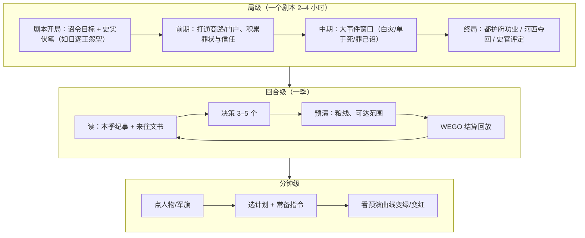

# 《西域·汉匈争霸》商业化进化路线图

> 输入：代码审计 [report_audit.md](file:///Users/xtxsinan/.gemini/antigravity/brain/96ef9250-2fe5-4573-a58f-e7c91ed88197/report_audit.md)（下称"审计"）、市场分析 [report_market.md](file:///Users/xtxsinan/.gemini/antigravity/brain/96ef9250-2fe5-4573-a58f-e7c91ed88197/report_market.md)（下称"市场"）、史料机制 [report_history.md](file:///Users/xtxsinan/.gemini/antigravity/brain/96ef9250-2fe5-4573-a58f-e7c91ed88197/report_history.md)（下称"史料"）、[README.md](file:///Users/xtxsinan/.gemini/antigravity/scratch/xiyu_strategy/README.md)、[design_doc.md](file:///Users/xtxsinan/.gemini/antigravity/scratch/xiyu_strategy/docs/design_doc.md)，并抽看了 [victory.gd](file:///Users/xtxsinan/.gemini/antigravity/scratch/xiyu_strategy/core/victory.gd)、`data/balance.json` 等代码。
>
> **数据核实**：市场报告的数据我抽查了 3 个关键数字，都通过 Steam 官方 `appreviews` 接口复核（2026-10-16）：
> - 横戈：1,411 好评 / 694 差评，共 2,105 条，约 67%，与市场报告一致。**已抽查**
> - 白日升：668 / 107，共 775 条，约 86%，一致。**已抽查**
> - 全战三国简中评测：41,508 / 10,520，共 52,028 条，约 80%，一致。**已抽查**
>
> 其余销量数据（全战三国 321 万份、Manor Lords 400 万份等）和愿望单经验值**未核实**（search_web 当日返回为空，维基页面也没抓到正文）。下文凡用到这类数字都会注明。

---

## 〇、一页结论

1. **核心幻想选"你是持节万里之外的汉使/都护"，不选"你是帝国"**。全作最有辨识度的东西，是"诏令在路上走几个月"与"将在外"之间的张力（史料核心结论 1、E7、C5、C6）。这种张力只有当玩家是被朝廷遥控的**代理人**时才成立。如果玩家扮演帝国，就回到了 P 社的赛道，而在那条赛道上我们没有任何优势。
2. **先修核心循环，再加内容**。汉方主胜利在 280 局里 0 次达成，结局只有 3 种分数（审计 §6、§11-1）。这个问题不解决，加人物和事件都是在给一辆没有发动机的车刷漆。
3. **范围锁死在前 119 年—前 60 年、节点地图加 WEGO，按"剧本制、每局 2–4 小时"来做**。横戈因为范围扩张而停更（市场 §三-5），这条路不能走。
4. **匈奴要重新设计成"靠分赃维系的草原联盟"**，钱就是赏赐池（史料 §五）。这是非对称玩法的第二支柱，也是"换边再玩一遍"的理由。
5. **商业目标要现实**。对标的不是全战三国，而是 Unity of Command II、Ultimate General、Old World 这一档：中位数结果是 1–5 万份。路线图按"先在国区站稳 86% 以上好评，再借英文版和 PBEM 走长尾"来设计。

---

## 一、定位

### 1.1 核心幻想：持节者，而非帝国

| 维度 | A. 你是汉帝国 | **B. 你是持节西域的汉使/都护（推荐）** |
|---|---|---|
| 独特性 | 与 EU/CK/Imperator 同质 | 题材内独一份：设计文档 §5.7 已设定"玩家扮演汉廷西域使节这一**职位**" |
| 与现有内核的契合 | 内核没有内政，扮演帝国会显得空 | 常备指令、10 天一步、古道里程，都在讲"远方授权"（审计 §2） |
| 天然张力 | 自己给自己下令，没有冲突 | 朝廷信任、诏令时差、矫诏与自劾的赛跑（史料 C6"赶在召还令送达前打完"） |
| 叙事 | 宏大但抽象 | 张骞→常惠→傅介子→郑吉，职位由一个个人物接力，天然产出"人的故事"（市场规律 2） |
| 范围控制 | 会诱发"加内政""加十三州" | 不模拟汉内政，只模拟朝廷与玩家的关系（设计 Q8 已定） |

**论证**：市场规律 2 和全战三国的 Guardian 评测都说明，"最伟大的故事是关于人，而不是帝国"。西域题材里，"人"恰好就是那几个持节远行的使者和都护。陈汤的"虽远必诛"、冯奉世矫诏而"有功不侯"，这些故事只有在"我是代理人"的视角下才有戏剧性。

**匈奴的对应幻想**：你是**单于**，不是"草原帝国"。你的敌人一半在帐外（汉），一半在帐内（二十四长、继承人，见史料 F1、F2）。两边都是"受制于人的权力者"，在结构上对称，在机制上不对称。

### 1.2 卖点

**一句话卖点**：
> 中文：**"诏书还在路上，匈奴已经南下。"** 一款关于粮草、诏令与人心的汉匈西域回合制策略游戏，同时下令、逐日结算。
> 英文：*Hold the Han tally ten thousand li from the throne. A WEGO strategy of grain lines, delayed edicts and steppe politics.*

**Steam 商店页前三条卖点**（都必须能用一张 GIF 验证）：
1. **万里粮道，看得见的后勤**：每一斛粮都要用民夫运过河西。补给线直接画在古地图上，断粮就会饿死。
2. **将在外，君命有所不受**：诏令和奏疏要在古道上走几个月。你可以奉诏、讨价还价，也可以矫诏发兵，再抢在召还令送达前立功。
3. **帝国对联盟，两种完全不同的玩法**：汉靠屯田、使团和补给线经营西域；匈奴靠劫掠和分赏维系二十四长，提防帐下诸王降汉。

**对标说法**：
- 对海外：**"Unity of Command meets Crusader Kings on the Silk Road"**（补给即玩法，加上人物驱动的故事）。也可以说"Old World 式的人物事件 + Diplomacy 式的同时下令"。
- 对国内：**"把《汉书·西域传》做成桌游"**。

### 1.3 差异化

| 竞品 | 它的核心 | 我们不做什么 | 我们做什么 |
|---|---|---|---|
| 横戈（67%，已抽查） | 套全战三国框架：大战略 + RTS + RPG | 不做即时战场，不扩到东汉或三国 | 桌游化的节点地图 + WEGO；横戈高赞好评建议"往 P 社/模拟经营靠，汉军靠朝廷支援、精兵稀少，匈奴靠掠夺"（市场 1.3），我们直接做这个方向 |
| 白日升（86%，已抽查） | 题材独特、细节密，但 UI 和教程拖累规模 | 不做"不直观的爱之作" | 同样的题材深度，加上首日教程和可读性 |
| 全战三国 | 3D 战场 + 武将 | 不比画面，不比武将数量 | 比"时代独有的问题"：后勤、时差、联盟分赃 |
| P 社（EU/CK/Imperator） | 沙盒、扮演国家、上百个系统 | 不做全球沙盒，不做 mana | 窄而深：一个地区、60 年、几十个人物，每局 2–4 小时 |

### 1.4 市场策略

- **国区是第一市场**。横戈 95% 的评测、全战三国 48% 的评测来自简中（市场 §四-1，后者已抽查）。国区玩家评价更苛刻，对"水军""跑路""AI 立绘"极度敏感（市场 §三-10），运营上要把"透明、持续更新"放在宣传之前。
- **海外是长尾市场**。海外的主战场在 Wargamer、Matrix/Slitherine 一类硬核社区，以及 PBEM 玩家。话术用"帝国对草原联盟"（类比罗马与帕提亚）和"补给即玩法"，不卖"中国元素"本身。首发必须**完整中英双语**，这会反过来要求现在就做字符串外置（审计 §8 本地化：现在全部硬编码）。
- **发行商**：Demo 有数据后再接触 Hooded Horse 或 Slitherine（市场规律 6）。国内可以考虑独立发行，但不要走铺量宣传。

### 1.5 一局时长与定价

- **剧本制**：教学剧本 30–45 分钟；标准剧本 2–4 小时（季制，12–40 回合）；1.0 版再加 60 年大剧本（约 8–15 小时）。现在默认的 240 个月制回合太长，60% 的对局打满期限（审计 §6），**默认改为季制**，月制留给硬核玩家。
- **定价**：EA \$14.99，国区建议 ¥48；1.0 版 \$19.99，国区 ¥58–68；DLC 剧本包 \$5–8。依据是市场规律 7：独立作品主流价位 \$20–40，EA 期应低于正式价；Pharaoh 和三国志8R 都是高价翻车的反例。我们内容体量小，不宜碰 \$25 以上。

---

## 二、差距诊断（按严重度排序）

| # | 缺失 | 现状证据 | 对应的市场规律 |
|---|---|---|---|
| 1 | **目标不可达，结局收敛** | 都护府 280 局 0 次达成；到期分数只有 3 种；不同种子提前结束的月数成组重复（审计 §6） | 失败教训 3"中后期乏味"、规律 1；Imperator 1.0 的"无目标感" |
| 2 | **玩家每回合缺少有代价的选择** | 前 10 回合只有 2–3 个决策点，开局约 11 个月没钱可花（审计 §3.3）；赏赐是纯粹的 farming，匈奴税率是伪决策 | 规律 1：Old World 的命令点、Unity of Command 的"给复杂度一个结构" |
| 3 | **没有人和事，题材卖点失效** | 人物、事件都是 0（审计 §4） | 规律 2：CK3、全战三国、太吾都是故事生成器 |
| 4 | **匈奴一侧是空壳** | 钱没有用途，外交只有 1 个按钮（审计 §11-4） | 规律 3：非对称是重玩性的第一引擎（WH3） |
| 5 | **没有教程，信息不可读** | 没有主菜单和教程；战报是一条滚动文本；红色"携粮 0"会误导新手（审计 §3.3、§7） | 失败教训 8：Unity of Command II、Shadow Empire、白日升都因此被限制了规模 |
| 6 | **完全信息，AI 可以背板** | 没有迷雾；匈奴每年 4 月集结伊吾、8 月出击（审计 §6） | 失败教训 4：弱 AI 会消解非对称；Imperator"太简单" |
| 7 | **物流是重复劳动** | 逐段手工运粮 6 段（审计 §3.2） | 规律 4："后勤要可视化成玩法，而不是记账" |
| 8 | **传播素材为零** | 胜负只弹一个 `AcceptDialog`，没有结局文本 | 规律 9、失败教训 9："好评但无人知晓"（FoG: Empires 峰值 466） |
| 9 | **技术债阻碍扩展** | AI 和规则写死节点 id，UI 是 1,153 行单文件，没有本地化，单存档（审计 §9） | 规律 8：mod 和数据外置是长尾的保险 |

**排序逻辑**：第 1–2 条属于"不好玩"，第 3–4 条属于"不想玩第二次"，第 5–8 条属于"玩不懂或没人知道"，第 9 条决定能不能做下去。只有第 1–2 条修好了，第 3 条以后的投入才有回报。

---

## 三、核心循环重构

### 3.1 设计原则：用"人"来限制行动数量

我们不照搬 Old World 的抽象命令点，而是让**每个有意义的行动都必须由一个在场的人物来执行**：

- 使团要有正使；
- 发兵要有将领；
- 屯田要有校尉；
- 矫诏要有持节者。

人物分布在地图上的不同节点，移动需要时间，所以**人物本身就是行动点**，而且这个行动点带有地理属性。这同时解决了两个问题：

- 规律 1 要求的"选择少而有代价"；
- 规律 2 要求的"人物驱动"。

第一版（EA）中，汉方同时可用的"持节/统兵"人物控制在 **4–6 人**，匈奴方的部领控制在 **4 部**（史料 §5.7 第 1 阶段只做 4 部）。

### 3.2 三层循环

**分钟级**：保留现有的"计划 + 预设 + 预演"，这是现在已经很好的部分（审计 §7 优点）。只加两点：

- 预演显示完整的粮食曲线；
- 预演显示敌军可能到达的范围。

**回合级（季）**：每回合开头先看"本季纪事"，用史书体写成，它也是传播素材；然后读"在途文书"。之后做决策，结算，看回放。

**局级**：每个剧本都有明确的弧线：前期铺垫，中期由一个大事件打破均势，后期决胜。这是治"结局收敛"的根本办法（见 3.5）。

### 3.3 每回合的关键决策（目标是 3–5 个，每个都和长期资源冲突）

**汉方（持节者）**

| # | 决策 | 代价与冲突 | 史料依据 |
|---|---|---|---|
| 1 | **如何回应诏令**：奉诏 / 上书讨价 / 矫诏并自劾 | 消耗信任，或背上先例值；召还令在途时间就是倒计时 | E7、C5、C6、E6 奏议说服 |
| 2 | **远征押注**：几时出兵、带多少马和民夫 | 国家马匹池会长期枯竭；兵少饿死，兵多吃垮民夫 | A3、C2 |
| 3 | **派什么样的使团**：精使还是募使，去哪国 | 钱与影响力之间取舍；募使可能受辱，但受辱会产生罪状，罪状就是开战理由 | B1 |
| 4 | **补给线与屯田往哪里前推** | 民夫会抽走屯田劳力；屯田会刺激邻国（龟兹） | D7、设计 §3.1 |
| 5 | **事件抉择**：如何处置降将家属、是否从俗再嫁等 | 信任与忠诚之间，没有标准答案 | E3、B2 |

**匈奴方（单于）**

| # | 决策 | 代价与冲突 | 史料依据 |
|---|---|---|---|
| 1 | **分赏**：赏赐池怎么分给 4 部 | 偏袒某部，其他部的忠诚就会下降；分得不够，有的部就不出兵 | §5.1、§5.4 正月小会 |
| 2 | **秋季攻势目标**（蹛林大会） | 忠诚低的部会擅自去打自己想打的地方 | §5.4 秋季蹛林 |
| 3 | **税率与僮仆都尉的巡行路线** | 税收要沿路递送，可能被汉军截获；税率越高，属国怨恨越高 | F4 |
| 4 | **战术卡**：诈败诱敌、拔亭障、焚田（三选一） | 每季只能打一张 | A1、D4、§5.5 |
| 5 | **龙城大会**：立威还是怀柔 | 立威失败会引发叛离，怀柔要花钱 | F2 |

**不对称性汇总**：

| 维度 | 汉 | 匈奴 |
|---|---|---|
| 时间 | 汉方的时间压力来自路程，即诏令时差 | 匈奴的时间压力来自日历：三次年会，加上秋高马肥 |
| 信息 | 汉方的信息靠修建烽燧来获取 | 匈奴天然机动，靠拔烽燧让汉方变瞎 |
| 经济 | 汉方经济是"朝廷拨款加屯田" | 匈奴经济是"劫掠和税收进赏赐池，再分配出去换忠诚" |
| 主要威胁 | 汉方最大的敌人是朝廷信任 | 匈奴最大的敌人是帐下诸王 |

### 3.4 机制取舍：做 6 个，暂缓其余

**EA 前必须做（6 个）**

| 机制 | 为什么强化循环 | 改造成本 |
|---|---|---|
| ① **诏令实体 + 朝廷信任 + 矫诏/自劾**（E7、C5、C6、设计 §5.7） | 给汉方每回合带来"授权与时间"的决策，是核心卖点 | 新建 `core/court.gd`；文书走现有 `pathfinding.gd` 的路程。约 1.5 人月 |
| ② **单于威望–赏赐池–4 部忠诚**（§5.1、F4） | 匈奴的钱终于有了用途；匈奴内部出现可以瓦解的弱点 | 新建 `core/tribes.gd`，改 `economy.gd`，在 `commands.gd` 加分赏指令。约 1 人月 |
| ③ **大军供粮意愿**（C2） | 把后勤和外交两大系统接通：兵多则沿途小国"莫不迎" | 改 `supply.gd` 和 `citystate.gd`，加一个公式。约 0.3 人月 |
| ④ **烽燧迷雾**（D4，轻量版） | 不确定性带来伏击和侦察的乐趣，AI 也不能再背板 | 在 `game_state.gd` 加可见性层；`map_view.gd` 改渲染；AI 改为读估计值。约 1.2 人月 |
| ⑤ **白灾瓦解链 + 单于继承**（F6、F1 简化版） | 中期大事件，打破收敛，制造机会窗口 | 依托事件系统 + `season_winter` 回调（现在是空函数）。约 0.6 人月 |
| ⑥ **罪状 + 日逐王事件链**（B1、C8、设计 §4.6） | 给汉方主胜利提供"加速器"，同时给战争正当性 | 事件系统 + `diplomacy.gd`。约 0.5 人月 |

**1.0 再做**：

- 质子继承竞赛（B3）：非常好，但依赖王族数据；
- 和亲与子嗣网络（B2）；
- 谋士槽（F5）；
- 关市与汉物依赖（D1）；
- 国家马匹池的完整恢复渠道（D6）。EA 只做马匹池加俘获；
- 屯田五阶段（D7）。EA 只做"斥候测地→屯田"两段。

**DLC 或永不做**：

- 五单于分裂与称臣（F7、F8）：需要多势力泛化，放进 DLC"五单于"；
- 疫病与诅军（F9）、走私与技术外流（D2）、传舍账本（D5）、月相：属于过度拟真；
- 扣使（B5）、巫蛊（E2）：只做成一次性事件，不做成系统；
- 财政政策卡（D3）：只把"向朝廷请款"并入诏令系统，不单独做系统。

> [!IMPORTANT]
> 判断标准只有一条：**这个机制能不能让一个已有的回合决策更难做？** 不能的就不做。Imperator 1.0 系统很多却缺少"时代味"，Victoria 3 的战争被抽象到不好玩（市场规律 1），都是前车之鉴。

### 3.5 修复"汉方主胜利不可达"与"结局收敛"

**问题根源**（结合 [victory.gd](file:///Users/xtxsinan/.gemini/antigravity/scratch/xiyu_strategy/core/victory.gd) 与 `balance.json`）：

- 主胜利是一道硬门槛："11 个属国 + 乌垒 + 车师前，维持 12 个月"。
- 汉影响力只能单调累积，而匈奴的秋季攻势必然打下河西城（`hexi_ever_captured_percent: 100`），所以汉方在两条战线之间来回失血。
- 匈奴内部没有可以瓦解的弱点，汉方也就没有"窗口期"。
- 计分只看属国数和河西城数两个离散变量，`horses_per_1000` 这一项根本没被使用，所以分数只有 3 种取值。

**修复方案**：

1. **把门槛换成功业值**。汉方胜利改为"都护府功业 ≥ 100 并维持 1 年"。功业由几个来源累积，可以互相替代：
   - 属国：每个 +6，乌垒和车师前各再 +10；
   - 屯田自养：西域屯田存粮达到阈值，+15；
   - 匈奴在西域的威吓被压制，+10；
   - **日逐王来降**：一次性 +25，同时撤销僮仆都尉。

   这样就从单一路径变成了多路径，也对应史料 C8 和设计 §9.1 原本就有的条件 2、3（代码只实现了条件 1）。
2. **给匈奴设计可以瓦解的弱点**。赏赐池断流会让忠诚下降，进而出现"不肯会龙城"和部领降汉（A4、F2、F6）。这样汉方的主胜利往往是"等到窗口期再一击"，而不是靠 20 年 farming。
3. **制造中期大事件**。白灾按载畜量和远征状态判定概率；单于有寿命，死后检定继承；"罪己诏"由汉方自己的冒进触发（E1）。每局大约有 1–3 个改变局势的事件，种子不同，轨迹就会不同。
4. **让 AI 有性格和开局变化**。单于的性格来自人物特性，比如伊稚斜"严罚"、乌维"守成"（史料 §三）。集结点从带标签的节点里随机选取；城邦初始倾向在 ±10 内随机。
5. **用连续变量计分，用分级结局代替胜负二值**。到期时按功业或威望、马匹（启用 `horses_per_1000`）、人口、信任计分，再输出**史官评定**的 5 个档次：
   - 汉方："封侯 / 赐爵 / 无功 / 下狱 / 族诛"；
   - 匈奴：对应地写成"大会龙城 / ……"。

   这样输了也有故事可讲。
6. **缩短剧本长度**，从 20 年 240 回合改为 3–15 年。终局在玩家还有兴趣时就到来（市场 §四-6）。

**验收指标**（`tools/sim_runner.gd` 跑 200 局 AI 对 AI）：

| 指标 | 目标 |
|---|---|
| 汉方主胜利率 | 20–35% |
| 匈奴主胜利率 | 20–35% |
| 到期计分 | ≤ 50% |
| 不同"终局状态签名"（胜者 × 档次 × 关键事件组合） | ≥ 15 种 |
| 单一签名占比 | ≤ 20% |

---

## 四、叙事与内容策略

### 4.1 最小可行规模

| 内容 | Demo | EA | 1.0 | 说明 |
|---|---|---|---|---|
| 剧本 | 1.5（楼兰姑师教学剧本 + 漠北之后前 5 年） | 3（楼兰姑师、漠北之后改造版、都护府） | 6（再加天马、罪己诏之后、斩楼兰）+ 60 年大剧本 | 顺序照史料 §二"先 2 后 1，再 3/7" |
| 人物 | 10 | 25（汉 13、匈奴 7、西域 5） | 50+ | EA 只做将领和使臣两类人物，国王只记名字和亲汉/亲匈倾向 |
| 事件 | 12 | 40（史料 24 条 + 16 条通用事件，如亭卒猎兽、使者归来） | 80+ | 每条事件 ≤ 120 字正文，2–3 个选项 |
| 诏令模板 | 6 | 15 | 30 | 例如"一年内令车师归附""求大宛良马" |
| 兵种 | 4 | 5（加罪人兵，即 E5 七科谪） | 6 | 不追求数量 |

**EA 剧本选择的理由**：

- **楼兰姑师**解决教学问题，也对应审计 §3.3 说的"唯一正确路线没人引导"；
- **都护府**是全作的主题高潮，日逐王来降可以作为一个人物之争（史料 C8）；
- **漠北之后**是沙盒式的主剧本。

**天马**（大宛之战）最适合传播："兵少饿死，兵多吃垮民夫"。它适合作为 EA 第一个大型免费更新，用来制造"持续更新"的口碑节点。

### 4.2 辨识度：史书式战报加汉简风格 UI

这是我们以小博大的主要手段，可以弥补节点地图天然的视觉弱势（市场规律 9、§四-10）。

1. **本季纪事**：每回合开头生成一段约 80 字的编年体文字，提供"文言 / 白话"两种显示方式。例如：

   > 「元狩五年秋，匈奴右贤王万骑入酒泉，焚田二千顷。都尉某坚守，粮尽三日。」

   做法是用模板加变量拼接，素材直接来自 `state.log_event`。核心是把触发器日志里的代码 id（如"触发【supply_low】"，见审计 §5）全部换成史书语句。
2. **诏令与奏疏做成竹简实物**。打开诏令时，竹简展开，盖有封泥，并标注"发长安某月某日，计程 X 日至"。在途文书在地图上画成驿骑小图标。这本身就是一张能讲清卖点 2 的 GIF。
3. **结局写成"附传"**。终局生成一份《汉书》体人物附传或"匈奴列传"片段：

   > 「郑吉……迎日逐王，并护北道，故号都护。」

   附传配上局内的关键数据，导出成 1080×1920 的分享卡（竖版适合 B 站动态、小红书、微博）。这是"截图就能看懂"的传播载体。
4. **美术统一用绢本舆图、简牍和汉画像石**，坚持人工绘制。审计 §5 提到，现有舆图和商队插画是 AI 生成的。国区对"AI 立绘"极其敏感（三国志8R 简中好评 39%，见市场 1.3），Steam 也要求披露 AI 内容。**Steam 页上线前必须换成人工绘制，或者至少由人工重绘**，否则会成为首日差评点。

### 4.3 重玩性来源（按投入产出比排序）

1. **非对称的双方**：执汉和执匈奴是两套不同的循环，相当于"一份钱买两个游戏"（规律 3）。
2. **剧本**：每个剧本有自己的胜利条件和核心张力（史料 §二）。
3. **概率性大事件和人物寿命**：霍去病会不会早逝？白灾在哪一年来？
4. **AI 性格**：单于和城邦国王的性格都来自人物特性。
5. **成就和"历史对照"**：结局页并列显示"史实：前 60 年设都护；你：前 71 年设都护"。B 站"如果霍去病没有早逝"一类的内容，正是 CK3 和 HOI4 在国内破圈的路径（市场 §四-10）。
6. **1.0 加入 PBEM 异步双人对战**。WEGO 加可序列化命令，在架构上已经具备条件（审计 §8），成本低，主播也喜欢"汉对匈"的双人对抗。

---

## 五、上手与可读性

### 5.1 教学剧本：楼兰姑师（前 108，3 年，12 回合）

教学设计成**一条叙事主线**，而不是一串弹窗，分成 5 课：

| 课次 | 教学内容 |
|---|---|
| 第 1 课 | 汉使王恢被劫，获得罪状 |
| 第 2 课 | 设一条补给线，从敦煌到阳关 |
| 第 3 课 | 赵破奴七百骑奔袭（轻骑擒王，C1），教常备指令和预演 |
| 第 4 课 | 楼兰遣质子，教外交状态 |
| 第 5 课 | 一道诏令到达："一年内破姑师"。教诏令和信任，并给出一次矫诏的机会 |

**目标**：30–45 分钟教会 80% 的核心系统。第 3 课特意安排一次"粮尽而还"的失败预演，让玩家亲眼看到 `T_max` 的含义。

### 5.2 自动化：把记账交给系统

| 现在的重复劳动 | 自动化方案 |
|---|---|
| 河西 6 段逐段运粮（审计 §3.2） | **补给线**：玩家只设"源→终点"和优先级，系统每旬按民夫余量自动派车，地图上用线宽表示运量，红色表示缺口。实现上在 `plan_executor.gd::_loop_convoy` 的基础上抽象出 `supply_lines`；`han_ai.gd::_logistics` 也改用这套机制，AI 代码反而能减少 |
| 赏赐逐份点击 | 改为给使团配"预算"，使团在途中自动分配 |
| 季制每回合要看 90 天回放 | 默认"只播关键事件"，加上×8 速度；回放期间允许浏览侧栏（审计 §7-5） |
| 匈奴每季分赏 | 提供"按上季比例"的一键默认方案，玩家只调整偏差 |

### 5.3 信息呈现

按优先级排列：

1. **回合摘要面板**：本季纪事、各项资源的收支变化、"需要你决定的 3 件事"。
2. **可点击战报**：点一条战报，地图就定位到对应地点；可以按势力或类型筛选。战斗详情按兵种显示损失，并单独列出"饿死 X"。审计 §6 指出，汉方伤亡中约 70% 是饿死，这件事必须让玩家看到。
3. **势力总览表**：18 个城邦的影响力、威吓和倾向排序，加上都护府功业的构成。
4. **嵌套 tooltip**：CK3 降低门槛靠的就是这个（市场 1.1）。
5. **修正误导性信息**：守军显示"就地食城粮"，不再显示红色的"可支撑 0 月"。
6. UI 拆分：把 `ui/main.gd` 拆成标签页和独立面板（城市、外交、军队、文书），停止每次 `refresh()` 都重建整个侧栏。

### 5.4 难度分级（3 档）

| 档位 | 名称 | 说明 |
|---|---|---|
| 轻车 | 新手 | 显示敌军估计值的误差带；诏令期限 +50%；AI 不用战术卡 |
| 持节 | 标准 | 默认档位 |
| 虽远必诛 | 困难 | 迷雾更重；AI 加入多军协同、诈败和拔亭障；朝廷更苛刻 |

难度不靠给 AI 资源作弊，主要调**信息**和**AI 行为**。

### 5.5 AI 改进方向

1. **去掉硬编码**：`HEXI`、`PRIORITY`、`yi_wu` 这些写死的 id 改成节点标签，例如 `frontier_gate`、`staging`、`ambush_road`。这是做多剧本的前提（审计 §9-4）。
2. **改为效用评分 AI**：对候选目标打分，`价值 × 成功概率 − 后勤风险`，再加性格权重。节点只有 42 个，状态空间小，适合这种做法（市场 §四-8）。
3. **AI 只能读迷雾下的估计值**，不再用 `Combat.expected_p` 读取敌军真实兵力。
4. **汉 AI 允许多支军队同时行动**；匈奴 AI 的集结点和伏击点从候选集合里随机选取。
5. **每次构建都跑 200 局批量模拟**，产出胜率、终局签名分布、每回合有效命令数，作为 CI 指标。

---

## 六、分阶段路线图

工作量假设：团队 2 人，1 名程序兼设计、1 名策划兼内容，外加 0.5 人的外包美术，配合 AI 辅助编码。以下工作量都按人月计。

### P0：核心循环修复（第 1–6 周，约 3 人月）

**目标**：证明修改后的循环"可达、可变、每回合有事做"。这一阶段不加美术，不做商店页。

**第 0 周的前置工作**：在本机安装 Godot 4.6，并配置 GitHub Actions headless CI，跑 `tests/run_*.gd` 和 `sim_runner`。审计 §1 指出本机现在连 Godot 都没有，整个阶段的验收都依赖模拟数据，这一步不做后面无法验收。

| 周 | 系统 | 要改的文件 | 要点 |
|---|---|---|---|
| 1 | **胜利与计分** | `core/victory.gd`、`data/balance.json`（victory 段）、`tools/summarize_sims.py` | 引入都护府功业值，由属国、屯田存粮、威吓压制等多个来源累积；启用 `horses_per_1000`；到期按连续变量计分并输出 5 档评定；`summarize_sims.py` 增加"终局签名"统计 |
| 1 | **开局空转** | `core/economy.gd::_new_year`、`data/scenario_mvp.json` | tick 0 先发半年拨款；新增"向朝廷请款"指令，消耗信任；默认改为季制，开局月对齐设计文档里的 3 月 |
| 2 | **匈奴赏赐池** | 新建 `core/tribes.gd`；改 `core/economy.gd`、`core/commands.gd`（新增 `distribute`）、`ai/xiongnu_ai.gd`、`data/scenario_mvp.json`（4 部） | 每部的忠诚决定征召折扣和是否出席会盟；税收进入赏赐池；AI 按性格分配 |
| 2–3 | **补给线自动化** | `core/supply.gd`、`core/plan_executor.gd::_loop_convoy`、`core/commands.gd`（新增 `set_supply_line`）、`ai/han_ai.gd::_logistics` | 设好源、终点和优先级后，每旬自动派车；`han_ai` 的 6 段运粮改为 1 条补给线 |
| 3 | **供粮意愿** | `core/supply.gd`、`core/citystate.gd` | 实现史料 C2 的公式，城邦按结果决定"出食给军"或"坚城守" |
| 3–4 | **事件引擎 v0** | 新建 `core/events.gd`、`data/events.json`；`core/buff_system.gd` 从 `match` 分发改为注册表 | 结构为 `{trigger, options[{text, effects, ai_weight}], chain_next}`；首批 10 条：白灾、单于死、日逐王怨望链（3 条）、汉使受辱、罪己诏、李将军迷道、乌孙求聘、天马来；`season_winter` 回调改为挂白灾判定 |
| 4–5 | **诏令 v0** | 新建 `core/court.gd`、`data/edicts.json`；`core/turn_resolver.gd` 每旬推进文书 | 实现朝廷信任；诏令和奏疏作为实体，按 `pathfinding.gd` 的路程移动；6 个模板；矫诏加自劾；召还令；信任降到 0 即失败 |
| 5 | **人物 v0** | 新建 `data/characters.json`（10 人）；改 `core/game_state.gd`（人物位置与寿命）、`core/combat.gd`（统率修正） | 只有将领和使臣两类，每人 2 个特性；"行动需要人物在场"先只对使团和矫诏生效 |
| 6 | **可读性急救** | `ui/main.gd`（拆出 `ui/panels/summary.gd`、`ui/panels/overview.gd`）、`core/plan_executor.gd::_react`（日志中文化） | 回合摘要、势力总览、可点击战报；修正"携粮 0"的误导显示 |
| 6 | **调参与验收** | `tools/sim_runner.gd`、`data/ai_profiles.json`（增加 3 种性格） | 跑 200 局并对照下表 |

**P0 验收标准**：

| 指标 | 目标 |
|---|---|
| AI 对 AI 200 局，汉方主胜利率 | 20–35% |
| AI 对 AI 200 局，匈奴主胜利率 | 20–35% |
| 到期计分比例 | ≤ 50% |
| 终局签名 | ≥ 15 种，单一签名占比 ≤ 20% |
| 匈奴赏赐池的支出占收入比例 | ≥ 80%（钱真的被花掉了） |
| 汉方前 10 回合（季制），每回合非默认命令 | ≥ 3 条（用脚本统计"人类代理"或开发者实玩记录） |
| 内部实玩 5 局 | 每局都能说出"一个故事"，记录在玩测日志中 |

不做的事：迷雾、美术、本地化。这些都放到 P1 以后，避免 P0 失焦。

### P1：垂直切片与 Steam 页上线（第 7–14 周，约 4 人月）

**交付物**：
- 烽燧迷雾轻量版（D4）；
- 楼兰姑师教学剧本；
- 字符串外置到 `tr()` 加 CSV，开始英文化；
- 多槽位存档，带版本号；
- 外包人工美术：主视觉胶囊图、10 张人物立绘、竹简 UI 套件；
- 60 秒预告片和 3 张 GIF：补给线、诏令赛跑、单于分赏；
- 中英双语商店页；
- QQ 群、Discord、B 站账号，开始**双周开发日志**。

**验收**：
- 真人试玩 10 人（找策略游戏玩家，不找亲友）：教程完成率 ≥ 70%，首局时长中位数 ≥ 60 分钟，"愿意再玩一局" ≥ 60%；
- 商店页上线 8 周内愿望单 ≥ 3,000（行业经验值，未核实）。

### P2：新品节 Demo（约第 6–8 月，约 5 人月）

**内容**：楼兰姑师教学剧本，加上漠北之后剧本的前 5 年（只能执汉）；中英双语；3 档难度；Demo 内带反馈问卷。

**验收**：
- Demo 游玩时长中位数 ≥ 60 分钟；
- Demo 期间愿望单增长 ≥ 5,000；累计愿望单 ≥ 1.5 万（EA 是否上线的决策线，行业经验值，未核实）；
- 收集 ≥ 200 份问卷；
- Steam Demo 页好评 ≥ 85%。

**否决条件**：累计愿望单低于 7,000 时，推迟 EA，回到 P1 重做卖点表达，不要硬上。

### P3：抢先体验（约第 11–13 月，约 8 人月）

**内容**：
- 3 个剧本，双方都可玩；
- 25 名人物，40 个事件，15 个诏令模板；
- 罪状与日逐王事件链完整；
- AI 去硬编码，3 种性格；
- 公开路线图（市场规律 6）。

**定价**：\$14.99，国区 ¥48。

**验收**：
- 首月好评率 ≥ 80%，简中好评率 ≥ 75%（参照国区普遍比总体低 10–30 个百分点，见市场 §三-10）；
- 游玩时长中位数 ≥ 6 小时；
- 首月销量 ≥ 1 万份（目标值）；
- **每 6–8 周发一次内容更新**，从不沉默超过 4 周。

### P4：1.0 正式版（EA 后 9–12 个月，约 12 人月）

**内容**：
- 6 个剧本，加 60 年大剧本；
- 50 名以上人物，80 个以上事件；
- 质子继承竞赛、和亲与子嗣网络、谋士槽、关市；
- Mod 工具（剧本、人物、事件全部数据驱动并有文档）；
- PBEM 异步双人对战；
- 定价改为 \$19.99。

**验收**：总评 ≥ 85%；30 天留存曲线保持平稳；创意工坊有 ≥ 20 个 mod。

### P5：DLC 与长尾

| DLC | 核心内容 | 依据 |
|---|---|---|
| **五单于** | 前 57–前 36 年，多势力分裂、称臣、陈汤斩郅支 | 史料 F7、F8、C6；需要泛化 `combat.gd::encounters` 的多势力支持 |
| **天马加强版** | 葱岭以西的大宛、康居 | — |
| （远期，谨慎）**定远** | 东汉班超 | 必须是独立剧本包，不改变本体范围。这是横戈的教训 |

每个 DLC 定价 \$6–9，配一次免费大更新，"付费加免费"同时发布（Pharaoh Dynasties 的模式）。

**总工作量粗估**：从现在到 1.0 约 32 人月，即 2.5 人干约 13 个月。AI 辅助编码主要压缩 P0 和 P1 的程序工作量；内容（事件文本、史料考订）和美术无法压缩。

---

## 七、风险与不该做的事

### 7.1 八个必须避开的坑

| # | 坑 | 前车之鉴 | 本项目的防线 |
|---|---|---|---|
| 1 | **范围膨胀** | 横戈从西域扩张到东汉十三州和汉末，之后停更近一年（市场 1.3） | 1.0 之前只做前 119–前 60 年；"新地图、新朝代"一律放进 DLC 待议清单；每个新机制都要通过 §3.4 的判断标准 |
| 2 | **过度拟真，变成黑箱** | Shadow Empire 被批"黑箱"，Unity of Command II 的图标问题被点名 | 每个隐藏公式都要有 tooltip 展开；疫病、走私、传舍账本一律不做（§3.4） |
| 3 | **首发内容不足** | Imperator 64%、Victoria 3 65%、Pharaoh 63%（市场 §三-1） | 用 Demo 数据决定 EA 时机；EA 至少 3 个剧本并且双方可玩；**定价要低于内容体量** |
| 4 | **沉默运营** | 横戈、Manor Lords 都出现过长期不更新；全战三国宣布停更当日约 1,500 条差评 | 双周开发日志；需要休整时提前公告；路线图写在商店页上 |
| 5 | **背离核心玩家的期待** | 汉匈决战把沙盒改成线性剧情，加入内购，评价 60% | 剧本有史实倾向，但不锁定结果；不做任何内购 |
| 6 | **AI 立绘和水军** | 三国志8R 简中好评 39%；横戈因"铺天盖地的夸赞"招致 600 赞差评 | 美术人工绘制，现有的 AI 舆图上线前替换；只做真实玩家共创和开发日志，不买量刷评 |
| 7 | **非对称一侧做成空壳** | 当前匈奴的问题（审计 §11-4） | 双方都通过验收才进 EA；如果匈奴来不及，宁可把"执匈奴"标成 Beta，也不要硬塞 |
| 8 | **工程债拖死内容** | 审计 §9：Dictionary 实体、每天深拷贝回放、O(n²) 的 BFS | P1 内完成增量回放帧和 hops 缓存；新系统（court、tribes、events）一律用带类型的 Resource 或类封装，不再增加裸 Dictionary 字段 |

### 7.2 题材敏感性

1. **民族叙事要平衡**。匈奴是可玩的一方，要有尊严、有逻辑：再分配联盟、"失我祁连山"之痛，以及中行说"汉物不过什二"的文化自觉。不能把匈奴写成"蛮夷经验包"，也不能写成"大汉天威"式的沙文叙事。文本统一采用史书视角，并附注"此为汉人史官之言"。结局评定对双方用同样的规格。
2. **屠城、族诛、和亲女性**。屠城（C2 轮台）只用抽象文字表现，并且必须带长期惩罚，不做成奖励。和亲公主和冯嫽要给出主动选择权（"上书求归"、"锦车持节"），而不只是一件道具。
3. **地理与现代政治**。地图只用汉代古地名和古代舆图风格，**不画任何现代国界或现代地名**；西域相关的文案只谈汉代史事，不做现实投射。这样可以同时规避国内审核风险，也避免海外（中亚、蒙古）玩家的情绪反弹。
4. **版号与渠道**。Steam 全球发行不需要国内版号，但国内其他渠道需要，例如 WeGame、TapTap 的付费上架（行业常识，未核实最新政策）。建议首发只上 Steam，**不要把版号放进关键路径**；地图和内容按"可以送审"的标准自律，为将来留余地。
5. **史实准确性**。史料报告里"未逐字核对"的条目（例如七科谪细目、简牍内容）在游戏内要标注"据学界释读"，避免被考据党抓住硬伤。国区历史游戏的口碑很大程度依赖考据圈的认可。

---

## 八、立即可做的 Top 10 行动项

| # | 行动 | 产出 | 工作量 |
|---|---|---|---|
| 1 | 在本机安装 Godot 4.6，配置 CI 跑 headless 测试和 200 局模拟 | 每次提交自动产出胜率和终局签名报告 | 2 天 |
| 2 | **重写 `core/victory.gd`**：引入都护府功业值和 5 档史官评定，启用 `horses_per_1000` | 汉方主胜利从 0% 变为"可达" | 4 天 |
| 3 | 修复开局空转：tick 0 发放拨款，新增"请款"指令，默认改为季制 | 前 10 回合决策点翻倍 | 2 天 |
| 4 | 新建 `core/tribes.gd`：赏赐池、4 部忠诚、分赏指令 | 匈奴的钱有了用途，匈奴出现可瓦解的弱点 | 1.5 周 |
| 5 | 补给线自动化，同时精简 `han_ai.gd::_logistics` | 去掉最大的重复劳动 | 1.5 周 |
| 6 | 事件引擎加 `data/events.json`，首批 10 条事件（白灾、单于死、日逐王链等） | 打破结局收敛，叙事层有了骨架 | 2 周 |
| 7 | `core/court.gd` 诏令 v0：文书按路程移动，矫诏和自劾 | 核心卖点 2 的可玩原型，可以录 GIF | 2 周 |
| 8 | 日志中文化，加上"本季纪事"模板 | 沉浸感和第一批传播素材 | 3 天 |
| 9 | 同步过时文档：`design_doc.md §10` 改为指向本路线图，冻结范围清单（"1.0 不做"列表） | 防止团队范围膨胀 | 1 天 |
| 10 | 开设 B 站、QQ 群和 Discord，发第一篇开发日志《诏书还在路上》，**同时启动人工美术外包询价**，替换 AI 舆图 | 先积累第一批种子用户，再上 Steam 页 | 持续 |

> [!TIP]
> 第 1–8 项合起来就是 P0。6 周后用一个数字判断成败：**200 局 AI 对局中，汉、匈主胜利率都在 20–35% 之间，并且内部实玩的每局都能讲出一个故事**。两条都达到才进 P1；达不到，就继续打磨循环，不加美术，也不开商店页。
