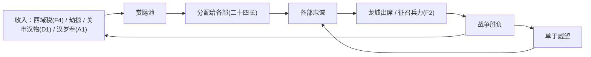

# 《西域·汉匈争霸》史料—机制挖掘报告

> 作者视角：秦汉史 / 内亚史研究 + 系统设计。对照现有设计 v0.4（影响力 vs 威吓、商路、后勤 `T_max`、屯田、围城、焚田、设伏、赏赐→册封→属国、季节；朝廷信任与诏令只有设计、尚未实现；人物系统也未实现）。
>
> **史料说明**：原文主要核对自维基文库所收《汉书》卷 61《张骞李广利传》、卷 69《赵充国传》、卷 70《傅常郑甘陈段传》、卷 79《冯奉世传》、卷 94 上下《匈奴传》、卷 96 上下《西域传》。凡加引号的原文均经逐字核对。《史记》《盐铁论》、简牍和现代研究部分依据通行研究与学界共识概述；这次的检索工具和 ctext 无法访问，所以这些部分**没有逐页核对**，表中已注明。年份按通行公元换算，个别有争议之处另作说明。

---

## 〇、核心结论：最值得做的五件事

1. **时间差与授权（"将在外"）**：长安到乌垒的诏令要走几个月。陈汤"矫制"后"上疏自劾"，冯奉世先斩后奏，赵充国顶住进兵诏书。这和现有的 10 天一步、常备指令完全契合：**诏令也是在路上的实体**，玩家可以在诏令送达前的窗口里行动。这是汉方最有特色的系统。
2. **单于合法性与再分配**（巴菲尔德说）：匈奴是"帝国联盟"，单于靠分配掠夺品和汉朝财物维系二十四长。匈奴方的核心资源不该只是"威吓"，还要有**"威望/赏赐池"**，用来维持诸王忠诚。打了败仗、遭遇灾害或继承有争议时，诸王会"不肯会龙城"，甚至降汉（浑邪王、日逐王）。
3. **继承竞赛与质子**：楼兰王一死，"匈奴先闻之，遣质子归，得立为王"。质子在谁手里、离王都多远，决定由谁扶立新王。把地理距离变成外交，非常有趣，且接口现成（王族、质子字段）。
4. **大军"光环"决定沿途补给**：贰师一征时"当道小国各坚城守，不肯给食"，二征则"兵多，所至小国莫不迎，出食给军"。**本地供粮意愿 = f(军队规模/当地胜兵, 影响力, 罪状)**，这能把后勤与外交两大系统打通。
5. **匈奴灾害—瓦解链**：前 71 年冬天大雪，"人民死者什三，畜产什五……诸国羁属者皆瓦解"。用环境冲击触发属国连锁叛离，给汉方制造历史性的机会窗口，也给匈奴方一个"雪灾求生"剧本。

---

## 一、主题卡片

格式：**史实 → 机制草案 → 接口 → 趣味 → 优先级**。

### A. 汉匈大框架

#### A1 白登之围与和亲体制（前 200—前 134）
- **史实**：高帝领兵 32 万（"多步兵"），冒顿"匿其精兵，见其羸弱"，在白登围困汉军七日。陈平行间，"厚遗阏氏"后才得解围（《汉书·匈奴传》）。此后由刘敬定和亲：宗室女嫁单于，每年送絮缯酒米，开放关市。前 90 年李广利投降后，狐鹿姑单于来书要价："岁给遗我糵酒万石，稷米五千斛，杂缯万匹，它如故约，则边不相盗矣"（同上）。
- **机制**：
  - **岁奉条约**（双方通用的外交状态）：匈奴对河西保持威吓 ≥ T，就可以发起"求和亲"。汉方选择**接受**时，每年支付钱和丝帛，匈奴劫掠减 70%，但武帝时期朝廷信任每年下降，宣帝以后不扣；选择**拒绝**时，匈奴获得"开战理由"，秋季南下的士气上升。
  - **诈败诱敌**（匈奴战术卡）：撤退时隐藏一部分精骑，敌军追击时在侧翼阶段获得大额加成。汉军以步兵为主、机动力低时更容易中计。
  - **重赂阏氏**：被围时可以消耗钱，通过使臣"行间"，成功率按单于宠妃（人物）的倾向计算。
- **接口**：外交关系 Buff；战斗第 1 阶段的避战/追击判定；钱。
- **趣味**：岁奉是"花钱买时间"，让玩家把兵力投到西域，代价是政治信任。
- **优先级**：中（岁奉条约为高）。

#### A2 马邑之谋（前 133）
- **史实**：聂翁壹佯装出卖马邑引诱单于，汉在马邑旁设伏 30 余万。单于"见畜布野而无人牧者，怪之"，攻下亭障，俘获雁门尉史，伏兵计划泄露。从此和亲破裂（《汉书·匈奴传》）。前 105—前 103 年还有一次镜像事件：匈奴左大都尉想杀单于降汉，汉为此筑受降城。赵破奴领 2 万骑接应，事情败露，全军覆没（同上）。
- **机制**：**诱敌/内应**行动。汉方派商人或间谍散布假情报，诱使匈奴大军进入设伏节点。泄密概率 = 基础值 + 伏兵规模系数 + 途经亭障数（"畜布野而无人"之类的破绽），伏兵越多越容易暴露。泄密后，伏兵一方本季威吓或影响力 −，关市关闭。反向事件"敌酋请降"中，玩家无法确认真假：可能是真降，也可能是陷阱或已经败露。
- **接口**：设伏（现有）；事件系统；情报。
- **趣味**：伏兵多则必胜，但也必然暴露。这种风险与收益的博弈，玩家要自己判断。
- **优先级**：中。

#### A3 河南、河西、漠北三战与马匹损耗（前 127—前 119）
- **史实**：前 127 年卫青取河南地，设朔方郡；前 121 年霍去病春夏两次出陇西、北地，进击河西；前 119 年漠北之战，卫青烧毁赵信城的积粟，霍去病封狼居胥。《史记·匈奴列传》记汉马出塞 14 万匹，"复入塞者不满三万匹"，此后汉"以马少，无以复往"，大规模出击中断了十多年（未逐页核对，属通行记载）。
- **机制**：**国家马匹池**（汉方）。中央军中骑兵的出征规模受马匹池限制；远征按天数和地形损耗马匹（沙漠、漠北损耗系数高），战后马匹恢复很慢，见 D6 马政。漠北级大战之后，匈奴失去幕南的王庭，龙城、单于庭节点的威吓辐射下降，汉方骑兵也要好几年才能恢复。
- **接口**：兵种"是否消耗马"；中央军年度恢复；俘获马匹。
- **趣味**：大胜伴随长期虚弱，玩家必须决定在哪一年把马匹池全部押上。
- **优先级**：高。

#### A4 浑邪王降汉与河西四郡、五属国（前 121—前 111 前后）
- **史实**：伊稚斜单于因河西战败想诛杀浑邪王、休屠王。浑邪王杀休屠王后降汉，降众四万余（号称十万）。霍去病渡河受降时，降众中有人中途变卦，霍去病斩杀八千人，局势才稳住。汉把降众分置五属国，"空其地，始筑令居以西，初置酒泉郡，后稍发徙民充实之，分置武威、张掖、敦煌，列四郡，据两关焉"（《汉书·西域传上》）。四郡的设置年份，《史记》《汉书》记载不一，学界多认为是在前 121 年到昭宣时期之间逐步完成。另据《史记·汲郑列传》，有五百多名商贾因与降胡交易被判死罪（未逐页核对）。
- **机制**：
  - **部领叛降**：匈奴部领满足"战败 + 单于惩罚令（事件）+ 汉影响力/接触"时，可能整部降汉。降众成为汉方的"属国"节点，提供胡骑兵源。受降时有一次"哗变检定"，汉将统率越高、受降兵力越多，成功率越高。
  - **移民实边**：新郡初期人口很少，汉方可以消耗钱和时间，从长安迁入人口，提升屯田上限。郡城开发度决定能否升级为补给源。
- **接口**：部领、人口迁徙（§3.2 未实现）、属国胡骑（§4.1）。
- **趣味**：匈奴内部惩罚越狠，越容易把部众推给汉。单于必须在立威与维持团结之间取舍。
- **优先级**：高。

### B. 使节、和亲与西域政治

#### B1 张骞两使与"使团经济"（前 139—前 115；此后使者"相望于道"）
- **史实**：张骞二使乌孙时，率 300 人，"马各二匹，牛羊以万数，赍金币帛直数千巨万，多持节副使，道可便遣之旁国"，到乌孙后"分遣副使使大宛、康居、月氏、大夏"（《汉书·张骞传》）。后来"使者相望于道，一辈大者数百，少者百余人……汉率一岁中使者多者十余，少者五六辈，远者八九岁，近者数岁而反"。使者多是"妄言无行之徒"，"私县官赍物，欲贱市以私其利"，结果"外国亦厌汉使……禁其食物，以苦汉使"，楼兰、姑师"攻劫汉使王恢等尤甚"；使者又"争言外国利害，皆有城邑，兵弱易击"（同上）。
- **机制**：
  - **使团编成**：使团由正使（人物）、副使数量和携带的财物组成。每名副使可以在途中分出一支"分使"，前往相邻国家（张骞模式），需要正使能力足够。
  - **使者质量 vs 数量**：可以选择"募使"（快速、廉价、人数多），代价是"贪渎"判定：一部分财物被私吞、外交收益打折，一定概率引发"辱使/禁食"事件（影响力 −，并产生"汉使受辱"）。妙处在于，**被劫杀的汉使会为汉方生成"罪状"**，即开战理由（§4.6）。廉价使团既是外交工具，也是制造开战理由的工具，这正好对应武帝朝的现实。
  - **往返时长**：远国使团需要好几年，可以借此揭开迷雾，显示大宛、康居、月氏的状态和道路。
- **接口**：使臣属性（能力/谨慎）；赏赐边际递减；罪状系统。
- **趣味**："派一批不靠谱的使者，等他们被杀"是史实上的灰色策略，玩家会意识到自己在做道德选择。
- **优先级**：高。

#### B2 乌孙和亲：细君、解忧、冯嫽（前 105—前 51）
- **史实**：乌孙"以马千匹聘"，汉在元封年间嫁去江都王女细君，昆莫立她为右夫人；"匈奴亦遣女妻昆莫，昆莫以为左夫人"（匈奴以左为尊）。细君作《黄鹄歌》。昆莫让孙子岑陬娶细君，细君上书拒绝，武帝回复"从其国俗，欲与乌孙共灭胡"。细君死后又嫁解忧，解忧先后嫁岑陬（军须靡）、翁归靡（肥王），生元贵靡、万年（后为莎车王）、大乐（左大将），女儿弟史嫁龟兹王绛宾。后来狂王泥靡被杀，匈奴妇所生的乌就屠自立。解忧的侍女冯嫽"能史书，习事"，嫁给乌孙右大将，"锦车持节"说服乌就屠，最终分立大小昆弥（前 53）。同时辛武贤领兵 1.5 万到敦煌，"穿卑鞮侯井以西，欲通渠转谷"，作为威慑后盾（均见《汉书·西域传下》）。乌孙"户十二万，口六十三万，胜兵十八万八千八百"，是西域最大的军事力量。
- **机制**：
  - **和亲公主**作为人物，长期驻在对方王廷，每年提供影响力，并带来一个"后宫派系"。匈奴也能向同一国家嫁女，形成**左右夫人竞争**，按地位和子嗣比拼对昆弥的影响。
  - **收继婚抉择**：老昆弥死时，公主面临"从其国俗"。接受则婚姻延续，但朝廷风向偏儒家时信任略降；拒绝则和亲断绝。
  - **公主子嗣网络**：子女成年后可以嫁入或出任他国国王（万年→莎车，弟史→龟兹），把汉影响力**跨国**扩散。现设计规定影响力不能跨国转移，这里正好提供一个**合法的例外**。
  - **冯嫽型女使**：特质"锦车持节"，调停内乱时成功率很高，需要背后有一支在途的汉军（距离 ≤ N 节点）提供"威重"。
- **接口**：外交附加状态 `marriage`；王族与继承（§6）；Q9 大国主动行动。
- **趣味**：家族政治是 CK 式乐趣，十年后才开花的婚姻投资，会给玩家长期期待。
- **优先级**：高。

#### B3 质子制度与继承竞赛
- **史实**：楼兰同时向汉和匈奴遣送质子。楼兰王死后，国人请回在汉的质子，但这名质子"常坐汉法，下蚕室宫刑，故不遣"。下一次王死时，"匈奴先闻之，遣质子归，得立为王"；新王的继母劝他说"先王遣两子质汉皆不还，奈何欲往朝乎"（《汉书·西域传上》）。大宛之战后，沿途小国"皆使其子弟从入贡献……因为质焉"（《张骞李广利传》）。
- **机制**：
  - **继承竞赛**：国王死亡时，各方持有的质子按"所在地到王都的路程"同时出发，先到者获得即位优势（再结合国内派系做检定）。匈奴因为单于庭离车师、楼兰近，天然占优；汉方可以把质子**前置**到敦煌或伊循，但会冒逃亡或被劫的风险。
  - **质子状态**：在汉越久，"汉化"越高，即位后亲汉（尉屠耆型），但国内认可度可能下降，见 C3"前王有子在"。质子可能因犯法遭"宫刑/拘禁"，变得无法遣返，这是一个随机事件，朝廷信任低或法家风向时更容易发生。
  - **遣子入质**：作为降服的附带条款，战胜后自动获得。
- **接口**：`hostage` 字段；王族继承顺位；路程计算（现有 Dijkstra）。
- **趣味**：把地图距离变成外交。玩家会开始盘算"把质子放在哪儿"。
- **优先级**：高。

#### B4 两属与王族派系
- **史实**：楼兰王被汉擒获后辩称："小国在大国间，不两属无以自安。"武帝"直其言，遣归国，亦因使候司匈奴"（《汉书·西域传上》）。车师、楼兰、莎车王族内部屡次出现亲汉派与亲匈派的斗争。
- **机制**：新增**两属**状态（介于册封与属国之间，可以同时对汉、对匈存在）。两属国同时向双方纳贡（给钱，额度较低），双方都不能驻军。好处是**情报**：两属国会把对方军队动向透露给你（延迟一季，可信度依影响力而定）。缺点是一旦开战，两属国最容易被双方指控而生成罪状。王族派系：每国设"亲汉 / 亲匈 / 自保"三派权重，影响 §5.5 倾向公式里的"王族个人倾向"项。
- **接口**：§5.2 层级；§5.5 AI 倾向；情报行动。
- **趣味**：不必非黑即白，允许小国"骑墙"，玩家也可以容忍它们骑墙以换取情报。
- **优先级**：中。

#### B5 扣使对等（苏武模式）
- **史实**："汉使留匈奴者前后十余辈，而匈奴使来汉，亦辄留之相当。"苏武被扣十九年，直到昭帝时才归汉；匈奴后来"归汉使不降者苏武、马宏等……欲以通善意"（《汉书·匈奴传》）。
- **机制**：使臣进入敌对势力领地时，有被扣押的风险（概率与关系、近期战事相关）。被扣人物可以被劝降（不降则积累"节义"声望；降了则成为对方的谋士，见 F5），扣使数量也可作为和谈筹码，"归还使者"是和谈中的一项让步。
- **接口**：人物位置；外交和谈。
- **趣味**：人质交换和气节，给人物系统增加情感厚度。
- **优先级**：低。

### C. 西域战争

#### C1 楼兰、姑师之役（前 108）
- **史实**：赵破奴"以七百骑先至，虏其王"，打破姑师（《张骞李广利传》）。正是这次的轻易得手，让武帝相信"宛兵弱……强弩射之，即破宛矣"，从而错判了大宛。
- **机制**：**轻骑奔袭/擒王**。对胜兵少的小城邦（楼兰 2912、车师前 1865），可以发动小股骑兵突袭，一次性检定能否擒王。成功则当场迫降，失败则损兵并提升该国怨恨。同时设一个隐藏变量**"轻敌"**：连续轻易得手后，朝廷会对更强的对手提出不切实际的诏令（例如"三千人取大宛"）。
- **接口**：战斗与围城；诏令生成器。
- **趣味**：用小胜引出大错，诏令系统由此有了历史逻辑。
- **优先级**：中。

#### C2 大宛之战（前 104—前 101）：后勤灾难范本
- **史实**：
  - **一征**：发"属国六千骑及郡国恶少年数万人"。"当道小国各坚城守，不肯给食，攻之不能下。下者得食，不下者数日则去。比至郁成，士财有数千，皆饥罢"，"往来二岁，至敦煌，士不过什一二"。李广利上书说"士卒不患战而患饥"（《张骞李广利传》）。
  - **二征**：出敦煌 6 万人（私从者不计），"牛十万，马三万匹，驴橐驼以万数赍粮"，另发"戍甲卒十八万酒泉、张掖北"，"发天下七科适"。军中带了"水工"改道水源，因为"宛城中无井，汲城外流水"；又拜两名习马者为执、驱马校尉，准备挑选良马。"兵多，所至小国莫不迎，出食给军。至轮台，轮台不下，攻数日，屠之。"最终"入玉门者万余人，马千余匹"，损失大多不是死于战斗或饥饿，而是因为"将吏贪，不愛卒，侵牟之"。诏书里还说"山雪不积"（张晏注："是岁雪少，故得往还"）。
- **机制**：
  1. **沿途供粮意愿**：军队经过非属国城邦时，按 `意愿 = a·(军队兵力/当地胜兵) + b·汉影响力 − c·匈奴威吓 + d·罪状` 计算。达到阈值就"出食给军"（相当于临时兵站），否则"坚城守"。城邦不供粮时，军队只能绕行、围城或屠城。屠城（轮台）会让周边国家立刻"迎军"，但威吓式手段会让汉方影响力和朝廷信任下滑（宣帝以后惩罚更重）。
  2. **断水源**：针对"无井"的城市（城市属性 `has_well`），可以执行"徙其城下水"的围城选项，大幅缩短围城时间。守方可以通过"秦人穿井"事件（降汉工匠）补上水井。
  3. **将领"贪渎"特质**：军队每 tick 的非战斗减员额外 + x%。
  4. **雪情**：葱岭山道的封闭期按年份浮动，可能出现"山雪不积"之年，作为随机吉兆。
  5. **执驱马校尉**：攻下马产地后，用"择马"动作获得"天马"，直接兑换朝廷信任（武帝期 ×2）。
- **接口**：`T_max`、运输队、围城、朝廷信任、§4.6 罪状。
- **趣味**：一征是教科书式的"兵少则饿死，兵多则民夫爆炸"；二征让玩家体会到，大军本身就是一种外交威慑。
- **优先级**：高（供粮意愿公式是全局机制）。

#### C3 傅介子刺楼兰王（前 77）
- **史实**：楼兰"当白龙堆，乏水草，常主发导，负水儋粮，送迎汉使，又数为吏卒所寇"，因而反复倒向匈奴。王弟尉屠耆降汉后，"霍光白遣平乐监傅介子往刺其王。介子轻将勇敢士，赍金币，扬言以赐外国为名"，在宴饮间刺杀了国王，宣称"王负汉罪……当更立王弟尉屠耆在汉者。汉兵方至，毋敢动"。汉立尉屠耆为王，改国名为鄯善。新王自请："身在汉久，今归，单弱，而前王有子在，恐为所杀。国中有伊循城……愿汉遣一将屯田积谷"。于是汉"遣司马一人、吏士四十人，田伊循以填抚之"（《汉书·西域传上》）。傅介子在此之前曾以骏马监身份出使，责问楼兰、龟兹（《傅介子传》）。
- **机制**：**刺杀—易王组合技**。前提：目标国有罪状（杀过汉使）；汉方手中有该国的流亡王族或质子；使臣有"勇决"特质，并携带赏赐财物作为掩护。成功率 = 能力 + 赏赐额 − 目标国匈奴威吓。成功后立傀儡（§5.2），并触发**"新王请屯"**：傀儡国开放一个小型屯田点（伊循型，只需 40 人），提供本地粮和驻军权，但傀儡王对前王之子的恐惧会持续存在，形成后续政变风险。另外，改国名可以作为 UI 彩蛋，也可以作为一次性"人心更始"效果。
- **接口**：§5.3 刺杀/政变；质子；屯田；朝廷风向（霍光时代低成本偏好可加成）。
- **趣味**：用一条人命替代一场战争，低成本高风险，失败时汉使暴毙，并产生反向罪状。
- **优先级**：高。

#### C4 车师五争（前 108—前 60 前后）
- **史实**（传统"五争车师"之说，分段依《汉书》西域、匈奴、郑吉诸传整理）：① 前 108 年赵破奴破姑师；② 前 99 年开陵侯（匈奴降者）率楼兰兵进攻车师，匈奴右贤王救援，汉军退走；③ 前 89 年开陵侯再次进攻，"危须、尉犁、楼兰六国子弟在京师者皆先归，发畜食迎汉军，又自发兵，凡数万人……共围车师，降其王"（轮台诏所述），但"士自载不足以竟师，强者尽食畜产，羸者道死数千人"；④ 昭帝时匈奴"发骑田车师"，与车师联合侵犯乌孙；⑤ 宣帝地节年间，郑吉率渠犁田卒与诸国兵攻破车师，匈奴来争，郑吉被围，汉一度把车师百姓迁到渠犁，留下空地。直到前 60 年日逐王降汉，北道才算确定；元帝时又"置戊己校尉，屯田车师前王庭"。
- **机制**：
  - **咽喉节点争夺**：车师前已经是汉的胜利必需节点。建议给它加"**争地**"属性：双方在此屯田时，屯田产量 +，但每季都会被对方"焚田"的概率翻倍。
  - **迁国/空城**：控制方可以把该国人口整体迁到己方腹地（汉→渠犁，匈奴→本部），节点人口归零、变为"空地"，对方无法从中征兵征粮，但汉方的属国数也会减一。这是一种"焦土外交"。
  - **质子先归**：现存质子越多，出征时质子所属国"发畜食迎汉军"的概率越高，这一点与 C2 的供粮公式叠加。
- **接口**：屯田、焚田、人口迁徙、胜利条件。
- **趣味**：咽喉节点上反复拉锯，正是"五争"的史诗感所在。
- **优先级**：高。

#### C5 冯奉世矫诏击莎车（前 65）
- **史实**：莎车杀死汉所立的莎车王万年（解忧之子）和汉使奚充国，扬言"北道诸国已属匈奴"，"从鄯善以西皆绝不通"。冯奉世当时以卫候身份持节护送大宛诸国客人，判断"不亟击之则莎车日强，其势难制"，于是"以节谕告诸国王，因发其兵，南北道合万五千人"，攻下莎车。事后丞相、将军都主张封赏，"少府萧望之独以奉世奉使有指，而擅矫制违命……即封奉世，开后奉使者利，以奉世为比，争逐发兵，要功万里之外，为国家生事于夷狄"，宣帝最终没有封侯（《冯奉世传》）。
- **机制**：
  - **持节动员**：持节使臣可以不带汉军，凭"节"征调周边属国或册封国的兵力（每国按胜兵 × 比例提供，消耗影响力），即"发诸国兵"。
  - **矫诏的"先例"变量**：每次矫诏成功都会累积"先例值"。先例越高，朝廷 AI 派来的副使、监军和继任者，越倾向于擅自发兵（AI 常备指令更激进），制造计划外战争和怨恨。对矫诏的封赏由朝廷风向决定，可能出现"有功不侯"的结果（信任 + 但不封侯）。
- **接口**：§5.7 矫诏、副使/监军 AI；§4.6 发诸国兵。
- **趣味**：成功也有长期代价。玩家给后来者开了口子，这个设计很少见，也很有历史味。
- **优先级**：高。

#### C6 陈汤、甘延寿斩郅支（前 36）
- **史实**：甘延寿病时，陈汤"独矫制发城郭诸国兵、车师戊己校尉屯田吏士"。甘延寿"惊起，欲止焉"，陈汤"按剑叱延寿"。随后"汉兵胡兵合四万余人，延寿、汤上疏自劾奏矫制"，即日"别为六校，其三校从南道逾葱岭径大宛，其三校都护自将……从北道入赤谷"。途中康居副王抱阗劫掠乌孙，陈汤"纵胡兵击之……得其所略民四百七十人，还付大昆弥，其马牛羊以给军食"，进入康居境内后"令军不得为寇"。功成后上疏"明犯强汉者，虽远必诛"（《陈汤传》）。丞相匡衡等人仍以"矫制生事"为由反对封侯，最后"上从众而侯之"（《冯奉世传》附杜欽疏）。
- **机制**：
  - **自劾**：矫诏出兵的同时可以"上疏自劾"。自劾奏疏作为实体送往长安，抵达前朝廷不知情；抵达后，矫诏惩罚减半，但朝廷可能发出"召还令"，召还令再走一趟路程回来。**玩家要赶在召还令送达前打完**。
  - **副贰冲突**：正副使由两名人物担任，性格相左时，"按剑叱"会有判定：成功则强行推进，失败则计划被搁置，事后关系恶化。
  - **分进合击 + 以战养战**：同一计划拆成南北两路（现有"军队拆分"接口），击败途中的劫掠者可以缴获牲畜补充军粮（俘获 → 粮）。"不得为寇"的命令维持当地影响力，代价是放弃劫掠补给。
- **接口**：军队拆分/合并、常备指令、俘获、朝廷信任、人物特质。
- **趣味**："赶在诏书到达之前完成任务"是天然的紧张时钟。
- **优先级**：高（自劾/召回在途机制）。

#### C7 常惠持节护乌孙兵：本始三年五将军出塞（前 72—前 71）
- **史实**：匈奴"发骑田车师"，侵犯乌孙，夺取车延、恶师之地，"使使胁求公主"。昆弥表示"愿发国半精兵，自给人马五万骑"，汉"大发十五万骑，五将军分道并出"（田广明、赵充国、田顺、范明友、韩增）。常惠"使持节护乌孙兵"，昆弥领 5 万骑从西路攻到右谷蠡王庭，"获单于父行及嫂、居次、名王……以下四万级，马、牛、羊、驴、橐驼七十余万头，乌孙皆自取所虏获"。常惠因此被封为长罗侯，汉又"遣惠持金币赐乌孙贵人有功者"（《汉书·西域传下》《常惠传》）。五将军本身大多无功，有的将军因逗留不进被诛。常惠回程时还"以便宜"征调西域兵讨伐龟兹（《常惠传》，未逐字核对）。
- **机制**：
  - **联军作战**：大国（乌孙）在汉影响力高、又遭匈奴侵犯时，会主动请求联合出兵。汉方派持节使臣"护军"，盟军就会按汉方计划行动。**战利品归盟军**，乌孙对汉的倾向 +，汉方得到的只是威吓下降和朝廷信任。
  - **护盟义务**：如果拒绝或拖延救援，公主所在国对汉的影响力会骤降，这对应现设计里匈奴册封的"保护义务"。
  - **将军逗留**：派出的中央军将领带有"怯战/观望"特质时，可能达不到约期，触发朝廷处罚事件。
- **接口**：Q9 大国主动行动；§5.4 保护义务对称化；常备指令"约期会合"触发器（新增 `rendezvous`）。
- **趣味**：借刀杀人，但刀会记得你。盟友的忠诚靠战利品和面子来维系。
- **优先级**：高。

#### C8 郑吉、日逐王降汉与都护府（前 68—前 60）
- **史实**：狐鹿姑单于即位时曾约定传位给弟弟左大将，左大将死后，"其子先贤掸不得代，更以为日逐王。日逐王者，贱于左贤王"（《汉书·匈奴传》）。到前 60 年，握衍朐鞮单于即位，"日逐王畔单于，将众来降，护鄯善以西使者郑吉迎之……封日逐王为归德侯，吉为安远侯……乃因使吉并护北道，故号曰都护……僮仆都尉由此罢"。都护"治乌垒城，去阳关二千七百三十八里，与渠犁田官相近，土地肥饶，于西域为中"，职责是"督察乌孙、康居诸外国……可安辑，安辑之；可击，击之"（《汉书·西域传上》）。
- **机制**：把"日逐王来降"做成一条**跨越 25 年的事件链**：起点是前 85 年先贤掸被夺嗣，留下"怨望"标记；单于每换一次人，怨望都会重新检定；汉在西域的影响力越高、离日逐王驻地（焉耆、危须、尉犁一带）越近，降汉概率越高。日逐王一旦降汉，匈奴在西域的**僮仆都尉被撤销**，征税能力崩塌，汉方胜利条件 3 大幅推进。匈奴方可以通过"改立/安抚日逐王"化解，代价是威望或赏赐池。
- **接口**：§9.1 胜利；匈奴继承（F1）。
- **趣味**：玩家能在开局几十年前就看到伏笔，匈奴玩家则必须提前处理这颗"定时炸弹"。
- **优先级**：高。

<!-- 下半部分：紧接上半部分"一、主题卡片"的 C 组之后，可直接拼接 -->

> **下半部分史料说明**：本部分新核对了维基文库所收《汉书》卷 6《武帝纪》、卷 50《汲黯传》、卷 54《李广苏建传》、卷 61《张骞李广利传》（颜注本）、卷 69《赵充国传》、卷 94 上下《匈奴传》、卷 96 上下《西域传》，《史记》卷 30《平准书》，《盐铁论》卷一。凡加「」或引号的原文均已逐字核对。居延、悬泉汉简，以及张晏注"七科谪"的细目，只按学界通行释读概述，**没有逐字核对**，正文另有标注。

### D. 经济与边塞

#### D1 关市：贸易既是缰绳，也是诱饵
- **史实**：马邑之谋失败、和亲断绝之后，「匈奴貪，尚樂關市，耆漢財物，漢亦通關市不絕以中之」。但五年后，「漢使四將各萬騎擊胡關市下」，卫青出上谷，一直打到龙城（《汉书·匈奴传上》）。早在文帝时，中行说就警告过单于：「今單于變俗好漢物，漢物不過什二，則匈奴盡歸於漢矣」（同上）。到昭帝时，盐铁会议上的大夫把贸易说成经济战：「夫中國一端之縵，得匈奴累金之物，而損敵國之用。是以騾驢馲駝，銜尾入塞，驒騱騵馬，盡為我畜」（《盐铁论·力耕》）。
- **机制**：
  - **关市节点状态**：边塞关隘（玉门、阳关，以及将来增加的朔方、云中）设一个 `market_open` 开关。开市时，匈奴每季获得"汉物"（新资源，见第五节），汉方得到少量马匹和**情报**（市场里能看到对方部落的动向）；双方的倾向也会慢慢软化。
  - **汉物依赖度**（匈奴的全局变量）：依赖度随开市时长上升。依赖度越高，关市一旦关闭，诸王忠诚就下降得越多。中行说型谋士（F5）可以执行"去汉化"政令，把依赖度压下来，代价是失去一部分赏赐池。
  - **关市伏击**：汉方可以在开市期间对聚在市下的部落发动突袭，收益很高，但会产生"背信"标记：此后和亲、和谈的门槛上升，匈奴获得开战理由。
- **接口**：商路（现有，可扩展出"边市"子类型）；新资源"汉物"；外交和谈。
- **趣味**：贸易是一把双刃剑。汉方用它喂养匈奴、让对方产生依赖，也可以在某个时刻翻脸。
- **优先级**：高（这是让匈奴的钱有用途的关键入口之一）。

#### D2 禁运与"阑出"：兵器、铁器与技术外流
- **史实**：浑邪王入长安时，「賈人與市者，坐當死五百餘人」。汲黯谏争说：「愚民安知市買長安中而文吏繩以為闌出財物如邊關乎？」（《汉书·汲黯传》）。按汉律，与胡人交易不许私带兵器出关（应劭注引律文，未逐字核对）。《西域传上》记载大宛以西至安息一带：「其地無絲漆，不知鑄鐵器。及漢使亡卒降，教鑄作它兵器」。轮台诏也承认：「今邊塞未正，闌出不禁」。
- **机制**：
  - **走私率**：每个边关节点按"边塞秩序"计算走私流量。走私给匈奴带来"铁器"进度，而且能绕开汉方的禁市令（走私货 = 打折的汉物）。汉方可以执行"严禁阑出"，走私降低，但每次执行都会触发一次"株连"判定，商路收入和城邦影响力受损（汲黯案）。
  - **技术外流**：汉军遭遇大败或出现降卒时，会给敌方（匈奴或所在城邦）掷一次"教铸兵器"判定。成功后，对方的弓骑或步兵获得永久的"铁兵"加成。这样一来，汉方大败的代价就不止当场的兵员损失（C2 里的"秦人穿井"属于同一类事件）。
- **接口**：兵种属性修正；事件系统；商路。
- **趣味**：失败会外溢成技术扩散，迫使汉方重视"别让败兵流落异域"。
- **优先级**：中。

#### D3 盐铁专卖、算缗告缗与汉代财政危机
- **史实**：漠北之战之后，「賞賜五十萬金，漢軍馬死者十餘萬匹，轉漕車甲之費不與焉。是時財匱，戰士頗不得祿矣」。徙民实边又让「縣官大空」。于是孔仅、东郭咸阳建议盐铁官营，「敢私鑄鐵器煮鹽者，釱左趾，沒入其器物」；算缗规定商贾「率緡錢二千而一算」；随后「楊可告緡遍天下，中家以上大抵皆遇告……於是商賈中家以上大率破……而縣官有鹽鐵緡錢之故，用益饒矣」（《史记·平准书》）。盐铁会议上，大夫为专卖辩护：「邊用度不足，故興鹽、鐵，設酒榷，置均輸，蕃貨長財，以佐助邊費」（《盐铁论·本议》）。武帝晚年，有司又奏请「欲益民賦三十助邊用」，被轮台诏驳回（《西域传下》）。
- **机制**：
  - **汉方财政政策卡**（每 5 年可调整一次，或由事件触发）：
    | 政策 | 效果 | 代价 |
    |---|---|---|
    | 盐铁官营 | 年度拨款 +30% | 朝廷"文学派"不满累积，轮台诏后的风向更早到来 |
    | 算缗 | 拨款 +15% | 商路收入 −10% |
    | 告缗 | 一次性大额拨款 | 商路收入 −40%，持续 5 年（"商贾中家以上大率破"） |
    | 益民赋 | 拨款 + | 朝廷信任 −，触发"重困老弱"事件 |
  - **国库枯竭**：远征支出累计超过拨款时，进入"财匱"状态：中央军年度恢复减半，诏令生成器转向"屯田、自养"类诏令。
- **接口**：汉年度拨款（`economy.gd::_new_year`）；商路收入；朝廷风向。
- **趣味**：可以缓解审计指出的"开局没钱发呆期"。玩家可以主动"向朝廷要钱"，但每一笔钱都对应着国内的某种痛苦。
- **优先级**：高。

#### D4 烽燧亭障：边塞预警网
- **史实**：赵充国说：「北邊自敦煌至遼東萬一千五百餘里，乘塞列隧有吏卒數千人，虜數大眾攻之而不能害」（《汉书·赵充国传》）。桑弘羊的屯田奏议要求「嚴敕太守、都尉明烽火，選士馬，謹斥候，蓄茭草」。轮台诏则批评边吏「使卒獵獸，以皮肉為利，卒苦而烽火乏」（均见《西域传下》）。武帝巡边时，发现「新秦中或千里無亭徼，於是誅北地太守以下」（《平准书》）。居延汉简中的《塞上烽火品约》按入塞匈奴的人数和远近，规定举烽、燃积薪的数目和白天黑夜的信号（据学界释读，未逐字核对）。
- **机制**：
  - **烽燧链**（现在没有战争迷雾，这正好是迷雾系统的汉方版本）：河西与边塞的道路上可以修建"亭障"（消耗钱和民夫）。亭障能探知相邻路段的敌军，并按"品约"分级报告（"百骑以下 / 千骑以上 / 大入"），**警报沿亭障链快速传递**，比骑兵行军快得多，可以提前激活沿线军队的 `enemy_near` 常备指令。
  - **亭障废弛**：维护费不足、或者守将带有"贪"特质时，亭障有概率变成"烽火乏"状态，警报延迟或失效。匈奴方可以用"拔亭障、俘尉史"来致盲（马邑型泄密见 A2）。
- **接口**：战争迷雾（审计第 5 条）；常备指令触发器；道路附加属性。
- **趣味**：信息成了可以建造、维护和破坏的基础设施，"情报战"由此有了物理载体。
- **优先级**：高（与战争迷雾一并做）。

#### D5 传舍与接待：使团经济的财政账本
- **史实**：《西域传上》记录了一种不对称：在乌孙以西到安息一带，「匈奴使持單于一信到國，國傳送食，不敢留苦。及至漢使，非出幣物不得食，不市畜不得騎，所以然者，以遠漢，而漢多財物，故必市乃得所欲」。楼兰则因为「負水儋糧，送迎漢使」而不堪重负（见 C3）。悬泉置遗址出土的《过长罗侯费用簿》，记录了驿站为接待常惠一行所支出的酒、肉、粮；《康居王使者册》（元帝时期）记录康居使者控诉酒泉官吏单方面评定所献骆驼的肥瘦、压低价值，而且不按惯例供食（据学界释读概述，未逐字核对）。
- **机制**：
  - **通行费不对称**：使团（B1）每经过一个非属国节点，汉方都要付"市食钱"；匈奴使者凭"威吓 ≥ 阈值"就能免费通行。属国负责"传送食"，但每接待一次，该国的"供应负担"就增加一点，负担过高会转化为怨恨（楼兰模式）。
  - **入朝接待**：外国遣使入朝能提升朝廷信任，但河西各节点要为使团支付"传舍费"（从存粮里扣）。玩家要决定接待规格："厚待"让影响力加倍；"薄待"或"估价不公"则会触发康居式投诉事件，影响力下降，严重时对方改向匈奴纳贡。
- **接口**：B1 使团；节点存粮；朝廷信任。
- **趣味**：外交成果和地方财政绑定在一起，"万国来朝"也会把河西吃穷。
- **优先级**：中。

#### D6 马政与天马
- **史实**：「天子為伐胡，盛養馬，馬之來食長安者數萬匹，卒牽掌者關中不足，乃調旁近郡」。缺马时，「令封君以下至三百石以上吏，以差出牝馬天下亭，亭有畜牸馬，歲課息」；在新秦中，「令民得畜牧邊縣，官假馬母，三歲而歸，及息什一」（《平准书》）。漠北之战一役，汉军损失马匹十余万（见 D3、A3）。武帝得乌孙马，「名曰『天馬』。及得宛汗血馬，益壯，更名烏孫馬曰『西極馬』，宛馬曰『天馬』云」（《张骞传》）；大宛的苜蓿、葡萄也被引种到离宫旁（「蒲陶、目宿離宮館旁，極望焉」，《西域传上》）。武帝晚年下轮台诏，要求「修馬復令，以補缺……郡國二千石各上進畜馬方略補邊狀」。
- **机制**（在 A3 国家马匹池的基础上，补充**恢复渠道**）：
  | 渠道 | 规则 |
  |---|---|
  | 官厩 | 每年基础恢复 |
  | 亭马/马复令（政策） | 恢复 +50%，消耗钱；轮台诏之后默认开启 |
  | 官假马母 | 在有牧地的屯田节点（如武威、张掖）建"马苑"，三年后开始产马，部分收益归民 |
  | 目宿 | 屯田节点可以改种苜蓿：粮产 −，马苑上限 + |
  | 俘获 | 现有机制 |
  | 贡马/天马 | 乌孙、大宛进贡：骑兵质量 +1 档，朝廷信任 +（武帝期 ×2，见 C2） |
  - 顺带修复审计指出的问题：`horses_per_1000` 没被计分使用。可以把"马匹池/兵力"直接作为汉方的终局计分项。
- **接口**：马匹池；屯田区；属国贡品；计分。
- **趣味**：马是汉方的战略瓶颈。玩家会为了"天马"去打一场本来不划算的战争，就像武帝那样。
- **优先级**：高。

#### D7 屯田：从轮台、渠犁到北胥鞬
- **史实**：「自武帝初通西域、置校尉，屯田渠犁」。李广利投降后，桑弘羊奏请在轮台屯田：「故輪台東捷枝、渠犁皆故國，地廣，饒水草，有溉田五千頃以上……可遣屯田卒詣故輪台以東，置校尉三人分護，各舉圖地形，通利溝渠……張掖、酒泉遣騎假司馬為斥候……田一歲，有積穀，募民壯健有累重敢徙者詣田所……稍築列亭，連城而西，以威西國，輔烏孫」，被武帝否决。昭帝时「乃用桑弘羊前議，以杅彌太子賴丹為校尉，將軍田輪台」。龟兹贵人姑翼进言：「賴丹本臣屬吾國，今佩漢印綬來，迫吾國而田，必為害」，龟兹王于是杀了赖丹，「漢未能征」。宣帝时，常惠调集诸国兵 5 万问罪，龟兹交出姑翼抵罪（《西域传下》）。都护府设立后，「徙屯田，田於北胥鞬，披莎車之地，屯田校尉始屬都護」（《西域传上》）。
- **机制**：
  - **屯田五阶段**（取代现在的"一键设屯田区"）：① 斥候测地（需要河西骑兵）→ ② 通渠（消耗民夫，持续一年）→ ③ 一年积谷 → ④ 募民迁徙（需要人口迁徙，§3.2）→ ⑤ 列亭连城（把亭障网延伸过来，D4）。每一阶段都会提高产量、防御和威吓辐射。
  - **邻国压迫感**：屯田节点会对相邻的独立大城邦（龟兹）累积"迫吾国而田"值，超过阈值后触发"刺杀屯田校尉"事件，产生罪状，汉方面临"征 / 不征"的选择。
  - **外籍校尉**：用他国的质子或王族担任屯田校尉（赖丹模式），能获得原属国的支持，但会加剧邻国的压迫感。
- **接口**：屯田区；B3 质子；罪状。
- **趣味**：屯田不只是生产设施，还是一种外交挑衅。
- **优先级**：高。

### E. 汉廷与军队

#### E1 轮台诏：朝廷风向的急转（前 89）
- **史实**：武帝下诏「深陳既往之悔」，驳回桑弘羊的轮台屯田议，说「今請遠田輪臺，欲起亭隧，是擾勞天下，非所以優民也。今朕不忍聞」。他检讨伐匈奴的决策过程：曾把匈奴缚马的文书「遍視丞相、御史、二千石……皆以『虜自縛其馬，不祥甚哉！』」，又「卦諸將，貳師最吉」，结果「今計謀卦兆皆反繆」。诏书提出新方针：「當今務在禁苛暴，止擅賦，力本農，修馬復令，以補缺，毋乏武備而已」。此后「由是不復出軍。而封丞相車千秋為富民侯，以明休息，思富養民也」（《汉书·西域传下》）。
- **机制**：
  - **风向切换由事件触发**：设计文档 §5.7 的风向表按年份写死，建议改成**条件触发**：当"大将覆没 + 财匱（D3）+ 巫蛊（E2）"三项中满足两项，就触发"罪己诏"，风向切换为"休息"。玩家可以通过避免大败来**推迟**这次转向，也可能因为冒进而**提前**引发。
  - **"休息"风向的具体规则**：远征类诏令停止生成；**远距屯田也会被否决**（轮台屯田正是被这道诏书否决的，这个反直觉的细节值得保留），只允许河西和已有属国内的屯田；"修马复令"自动开启（D6）；汉方的赏赐、安抚类行动信任加成 +50%。
  - **卜筮与吉凶**：出征前可以"卜诸将"，给出一个看似有用的吉凶提示（实际与胜率弱相关）。事后如果卦兆"反缪"，会增加皇帝的悔意值，加速风向转变。
- **接口**：§5.7 风向、诏令生成器、屯田许可。
- **趣味**：玩家的每一次冒进都在给自己积累"罪己诏"。
- **优先级**：高。

#### E2 巫蛊之祸：后方清洗导致前线冒进（前 91—前 90）
- **史实**：前 90 年李广利出五原，局势本来顺利，「會貳師妻子坐巫蠱收，聞之憂懼」。掾属胡亚夫劝他：「夫人室家皆在吏，若還不稱意，適與獄會，郅居以北可復得見乎？」李广利「由是狐疑，欲深入要功」，长史密谋把他抓起来，被他杀掉。最后他在燕然山兵败投降（《汉书·匈奴传上》）。匈奴还拿巫蛊之事羞辱汉使：「漢，禮義國也。貳師道前太子發兵反，何也？」（同上）
- **机制**：
  - **"家室在吏"状态**：当朝廷发生清洗事件（巫蛊、某派系倒台）时，与该派系有关联的将领获得这个状态，常备指令被强制改为"激进"（无视 `supply_low` 和 `losses_high`），并持续累积叛降概率。部下可能发动"执将"判定，成功则军队由副将带回，失败则副将被斩。
  - **匈奴宣传战**：汉廷内乱期间，匈奴可以发动"辱使"外交行动，降低汉方在两属国家（B4）的影响力。
- **接口**：人物关系与派系；常备指令；E3 降将。
- **趣味**：玩家看着一位能干的将军被后方逼上绝路，这是 CK 式的悲剧。
- **优先级**：中。

#### E3 李陵与李广利：降将的两种命运（前 99、前 90）
- **史实**：李陵率步卒五千出击，「以亡救而敗」投降。公孙敖误报说「李陵教單于為兵以備漢軍」，武帝「於是族陵家」。其实那是另一个降将，「乃李緒，非我也」，李陵于是派人刺杀了李绪。单于「以女妻之，立為右校王，衞律為丁靈王，皆貴用事」。事后武帝悔悟：「陵當發出塞，乃詔強弩都尉令迎軍。坐預詔之，得令老將生奸詐」（以上见《汉书·李陵传》）。李广利投降后，「單于素知其漢大將貴臣，以女妻之，尊寵在衛律上」，后来卫律嫉妒他的宠信，借胡巫之口把他杀了（《匈奴传上》，见 F9）。
- **机制**：
  - **降将处置**：汉将投降后，汉方可选：「族其家」（朝廷信任 +，但其他在外将领的忠诚 −，而且降将会死心塌地，在匈奴的能力全额发挥），或「贳其罪」（信任 −，保留招回降将的可能，苏武模式见 B5）。
  - **情报误认**：降将相关的情报可信度有限（李绪/李陵错认），错误情报可能导致误杀，触发降将的复仇事件。
  - **约期接应**：出征计划可以指定接应部队。但接应将领如果与主将不和，有概率拖延。路博德就是例子：他「亦羞爲陵後距」，以「方秋匈奴馬肥，未可與戰」为理由上奏请求延期（《李陵传》）。这与 C7 的 `rendezvous` 触发器是同一个接口。
- **接口**：人物、F5 降人谋士、情报可信度。
- **趣味**：处置降将的家属，是一个没有正确答案的选择。
- **优先级**：中。

#### E4 军功爵、封侯与卖爵
- **史实**：漠北之战后国库耗竭，于是「請置賞官，命曰武功爵。級十七萬，凡直三十餘萬金……軍功多用越等，大者封侯卿大夫，小者郎吏。吏道雜而多端，則官職秏廢」（《平准书》）。对于降人，汉朝「設金爵之賞以待降者」。但呼韩邪称臣以后，谷永、杜钦反对接受匈奴逃亡者：「今既享單于聘貢之質，而更受其逋逃之臣，是貪一夫之得而失一國之心」（《匈奴传下》）。陈汤、冯奉世"有功是否封侯"之争见 C5、C6。
- **机制**：
  - **封侯作为人物奖励**：将领和使臣有"求侯"欲望值。久不封侯，AI 副将会更冒进；封侯后，"守成"倾向上升，主动性下降。
  - **卖爵**：一种财政行动，立刻获得钱，但会降低此后新招募将领的平均能力（"吏道杂"）。
  - **招降悬赏**：开启后，匈奴部领叛降的概率上升（接 A4、C8）；匈奴称臣以后再招降，会损害双方关系，并留下"归曲"罪状。
- **接口**：人物属性；财政；部领叛降。
- **优先级**：中。

#### E5 七科谪与罪人兵（回答设计文档 Q3）
- **史实**：天汉四年（前 97）「發天下七科謫及勇敢士」，随李广利出朔方（《武帝纪》）；大宛二征时也「發天下七科適」（《李广利传》，颜注说"七科，解在〈武紀〉"）。按张晏注，七科指有罪的吏、亡命者、赘婿、贾人、曾有市籍者、父母有市籍者、祖父母有市籍者（未逐字核对）。大宛一征发「郡國惡少年數萬人」（见 C2）。武帝还「令死罪人贖錢五十萬減死一等」（《武帝纪》）。大鸿胪曾提议「欲募囚徒送匈奴使者」，被轮台诏斥为「五伯所弗能為也」。
- **机制**（Q3 的建议答案）：
  - **罪人兵池** = 全国罪犯 + 商贾子弟。招募免费，但士气低、逃亡率高，与"贪渎"将领组合时减员翻倍（C2 二征"侵牟之"）。
  - **赎罪二选一**：同一批罪人，可以选择"赎钱"（得钱）或"发谪"（得兵），这体现财政与兵源的互换。
  - **战后安置**：幸存者可以赦免为屯田人口，补充 D7 的"募民"阶段。
  - **商贾征发的副作用**：发谪包含商贾时，商路收入暂时下降（与 D3 的告缗叠加）。
- **接口**：§4.1 兵源；屯田人口；商路。
- **优先级**：中。

#### E6 赵充国屯田奏议：以屯代战（前 61—前 60）
- **史实**：赵充国说「百聞不如一見。兵難隃度，臣願馳至金城，圖上方略」。宣帝催他进兵，说「將軍不念中國之費，欲以歲數而勝微」，并指出当时「張掖以東粟石百餘，芻槁束數十。轉輸並起，百姓煩擾」。赵充国坚持主张「留步士萬人屯田……屯田內有亡費之利，外有守禦之備……虜見萬人留田為必禽之具，其土崩歸德，宜不久矣」，总结为「留屯田得十二便，出兵失十二利」。他回顾此前的失误时说：「金城、湟中穀斛八錢，吾謂耿中丞，糴二百萬斛穀，羌人不敢動矣。耿中丞請糴百萬斛，乃得四十萬斛耳」。朝议风向逐渐转变：「初是充國計者什三，中什五，最後什八」。用兵时，他「令軍毋燔聚落芻牧田中」，罕羌因此「不煩兵而下」（《汉书·赵充国传》）。
- **机制**：
  - **"坐胜"屯田**：在敌方部族或叛国的相邻节点设立重兵屯田，对目标每季施加"瓦解"压力（怨恨 +、部众离散），**不需要开战**就能逐渐迫使对方降附。代价是要长期驻军，而且朝廷每季都会发"催战诏"。
  - **奏议说服**：玩家可以连续上奏反对朝廷的进兵诏令。每次上奏都会提升朝议支持率（30% → 50% → 80%）。支持率达到阈值时，诏令被撤回，玩家获得信任；反复上奏不成功则失去信任。这让"讨价还价"（§5.7）成了一个多回合过程。
  - **区域粮价**：每个区域有动态粮价，转输越频繁越贵。在丰年**平价预购**（"糴二百萬斛"）可以大幅降低后续远征成本，这是给汉方的投机型决策。
  - **"毋燔聚落"**：讨伐时禁止焚掠，周边各方投降更快。这是 C6"不得为寇"的同类规则。
- **接口**：屯田；诏令；粮价（新增）；部族怨恨。
- **趣味**：一位老将用屯田和奏疏打赢了战争。这给"不打仗"的玩家提供了一条正当的胜利路径。
- **优先级**：高。

#### E7 诏令与文书的传递时差（参数化建议）
- **史实**：赵充国的奏议「六月戊申奏，七月甲寅璽書報從充國計焉」。按干支推算，两日相隔 6 天（如果中间隔了一个整月，则是 66 天），往返金城与长安之间，很可能依靠驿骑接力。桑弘羊设计的轮台屯田也规定「事有便宜，因騎置以聞」，即用驿骑传递紧急文书。汉代邮书制度对行书的速度有日程规定，居延简中多见邮书逾期的考课记录（未逐字核对具体数值）。陈汤"自劾"与召还的时间竞速见 C6。
- **机制**：
  - **文书实体**：奏疏和诏令作为不可攻击的"信使"在道路上移动。速度分两档：驿骑约为普通骑兵速度的 3 倍（只限亭障与驿置完备的路段，D4）；出了驿路，就按普通骑行。
  - **断驿**：匈奴截断驿路，或在河西焚掠亭障后，诏令只能绕行或延误。这正好是匈奴干扰汉方"授权链"的手段。
  - **"便宜"许可**：信任 ≥ 80 时（设计已有），玩家在远方可以先行动、后补奏；文书在途期间，朝廷看不到玩家的行动，形成真实的信息差。
- **接口**：现有路径与里程数据；亭障；§5.7 诏令。
- **优先级**：高（这是核心结论第 1 条的工程落点）。

### F. 匈奴内部

#### F1 单于继承：左右贤王、二十四长与骨都侯
- **史实**：「置左右賢王，左右谷蠡，左右大將，左右大都尉，左右大當戶，左右骨都侯。匈奴謂賢曰『屠耆』，故常以太子為左屠耆王。自左右賢王以下至當戶，大者萬餘騎，小者數千，凡二十四長，立號曰『萬騎』。其大臣皆世官。呼衍氏，蘭氏，其後有須卜氏，此三姓，其貴種也……而左右賢王、左右谷蠡最大國，左右骨都侯輔政」（《汉书·匈奴传上》）。继承常常出现争议。且鞮侯死时，左大将被拥立，又让位给兄长，约定「即不幸死，傳之於我」，结果狐鹿姑即位后，以其子先贤掸「不得代，更以為日逐王」（见 C8）。狐鹿姑临终说「我子少，不能治國，立弟右谷蠡王」，但「衛律等與顓渠閼氏謀，匿單于死，詐撟單于令……更立子左谷蠡王為壺衍鞮單于」；于是左贤王、右谷蠡王「以不得立怨望……於是二王去居其所，未嘗肯會龍城」（同上）。
- **机制**：
  - **二十四长实体化**：匈奴方不再是一个整体，而是由 6–8 个"部"组成（单于本部、左贤王、右贤王、左右谷蠡、日逐王/西边、浑邪/休屠型河西部……）。每部有自己的部领人物、骑兵、牧地和**忠诚度**。单于直接指挥本部；其他部的兵力要通过"征召"调用，忠诚度低时会打折或拒绝出兵。
  - **继承规则**：单于死亡时，按"遗命 > 左贤王（储君）> 兄弟 > 子"计算各候选人的支持度。阏氏、骨都侯可以"匿丧矫令"（类似汉方的矫诏），成功则立少主，但失位者获得"怨望"，可能不会龙城（F2）、降汉（C8）或自立（F7）。
  - **兄终弟及与父死子继的张力**：每一次"让位约定"都会生成一个伏笔标记，几十年后在继承时引爆。
- **接口**：人物系统（§6）；部领节点；事件链。
- **趣味**：匈奴方的主要敌人可能在帐内。
- **优先级**：高（匈奴可玩性的核心）。

#### F2 单于庭与龙城大会：合法性仪式
- **史实**：「歲正月，諸長小會單于庭，祠。五月，大會龍城，祭其先、天地、鬼神。秋，馬肥，大會蹛林，課校人畜計」（《匈奴传上》）。"不肯会龙城"是诸王离心的标准表述（见 F1）。日逐王降汉，也与「國人以故頗言日逐王當為單于」有关（《匈奴传上》）。
- **机制**：
  - **三次年会**：正月（单于庭小会，诸王述职）、五月（龙城大会，合法性检定）、秋季（蹛林大会，"课校人畜"，即普查和征兵基数结算）。
  - **龙城检定**：每部是否出席由"忠诚 + 单于威望 − 怨望"决定。出席则本年征召和赋税照常；缺席则视为半独立，单于威望下降。连续两年缺席，可能导致自立或叛降。
  - **汉方的反制**：攻破龙城或单于庭节点（卫青前 129 年至龙城，霍去病封狼居胥），会让当年的龙城大会无法举行，所有部的忠诚度下降。这为汉方提供一个"斩首行动"目标，比单纯的歼敌更有意义。
- **接口**：日历事件；节点 tag `sacred`；F1 部的忠诚。
- **优先级**：高。

#### F3 季节迁徙与"秋高马肥"
- **史实**：匈奴「各有分地，逐水草移徙」，「舉事常隨月，盛壯以攻戰，月虧則退兵」（《匈奴传上》）。路博德也说「方秋匈奴馬肥，未可與戰」（《李陵传》）。王莽时严尤论伐胡之难：「胡地秋冬甚寒，春夏甚風……師有疾疫之憂，是故前世伐胡，不過百日」（《匈奴传下》）。前 85 年后，匈奴一度因为畏惧汉兵，「西北遠去，不敢南逐水草，發人民屯甌脫」（《匈奴传上》）。
- **机制**：
  - **牧场季节轮转**：每部有冬、夏两处牧地节点，春秋两季自动迁移（可以手动推迟，但会损耗马匹）。迁徙中的部落防御很弱，是汉方奇袭的窗口；冬季营地固定，则容易被定位。
  - **月相修正**：匈奴进攻时，满月期士气 +，月亏期撤退判定 +。这是一个轻量的史实彩蛋，同时增加了汉方读懂对手节奏的乐趣。
  - **瓯脱（缓冲地）**：双方之间设"瓯脱"节点。匈奴派"瓯脱王"驻守，可以充当前哨与预警（相当于匈奴版的 D4）。瓯脱王被俘，会让匈奴一整季"不敢南逐水草"，牧场面积缩小。
  - **"不过百日"**：汉军在草原深处停留超过 100 天后，疾疫减员率开始陡增（接 F9）。
- **接口**：现有季节系统（`season_winter` 回调目前是空的，这里正好可以填上）；牧草；常备指令。
- **优先级**：高。

#### F4 日逐王与僮仆都尉：匈奴的西域财政
- **史实**：「匈奴西邊日逐王置僮僕都尉，使領西域，常居焉耆、危須、尉黎間，賦稅諸國，取富給焉」。日逐王降汉后，「僮僕都尉由此罷，匈奴益弱，不得近西域」（《汉书·西域传上》）。
- **机制**：
  - **僮仆都尉作为实体**：匈奴在西域的征税不再是"属国自动缴税"，而要由一位驻在焉耆一带的僮仆都尉（人物 + 小股驻军）来执行。每季巡行属国征税，**税收按路程逐国递送**，可以被汉方伏击截获。
  - **税收用途**：西域税是匈奴"赏赐池"的主要来源（见第五节）。都尉被杀、被逐或日逐王降汉，赏赐池就会断流，进而引发诸王忠诚下降，形成连锁反应。
  - 这样，匈奴的"税率"就从审计所说的"伪决策"变成真正的权衡：高税率意味着当季赏赐充足，但属国怨恨上升，汉方也会被吸引来截杀都尉。
- **接口**：现有税率；C8 日逐王事件链；第五节赏赐池。
- **优先级**：高。

#### F5 汉降人在匈奴：中行说、卫律、李陵、李广利
- **史实**：宦者中行说被强迫随翁主出嫁，临行前说「必我也，為漢患者」。到匈奴后，他「教單于左右疏記，以計識其人眾畜牧」，并把单于致汉皇帝的书信改为一尺二寸的木牍，开头写「天地所生日月所置匈奴大單于敬問漢皇帝無恙」（《匈奴传上》）。卫律「父本長水胡人。律生長漢」，因李延年案逃亡降匈奴，「常在單于左右」，后被封为丁零王（《李陵传》）。他为单于出谋「穿井築城，治樓以藏穀，與秦人守之」，有人反对「胡人不能守城，是遺漢糧也」，这个计划才作罢；他「常言和親之利，匈奴不信，及死後，兵數困，國益貧」（《匈奴传上》）。李陵的情况是「陵居外，有大事，乃入議」（《李陵传》）。
- **机制**：
  - **谋士槽位**：单于帐下有 2–3 个谋士槽，汉降人（包括 B5 被扣、劝降成功的汉使，E3 的降将）可以入槽，每人提供一项特殊能力：
    | 原型 | 能力 |
    |---|---|
    | 中行说 | "疏记"：匈奴获得人口与畜牧统计，征召效率 +；"去汉化"降低汉物依赖（D1）；外交文书"倨傲"：拒绝和亲的士气加成翻倍 |
    | 卫律 | "穿井筑城"：允许匈奴在本部建一座有井的城寨（新建筑，可存粮、可抗围），但被攻破时整城存粮归汉；"言和亲之利"：和亲谈判成功率 + |
    | 李陵 | "教兵"：匈奴骑兵获得对汉步兵阵的克制加成（反制弩阵），同时在汉方触发"族家"事件（E3） |
    | 李广利 | 汉军情报：揭示汉方中央军池与河西兵力，但会引来匈奴贵臣的嫉妒（F9 胡巫事件） |
  - **嫉妒与宠信**：谋士之间、谋士与匈奴贵族之间有"宠信"竞争，可能互相陷害。
- **接口**：人物系统；B5 扣使；E3 降将；建筑系统（简化）。
- **趣味**：汉方的每一次失败，都可能在敌营里多出一个最了解汉朝的人。
- **优先级**：高。

#### F6 前 71 年大雪与"三国乘弱"
- **史实**：（核心结论第 5 条已引用"什三、什五"一句，这里补充连锁过程。）本始三年冬，单于自将万骑攻打乌孙，「會天大雨雪，一日深丈餘，人民畜產凍死，還者不能什一。於是丁令乘弱攻其北，烏桓入其東，烏孫擊其西」，结果「諸國羈屬者皆瓦解，攻盜不能理。其後漢出三千餘騎，為三道，並入匈奴，捕虜得數千人還」（《匈奴传上》）。更早的前 104 年冬，也有「匈奴大雨雪，畜多飢寒死，而單于年少，好殺伐，國中多不安」，导致左大都尉谋杀单于降汉（同上，接 A2）。
- **机制**：
  - **白灾事件**：冬季对匈奴各部按"牧地载畜量 + 当季是否远征"判定白灾。远征中的部落受灾加倍（"還者不能什一"）。
  - **乘弱连锁**：白灾后，匈奴总威望低于阈值时，周边的非玩家势力（丁零、乌桓作为地图边缘的事件势力，乌孙作为 Q9 的主动大国）会依次发动"乘弱"攻击。各属国对匈奴的威吓瞬间减半，进入"羁属瓦解"状态，持续 2–3 年。
  - **汉方的机会窗口**：瓦解期间，汉方出兵的损耗降低，招降更容易成功。但汉朝"小股深入"即可取胜，这样的胜利会让玩家低估匈奴（与 C1 的"轻敌"变量对称）。
- **接口**：季节；Q9 大国行动；威吓。
- **优先级**：高。

#### F7 五单于争立与呼韩邪、郅支分裂（前 58—前 36）
- **史实**：握衍朐鞮单于「暴虐殺伐，國中不附」，右贤王对他说「若不愛人，殺昆弟諸貴人。各自死若處，無來汙我」，单于最终自杀，左地贵人拥立呼韩邪（《匈奴传上》）。接着，屠耆单于错杀右贤王父子，呼揭王恐惧叛去，「自立為呼揭單于。右奧鞬王聞之，即自立為車犁單于。烏藉都尉亦自立為烏藉單于。凡五單于」。后来呼韩邪的兄长「左賢王呼屠吾斯亦自立為郅支骨都侯單于」，郅支击败闰振单于和呼韩邪，「郅支都單于庭」（《匈奴传下》）。郅支杀死汉使谷吉，「自知負漢……欲遠去」，应康居之邀西迁，途中「人眾中寒道死，餘財三千人到康居」（同上）。
- **机制**：
  - **分裂状态**：继承危机（F1）极端恶化时，匈奴阵营分裂为 2–5 个"单于"势力，各自控制若干部。玩家选择其中一个继续游戏，其余由 AI 控制，彼此敌对。
  - **再统一**：击败对手单于并吞并其部众（"并其兵"），或者让对方自杀、降附。统一后威望大增。
  - **西迁路线**：失势的单于可以选择"远去"，与康居结盟，在西域另立据点（郅支城）。这给匈奴玩家提供了一条"另起炉灶"的路线，也给汉方提供了"虽远必诛"的终局目标（C6）。
- **接口**：多势力（目前 `encounters` 只区分汉/匈，需要泛化）；F1；C6。
- **优先级**：中（工程量较大，可作为 DLC 剧本"五单于"的核心）。

#### F8 呼韩邪称臣入朝（前 51）
- **史实**：左伊秩訾王劝呼韩邪「稱臣入朝事漢，從漢求助」，诸大臣反对：「匈奴之俗，本上氣力而下服役，以馬上戰鬥為國，故有威名於百蠻……奈何亂先古之制，臣事於漢，卑辱先單于，為諸國所笑！」左伊秩訾答：「彊弱有時，今漢方盛，烏孫城郭諸國皆為臣妾」（《匈奴传下》）。甘露三年正月，呼韩邪在甘泉宫朝见，「漢寵以殊禮，位在諸侯王上，贊謁稱臣而不名」，获赐「黃金璽盭綬……錦鏽綺縠雜帛八千匹，絮六千斤」，并「自請願留居光祿塞下，有急保漢受降城」。元帝时，汉使韩昌、张猛与单于盟誓：「自今以來，漢與匈奴合為一家，世世毋得相詐相攻……有寇，發兵相助」，汉廷公卿却以「擅以漢國世世子孫與夷狄詛盟」为由追究二人（同上）。
- **机制**：
  - **称臣选项**（匈奴方外交的终极按钮）：威望极低或内战失利时，单于可以选择"称臣"：获得汉的大额赏赐（汉物、粮）、汉军保护和"保塞"地位，但所有部的忠诚度要做一次大检定，反对者可能投奔对立的单于（F7）。
  - **称臣后的胜利条件**：匈奴玩家的胜利条件改为"二十年内重新统一草原并恢复威望"，这正是呼韩邪的历史路线（北归单于庭，"國中遂定"）。
  - **汉方的副作用**：汉方接受称臣后，失去"击匈奴"类信任来源，并要承担保护义务；擅自盟誓的使臣会受到弹劾（类似 E7 的授权问题）。
- **接口**：外交；胜利条件分支；F7。
- **优先级**：中高。

#### F9 胡巫、诅军与疫病
- **史实**：轮台诏引用匈奴降者的话：「聞漢軍當來，匈奴使巫埋羊牛所出諸道及水上以詛軍。單于遺天子馬裘，常使巫祝之。縛馬者，詛軍事也」（《西域传下》）。卫律嫉妒李广利得宠，趁母阏氏生病，「律飭胡巫言先單于怒……於是收貳師……遂屠貳師以祠。會連雨雪數月，畜產死，人民疫病，穀稼不孰，單于恐，為貳師立祠室」（《匈奴传上》）。武帝时「漢兵深入窮追二十餘年，匈奴孕重墯殰，罷極苦之」（同上）。
- **机制**：
  - **埋牲诅军**（匈奴战术行动）：在汉军预计经过的道路或水源节点埋牲。实际效果是降低汉军士气，并**污染水源**（汉军在该节点的疾疫判定 +）。现代研究认为这可能与以腐尸污染水源造成传染有关，属于推测，宜作为"传说/实效"二义处理。汉方的"巫者/方士"人物可以禳除。
  - **疫病**：大军长期驻扎、屯聚、远征超过百日（F3）或在被诅水源取水时，按概率爆发疫病。疫病期间非战斗减员增加，而且可能通过俘虏或降众传播到对方营地。
  - **祠兵与凶兆**：匈奴可以"祠兵"（献祭俘虏或降将）换取一次性士气提升，但如果随后出现灾害（雪灾、疫病），会触发"冤魂"事件，单于威望下降，需要"立祠室"安抚。
- **接口**：战斗士气；疾疫减员（新增）；F5 谋士嫉妒。
- **趣味**：用"超自然 + 可解释"的双重叙事，营造历史氛围，又不会破坏规则的透明。
- **优先级**：中。

---

## 二、历史剧本与开局清单

> 原则：每个剧本都要有**非对称的胜负条件**和一条**核心张力**，开局时长控制在 3–25 年。表中的"双方胜利条件"是在 §9 主胜利条件基础上的剧本特化。

| # | 剧本 | 起点 | 汉胜利 | 匈奴胜利 | 核心张力 |
|---|---|---|---|---|---|
| 1 | **漠北之后**（默认，现有） | 前 119 年。卫青、霍去病刚打完漠北之战，马匹池见底（A3），浑邪王降众已分置五属国（A4），河西只有酒泉一郡成形；张骞准备二使乌孙 | 设立都护府（§9.1） | 夺回河西四郡（§9.2），或迫使汉签订岁奉条约并维持 10 年 | 汉缺马又缺钱，必须先靠外交和屯田熬过 10 年恢复期；匈奴单于庭北迁，诸王失牧，正处在一个低谷 |
| 2 | **楼兰姑师**（教学剧本） | 前 108 年。楼兰、姑师屡次劫杀汉使王恢等（B1），汉方已积累罪状 | 3 年内迫降楼兰、攻破姑师，并让楼兰遣质子 | 让楼兰保持两属或倒向匈奴 | 教学目标是罪状、轻骑擒王（C1）、质子（B3）和 `T_max`。正好也能修复审计指出的"开局唯一正确路线是砸楼兰却无人引导"的问题 |
| 3 | **天马**（大宛之战） | 前 104 年。大宛杀汉使，李广利拜贰师将军；同年冬天匈奴大雨雪（F6），左大都尉密谋降汉 | 得到大宛善马 ≥ N 匹，并让大宛改立亲汉的王（昧蔡） | 让贰师军"士不过什一二"（大宛之战中汉军伤亡 ≥ 70%），或者伏击浞野侯所部 | 一征是后勤灾难，二征则是押上国力的豪赌（C2）。匈奴的选择是救大宛，还是吃掉受降城的接应部队 |
| 4 | **罪己诏之后** | 前 89 年。李广利已经投降，轮台诏颁布（E1），风向为"休息"；渠犁一带有小规模屯田 | 10 年内在不发动远征的前提下，让西域属国 ≥ 6 个（只能靠外交、屯田和刺杀） | 重建对西域的完全控制，并逼迫汉恢复岁奉 | 汉方被禁止大规模用兵，必须"以低成本手段"经营西域。匈奴则正值狐鹿姑晚年，将面临继承危机（F1） |
| 5 | **斩楼兰** | 前 77 年。霍光秉政，尉屠耆身在长安，楼兰王安归亲匈奴；龟兹刚杀了赖丹（D7） | 立尉屠耆为王并让伊循屯田存续 5 年，同时问罪龟兹 | 让鄯善新王被"前王之子"推翻，或者阻止伊循屯田 | 刺杀和易王组合技（C3）、屯田挑衅（D7）。匈奴正处于壶衍鞮时期，国内"乖离"，有心无力 |
| 6 | **五将军与乌孙** | 前 72 年。匈奴侵夺乌孙的车延、恶师之地，"胁求公主"；解忧公主上书求援 | 联合乌孙重创右谷蠡王庭，并保住公主（C7） | 迫使乌孙交出公主，或断绝与汉的和亲 | 联军指挥与五将军"逗留"判定。前 71 年冬白灾（F6）是确定事件，双方都要提前准备 |
| 7 | **都护府** | 前 60 年。握衍朐鞮单于刚即位，日逐王先贤掸心怀怨望（C8），郑吉在渠犁屯田 | 迎降日逐王，设立都护府并维持 4 年 | 留住日逐王（安抚或换人），维持僮仆都尉（F4） | 争夺一个关键人物的忠诚。匈奴玩家要在"清洗前朝贵人"和"维持团结"之间抉择 |
| 8 | **五单于**（大型剧本，至斩郅支） | 前 57 年。五单于并立（F7），汉方由宣帝主政，乌孙已分为大小昆弥 | 扶持一位单于称臣（F8），并消灭不肯称臣的对手（前 36 年陈汤模式，C6） | 玩家扮演某一位单于，重新统一草原；或者西迁康居、另建国家 | 多方混战下的 CK 式权谋。汉方的定位是"裁判兼投资人"，甘延寿与陈汤的矫诏（C6）则是这个剧本的高潮 |

**实现顺序建议**：先做 2（教学），然后改造 1（默认），再做 3 和 7（最能体现系统特色），4/5/6 作为"中期更新"，8 依赖多势力泛化，放到最后。

---

## 三、关键史实人物花名册（约 50 人）

> 年份为生卒年或主要活动年代（"活跃"）。特性名称都是游戏化的建议。史料缺名的小国王按 §6 的规则，以称号命名。

### 汉（26 人）
| 人物 | 年代 | 身份 | 建议特性/能力 |
|---|---|---|---|
| 汉武帝 刘彻 | 前 156—前 87 | 皇帝（风向源） | "好大喜功"：远征诏令多，天马信任 ×2；晚年"悔"值累积，触发轮台诏 |
| 汉昭帝 刘弗陵 | 前 94—前 74 | 皇帝 | 幼主：风向由霍光决定 |
| 霍光 | ?—前 68 | 大将军（风向源） | "持重"：刺杀、离间、屯田信任 +；远征 − |
| 汉宣帝 刘询 | 前 91—前 48 | 皇帝 | "综核名实"：击匈奴、收西域信任 +；对矫诏的封赏较吝啬（冯奉世） |
| 汉元帝 刘奭 | 前 75—前 33 | 皇帝 | "儒柔"：矫诏惩罚重，但"上从众而侯之"（C6） |
| 卫青 | ?—前 106 | 大将军 | 统帅：大军指挥无惩罚，"焚积粟"（攻破城寨时焚毁存粮） |
| 霍去病 | 前 140—前 117 | 骠骑将军 | "轻骑远袭"：远征携粮需求 −30%，"因粮于敌"；寿命短 |
| 李广 | ?—前 119 | 前将军 | 骑射 +，"数奇"（迷路判定 +），开局即触发自刎事件 |
| 张骞 | ?—前 114 | 博望侯、使臣 | "凿空"：揭开远国迷雾，分遣副使；死后"博望侯"成为后继使者的信用（"諸後使往者皆稱博望侯"） |
| 赵破奴 | 活跃于前 121—前 91 | 浞野侯 | "七百骑擒王"（C1）；被俘后可归汉；受巫蛊牵连 |
| 李广利 | ?—约前 88 | 贰师将军 | 外戚，"贪渎"属下（C2）；"家室在吏"（E2）后可能投降 |
| 李陵 | ?—前 74 | 骑都尉 | "步卒五千"：步兵对骑兵的防御 +；投降后成为匈奴的右校王（F5） |
| 苏武 | 前 140—前 60 | 中郎将、使臣 | "持节不屈"：被扣时节义声望持续累积（B5） |
| 路博德 | 活跃于前 119—前 99 | 伏波将军、强弩都尉 | "羞为后距"：作为接应部队时有拖延概率（E3） |
| 桑弘羊 | 前 152—前 80 | 搜粟都尉、御史大夫 | 财政政策卡 −成本（D3）；提出"轮台屯田"诏令（D7） |
| 细君公主 | ?—约前 101 | 和亲公主（乌孙） | "黄鹄歌"：在乌孙时汉影响力 +，但本人士气会下降，寿命短 |
| 解忧公主 | 约前 120—前 49 | 和亲公主（乌孙） | 子嗣网络（B2），"上书求援"可触发联军 |
| 冯嫽 | 活跃于前 64—前 51 | 女使 | "锦车持节"：调停乌孙内乱（B2） |
| 常惠 | ?—前 46 | 长罗侯、使臣 | "护乌孙兵"（C7）、"便宜发诸国兵" |
| 傅介子 | ?—前 65 | 义阳侯、使臣 | "勇决"：刺杀成功率 +（C3） |
| 郑吉 | ?—前 49 | 安远侯、首任都护 | "屯田校尉"：屯田产量 +；"迎降"：日逐王降汉判定 + |
| 赵充国 | 前 137—前 52 | 后将军 | "百闻不如一见"（亲临前线时揭开迷雾）、"坐胜屯田"（E6）、"奏议说服"+ |
| 冯奉世 | ?—前 39 | 卫候、使臣 | "以节发兵"：可不带汉军征调诸国兵（C5） |
| 甘延寿 | 活跃于前 36 | 西域都护 | 骑射 +，"谨慎"：会阻止矫诏（C6） |
| 陈汤 | ?—约前 6 | 副校尉 | "矫制"：矫诏行动成功率 +，"贪"：有战利品时信任 − |
| 段会宗 | 约前 84—前 10 | 都护 | "招还亡畔"：降低叛离率，西域人望高 |

### 匈奴（16 人）
| 人物 | 年代 | 身份 | 建议特性/能力 |
|---|---|---|---|
| 伊稚斜单于 | 在位前 126—前 114 | 单于（开局） | "严罚"：可以惩罚败将，但会把部领推向汉（A4） |
| 乌维单于 | 在位前 114—前 105 | 单于 | "守成"：恢复速度 + |
| 儿单于 | 在位前 105—前 102 | 单于 | "年少好杀"：国内不安，大都尉谋叛（F6） |
| 且鞮侯单于 | 在位前 101—前 96 | 单于 | "扣使"：苏武事件 |
| 狐鹿姑单于 | 在位前 96—前 85 | 单于 | "让国之约"：留下先贤掸伏笔（C8） |
| 壶衍鞮单于 | 在位前 85—前 68 | 单于 | 幼主，"国内乖离" |
| 握衍朐鞮单于 | 在位前 60—前 58 | 单于 | "暴虐"：清洗贵人，所有部的忠诚 − |
| 呼韩邪单于 稽侯狦 | 在位前 58—前 31 | 单于 | "称臣"（F8）；"彊弱有时"：低谷时恢复 + |
| 郅支单于 呼屠吾斯 | 在位前 56—前 36 | 单于 | "西迁"、"杀汉使"：好战，单挑能力强 |
| 浑邪王 | 降于前 121 | 河西部领 | 可降汉；降汉后为属国胡骑首领 |
| 赵信（自次王） | 活跃于前 123—前 119 | 降匈汉将 | "赵信城"：匈奴可以在漠北建积粟城（被卫青焚毁） |
| 卫律（丁零王） | ?—约前 80 | 降人谋士 | 见 F5 |
| 先贤掸（日逐王） | ?—降于前 60 | 西边王 | "怨望"、"控制僮仆都尉"（F4） |
| 颛渠阏氏 | 活跃于前 85—前 58 | 阏氏 | "匿丧矫令"（F1）：扶立幼主 |
| 左伊秩訾王 | 活跃于前 53 | 谋臣 | "劝称臣"：开启 F8 选项 |
| 中行说 | 活跃于前 174—约前 160 | 降人谋士 | 只用于更早的剧本或作为"遗策"Buff（"疏记"制度永久保留） |

### 西域及周边（15 人）
| 人物 | 年代 | 国别/身份 | 建议特性/能力 |
|---|---|---|---|
| 猎骄靡（昆莫） | ?—约前 103 | 乌孙王 | "两妻"：同时接受汉、匈和亲（B2） |
| 军须靡（岑陬） | 活跃于前 103—约前 93 | 乌孙王 | 收继婚事件 |
| 翁归靡（肥王） | 活跃于约前 93—前 60 | 乌孙王 | 亲汉："愿发国半精兵"（C7） |
| 泥靡（狂王） | ?—约前 53 | 乌孙王 | "狂"：被刺杀的概率高 |
| 乌就屠 | 活跃于前 53 | 小昆弥 | 匈奴妇所生，亲匈 |
| 元贵靡 | ?—约前 51 | 大昆弥 | 解忧之子 |
| 安归 | ?—前 77 | 楼兰王 | 亲匈，"劫汉使" |
| 尉屠耆 | 活跃于前 77 | 鄯善王 | "身在汉久"：汉化高，国内认可低，"请屯伊循"（C3） |
| 毋寡 | ?—前 101 | 大宛王 | "匿善马"：拒绝汉方求马 |
| 昧蔡 | 活跃于前 101 | 大宛王 | 亲汉，事后被国人所杀 |
| 绛宾 | 活跃于前 65 | 龟兹王 | "汉外孙婿"：仿汉礼（"如漢家儀"），亲汉 |
| 万年 | ?—前 65 | 莎车王 | 解忧之子，被杀后触发 C5 |
| 赖丹 | ?—约前 80 | 扜弥太子、校尉 | 外籍屯田校尉（D7） |
| 姑翼 | 活跃于约前 80 | 龟兹贵人 | 反汉谋臣："迫吾国而田，必为害" |
| 康居王（佚名） | 活跃于前 44—前 36 | 康居 | 引郅支西迁，与乌孙为敌 |

> 共 57 人。按剧本起始年载入，不在场的人物作为"即将登场"灰显，给玩家一个时间轴预期。

---

## 四、事件链清单（CK 式叙事事件，24 条）

> 格式：**触发条件 → 选项 → 后果**。数据结构建议 `{id, trigger{...}, options[{text, effects[], ai_weight}], chain_next}`，用 JSON 驱动，挂在 Buff 引擎上（§7）。✦ 表示"史实默认路径"。

| # | 事件 | 触发条件 | 选项 | 后果 |
|---|---|---|---|---|
| 1 | **李将军迷道** | 前 119 年开局，李广所部在远征中 | ✦ a 对簿自刎 / b 上书请罪 | a：李广死亡，陇西将门"怨"+1（为李陵事件埋下伏笔）；b：信任 −5，李广降为庶人，3 年后可再起用 |
| 2 | **博望侯二使** | 张骞在世，汉对乌孙影响力 > 0 | a ✦ 率三百人、马各二匹出使 / b 简从出使 | a：花费大，分遣副使到 4 国（B1）；b：花费低，只到乌孙 |
| 3 | **乌孙求聘** | 汉对乌孙影响力 ≥ 40 | a ✦ 嫁宗室女（细君）/ b 推辞 / c 只赐金帛 | a：和亲状态，匈奴同时嫁女的事件被触发；b：乌孙倾向 −；c：影响力小幅上升 |
| 4 | **从其国俗** | 和亲公主所在国老王去世 | a ✦ 从俗再嫁 / b 上书求归 | a：和亲延续，公主士气 −；b：和亲断绝，公主回汉，信任 ± 随风向而定 |
| 5 | **汉使受辱** | 使团经过匈奴威吓高的国家，且使臣品质低（B1） | a 忍辱 / b ✦ 记为罪状 / c 使臣自行报复 | b：生成罪状（可用于 C1）；c：使臣可能被杀，罪状 ×2 |
| 6 | **缚马之书** | 匈奴缚马于城下（匈奴方行动"示弱/诅军"） | a ✦ 视为吉兆、出兵 / b 视为诅军、按兵 | a：本次远征士气 +，但若战败，"悔"值大增（E1）；b：匈奴获得一季的喘息 |
| 7 | **天马来** | 获得乌孙或大宛良马 ≥ 100 | a ✦ 献于长安，作《天马歌》/ b 留作军用 | a：信任 +15（武帝期）；b：骑兵质量 + |
| 8 | **宛王匿马** | 汉方向大宛求马被拒 | a ✦ 拜贰师将军讨伐 / b 加价再求 / c 作罢 | a：开启剧本 3 式的远征诏令；b：钱 −；c：信任 −（武帝期） |
| 9 | **受降城之约** | 匈奴发生白灾 + 某部领忠诚 < 20 | a ✦ 筑受降城并遣军接应 / b 观望 | a：可能真降（大量胡骑），也可能败露、全军覆没（浞野侯）；b：部领被单于诛杀 |
| 10 | **家室在吏** | 朝廷发生清洗，某出征将领与之有牵连 | a 召回 / b ✦ 不召（将领自行抉择） | a：将领回朝下狱；b：将领进入"激进"模式（E2），其后有降匈事件 |
| 11 | **罪己诏** | 悔值 ≥ 阈值，或"大败 + 财匱" | 仅一个选项：颁诏 | 风向切换为"休息"（E1），远征类诏令关闭 5 年 |
| 12 | **匿丧矫令** | 单于病死，遗命与阏氏意愿不一致 | a 遵遗命 / b ✦ 阏氏与谋士秘不发丧，矫立少主 | a：继承平稳，阏氏派怨望；b：失位诸王"不肯会龙城"（F1、F2） |
| 13 | **先贤掸不得代** | 狐鹿姑即位后，前约定的继承人去世 | a ✦ 改封日逐王 / b 立为左贤王 | a：埋下 C8 伏笔；b：单于子"怨望"，另一颗定时炸弹 |
| 14 | **穿井筑城** | 匈奴拥有卫律型谋士 | a 筑城藏谷 / b ✦ 听从反对者作罢 | a：获得城寨（F5），若被攻破则"遗汉粮"；b：无 |
| 15 | **祠兵** | 匈奴俘获汉方高级将领，且有嫉妒他的谋士 | a 屠以祠兵 / b 以女妻之、厚待 | a：士气 +，若随后发生灾害，触发 16；b：获得降将谋士（F5） |
| 16 | **冤魂作祟** | 15a 之后一年内发生雪灾或疫病 | a ✦ 为死者立祠室 / b 无视 | a：钱 −、威望小降；b：威望大降，疫病延长 |
| 17 | **楼兰请屯** | 汉方成功立傀儡王（C3） | a ✦ 遣司马一人、吏士四十人田伊循 / b 拒绝 | a：获得伊循屯田，前王之子成为政变风险；b：傀儡王的恐惧值持续上升 |
| 18 | **赖丹之死** | 汉方用外籍校尉在龟兹邻近屯田 ≥ 2 年 | 龟兹 AI：a 杀校尉、上书谢罪 / b 容忍 | a：汉获得罪状，面临"征 / 不征"；不征则信任 − |
| 19 | **矫制自劾** | 持节使臣以未授权方式发兵 | a ✦ 同时上疏自劾 / b 隐匿 | a：奏疏进入在途状态，见 C6；b：一旦败露，信任暴跌 |
| 20 | **大雨雪** | 冬季，匈奴大军远征在外 | 无选项（灾害） | 匈奴"還者不能什一"，丁零、乌桓、乌孙依次乘弱进攻（F6） |
| 21 | **五单于** | 单于暴虐，或继承争议同时出现 ≥ 3 个怨望部领 | 每个部领：a 自立 / b 效忠 / c 降汉 | 进入 F7 分裂状态 |
| 22 | **称臣之议** | 单于威望极低、内战失利，有"劝称臣"型谋臣 | a ✦ 称臣入朝 / b 坚持旧制 | a：F8；b：部众加速离散，但"威名"保留，士气 + |
| 23 | **刑白马之盟** | 汉使与称臣单于会盟时，单于"欲北归" | a ✦ 使臣擅自盟誓 / b 请示朝廷 | a：单于忠诚 +，但使臣被弹劾（信任 −）；b：文书往返期间，单于可能北去（E7） |
| 24 | **虽远必诛** | 不肯称臣的单于杀了汉使，并西迁至康居 | a ✦ 矫诏发城郭诸国兵西征 / b 等待诏令 | a：C6 剧情；b：诏令到达时单于已筑城，难度上升 |

> 另可补充的低优先级事件：锦车持节（冯嫽）、黄鹄之歌、苏武牧羊（B5）、康居使者告状（D5）、亭卒猎兽（D4"烽火乏"）、告缗风暴（D3）、汉降卒教铸（D2）、渥洼天马（祥瑞）。

---

## 五、匈奴方可玩性：让匈奴不只是"威吓机器"

审计指出：匈奴的钱没有用途，外交只有一个按钮，"征税"是伪决策，决策量只有汉方的一半。下面的方案基于史料提出，核心是**把匈奴重新设计成一个"再分配型草原联盟"**（巴菲尔德 *The Perilous Frontier* 的"外部边疆战略"说；也可参考狄宇宙 *Ancient China and Its Enemies*）。

### 5.1 三资源闭环："威望—赏赐池—忠诚"

- **匈奴的钱 = 赏赐池**。史料依据：「其攻戰，斬首虜賜一卮酒，而所得鹵獲因以予之，得人以為奴婢。故其戰，人人自為趨利……故其逐利，如鳥之集；其困敗，瓦解雲散矣」（《匈奴传上》）。所以钱的主要用途是**每季分配给各部**，维持忠诚和征召率。
- 这样，税率（F4）、劫掠目标和关市政策（D1）都有了真实的权衡：钱不够就分不起赏，忠诚下滑，部落拒绝出兵。

### 5.2 给匈奴的"钱"开出 8 个花钱口
| 用途 | 说明 | 史料钩子 |
|---|---|---|
| 分赏各部 | 每季主要支出，维持忠诚 | 卤获予之 |
| 赂遗西域贵人 | 匈奴版"赏赐"，提升威吓以外的"亲匈派"权重（B4） | 王族派系 |
| 嫁女联姻 | 向西域大国遣送公主，与汉的和亲竞争（B2"左夫人"） | 乌孙左夫人 |
| 雇用城郭兵 | 征调属国步兵攻城（设计中"借西域步兵"的实现） | 车师、楼兰助匈 |
| 招纳汉降人 | 付钱"以女妻之"，留住降将，填入谋士槽（F5） | 李陵、卫律、李广利 |
| 收买间谍/内应 | 购买汉方情报：亭障位置、汉军计划（D4、A2） | 马邑泄密 |
| 筑城藏谷 | 卫律式城寨（F5） | 穿井筑城 |
| 祭祀/立祠 | 化解凶兆、维持威望（F9） | 为贰师立祠 |

### 5.3 外交按钮从 1 个扩展到 10 个
| 按钮 | 对象 | 效果 |
|---|---|---|
| 令其臣服（现有） | 西域 | 威吓 → 属国 |
| 遣质子归国/扣质子 | 西域 | 继承竞赛（B3） |
| 嫁女（左夫人） | 大国 | 和亲竞争（B2） |
| 扶立亲匈王族 | 西域 | 政变（§5.4） |
| 求和亲/岁奉 | 汉 | A1 条约 |
| 开/闭关市 | 汉 | D1 |
| 扣留汉使/归还汉使 | 汉 | B5，可作为和谈筹码 |
| 辱使宣传 | 两属国家 | E2 |
| 迁国 | 车师型争地 | 把人口迁回本部（C4） |
| 称臣 | 汉 | F8 终极选项 |

### 5.4 匈奴的"内政"：部、继承、龙城
- 每年 3 个固定决策点（正月、五月、秋），各有选择，不再是"每月看着回放"。
  - **正月小会**：分配赏赐池（可以偏袒某部，以换取它的支持）。
  - **五月龙城**：合法性检定。单于可以选择**立威**（惩罚缺席者，有成功率，失败则引发叛离）或**怀柔**（花钱）。
  - **秋季蹛林**："课校人畜"，决定当年的征召总额和秋季攻势目标（让诸王投票，忠诚高的部服从单于选择的目标，忠诚低的部会**擅自去打自己想打的地方**）。这是一个很有意思的不确定因素。
- **继承危机**（F1）和**分裂**（F7）给中后期带来戏剧性，破解审计指出的"结果高度收敛"。

### 5.5 机动性与"不对称的后勤"
- 匈奴没有汉的运输队，但有**部落迁徙**（F3）：整个部落带着马、羊一起移动，速度慢，但自带食物。远征骑兵依靠"马奶 + 掠夺"维持，超过一定时间必须回到牧地。这正好对应汉方的 `T_max`。
- **战术卡**（每季可选一张）：诱兵包敌（A1 诈败）、埋牲诅水（F9）、焚田（现有）、夜塹急击（"夜塹漢軍前，深數尺，從後急擊之"，李广利燕然山之败，《匈奴传上》）、拔亭障（D4）。

### 5.6 匈奴的多元胜利条件
| 路线 | 条件 | 原型 |
|---|---|---|
| 军事 | 夺回河西四郡（现有 §9.2） | "失我焉支山"之恨 |
| 条约 | 迫使汉签订岁奉条约并维持 10 年，同时僮仆都尉还控制 ≥ 8 国 | 冒顿至军臣时期的和亲体制 |
| 生存/复兴 | 称臣以后 20 年内重新统一草原，威望恢复到阈值 | 呼韩邪 |
| 西迁 | 失去草原后在康居、乌孙方向建立新据点并存续 15 年 | 郅支（以及后来北匈奴的西迁） |

### 5.7 落地优先级（与审计 §12 路线对齐）
1. **第 1 阶段（1–2 周）**：赏赐池 + 各部忠诚（只做 4 个部）+ 每季分赏操作 + 税收递送（F4）。这一步就能解决"钱没有用途"的问题。
2. **第 2 阶段**：龙城、蹛林年会，以及关市开闭与汉物依赖（D1），再加 3 个外交按钮（质子、嫁女、求岁奉）。
3. **第 3 阶段**：谋士槽（F5）、继承（F1）、白灾连锁（F6）。
4. **第 4 阶段**：分裂与称臣（F7、F8），配合剧本 8。

---

## 六、补充出处一览

- 逐字核对（维基文库）：《汉书》卷 6《武帝纪》，卷 50《汲黯传》，卷 54《李陵传》，卷 61《张骞李广利传》（颜注本），卷 69《赵充国传》，卷 94 上下《匈奴传》，卷 96 上下《西域传》；《史记》卷 30《平准书》；《盐铁论》卷一《本议》《力耕》。
- 未逐字核对、按通行释读概述：张晏注"七科谪"细目（《汉书·武帝纪》注）；应劭注引"胡市"律文（《汉书·汲黯传》注）；居延汉简《塞上烽火品约》；悬泉汉简《过长罗侯费用簿》《康居王使者册》；汉代邮书行程的规定。
- 现代研究（观点引用）：Thomas Barfield, *The Perilous Frontier: Nomadic Empires and China* (1989)；Nicola Di Cosmo, *Ancient China and Its Enemies* (2002)；张德芳等《悬泉汉简》整理与研究；初师宾、薛英群等居延烽燧研究；余英时《汉代贸易与扩张》。
- 年代说明：赵充国奏议的往返时间按干支推算为 6 日（若中间跨一个整月则为 66 日），书中作为驿传速度的一个参考点，不作定论。
